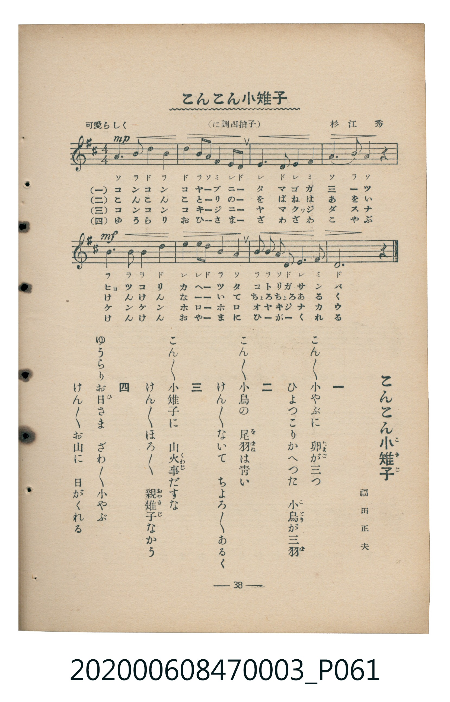

# こんこん小雉子

> Re:Shōka 使用 AI 協助辨識與重建樂譜，可能會有錯誤。歡迎回報。

- **NEUTRINO 歌聲合成版**：<br><audio controls src="konkon_kokiji_neutrino.mp3"></audio>
- **鋼琴伴奏版**：<br><audio controls src="konkon_kokiji.mp3"></audio>


- 詞：福田正夫
- 曲：杉江秀
- 臺灣教育會公認《新定兒童唱歌》尋常科第三學年用（2020.006.0847.0003）

## 說明

原書資訊與歌詞全文（對應 P061.jpg，書頁 p. 38，補充教材第 3 首）：
調性與拍號：に調四拍子（D 大調 4/4 拍），可愛らしく ♩=100


## 歌詞

```text
一
こんこん小やぶに　卵が三つ
ひよつこりかへつた　小鳥が三羽

二
こんこん小鳥の　尾羽は青い
けんけんないて　ちよろちよろあるく

三
こんこん小雉子に　山火事だすな
けんけんほろほろ　親雉子なかう

四
ゆうらりお日さま　ざわざわ小やぶ
けんけんお山に　日がくれる
```

## ABC

```abc
X:1
T:こんこん小雉子
C:曲：杉江秀
M:4/4
L:1/16
Q:1/4=100
K:D
V:V1 name="Piano" snm="Pia"
[V:V1]
!mp! A6 B2 d4 B4 | d4 B2 A2 F4 E2 D2 | E6 D2 E4 F4 | A6 B2 A4 z4 |
w: 1.~こ ん こ ん | こ や _ ぶ に _ | た ま ご が | み _ つ
w: 2.~こ ん こ ん | こ と _ り の _ | を ば ね は | あ を い
w: 3.~こ ん こ ん | こ き _ じ に _ | や ま くゎ じ | だ す な
w: 4.~ゆ う ら り | お ひ _ さ ま _ | ざ わ ざ わ | こ や ぶ
!mf! B6 B2 B4 d4 | e4 e2 d2 B4 A4 | B2 B2 A2 D2 E6 F2 | D12 z4 |
w: 1.~ひょ つ こ り | か へ _ つ た | こ と り が さ ん | ば
w: 2.~け ん け ん | な _ _ い て | ちょ ろ ちょ ろ あ る | く
w: 3.~け ん け ん | ほ ろ _ ほ ろ | お や き じ な か | う
w: 4.~け ん け ん | お や _ ま に | ひ _ が _ く れ | る
```

## TMD 檔案連結

- [主旋律 TMD 檔案](konkon_kokiji.tmd) [[在 TMD Studio 編輯](https://tmdlang.github.io/Tmd-TS/#tmd=s7IKdvYPcrWy4qpTUCpJTLdSSM7PyUlNLsnMz7MqzsjMK0nNjM_KTMmPL87Iz05Ugisry88pzU21Si9KTEmNN443MjAyiDcwMIs3sDAxBzIMjBFKi_NLi5JTrYqTM_Lzc-JLUitKkvLzsxHyBUX5Zal5iXlANQVFIBtTwIoQClLLMlNSQdKpKZkl-UWZiTlI7kgtKga7FWxJfElRYl5xclFmAcgDCFUlGalAxybmZeaC9GppKTxunPy4aTKEfLqh_-XszqdrJyhoaXEp2ioYGhhw2dsquHDZmOib2IHMeLFy3vs9s54v638-ZcOztYufLlkNNvrZ7E1A4WdzO59tnP98eQNY7EX7rueNi59NnfmiadOzOc1PW9e8WNX7uKHr2bQNT9fNeto66fnqpU-nbHy2tudxQ_fTDd1Pd-x4vnzi8zVrnuwAOmHH051bnk9Z8X5PByhA9YABqgcKUCDDwPj9nk4lLi59LQVbagEuBQWFp33zn83e8WJz-4sVXS862oHuAnr2aeuKZ9Paga54uqH3WXunQoCBmaFeVkH6-z09QMUvFzQqFOgpGFsAuS8Wz3na2gr07rO5E4CeUDBWeLlsGtClwHABmf5i1f5nDctB5nb3vpg5Hyj6uHE1UPDp7NlAEWCQA-1wUXi6ZDlQTAEY2gpAUbDunqf965-1zH7c1Pm4cfrjxn6FRzNX2oIiBmTqkx0NIAotDh83tTxu3AY0_3FDw9PerY8be4BB-rhxCUTppsdNHUAOWHXX48bux407wNz5INXABLB5KUTD8317IXbs6sFiB1jZOrCWfUCVjxvXv5w76XFjC0TpRLBSCLkKKPq4cRlQ6ePGhSC7m3qRGE2Pm4Au6If6phObTeAUCfXNxo3PG1c_2QXUsuBx40yg4Zj27QabCyYbGl4sWwXTD3QHUFsb2CZgqIM1NrUBRUBBCwqJrmfTgX6a-rhxH9it0x439UNIeJBiWtYFdBHEaWDNPUCvPG7qAfoJpJTydAkFClr6XFze-XnZ-Xne-dmZWZlWAZmJefkONQY11SCLFGwstOzADGCmMNQ1sUIJQzAJTRFAifkgDzZOATt2_-PGxcDIB5kP0l2jUJ1bUKtgqqALhGYKhnFgShcoDmWaApO1roKRgiFQyAisyhBMg0Rr4PpAtAFIBGyoj2ENyDlgOaBroGwQC6QHxmsBkY3bwORqqMx8iJ7GfUA8BczqgcrsB8uARJYAyXiEXUZE2NW4AizWBWavg8g0TYKatwGI14JZ66F6mqCmTQKyQa5Ess2YGNt6weQMZJ-BfQvzGTDB9MGVgLQtgErOBOJVqBaagDS3QeXbgOxOuFdAOiFe2gQmp0ItgMhMgzqyH8oGsRCOhEQAJPgRtgHTkqmuBSgtAYuMdnBKQS4ygNz54HTWuAIsCkxOU8GpbQNyckqrBacgULIA0eB0BEw7IApIALkgUVCCqQGrMIUmKFCSAqY6aDSDIHqCArkJGhBL4CEPC4husPgOqCyIBKUliHdB8Q9SCUpNkGCCxBlIdgOSheipaiJSPIPYiHgGRRLEJZBUvAwqDizk2oHKelGZsPTUDVYDigYsNoJTFm4bd4N5kJSFYEOSACQqQTbNgLsNFCIgWUjSwbANlKzw2AZOVtAcCkpQiBwKSWqgXAnzCbD0A6dwUAyg2lTLxaVrp4BciikA-cpcAA)]
- [鋼琴伴奏 TMD 檔案](konkon_kokiji_piano.tmd) [[在 TMD Studio 編輯](https://tmdlang.github.io/Tmd-TS/#tmd=s7IKdvYPcrWy4tLSUnjcOPlx02QI-XRD_8vZnU_XTni_p-Nl957nE7Y82bPl6dL-550d7_d0KmhpcSnaKhgaGHDZ2yq4cNmY6JvYcdUpKL1YOe_9nlnPl_U_n7Lh2drFT5esVgIJP5u9CSj8bG7ns43zny9vAIu9aN_1vHHxs6kzXzRtejan-Wnrmhereh83dD2btuHpullPWyc9X7306ZSNz9b2PG7ofrqh--mOHc-XT3y-Zs2THUB37Xi6c8vzKSuArjMyMDLQMzAw0zOwMDEHMgyMgQ5U4uLyzs_Lzs_zzs_OzMq0CshMzMsP8nCoMaip5lIAAhsLLTswQ19LwVDXxArF82Cy5XHjtseNq4ES8x837nvcOOVxY8_jxv2PGxc_blyioKUP1l2jUJ1bUKtgqqALhGYKhnFgShcoDmWaKhgDaSMFQ6CQEViVIZgGidbA9YFoA5AI2FAfwxqQc8ByQNdA2SAWSA-M1wIiG7eBydVQmfkQPY37gHgKmNUDldkPlgGJLAGS8Qi7jIiwq3EFWKwLzF4HkWmaBDVvAxCvBbPWQ_U0QU2bBGSDXIlkmzExtvWCyRnIPgP7Fuaz_sdNfXAlIG0LoJIzgXgVqoUmIM1tUPk2ILsT7hWQToiXNoHJqVALIDLToI7sh7JBLIQjIREACX6EbcC0ZKprAUpLmx43tYNTCjAhdT1u7H7cuAPMnQ9OZ40rwKLA5DQVnNo2ICentFpwCgIlCxANTkfAtAOigASQCxIFJZgasApTaIICJSlgqoNGMwiiJyiQm6ABsQQe8rCA6AaL74DKgkhQWoJ4FxT_IJWg1AQJJkicgWQ3IFmInqomIsUziI2IZ1AkQVwCScXLoOILQU583NSLyoSlp26wGlA0YLERnLJw27gbzIOkLAQbkgQgUQmyaQbcbaAQAclCkg6GbaBkhcc2cLKC5lBQgkLkUEhSA-VKmE8eN_WAUzgoBlBtqsVWiPkgF2Im0EIMGPHxCtGGsQpm8UDaLD43FiEEpYCFDUjONB5JBKHCAOqxGgUToJgJqkFGQKYRiIksCFIH1As3FN00oON17RSQ3R_tYxgLtgRD3AiHuDEOcRO4uDIXAA)]

## 分析

```text
================================================================================
📊 TMD Song Profile: [ こんこん小雉子 ]
================================================================================
⏱  Duration:       0:19 (19.2s), 8 measures total
🎼 Key & Tempo:    首調基準 D, != 100.0 BPM, <4/4>
   - 分析範圍：      由實際發聲的音符與和弦推測調性；播放脈絡另行呈現
🎤 人聲音域:    D4 (MIDI 62) – E5 (MIDI 76) [跨度: 14 個半音 / 1.2 個八度, 難度: moderate]
   - 最低音:  D4 in [KonkonKokiji #1 @ m.2, 0:04]
   - 最高音: E5 in [KonkonKokiji #1 @ m.6, 0:12]
   - 適合: soprano, mezzo-soprano, contralto, tenor, baritone, bass
🏛  結構:      KonkonKokiji (19.2s)
⚡ 編曲密度:        Peak 1 軌道同時演奏
🗝  調性診斷：       D 調性不明確（純淨自然大調，未偵測到可信轉調）
   - 風格氣質:    純淨自然大調（陽光明朗、易唱易記，無明顯調外色彩）
   - 轉調歷程:    全曲維持單一推測調性（未偵測到可信轉調）
   - 核心骨幹音:  D, B, E, A, F#
   - 調性數值:    D 調性不明確 [相關度: 0.76, 穩定度: Ambiguous, 自然音純度: 100.0%]
   - 候選調性 (K-S): D 大調 (0.76), B 小調 (0.73), A 大調 (0.67)
   - 五度圈歷程:   +2
   - 各段落調性細節:
     • [KonkonKokiji #1]: D 調性不明確 (r: 0.76, 自然音純度: 100.0%)

  [ 五度圈游移軌跡 ]
               C  
         F            G  
      Bb              [D ]*
      Eb               A  
         Ab           E  
            Db       B  
               F# 
     (* = active key center)

  [ 十二半音累積音高分佈 ]
     C  :                            0.0%
     C# :                            0.0%
     D  : ████████████████████████  26.7%
     D# :                            0.0%
     E  : ██████████████████        20.0%
     F  :                            0.0%
     F# : ████████                   8.3%
     G  :                            0.0%
     G# :                            0.0%
     A  : ██████████████████        20.0%
     A# :                            0.0%
     B  : ███████████████████████   25.0%
--------------------------------------------------------------------------------
Assignment 軌道音域：
  - Piano         : D4 – E5 (14 個半音 / 1.2 個八度, 33 個音符)
================================================================================
```


## 原書掃描頁




