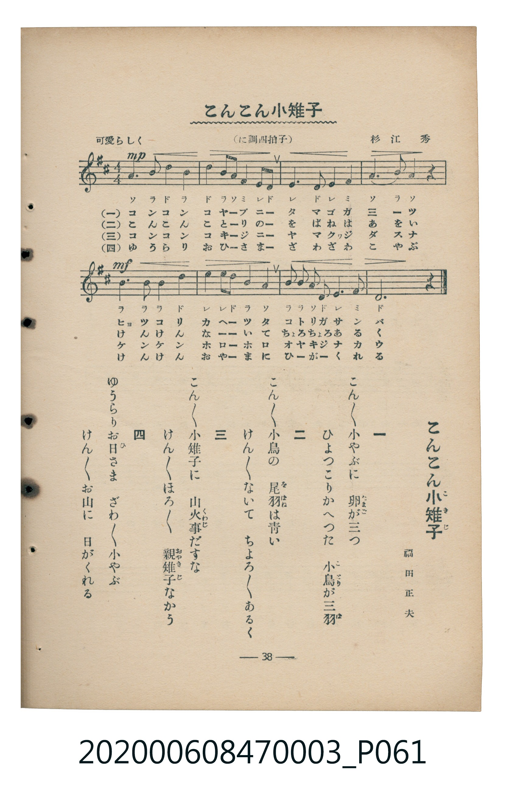

# こんこん小雉子

> Re:Shōka 使用 AI 協助辨識與重建樂譜，可能會有錯誤。歡迎回報。

- **鋼琴伴奏版**：<br><audio controls src="konkon_kokiji.mp3"></audio>
- **NEUTRINO 歌聲合成版**：<br><audio controls src="konkon_kokiji_neutrino.mp3"></audio>

- 詞：福田正夫
- 曲：杉江秀
- 臺灣教育會公認《新定兒童唱歌》尋常科第三學年用（2020.006.0847.0003）

## 說明

原書資訊與歌詞全文（對應 P061.jpg，書頁 p. 38，補充教材第 3 首）：
調性與拍號：に調四拍子（D 大調 4/4 拍），可愛らしく ♩=100


## 歌詞

```text
一
こんこん小やぶに　卵が三つ
ひよつこりかへつた　小鳥が三羽

二
こんこん小鳥の　尾羽は青い
けんけんないて　ちよろちよろあるく

三
こんこん小雉子に　山火事だすな
けんけんほろほろ　親雉子なかう

四
ゆうらりお日さま　ざわざわ小やぶ
けんけんお山に　日がくれる
```

## ABC

<div class="abc-score" data-abc-src="konkon_kokiji.abc" aria-label="五線譜載入中"></div>

[下載 ABC 原始檔](konkon_kokiji.abc)

## TMD 檔案連結

- [主旋律 TMD 檔案](konkon_kokiji.tmd) [[在 TMD Studio 編輯](https://tmdlang.github.io/Tmd-TS/#tmd=s7IKdvYPcrWy4qpTUCpJTLdSSM7PyUlNLsnMz7MqzsjMK0nNjM_KTMmPL87Iz05Ugisry88pzU21Si9KTEmNN443MjAyiDcwMIs3sDAxBzIMjBFKi_NLi5JTrYqTM_Lzc-JLUitKkvLzsxHyBUX5Zal5iXlANQVFIBtTwIoQClLLMlNSQdKpKZkl-UWZiTlI7kgtKga7FWxJfElRYl5xclFmAcgDCFUlGalAxybmZeYi6wUalZ6ZZ1WSmAn0HMiD5YnxuYmZeTmJeSnIqkoy8oH-LMiotMrILAY5IDkxJz47MQ8pOKDWFySmp1oFGJgZKnFpaSk8bpz8uGkyhHy6of_l7M6naycoaGlxKdoqGBoYcNnbKrhw2Zjom9iBzHmxct77PbOeL-t_PmXDs7WLny5ZDTb-2exNQOFnczufbZz_fHkDWOxF-67njYufTZ35omnTsznNT1vXvFjV-7ih69m0DU_XzXraOun56qVPp2x8trbncUP30w3dT3fseL584vM1a57sADphx9OdW55PWfF-Twco1vSAsaYHijUgw8D4_Z5OJS4ufS0FW2oBLgUFhad985_N3vFic_uLFV0vOtqB7gJ69mnrimfT2oGueLqh91l7pwIo2PSyCtLf7-kBKn65oFGhQE_B2ALIfbF4ztPWVqB3n82dAPSEgrHCy2XTgC4FhgvI9Ber9j9rWA4yt7v3xcz5QNHHjauBgk9nzwaKAIMcaIeLwtMly4FiCsDQVgCKgnX3PO1f_6xl9uOmzseN0x839is8mrnSFhQxIFOf7GgAUWhx-Lip5XHjNqD5jxsanvZufdzYAwzSx41LIEo3PW7qAHLAqrseN3Y_btwB5s4HqQYmgM1LIRqe79sLsWNXDxY7wMrWgbXsA6p83Lj-5dxJjxtbIEongpVCyFVA0ceNy4BKHzcuBNnd1IvEaHrcBHRBP9Q3ndhsAqdIqG82bnzeuPrJLqCWBY8bZwINx7RvN9hcMNnQ8GLZKph-oDuA2trANgFDHayxqQ0oAgpaUEh0PZsO9NPUx437wG6d9ripH0LCgxTTsi6giyBOA2vuAXrlcVMP0E8gpZSnSyhQ0NLn4vLOz8vOz_POz87MyrQKyEzMy3eoMaipBlmkYGOhZQdmADOFoa6JFUoYgkloigBKzAd5sHEK2LH7HzcuBkY-yHyQ7hqF6tyCWgVTBV0gNFMwjANTukBxKNMUmKx1FYwUDIFCRmBVhmAaJFoD1weiDUAiYEN9DGtAzgHLAV0DZYNYID0wXguIbNwGJldDZeZD9DTuA-IpYFYPVGY_WAYksgRIxiPsMiLCrsYVYLEuMHsdRKZpEtS8DUC8FsxaD9XTBDVtEpANciWSbcbE2NYLJmcg-wzsW5jPgAmmD64EpG0BVHImEK9CtdAEpLkNKt8GZHfCvQLSCfHSJjA5FWoBRGYa1JH9UDaIhXAkJAIgwY-wDZiWTHUtQGkJWGS0g1MKcpEB5M4Hp7PGFWBRYHKaCk5tG5CTU1otOAWBkgWIBqcjYNoBUUACyAWJghJMDViFKTRBgZIUMNVBoxkE0RMUyE3QgFgCD3lYQHSDxXdAZUEkKC1BvAuKf5BKUGqCBBMkzkCyG5AsRE9VE5HiGcRGxDMokiAugaTiZVBxYCHXDlTWi8qEpadusBpQNGCxEZyycNu4G8yDpCwEG5IEIFEJsmkG3G2gEAHJQpIOhm2gZIXHNnCyguZQUIJC5FBIUgPlSphPgKUfOIWDYgDVplouLl07BeRSTAHIV-YCAA)]
- [鋼琴伴奏 TMD 檔案](konkon_kokiji_piano.tmd) [[在 TMD Studio 編輯](https://tmdlang.github.io/Tmd-TS/#tmd=s7IKdvYPcrWy4qpTUCpJTLdSyC8qychPL0osyKi0ysgsLskvykxOzInPTsxLVIIrKs4vLUpOjS9ITE-1CjAwM1Ti0tJSeNw4-XHTZAj5dEP_y9mdT9dOeL-n42X3nucTtjzZs-Xp0v7nnR3v93QqaGlxKdoqGBoYcNnbKrhw2Zjom9iBDH-xct77PbOeL-t_PmXDs7WLny5ZDbbz2exNQOFnczufbZz_fHkDWOxF-67njYufTZ35omnTsznNT1vXvFjV-7ih69m0DU_XzXraOun56qVPp2x8trbncUP30w3dT3fseL584vM1a57sALprx9OdW55PWQF0nZGBkYGegYGZnoGFiTmQYWAMdKASF5d3fl52fp53fnZmVqZVQGZiXn6Qh0ONQU01lwIQ2Fho2YEZ-loKhromViieB5Mtjxu3PW5cDZSY_7hx3-PGKY8bex437n_cuPhx4xIFLX2w7hqF6tyCWgVTBV0gNFMwjANTukBxKNNUwRhIGykYAoWMwKoMwTRItAauD0QbgETAhvoY1oCcA5YDugbKBrFAemC8FhDZuA1MrobKzIfoadwHxFPArB6ozH6wDEhkCZCMR9hlRIRdjSvAYl1g9jqITNMkqHkbgHgtmLUeqqcJatokIBvkSiTbjImxrRdMzkD2Gdi3MJ_1P27qgysBaVsAlZwJxKtQLTQBaW6DyrcB2Z1wr4B0Qry0CUxOhVoAkZkGdWQ_lA1iIRwJiQBI8CNsA6YlU10LUFra9LipHZxSgAmp63Fj9-PGHWDufHA6a1wBFgUmp6ng1LYBOTml1YJTEChZgGhwOgKmHRAFJIBckCgowdSAVZhCExQoSQFTHTSaQRA9QYHcBA2IJfCQhwVEN1h8B1QWRILSEsS7oPgHqQSlJkgwQeIMJLsByUL0VDURKZ5BbEQ8gyIJ4hJIKl4GFV8IcuLjpl5UJiw9dYPVgKIBi43glIXbxt1gHiRlIdiQJACJSpBNM-BuA4UISBaSdDBsAyUrPLaBkxU0h4ISFCKHQpIaKFfCfPK4qQecwkExgGpTLbZCzAe5EDOBFmLAiI9XiDaMVTCLB9Jm8bmxCCEoBSxsQHKm8UgiCBUGUI_VKJgAxUxQDTICMo1ATGRBkDqgXrih6KYBHa9rp4Ds_mgfw1iwJRjiRjjEjXGIm8DFlbkA)]

## 分析

```text
================================================================================
📊 TMD Song Profile: [ こんこん小雉子 ]
================================================================================
⏱  Duration:       0:19 (19.2s), 8 measures total
🎼 Key & Tempo:    首調基準 D, != 100.0 BPM, <4/4>
   - 分析範圍：      由實際發聲的音符與和弦推測調性；播放脈絡另行呈現
🎤 人聲音域:    D4 (MIDI 62) – E5 (MIDI 76) [跨度: 14 個半音 / 1.2 個八度, 難度: moderate]
   - 最低音:  D4 in [KonkonKokiji #1 @ m.2, 0:04]
   - 最高音: E5 in [KonkonKokiji #1 @ m.6, 0:12]
   - 適合: soprano, mezzo-soprano, contralto, tenor, baritone, bass
🏛  結構:      KonkonKokiji (19.2s)
⚡ 編曲密度:        Peak 1 軌道同時演奏
🗝  調性診斷：       D 調性不明確（純淨自然大調，未偵測到可信轉調）
   - 風格氣質:    純淨自然大調（陽光明朗、易唱易記，無明顯調外色彩）
   - 轉調歷程:    全曲維持單一推測調性（未偵測到可信轉調）
   - 核心骨幹音:  D, B, E, A, F#
   - 調性數值:    D 調性不明確 [相關度: 0.76, 穩定度: Ambiguous, 自然音純度: 100.0%]
   - 候選調性 (K-S): D 大調 (0.76), B 小調 (0.73), A 大調 (0.67)
   - 五度圈歷程:   +2
   - 各段落調性細節:
     • [KonkonKokiji #1]: D 調性不明確 (r: 0.76, 自然音純度: 100.0%)

  [ 五度圈游移軌跡 ]
               C  
         F            G  
      Bb              [D ]*
      Eb               A  
         Ab           E  
            Db       B  
               F# 
     (* = active key center)

  [ 十二半音累積音高分佈 ]
     C  :                            0.0%
     C# :                            0.0%
     D  : ████████████████████████  26.7%
     D# :                            0.0%
     E  : ██████████████████        20.0%
     F  :                            0.0%
     F# : ████████                   8.3%
     G  :                            0.0%
     G# :                            0.0%
     A  : ██████████████████        20.0%
     A# :                            0.0%
     B  : ███████████████████████   25.0%
--------------------------------------------------------------------------------
Assignment 軌道音域：
  - Piano         : D4 – E5 (14 個半音 / 1.2 個八度, 33 個音符)
================================================================================
```


## 原書掃描頁




