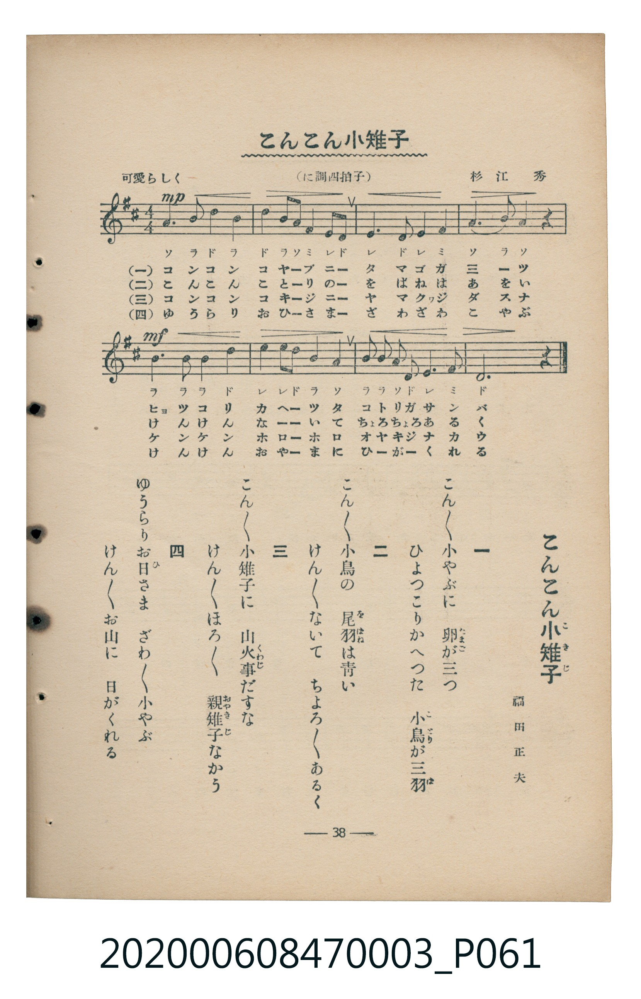

# こんこん小雉子

<audio controls src="konkon_kokiji.mp3"></audio>

- 詞：福田正夫
- 曲：杉江秀
- 臺灣教育會公認《新定兒童唱歌》尋常科第三學年用（2020.006.0847.0003）

## 說明

原書資訊與歌詞全文（對應 P061.jpg，書頁 p. 38，補充教材第 3 首）：
調性與拍號：に調四拍子（D 大調 4/4 拍），可愛らしく ♩=100

## 歌詞

```text
一
こんこん小やぶに　卵が三つ
ひよつこりかへつた　小鳥が三羽

二
こんこん小鳥の　尾羽は青い
けんけんないて　ちよろちよろあるく

三
こんこん小雉子に　山火事だすな
けんけんほろほろ　親雉子なかう

四
ゆうらりお日さま　ざわざわ小やぶ
けんけんお山に　日がくれる
```

## ABC

```abc
X:1
T:こんこん小雉子
C:曲：杉江秀
M:4/4
L:1/16
Q:1/4=100
K:D
V:V1 name="Piano" snm="Pia"
[V:V1]
A6 B2 d4 B4 | d4 B2 A2 F4 E2 D2 | E4 D2 E2 F8 | A6 B2 A4 z4 |
B4 B2 B2 d8 | e4 e2 d2 B4 A4 | B2 B2 A2 d2 e4 f4 | d12 z4 |
```

## TMD 檔案連結

- [主旋律 TMD 檔案](konkon_kokiji.tmd) [[在 TMD Studio 編輯](https://tmdlang.github.io/Tmd-TS/#tmd=s7IKdvYPcrWy4tLSUnjcOPlx02QI-XRD_8vZnU_XTlDQ0uJStFUwNDDgsrdVcOGyMdE3seOqU1B6sXLe-z2zni_rfz5lw7O1i58uWa0EEn42exNQ-Nnczmcb5z9f3gAWe9G-63nj4mdTZ75o2vRsTvPT1jUvVvU-buh6Nm3D03WznrZOer566dMpG5-t7Xnc0P10Q_fTHTueL5_4fM2aJzuATtjxdOeW51NWvN_TYWRgZKBnYGCmZ2BhYg5kGBi_39OpxMWlr6VgSy3ApaCg8LRv_rPZO15sbn-xoutFRzvQXUDPPm1d8WxaO9AVTzf0PmvvVAgwMDPUyypIf7-nB6j45YJGhQI9BWMLIPfF4jlPW1uB3n02dwLQEwrGCi-XTQO6FBguINNfrNr_rGE5yNzu3hcz5wNFHzeuBgo-nT0bKAIMcqAdLgpPlywHiikAQ1sBKArW3fO0f_2zltmPmzofN05_3Niv8GjmSltQxIBMfbKjAUShxeHjppbHjduA5j9uaHjau_VxYw8wSB83LoEo3fS4qQPIAavuetzY_bhxB5g7H6QamAA2L4VoeL5vL8SOXT1Y7AArWwfWsg-o8nHj-pdzJz1ubIEonQhWCiFXAUUfNy4DKn3cuBBkd1MvEqPpcRPQBf1Q33RiswmcIqG-2bjxeePqJ7uAWhY8bpwJNBzTvt1gc8FkQ8OLZatg-oHuAGprA9sEDHWwxqY2oAgoaEEh0fVsOtBPUx837gO7ddrjpn4ICQ9STMu6gC6COA2suQfolcdNPUA_gZRSni6hQEFLn4vLOz8vOz_POz87MyvTKiAzMS_focagRqEaZJOCjYWWHZgBzBWGuiZWKIEIJqFJAigxH-TDxilg1-5_3LgYGPsgC0C6axRMFXSB0EzBMA5M6QKFoExTYJLWVTBSMAQKGQFZhkASJAKCCH0g2gAkAnONqa4FyDXAVNcOtgs51QG588EubVwBFgU6aCrYvRsQDgK5wQzmIIhdRiAmkAAKgWRBVoLUgSwHCoFljUEE1OkwCHFWLReXrp0CcmAqAPnKXFwA)]
- [鋼琴伴奏 TMD 檔案](konkon_kokiji_piano.tmd) [[在 TMD Studio 編輯](https://tmdlang.github.io/Tmd-TS/#tmd=s7IKdvYPcrWy4tLSUnjcOPlx02QI-XRD_8vZnU_XTni_p-Nl957nE7Y82bPl6dL-550d7_d0KmhpcSnaKhgaGHDZ2yq4cNmY6JvYcdUpKL1YOe_9nlnPl_U_n7Lh2drFT5esVgIJP5u9CSj8bG7ns43zny9vAIu9aN_1vHHxs6kzXzRtejan-Wnrmhereh83dD2btuHpullPWyc9X7306ZSNz9b2PG7ofrqh--mOHc-XT3y-Zs2THUB37Xi6c8vzKSuArjMyMDLQMzAw0zOwMDEHMgyMgQ5U4uLyzs_Lzs_zzs_OzMq0CshMzMsP8nCoMahRqOZSAAIbCy07MKNGwVRBFwjNFAzjwJQuUAjKNFUwBtJGCoZAISMgyxBIgkRAEKEPRBuARKDmgYwwg5kHUWoEYgIJoBBIFqQDpA6kFygEljUGEVCbYRBiai02z_igeMYE7hnDeIVow1gFs3ggbRafG4sQglJAd4PkTOORRBAqDOC-MAGKmaAaZARkGoGYyIIgdUC9cEPRTQO6XtdOAdkDClj4ylxcAA)]

## 分析

```text
================================================================================
📊 TMD Song Profile: [ こんこん小雉子 ]
================================================================================
⏱  Duration:       0:19 (19.2s), 8 measures total
🎼 Key & Tempo:    首調基準 D, != 100.0 BPM, <4/4>
   - 分析範圍：      由實際發聲的音符與和弦推測調性；播放脈絡另行呈現
🎤 人聲音域:    D4 (MIDI 62) – F#5 (MIDI 78) [跨度: 16 個半音 / 1.3 個八度, 難度: moderate]
   - 最低音:  D4 in [KonkonKokiji #1 @ m.2, 0:04]
   - 最高音: F#5 in [KonkonKokiji #1 @ m.7, 0:16]
   - 適合: soprano, mezzo-soprano, tenor, baritone
🏛  結構:      KonkonKokiji (19.2s)
⚡ 編曲密度:        Peak 1 軌道同時演奏
🗝  調性診斷：       D 大調（純淨自然大調，未偵測到可信轉調）
   - 風格氣質:    純淨自然大調（陽光明朗、易唱易記，無明顯調外色彩）
   - 轉調歷程:    全曲維持單一推測調性（未偵測到可信轉調）
   - 核心骨幹音:  D, B, A, E, F#
   - 調性數值:    D 大調 [相關度: 0.85, 穩定度: Moderate, 自然音純度: 100.0%]
   - 候選調性 (K-S): D 大調 (0.85), B 小調 (0.76), A 大調 (0.65)
   - 五度圈歷程:   +2
   - 各段落調性細節:
     • [KonkonKokiji #1]: D 大調 (r: 0.85, 自然音純度: 100.0%)

  [ 五度圈游移軌跡 ]
               C  
         F            G  
      Bb              [D ]*
      Eb               A  
         Ab           E  
            Db       B  
               F# 
     (* = active key center)

  [ 十二半音累積音高分佈 ]
     C  :                            0.0%
     C# :                            0.0%
     D  : ████████████████████████  30.0%
     D# :                            0.0%
     E  : ████████████              15.0%
     F  :                            0.0%
     F# : ███████████               13.3%
     G  :                            0.0%
     G# :                            0.0%
     A  : ████████████████          20.0%
     A# :                            0.0%
     B  : █████████████████         21.7%
--------------------------------------------------------------------------------
Assignment 軌道音域：
  - Piano         : D4 – F#5 (16 個半音 / 1.3 個八度, 33 個音符)
================================================================================
```


## 原書掃描頁




