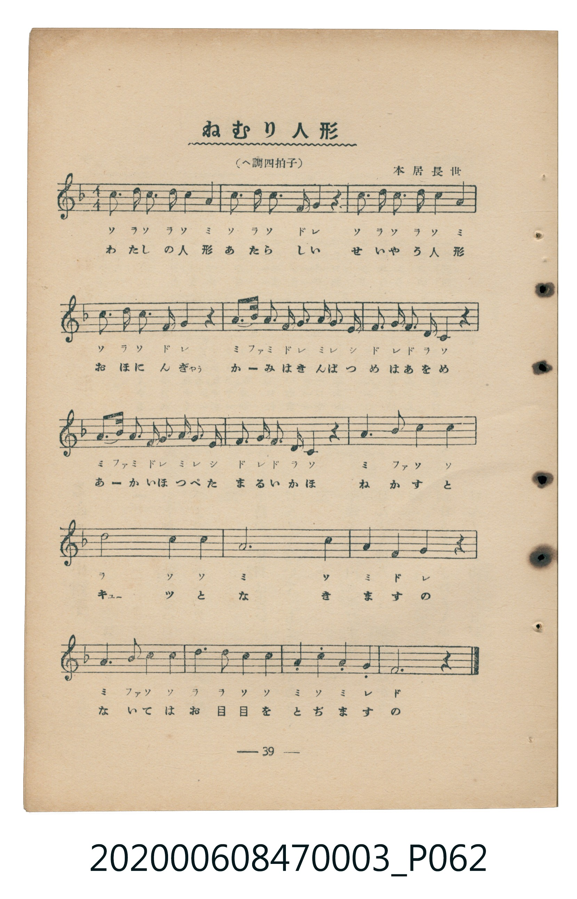
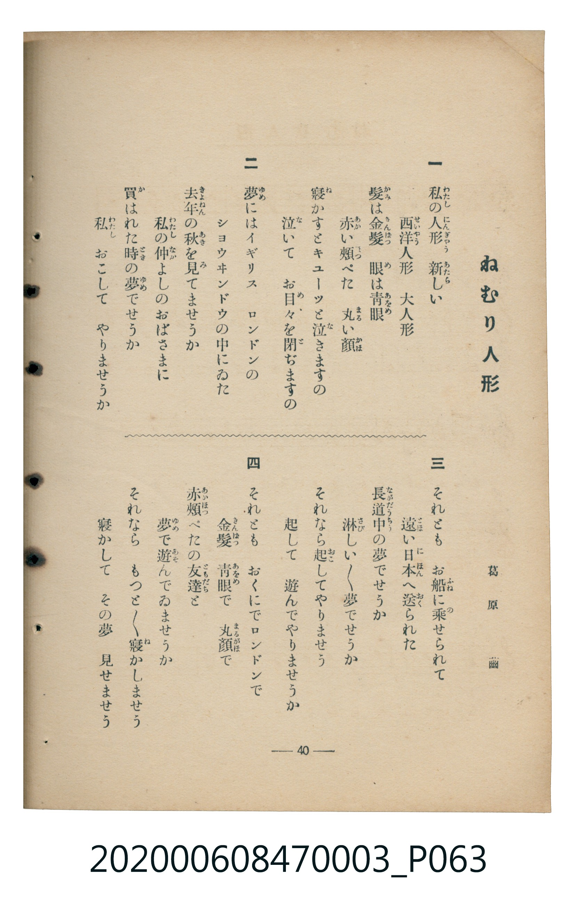

# ねむり人形

> Re:Shōka 使用 AI 協助辨識與重建樂譜，可能會有錯誤。歡迎回報。

- **鋼琴伴奏版**：<br><audio controls src="nemuri_ningyo.mp3"></audio>
- **NEUTRINO 歌聲合成版**：<br><audio controls src="nemuri_ningyo_neutrino.mp3"></audio>

- 詞：葛原𦱳
- 曲：本居長世
- 臺灣教育會公認《新定兒童唱歌》尋常科第三學年用（2020.006.0847.0003）

## 說明

原書資訊與歌詞全文（對應 P062.jpg–P063.jpg，書頁 pp. 39–40，補充教材第 4 首）：
調性與拍號：へ調四拍子（F 大調 4/4 拍），♩=96


## 歌詞

```text
一
私の人形　新しい
西洋人形　大人形
髪は金髪　眼は青眼
赤い頬ぺた　丸い顔
寝かすとキューツと泣きますの
泣いて　お目々を閉ぢますの

二
夢にはイギリス　ロンドンの
ショウヰンドウの中にゐた
去年の秋を見てませうか
私の仲よしのおばさまに
買はれた時の夢でせうか
私　おこして　やりませうか

三
それとも　お船に乗せられて
遠い日本へ送られた
長道中の夢でせうか
淋しい淋しい夢でせうか
それなら起してやりませう
起して　遊んでやりませうか

四
それとも　おくにでロンドンで
金髪　青眼で　丸顔で
赤頬ぺたの友達と
夢で遊んでゐませうか
それなら　もつともつと寝かしませう
寝かして　その夢　見せませう
```

## ABC

<div class="abc-score" data-abc-src="nemuri_ningyo.abc" aria-label="五線譜載入中"></div>

[下載 ABC 原始檔](nemuri_ningyo.abc)

## TMD 檔案連結

- [主旋律 TMD 檔案](nemuri_ningyo.tmd) [[在 TMD Studio 編輯](https://tmdlang.github.io/Tmd-TS/#tmd=s7IKdvYPcrWy4qpTUCpJTLdSSM7PyUlNLsnMz7MqzsjMK0nNjM_KTMmPL87Iz05Ugisry88pzU21Si9KTEmNN443MjAyiDcwMIs3sDAxBzIMjBFKi_NLi5JTrYqTM_Lzc-JLUitKkvLzsxHyBUX5Zal5iXlANQVFIBtTwIoQClLLMlNSQdKpKZkl-UWZiTlI7kgtKga7FWxJfElRYl5xclFmAcgDCFUlGalAx6Yl5mbmVCJEgUalZ-ZZlSRmAj0H8mB5YnxuYmZeTmJeCrKqkox8oD8LMiqtMjKLQQ5ITsyJz07MQwoOqPUFiempVgEGZka6QAIYBFpaCo8b1z5uanjc1PVk166nexcpaGlxKdoqWJpx2dsquHHZmOib2IFMebFy3vs9s15MnP20b_6HZRs3g41-NnsTUPDZnDVPN7a-nLr9yY5pYOEX7bueNy5-NnXmi6ZNz-Y0P21d82JV7-OGrmfTNjxdN-tp66Tnq5c-nbLx2dqexw3dTzd0P92x4_nyic_XrHmyo_Pp2h1Pd255PmXF-z0doEjTA0aaHijSgAwD4_d7OpW4uPS1FGypBbgUFBSAXno2e8eLze0vVnS96GgHugvo26etK55Nawe64umG3mftnQqgUNPLKkh_1DAZFHYg5vs9PUB9Lxc0KhQU6CkYWwKlTAyAgi8Wz3na2gr0_7O5E4C-UjBReLlsGtDpwLACWfdi1f5nDctBFnX3vpg5Hyj6uHEHUPDp7NlAkadrJwAtdVN4umQ5UEwBGP4KQFGw7p5HM1faAmMGZMiTHQ0g6vnyxseN6yBR97ihARjCjxunP25sAduzdP-zLd1wOaCBEDZI7uXqVY8b179snwhiNDQ8n7MHxJ07CcgAa926BGjIywVrHjfuetw4H6jiyY4dIJGFU8ABtn7u48bux40zHzeueNy09nHz0sfNex43twC5zzYvftzY-7hxH1h2HUg1WAgotwxozOPGruez1z1uaH3cNOnltM7HjYsQSsHe2tUDtmAJUHw10EmPm5Y8blr3uHnV46adIO3NQMs2P27uBJEQ0x83bX_cvPxx07LHzRugckA2MEx2rAUZ0TQB6H5IJO8GJiygxPPl3UDLXywDuh-oDmj57MeNbUDvIAXn7k2PmzrAAbkO6ODHjcBAnQpWuhocOJu2g13WAzT52cwmoCKwc5djmAT27uPGyWCTwL5vagFmNBRLIXHZCfZJ41ywocAgbYLofdGxE2jnk51A7bMfNwE9BpRdBo6-xgXAIH02fSkw7wETz8uGRpg02K_AvPiycTI4BLC57dl2oN9BqQTOwKII5hpgyHe-2Ar0MdgPqB6AJBWYXEPDS6B3m4DeBUYHVo8CUzh2jz5u7AfH93LUCF4O9gwskUKSJ0gRODkC0yJUBTC1IpIq0Mf93S8bgXIr4ClpOZLDgOkBNc6RPQqOI2CMAlM_2HFgBiy1Az2J5G8kUUjCBnLBgd3QAE5bQHVIqikvqKBAQUufi8svNbe0KNMvMy-9Mt8qIDMxL9-hxqCmGmSRgo2Flh2YASwlDXVNrIAZBBi2wHABpWagZ4FZAhgQfaAYamwD8oGenA_yOTgdAPlAFwPjDiqJrhgYUbvRRYEOAllXo6BhqqALhGaaqhq6uproXBDPGIhxqTOEco2AbAM86sg2D-xKH0OgemCIgJUAfQ5UDvQ5lLdOE-plMA_ov2aQ_8BWAMMJWUtTJ5Q3HaSlBciMh6mbDZVpAasDSYF4bfiM7oIq2g12zWoIr2kySAtCJdgCiB-MwH4ACYLUNSLralwP1AUuM0E8cLEJtaV5LURF82aQ-maoB0A8ULpAeABcnEKNXgZWugFJKbh0hQQWzPWroDZ3o7h-Asjc-ajuNgarnwtV0QNWvwLKawKpByavrWCzQEU3zHyQRSCx2cgBD9INzHjIAQ81CRqKsIBfDVK3GxbwO9CDvB_TUDRHmxDhaFBygpRfRAQ2SA3c0b2IyAbyNkJdtQSkrglYSwFjFywAM7dxH1Q9JLB7EF5GMheW-011LYC5H1RG7QfVV8BaGZRtNwKNB6UasBDMDnAxAFQIzNDA_A2srkFFKVB0H9AmsCiQ3I2U00EZT1fBBJbjIFxYjtMAZTlg5kTlmsdD-UDthmARI5gCCNcMpsAU5Av0LNvYDVYEUg70D9TfwMSOLwzByRkUgAi10FzcNAmUTUBS6NkKFErtSFZBIxJqOCwtAiMeyWKgYWCtMGeBsw0sqsBVACh-QB7AyAyQzAOxChabC8A8aPZuXIjCAxZRWDI_NL_isgqShCFeh1gFCUxYXlkC5e0C80DpH8kq5MQO5C1AOAsihbBnYNIFNm-By15ggoWnBCBvF5QHLL-x5CRYcQHkQTRiFLc4qwz0IrCpA8oDVbhQy2DFzQaw8qlQ3j5wpYBqGSRZwFSAiw-4ZRBv4ZQjM2FAtYBDEJ5bliPnlsa5YDlQEQqVA-ubgBTy-BM7sDCy1DU0ApVGwJId2nEAOhLecwDWcUA-sAmG1HVAFDfQVAWu8kG4RsEMYjWSCEQNQhQiAkpBmA0AeK4GOhNoF5gFSspAGZiToCYB-zTIsrDsCtXdCxUFeR5mDrwqhacdRLJcD6pAwCxQHgPJQPIWzCxYpQqPEogcOFJAqkGxCQliqOPRUw5SPQV1LKRuA8nAkuBkUMoEs0C1J8gySNqHWQZSh_AUqDWD0f4AJhs8NoGazYuhloEiGcpFBCIk8GEeB_kCJApxE9RWdCtBbVljXUMzUAoCJhJwZxIUnKBmPbDrA0STQBYgdycJJx8ztOQDa1GCEkwNOOnAIHrygeV3UHsZ0hpajxrKoCoVUnUDHYaIaqD7kHwJSjAgGUilAoFoSQdR6kBDCAQJxyYkFtFCE5ESMawCJx2cRiKKAVA9CGZB2iPkWQZOPcgZENUyaLoC9VXA2QCR_EHVKyxFIlInSAY5u0BsquXi0rVTQO4nKQD5ylwA)]
- [鋼琴伴奏 TMD 檔案](nemuri_ningyo_piano.tmd) [[在 TMD Studio 編輯](https://tmdlang.github.io/Tmd-TS/#tmd=s7IKdvYPcrWy4qpTUCpJTLdSyC8qychPL0osyKi0ysgsLskvykxOzInPTsxLVIIrKs4vLUpOjS9ITE-1CjAwM9IFEsZKXFpaCo8b1z5uanjc1PVk166nexe939PxsnvP8wlbnuzZ8nRp__POjvd7OhW0tLgUbRUszbjsbRXcuGxM9E3sQEa_WDnv_Z5ZLybOfto3_8OyjZvB9j2bvQko-GzOmqcbW19O3f5kxzSw8Iv2Xc8bFz-bOvNF06Znc5qftq55sar3cUPXs2kbnq6b9bR10vPVS59O2fhsbc_jhu6nG7qf7tjxfPnE52vWPNnR-XTtjqc7tzyfsgLoOiMDIwM9AwMzPQMLE3Mgw8AY6EAlLi6_1NzSoky_zLz0ynyrgMzEvPwgD4cag5pqLgUgsLHQsgMz9LUUDHVNrBQeN_U_bpz_uHH648Z1wDBY_bhp8uPGvsdNLY8b24D8JpBkUydYvgXInw2k4JLoirseN-5GF9XSB1tXo6BhqqALhGaaqhq6uproXBDPGIhxqTOEco2AbAM86sg2D-xKH0OgemCIgJUAfQ5UDvQ5lLdOE-plMA_ov2aQ_8BWAMMJWUtTJ5Q3HaSlBciMh6mbDZVpAasDSYF4bfiM7oIq2g12zWoIr2kySAtCJdgCiB-MwH4ACYLUNSLralwP1NW05HHTOhCvedXjpp1QW5rXQlQ0bwapb4Z6AMQDpQuEB5q2P25eDjV6GVjpBiSlzZ1AUUhgwVy_CmpzN4rrJ4DMnY_qbmOw-rlQFT1g9SugvCaQemDy2go2ay3EILB6kEUgsdnIAQ_S_bgR5BJ4wENNgoYiLOBXg9TthgX8DvQg78c0FM3RJkQ4GpScQNHbCAo4QoENUgN3dC8isoG8jVBXLQGpa3rcNAkYu2ABmLmN-6DqIYHdg_Aykrmw3G-qawHM_Y3djxv3A9MF0C5wtt0INB6UasBCMDvAxQBQITBDA_P34seNu0DhALQOaBNYFEjuRsrpoIynq2ACy3EQLizHaYCyHDBzonLN46F8oHZDsIgRTAGEawZTYAryBXqWbewGKwIpB_oH6m9gYscXhuDkDApAhFpoLm6aBMomICn0bAUKpXYkq6ARCTUclhaBEY9kMdAwsFaYs8DZBhZVoAIVnPtBHsDIDJDMA7EKFpsLwDxo9m5ciMIDFlFYMj80v-KyCpKEIV6HWAUJTFheWQLl7QLzQOkfySrkxA7kLUA4CyKFsGdg0gU2b4HLXmCChacEIG8XlAcsv7HkJFhxAeRBNGIUtzirDPQisKkDygNVuFDLYMXNBrDyqVDePnClgGoZJFnAVICLD7hlEG_hlCMzYUC1gEMQnluWI-eWxrlgOVARCpUD65uAFPL4EzuwMLLUNTQClUbAkh1YlswEpZ3HTWsfNy993LzncTOwjgPyG1eBsh-w0AHJr0MUN9BUBa7yQbhGwQxiNZIIRA1CFCICSkGYDQB4rgY6E2gXmAVKykAZmJOgJj1uBiUMuCwsu0J190JFQZ6HmQOvSuFpB5Es14MqEDALlMdAMpC8BTMLVqnCowQiB44UkGpQbEKCGOp49JSDVE9BHQup20AysCQ4GZQywSxQ7QmyDJL2YZaB1CE8BWrNYLQ_gMkGj01NwKpkMdQyUCRDuYhAhAQ-zOMgX4BEIW6C2opuJagta6xraAZKQcBEAqyQloGDE1j5AmsyEJoEsuBx4yISko8ZWvKBtShBCaYGnHRgED35wPI7qL0MaQ2tRw1lUJUKqbqBDkNENdB9SL4EJRiQDKRSgUC0pIModaAhBIKEYxMSi2ihiUiJGFaBkw5OIxHFAKgeBLMg7RHyLAOnHuQMiGoZNF2B-irgbIBI_qDqFZYiEakTJIOcXSA21WLrJvkgd5NMoN0kYEzHK0QbxsIoON80Ph4Y8YSkkcwwi8-FCEebxoMUmoGYRjBBmFEEVeFwlQlInQmmO-B8Sg1CchNCC8gYYFjq2ikgB2e0D1AWQ8wIi5gxFjGg3UAxZS4A)]

## 分析

```text
================================================================================
📊 TMD Song Profile: [ ねむり人形 ]
================================================================================
⏱  Duration:       0:40 (40.0s), 16 measures total
🎼 Key & Tempo:    首調基準 F, != 96.0 BPM, <4/4>
   - 分析範圍：      由實際發聲的音符與和弦推測調性；播放脈絡另行呈現
🎤 人聲音域:    C4 (MIDI 60) – D5 (MIDI 74) [跨度: 14 個半音 / 1.2 個八度, 難度: moderate]
   - 最低音:  C4 in [NemuriNingyo #1 @ m.6, 0:13]
   - 最高音: D5 in [NemuriNingyo #1 @ m.1, 0:00]
   - 適合: soprano, mezzo-soprano, contralto, tenor, baritone, bass
🏛  結構:      NemuriNingyo (40.0s)
⚡ 編曲密度:        Peak 1 軌道同時演奏
🗝  調性診斷：       C 調性不明確（純淨自然大調，未偵測到可信轉調）
   - 風格氣質:    純淨自然大調（陽光明朗、易唱易記，無明顯調外色彩）
   - 轉調歷程:    全曲維持單一推測調性（未偵測到可信轉調）
   - 核心骨幹音:  C, A, F, G, D
   - 調性數值:    C 調性不明確 [相關度: 0.79, 穩定度: Ambiguous, 自然音純度: 97.4%]
   - 候選調性 (K-S): C 大調 (0.79), A 小調 (0.78), F 大調 (0.74)
   - 五度圈歷程:   +0
   - 各段落調性細節:
     • [NemuriNingyo #1]: C 調性不明確 (r: 0.79, 自然音純度: 97.4%, 調外音: A#)

  [ 五度圈游移軌跡 ]
              [C ]*
         F            G  
      Bb               D  
      Eb               A  
         Ab           E  
            Db       B  
               F# 
     (* = active key center)

  [ 十二半音累積音高分佈 ]
     C  : ████████████████████████  34.5%
     C# :                            0.0%
     D  : ███████                   10.3%
     D# :                            0.0%
     E  : █                          0.9%
     F  : ██████████                13.8%
     F# :                            0.0%
     G  : █████████                 12.9%
     G# :                            0.0%
     A  : █████████████████         25.0%
     A# : ██                         2.6%
     B  :                            0.0%
--------------------------------------------------------------------------------
Assignment 軌道音域：
  - Piano         : C4 – D5 (14 個半音 / 1.2 個八度, 73 個音符)
================================================================================
```


## 原書掃描頁






