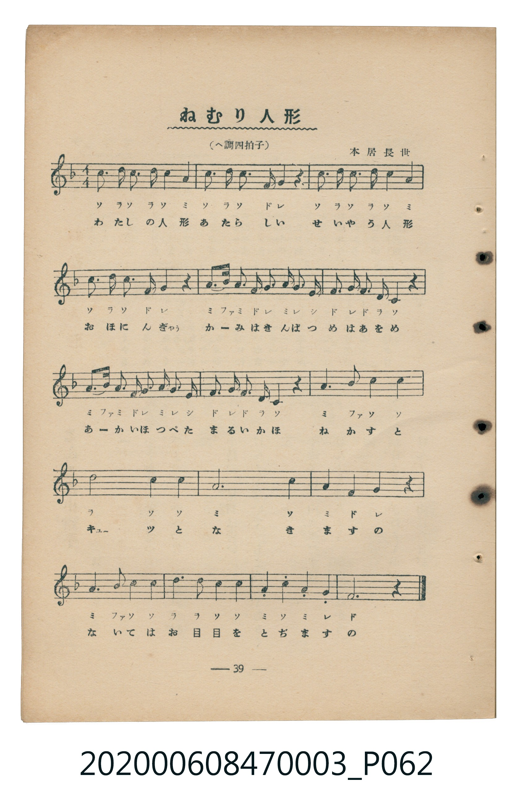
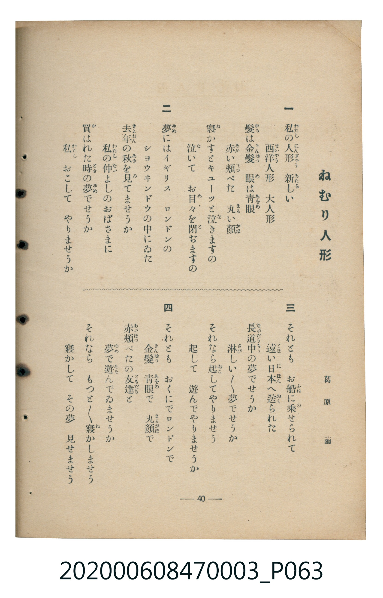

# ねむり人形

> Re:Shōka 使用 AI 協助辨識與重建樂譜，可能會有錯誤。歡迎回報。

- **NEUTRINO 歌聲合成版**：<br><audio controls src="nemuri_ningyo_neutrino.mp3"></audio>
- **鋼琴伴奏版**：<br><audio controls src="nemuri_ningyo.mp3"></audio>


- 詞：葛原齒
- 曲：本居長世
- 臺灣教育會公認《新定兒童唱歌》尋常科第三學年用（2020.006.0847.0003）

## 說明

原書資訊與歌詞全文（對應 P062.jpg–P063.jpg，書頁 pp. 39–40，補充教材第 4 首）：
調性與拍號：へ調四拍子（F 大調 4/4 拍），♩=96


## 歌詞

```text
一
私の人形　新しい
西洋人形　大人形
髪は金髪　眼は青眼
赤い頬ぺた　丸い顔
寝かすとキューツと泣きますの
泣いて　お目々を閉ぢますの

二
夢にはイギリス　ロンドンの
ショウヰンドウの中にゐた
去年の秋を見てませうか
私の仲よしのおばさまに
買はれた時の夢でせうか
私　おこして　やりませうか

三
それとも　お船に乗せられて
遠い日本へ送られた
長道中の夢でせうか
淋しい淋しい夢でせうか
それなら起してやりませう
起して　遊んでやりませうか

四
それとも　おくにでロンドンで
金髪　青眼で　丸顔で
赤頬ぺたの友達と
夢で遊んでゐませうか
それなら　もつともつと寝かしませう
寝かして　その夢　見せませう
```

## ABC

```abc
X:1
T:ねむり人形
C:曲：本居長世
M:4/4
L:1/16
Q:1/4=96
K:F
V:V1 name="Piano" snm="Pia"
[V:V1]
c3 d c3 d c4 A4 | c3 d c3 F G4 z4 | c3 d c3 d c4 A4 | c3 d c3 F G4 z4 |
w: 1.~わ た し の にん ぎゃう | あ た ら し い | せ い や う にん ぎゃう | お ほ に ん ぎゃう
w: 2.~ゆ め に は イギ リス | ロ ン ド ン の | ショ ウ ヰ ン ドウ の | な か に ゐ た
w: 3.~そ れ と も おふ ねに | の せ ら れ て | と ほ い に ほん へ | お く ら れ た
w: 4.~そ れ と も おく にで | ロ ン ド ン で | き ん ぱ つ あをめ で | ま る が ほ で
A3 B A3 F G3 A G3 E | F3 G F3 D C4 z4 | A3 B A3 F G3 A G3 E | F3 G F3 D C4 z4 |
w: 1.~か _ み は き ん ぱ つ | め は あ を め | あ _ か い ほ つ ぺ た | ま る い か ほ
w: 2.~きょ _ ね ん の あ き を | み て ま せう か | わ た し の な か よ しの | お ば さ ま に
w: 3.~な _ が だ う ち う の | ゆ め で せう か | さ び し い さ び し い | ゆ め で せう か
w: 4.~あ _ か ほ つ ぺ た の | と も だ ち と | ゆ _ め で あ そ ん で | ゐ _ ま せう か
A6 B2 c4 c4 | d8 c4 c4 | A12 c4 | A4 F4 G4 z4 |
w: 1.~ね か す と | キュー ツ と | な き | ま す の
w: 2.~か は れ た | と き の | ゆ め | で せう か
w: 3.~そ れ な ら | お し て | や り | ま せ う
w: 4.~そ れ な ら | もっ もっ と | ね か | し ま せう
A6 B2 c4 c4 | d6 d2 c4 c4 | A4 c4 A4 G4 | F12 z4 |
w: 1.~な い て は | お め め を | と ぢ ま す | の
w: 2.~わ た し _ | お こ し て | や り ま せう | か
w: 3.~お こ し て | あ そ ん で | や り ま せう | か
w: 4.~ね か し て | そ の ゆ め | み せ ま せ | う
```

## TMD 檔案連結

- [主旋律 TMD 檔案](nemuri_ningyo.tmd) [[在 TMD Studio 編輯](https://tmdlang.github.io/Tmd-TS/#tmd=s7IKdvYPcrWy4qpTUCpJTLdSSM7PyUlNLsnMz7MqzsjMK0nNjM_KTMmPL87Iz05Ugisry88pzU21Si9KTEmNN443MjAyiDcwMIs3sDAxBzIMjBFKi_NLi5JTrYqTM_Lzc-JLUitKkvLzsxHyBUX5Zal5iXlANQVFIBtTwIoQClLLMlNSQdKpKZkl-UWZiTlI7kgtKga7FWxJfElRYl5xclFmAcgDCFUlGalAx6Yl5mbmVCJEgUalZ-ZZlSRmAj0H8mB5YnxuYmZeTmJeihKXlpbC48a1j5saHjd1Pdm16-neRQpaWlyKtgqWZlz2tgpuXDYm-iZ2IMNerJz3fs-sFxNnP-2b_3LvJLAFz2ZvAoo9m7Pm6cbWl1O3P9kxDSz8on3X88bFz6bOfNG06dmc5qeta16s6n3c0PVs2oan62Y9bZ30fPXSp1M2Plvb87ih--mG7qc7djxfPvH5mjVPdnQ-Xbvj6c4tz6eseL-nAxTeesDw1gOFN5BhYPx-T6cSF5e-loIttQCXgoIC0EfPZu94sbn9xYquFx3tQHcBPfu0dcWzae1AVzzd0PusvVMhwMDMSC-rIP1Rw2Qg0xjEfL-nB6jv5YJGhYICPQVjS6CUiQFQ8MXiOU9bW4H-fzZ3AtBXCiYKL5dNAzodGFYg616s2v-sYTnIou7eFzPnA0UfN-4ACj6dPRso8nTtBKClbgpPlywHiikAg18BKArW3fNo5kpbYMSADHmyowFEPV_e-LhxHSTmHjc0AEP4ceP0x40tYHuW7n-2pRsuBzQQwgbJvVy96nHj-pftE0GMhobnc_aAuHMnARlgrVuXAA15uWDN48ZdjxvnA1U82bEDJLJwCjjA1s993Nj9uHHm48YVj5vWPm5e-rh5z-PmFiD32ebFjxt7HzfuA8uuA6kGCwHllgGNedzY9Xz2uscNrY-bJr2c1vm4cRFCKdhbu3rAFiwBiq8GOulx05LHTeseN6963LQTpL0ZaNnmx82dIBJi-uOm7Y-blz9uWva4eQNUDsgGhsmOtSAjmiYA3Q-J5N3AhAWUeL68G2j5i2VA9wPVAS2f_bixDegdpODcvelxUwc4INcBHfy4ERioU8FKV4MDZ9N2sMt6gCY_m9kEVAR27nIMk8Defdw4GWwS2PdNLcB8hmIpJC47wT5pnAs2FBikTRC9Lzp2Au18shOoffbjJqDHgLLLwNHXuAAYpM-mLwXmPWDiednQCJMG-xWYF182TgaHADa3PdsO9DsolcAZWBTBXAMM-c4XW4E-BvsB1QOQpAKTa2h4CfRuE9C7wOjA6lFgCsfu0ceN_eD4Xo4awcvBnoElUkjyBCkCJ0dgWoSqAKZWRFIF-ri_-2UjUG4FPCUtR3IYMD2gxjmyR8FxBIxRYOoHOw7MgKV2oCeR_I0kCknYQC44sBsawGkLqA5JNeUFFRQoaOlzcfml5pYWZfpl5qVX5lsFZCbm5TvUGNRUgyxSsLHQsgMzgKWkoa6JFTCDAMMWGC6g1Az0LDBLAAOiDxRDjW1APtCT80E-B6cDIB_oYmDcQSXRFQMjaje6KNBBIOtqFDRMFXSB0ExTVUNXVxOdC-IZAzEudYZQrhGQbYBHHdnmgV3pYwhUDwwRsBKgz4HKgT6H8tZpQr0M5gH91wzyH9gKYDgha2nqhPKmg7S0AJnxMHWzoTItYHUgKRCvDZ_RXVBFu8GuWQ3hNU0GaUGoBFsA8YMR2A8gQZC6RmRdjeuBusBlJogHLjahtjSvhaho3gxS3wz1AIgHShcID4CLU6jRy8BKNyApBZeukMCCuX4V1OZuFNdPAJk7H9XdxmD1c6EqesDqV0B5TSD1wOS1FWwWqOiGmQ-yCCQ2GzngQbqBGQ854KEmQUMRFvCrQep2wwJ-B3qQ92MaiuZoEyIcDUpOkPKLiMAGqYE7uhcR2UDeRqirloDUNQFrKWDsggVg5jbug6qHBHYPwstI5sJyv6muBTD3g8qo_aD6Clgrg7LtRqDxoFQDFoLZAS4GgAqBGRqYv4HVNagoBYruA9oEFgWSu5FyOijj6SqYwHIchAvLcRqgLAfMnKhc83goH6jdECxiBFMA4ZrBFJiCfIGeZRu7wYpAyoH-gfobmNjxhSE4OYMCEKEWmoubJoGyCUgKPVuBQqkdySpoREINh6VFYMQjWQw0DKwV5ixwtoFFFbgKAMUPyAMYmQGSeSBWwWJzAZgHzd6NC1F4wCIKS-aH5ldcVkGSMMTrEKsggQnLK0ugvF1gHij9I1mFnNiBvAUIZ0GkEPYMTLrA5i1w2QtMsPCUAOTtgvKA5TeWnAQrLoA8iEaM4hZnlYFeBDZ1QHmgChdqGay42QBWPhXK2weuFFAtgyQLmApw8QG3DOItnHJkJgyoFnAIwnPLcuTc0jgXLAcqQqFyYH0TkEIef2IHFkaWuoZGoNIIWLJDOw5AR8J7DsA6DsgHNsGQug6I4gaaqsBVPgjXKJhBrEYSgahBiEJEQCkIswEAz9VAZwLtArNASRkoA3MS1CRgnwZZFpZdobp7oaIgz8PMgVel8LSDSJbrQRUImAXKYyAZSN6CmQWrVOFRApEDRwpINSg2IUEMdTx6ykGqp6COhdRtIBlYEpwMSplgFqj2BFkGSfswy0DqEJ4CtWYw2h_AZIPHJlCzeTHUMlAkQ7mIQIQEPszjIF-ARCFugtqKbiWoLWusa2gGSkHARALuTIKCE9SsB3Z9gGgSyALk7iTh5GOGlnxgLUpQgqkBJx0YRE8-sPwOai9DWkPrUUMZVKVCqm6gwxBRDXQfki9BCQYkA6lUIBAt6SBKHWgIgSDh2ITEIlpoIlIihlXgpIPTSEQxAKoHwSxIe4Q8y8CpBzkDoloGTVegvgo4GyCSP6h6haVIROoEySBnF4hNtVxcunYKyP0kBSBfmQsA)]
- [鋼琴伴奏 TMD 檔案](nemuri_ningyo_piano.tmd) [[在 TMD Studio 編輯](https://tmdlang.github.io/Tmd-TS/#tmd=s7IKdvYPcrWy4tLSUnjcuPZxU8Pjpq4nu3Y93bvo_Z6Ol917nk_Y8mTPlqdL-593drzf06mgpcWlaKtgacZlb6vgxmVjom9ix1WnoPRi5bz3e2a9mDj7ad_8l3snKYHEns3eBBR7NmfN042tL6duf7JjGlj4Rfuu542Ln02d-aJp07M5zU9b17xY1fu4oevZtA1P18162jrp-eqlT6dsfLa253FD99MN3U937Hi-fOLzNWue7Oh8unbH051bnk9ZAXSckYGRgZ6BgZmegYWJOZBhYAx0nxIXl19qbmlRpl9mXnplvlVAZmJefpCHQ41BTTWXAhDYWGjZgRn6WgqGuiZWCo-b-h83zn_cOP1x4zpgEKx-3DT5cWPf46aWx41tQH4TSLKpEyzfAuTPBlJwSXTFXY8bd6OLaumDratR0DBV0AVCM01VDV1dTXQuiGcMxLjUGUK5RkC2AR51ZJsHdqWPIVA9METASoA-ByoH-hzKW6cJ9TKYB_RfM8h_YCuA4YSspakTypsO0tICZMbD1M2GyrSA1YGkQLw2fEZ3QRXtBrtmNYTXNBmkBaESbAHED0ZgP4AEQeoakXU1rgfqalryuGkdiNe86nHTTqgtzWshKpo3g9Q3Qz0A4oHSBcIDTdsfNy-HGr0MrHQDktLmTqAoJLBgrl8FtbkbxfUTQObOR3W3MVj9XKiKHrD6FVBeE0g9MHltBZu1FmIQWD3IIpDYbOSAB-l-3AhyCTzgoSZBQxEW8KtB6nbDAn4HepD3YxqK5mgTIhwNSk6g6G0EBRyhwAapgTu6FxHZQN5GqKuWgNQ1PW6aBIxdsADM3MZ9UPWQwO5BeBnJXFjuN9W1AOb-xu7HjfuB6QJoFzjbbgQaD0o1YCGYHeBiAKgQmKGB-Xvx48ZdoHAAWge0CSwKJHcj5XRQxtNVMIHlOAgXluM0QFkOmDlRuebxUD5QuyFYxAimAMI1gykwBfkCPcs2doMVgZQD_QP1NzCx4wtDcHIGBSBCLTQXN00CZROQFHq2AoVSO5JV0IiEGg5Li8CIR7IYaBhYK8xZ4GwDiypQgQrO_SAPYGQGSOaBWAWLzQVgHjR7Ny5E4QGLKCyZH5pfcVkFScIQr0OsggQmLK8sgfJ2gXmg9I9kFXJiB_IWIJwFkULYMzDpApu3wGUvMMHCUwKQtwvKA5bfWHISrLgA8iAaMYpbnFUGehHY1AHlgSpcqGWw4mYDWPlUKG8fuFJAtQySLGAqwMUH3DKIt3DKkZkwoFrAIQjPLcuRc0vjXLAcqAiFyoH1TUAKefyJHVgYWeoaGoFKI2DJDixLZoLSzuOmtY-blz5u3vO4GVjHAfmNq0DZD1jogOTXIYobaKoCV_kgXKNgBrEaSQSiBiEKEQGlIMwGADxXA50JtAvMAiVloAzMSVCTHjeDEgZcFpZdobp7oaIgz8PMgVel8LSDSJbrQRUImAXKYyAZSN6CmQWrVOFRApEDRwpINSg2IUEMdTx6ykGqp6COhdRtIBlYEpwMSplgFqj2BFkGSfswy0DqEJ4CtWYw2h_AZIPHpiZgVbIYahkokqFcRCBCAh_mcZAvQKIQN0FtRbcS1JY11jU0A6UgYCIBVkjLwMEJrHyBNRkITQJZ8LhxEQnJxwwt-cBalKAEUwNOOjCInnxg-R3UXoa0htajhjKoSoVU3UCHIaIa6D4kX4ISDEgGUqlAIFrSQZQ60BACQcKxCYlFtNBEpEQMq8BJB6eRiGIAVA-CWZD2CHmWgVMPcgZEtQyarkB9FXA2QCR_UPUKS5GI1AmSQc4uEJtqsXWTfJC7SSbQbhIwpuMVog1jYRScbxofD4x4QtJIZpjF50KEo03jQQrNQEwjmCDMKIKqcLjKBKTOBNMdcD6lBiG5CaEFZAwwLHXtFJCDM9oHKIshZoRFzBiLGNBuoJgyFwA)]

## 分析

```text
================================================================================
📊 TMD Song Profile: [ ねむり人形 ]
================================================================================
⏱  Duration:       0:40 (40.0s), 16 measures total
🎼 Key & Tempo:    首調基準 F, != 96.0 BPM, <4/4>
   - 分析範圍：      由實際發聲的音符與和弦推測調性；播放脈絡另行呈現
🎤 人聲音域:    C4 (MIDI 60) – D5 (MIDI 74) [跨度: 14 個半音 / 1.2 個八度, 難度: moderate]
   - 最低音:  C4 in [NemuriNingyo #1 @ m.6, 0:13]
   - 最高音: D5 in [NemuriNingyo #1 @ m.1, 0:00]
   - 適合: soprano, mezzo-soprano, contralto, tenor, baritone, bass
🏛  結構:      NemuriNingyo (40.0s)
⚡ 編曲密度:        Peak 1 軌道同時演奏
🗝  調性診斷：       C 調性不明確（純淨自然大調，未偵測到可信轉調）
   - 風格氣質:    純淨自然大調（陽光明朗、易唱易記，無明顯調外色彩）
   - 轉調歷程:    全曲維持單一推測調性（未偵測到可信轉調）
   - 核心骨幹音:  C, A, F, G, D
   - 調性數值:    C 調性不明確 [相關度: 0.79, 穩定度: Ambiguous, 自然音純度: 97.4%]
   - 候選調性 (K-S): C 大調 (0.79), A 小調 (0.78), F 大調 (0.74)
   - 五度圈歷程:   +0
   - 各段落調性細節:
     • [NemuriNingyo #1]: C 調性不明確 (r: 0.79, 自然音純度: 97.4%, 調外音: A#)

  [ 五度圈游移軌跡 ]
              [C ]*
         F            G  
      Bb               D  
      Eb               A  
         Ab           E  
            Db       B  
               F# 
     (* = active key center)

  [ 十二半音累積音高分佈 ]
     C  : ████████████████████████  34.5%
     C# :                            0.0%
     D  : ███████                   10.3%
     D# :                            0.0%
     E  : █                          0.9%
     F  : ██████████                13.8%
     F# :                            0.0%
     G  : █████████                 12.9%
     G# :                            0.0%
     A  : █████████████████         25.0%
     A# : ██                         2.6%
     B  :                            0.0%
--------------------------------------------------------------------------------
Assignment 軌道音域：
  - Piano         : C4 – D5 (14 個半音 / 1.2 個八度, 73 個音符)
================================================================================
```


## 原書掃描頁






