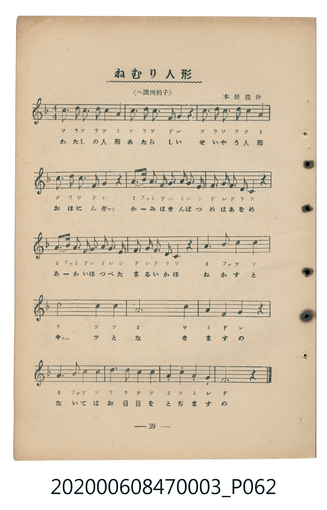
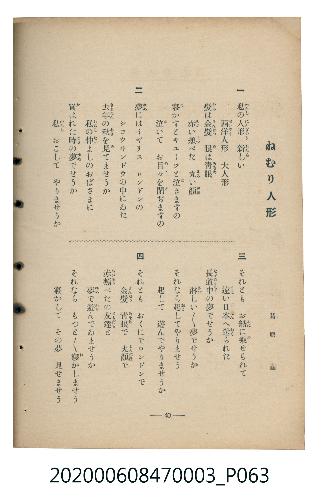

# ねむり人形

<audio controls src="nemuri_ningyo.mp3"></audio>

- 詞：葛原齒
- 曲：本居長世
- 臺灣教育會公認《新定兒童唱歌》尋常科第三學年用（2020.006.0847.0003）

## 說明

原書資訊與歌詞全文（對應 P062.jpg–P063.jpg，書頁 pp. 39–40，補充教材第 4 首）：
調性與拍號：へ調四拍子（F 大調 4/4 拍），♩=96

## 歌詞

```text
一
私の人形　新しい
西洋人形　大人形
髪は金髪　眼は青眼
赤い頬ぺた　丸い顔
寝かすとキューツと泣きますの
泣いて　お目々を閉ぢますの

二
夢にはイギリス　ロンドンの
ショウヰンドウの中にゐた
去年の秋を見てませうか
私の仲よしのおばさまに
買はれた時の夢でせうか
私　おこして　やりませうか

三
それとも　お船に乗せられて
遠い日本へ送られた
長道中の夢でせうか
淋しい淋しい夢でせうか
それなら起してやりませう
起して　遊んでやりませうか

四
それとも　おくにでロンドンで
金髪　青眼で　丸顔で
赤頬ぺたの友達と
夢で遊んでゐませうか
それなら　もつともつと寝かしませう
寝かして　その夢　見せませう
```

## 原書掃描頁





## 分析

```text
================================================================================
📊 TMD Song Profile: [ ねむり人形 ]
================================================================================
⏱  Duration:       0:40 (40.0s), 16 measures total
🎼 Key & Tempo:    首調基準 F, != 96.0 BPM, <4/4>
   - 分析範圍：      由實際發聲的音符與和弦推測調性；播放脈絡另行呈現
🎤 人聲音域:    C4 (MIDI 60) – D5 (MIDI 74) [跨度: 14 個半音 / 1.2 個八度, 難度: moderate]
   - 最低音:  C4 in [NemuriNingyo #1 @ m.6, 0:13]
   - 最高音: D5 in [NemuriNingyo #1 @ m.1, 0:00]
   - 適合: soprano, mezzo-soprano, contralto, tenor, baritone, bass
🏛  結構:      NemuriNingyo (40.0s)
⚡ 編曲密度:        Peak 1 軌道同時演奏
🗝  調性診斷：       A 調性不明確（純淨自然大調，未偵測到可信轉調）
   - 風格氣質:    純淨自然大調（陽光明朗、易唱易記，無明顯調外色彩）
   - 轉調歷程:    全曲維持單一推測調性（未偵測到可信轉調）
   - 核心骨幹音:  C, A, F, D, G
   - 調性數值:    A 調性不明確 [相關度: 0.80, 穩定度: Ambiguous, 自然音純度: 97.5%]
   - 候選調性 (K-S): A 小調 (0.80), C 大調 (0.77), F 大調 (0.74)
   - 五度圈歷程:   +3
   - 各段落調性細節:
     • [NemuriNingyo #1]: A 調性不明確 (r: 0.80, 自然音純度: 97.5%, 調外音: A#)

  [ 五度圈游移軌跡 ]
               C  
         F            G  
      Bb               D  
      Eb              [A ]*
         Ab           E  
            Db       B  
               F# 
     (* = active key center)

  [ 十二半音累積音高分佈 ]
     C  : ████████████████████████  33.9%
     C# :                            0.0%
     D  : ████████                  11.9%
     D# :                            0.0%
     E  : █                          1.7%
     F  : ██████████                13.6%
     F# :                            0.0%
     G  : ████████                  11.0%
     G# :                            0.0%
     A  : ██████████████████        25.4%
     A# : ██                         2.5%
     B  :                            0.0%
--------------------------------------------------------------------------------
Assignment 軌道音域：
  - Piano         : C4 – D5 (14 個半音 / 1.2 個八度, 73 個音符)
================================================================================
```

## ABC

```abc
X:1
T:ねむり人形
C:曲：本居長世
M:4/4
L:1/16
Q:1/4=96
K:F

V:V1 name="Piano" snm="Pia"

[V:V1]
c3 d c2 d2 c4 a4 | c3 d c4 f2 g4 z2 | c3 d c2 d2 c4 a4 | c3 d c4 f2 g4 z2 |
a3 b a2 f2 g2 a3 g e2 | f2 g2 f2 d2 c4 z4 | a3 b a2 f2 g2 a3 g e2 | f2 g2 f2 d2 c4 z4 |
a6 b2 c4 c4 | d8 c4 c4 | a12 c4 | a4 f4 g4 z4 |
a6 b2 c4 c4 | d6 d2 c4 c4 | a4 c4 a4 g4 | f12 z4 |
```

- [主旋律 TMD 檔案](nemuri_ningyo.tmd)
- [鋼琴伴奏 TMD 檔案](nemuri_ningyo_piano.tmd)
