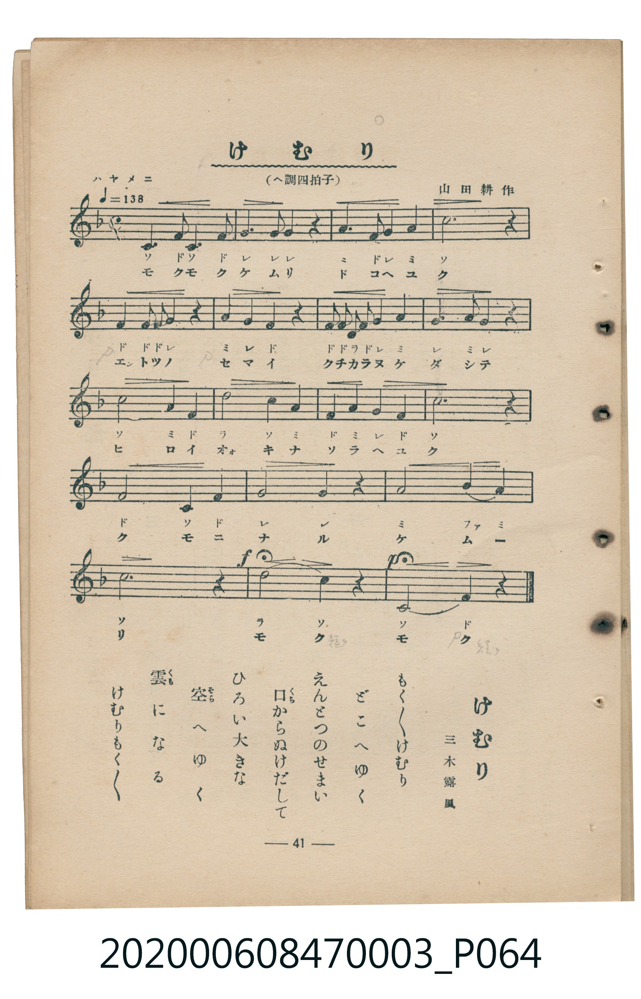

# けむり

> Re:Shōka 使用 AI 協助辨識與重建樂譜，可能會有錯誤。歡迎回報。

<audio controls src="kemuri.mp3"></audio>

- 詞：三木露風
- 曲：山田耕作
- 臺灣教育會公認《新定兒童唱歌》尋常科第三學年用（2020.006.0847.0003）

## 說明

原書資訊與歌詞全文（對應 P064.jpg，書頁 p. 41，補充教材第 5 首）：
調性與拍號：へ調四拍子（F 大調 4/4 拍），ハヤメニ ♩=138

## 歌詞

```text
もく〳〵けむり
どこへゆく
えんとつのせまい
口からぬけだして
ひろい大きな
空へゆく
雲になる
けむりもく〳〵
```

## ABC

```abc
X:1
T:けむり
C:曲：山田耕作
M:4/4
L:1/16
Q:1/4=138
K:F
V:V1 name="Piano" snm="Pia"
[V:V1]
C6 F2 C6 F2 | G6 G2 G4 z4 | A6 F2 G4 A4 | c12 z4 |
F4 F2 F2 G4 z4 | A4 G4 F4 z4 | F2 F2 D2 F2 G4 A4 | G6 A2 G4 z4 |
c8 A4 F4 | d8 c4 A4 | F4 A4 G4 F4 | c12 z4 |
F8 C4 F4 | G8 G4 z4 | A8 B4 A4 | c12 z4 |
!f! d8 c4 z4 | !p! C8 F4 z4 |
```

## TMD 檔案連結

- [主旋律 TMD 檔案](kemuri.tmd) [[在 TMD Studio 編輯](https://tmdlang.github.io/Tmd-TS/#tmd=s7IKdvYPcrWy4qpTUCpJTLdSSM7PyUlNLsnMz7MqzsjMK0nNjM_KTMmPL87Iz05Ugisry88pzU21Si9KTEmNN443MjAyiDcwMIs3sDAxBzIMjBFKi_NLi5JTrYqTM_Lzc-JLUitKkvLzsxHyBUX5Zal5iXlANQVFIBtTwIoQClLLMlNSQdKpKZkl-UWZiTlI7kgtKga7FWxJfElRYl5xclFmAcgDCFUlGalAx-YllpQWpSpxaWkpPG6c-Lip4XFTl4KWFpeirYKhsQWXva2CG5eNib6JHUjfi5Xz3u-Z9WRH57M5K17O2fRy0Qqwcc9mbwIKP9248fmUDS8apj7ZOwcs_KJ91_PGxc-mznzRtOnZnOanrWterOp93ND1bNqGp-tmPW2d9Hz10qdTNj5b2_O4ofvphu6nO3Y8Xz7x-Zo1QAuert3xdOeW51NWvN_TAQpHPWA46oHCEcgwMH6_p1OJi0tfS8GWWoBLQUHhad_8Z7N3vNjc_mJF14uOdqC7gP592rri2bR2oCuebuh91t6pEGBgZqKXVZD-fk8PUPHLBY0KBXoKJoZA7ovFc562tgK9-2zuBKAnFEwVXi6bBnQpMGhApr9Ytf9Zw3KQud29L2bOB4o-btwBFHw6ezZQ5OnaCUA73BSeLlkOFFMABrgCUBSsu-dxc__j5iWPmxc-bu5WeDRzpS0oYkBGPm5qetzY_7hh8-OGrfDIA0s0rnzcOBlo_uOmNqAKiFDH4yag0IrHjUseN6573Dj7ceO-x40tYI_3L37c2P24qfNx4xqQOY0LHjdOf9y4DKJv0-OmXqBCoMseNwIZq0Ciz1fuQjH95exNjxtXAyUfN3VDdEFdg-xEkATlMQUFClr6XFzeqbmlRZlWAZmJefkONQY1CtUgOxRsLLTswAxgCgmuLC5JzVUwVNDI1TPUNdG0UnjcvOhx03oo2bTxcfOCx82rgKKdj5s2P26e8bh5GVACZDzIhBoF03gFXSA0RDBqFIzALCMwbQDENQrGUDmQCIgN1AcWgUCwGjQXGYFcZKprAXJR04rHzUC7Ox43tzxu7gPydz9unve4aQmQBXRo4-Om1Y-bVz5u7gE7Fxis2x83tyFcaAi2GWI3wjUgHkgGIgKSN4tHcSDEE8YIbWgONAY50FLX0AgcZpMeN6-FuAgYxysfN6193NwF5OwFOwwz0KAeB9kEckSNghlUBCQDsR8kjuxQwkFmAo5EY11DU3CggeMQmCWALnncvBooAInLPaghA7YUFHUQOyC-htiKHHW6QNOhLkOz1RRsq5muITiqwEkFlHRgFIaf4a5XqE6rRfE3VLSgFpaWkGKIq5aLS9dOAZKiFYAsZS4A)]
- [鋼琴伴奏 TMD 檔案](kemuri_piano.tmd) [[在 TMD Studio 編輯](https://tmdlang.github.io/Tmd-TS/#tmd=s7IKdvYPcrWy4tLSUnjcOPFxU8Pjpq73ezpedu95PmHLkz1bni7tf97Z8X5Pp4KWFpeirYKhsQWXva2CG5eNib6JHVedgtKLlfPe75n1ZEfnszkrXs7Z9HLRCiWQ8LPZm4DCTzdufD5lw4uGqU_2zgELv2jf9bxx8bOpM180bXo2p_lp65oXq3ofN3Q9m7bh6bpZT1snPV-99OmUjc_W9jxu6H66ofvpjh3Pl098vmYN0IKna3c83bnl-ZQVQAcaGRgZ6BkYmOkZWJiYAxkGxkA3KnFxeafmlhZlWgVkJublB3k41BjUKFRzKQCBjYWWHZihr6UQXFlckpqrYKigkatnqGuiaaXwuHnR46b1ULJp4-PmBY-bVwFFOx83bX7cPONx8zKghIKWPtiEGgXTeAVdIDREMGoUjMAsIzBtAMQ1CsZQOZAIiA3UBxaBQLAaNBcZgVxkqmsBclHTisfNQLs7Hje3PG7uA_J3P26e97hpCZAFdGjj46bVj5tXPm7uATsXGG3bHze3IVxoCLYZYjfCNSAeSAYiApI3i0dxIMQTxghtaA40BjnQUtfQCBxmkx43r4W4aNXjppWPm9Y-bu4CcvaCHYYZaFCPg2wCOaJGwQwqApKB2A8SR3Yo4SAzAUeisa6hKTjQwHHY3A10XNfj5tVAAUhc7kENGbCloKiD2AHxNcRW5KjTBZoOdRmaraZgW810DcFRBU4qoKQDozD8DHe9QnVaLYq_oaIFtbC0hBRDXLWoCdoHJUGb4E7QSL6NV4g2jIVRoJQLZJnGx4IZBggFYHGsKnAlUQw7kE0E6QfSIK4ZyDyz-NxYBSNi7UCkMtweMQEZYQKxBiICZYBtMQLZR9AepLRDQYjhThrIBQaaIaBkgOwFsBg4EYCTJcS1wOjXtVOApAAFIEuZCwA)]

## 分析

```text
================================================================================
📊 TMD Song Profile: [ けむり ]
================================================================================
⏱  Duration:       0:31 (31.3s), 18 measures total
🎼 Key & Tempo:    首調基準 F, != 138.0 BPM, <4/4>
   - 分析範圍：      由實際發聲的音符與和弦推測調性；播放脈絡另行呈現
🎤 人聲音域:    C4 (MIDI 60) – D5 (MIDI 74) [跨度: 14 個半音 / 1.2 個八度, 難度: moderate]
   - 最低音:  C4 in [Kemuri #1 @ m.1, 0:00]
   - 最高音: D5 in [Kemuri #1 @ m.10, 0:15]
   - 適合: soprano, mezzo-soprano, contralto, tenor, baritone, bass
🏛  結構:      Kemuri (31.3s)
⚡ 編曲密度:        Peak 1 軌道同時演奏
🗝  調性診斷：       C 大調（純淨自然大調，未偵測到可信轉調）
   - 風格氣質:    純淨自然大調（陽光明朗、易唱易記，無明顯調外色彩）
   - 轉調歷程:    全曲維持單一推測調性（未偵測到可信轉調）
   - 核心骨幹音:  C, G, F, A, D
   - 調性數值:    C 大調 [相關度: 0.85, 穩定度: Moderate, 自然音純度: 98.4%]
   - 候選調性 (K-S): C 大調 (0.85), F 大調 (0.80), A 小調 (0.62)
   - 五度圈歷程:   +0
   - 各段落調性細節:
     • [Kemuri #1]: C 大調 (r: 0.85, 自然音純度: 98.4%, 調外音: A#)

  [ 五度圈游移軌跡 ]
              [C ]*
         F            G  
      Bb               D  
      Eb               A  
         Ab           E  
            Db       B  
               F# 
     (* = active key center)

  [ 十二半音累積音高分佈 ]
     C  : ████████████████████████  30.6%
     C# :                            0.0%
     D  : ██████                     7.3%
     D# :                            0.0%
     E  :                            0.0%
     F  : ████████████████          21.0%
     F# :                            0.0%
     G  : █████████████████         21.8%
     G# :                            0.0%
     A  : ██████████████            17.7%
     A# : █                          1.6%
     B  :                            0.0%
--------------------------------------------------------------------------------
Assignment 軌道音域：
  - Piano         : C4 – D5 (14 個半音 / 1.2 個八度, 52 個音符)
================================================================================
```


## 原書掃描頁




