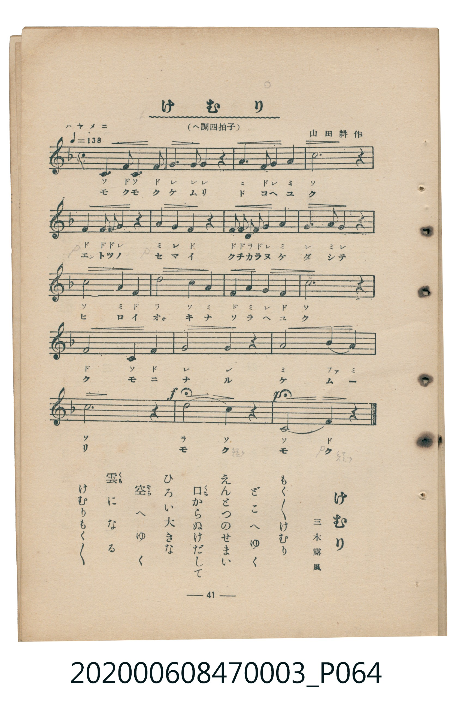

# けむり

> Re:Shōka 使用 AI 協助辨識與重建樂譜，可能會有錯誤。歡迎[回報](https://github.com/TMDLang/reshoka/issues)。

- **鋼琴伴奏版**：<br><audio controls src="kemuri.mp3"></audio>
- **NEUTRINO 歌聲合成版**：<br><audio controls src="kemuri_neutrino.mp3"></audio>

- 詞：三木露風
- 曲：山田耕筰
- 臺灣教育會公認《新定兒童唱歌》尋常科第三學年用（2020.006.0847.0003）

## 說明

原書資訊與歌詞全文（對應 P064.jpg，書頁 p. 41，補充教材第 5 首）：
調性與拍號：へ調四拍子（F 大調 4/4 拍），ハヤメニ ♩=138


## 歌詞

```text
もく〳〵けむり
どこへゆく
えんとつのせまい
口からぬけだして
ひろい大きな
空へゆく
雲になる
けむりもく〳〵
```

## ABC

<div class="abc-score" data-abc-src="kemuri.abc" aria-label="五線譜載入中"></div>

[下載 ABC 原始檔](kemuri.abc)

## TMD 檔案連結

- [主旋律 TMD 檔案](kemuri.tmd) [[在 TMD Studio 編輯](https://tmdlang.github.io/Tmd-TS/#tmd=s7IKdvYPcrWy4qpTUCpJTLdSSM7PyUlNLsnMz7MqzsjMK0nNjM_KTMmPL87Iz05Ugisry88pzU21Si9KTEmNN443MjAyiDcwMIs3sDAxBzIMjBFKi_NLi5JTrYqTM_Lzc-JLUitKkvLzsxHyBUX5Zal5iXlANQVFIBtTwIoQClLLMlNSQdKpKZkl-UWZiTlI7kgtKga7FWxJfElRYl5xclFmAcgDCFUlGalAx-YllpQWpSJEgUalZ-ZZlSRmAj0H8mB5YnxuYmZeTmJeCrKqkox8oD8LMiqtMjKLQQ5ITsyJz07MQwoOqPUFiempVgEGZiZKXFpaCo8bJz5uanjc1KWgpcWlaKtgaGzBZW-r4MZlY6JvYgfS-2LlvPd7Zj3Z0flszoqXcza9XLQCbOSz2ZuAwk83bnw-ZcOLhqnP124AC79o3_W8cfGzqTNfNG16Nqf5aeuaF6t6Hzd0PZu24em6WU9bJz1fvfTplI3P1vY8buh-uqH76Y4dz5dPfL5mDdCCp2t3PN255fmUFe_3dIAiSw8YWXqgyAIyDIzf7-lU4uLS11KwpRbgUlBQeNo3_9nsHS82t79Y0fWiox3oLqB_n7aueDatHeiKpxt6n7V3KoBCSy-rIP39nh6g4pcLGhUK9BRMDIHcF4vnPG1tBXr32dwJQE8omCq8XDYN6FJg0IBMf7Fq_7OG5SBzu3tfzJwPFH3cuAMo-HT2bKDI07UTgHa4KTxdshwopgAMcAWgKFh3z-Pm_sfNSx43L3zc3K3waOZKW1DEgIx83NT0uLH_ccPmxw1b4ZEHlmhc-bhxMtD8x01tQBUQoY7HTUChFY8blzxuXPe4cfbjxn2PG1vAHu9f_Lix-3FT5-PGNSBzGhc8bpz-uHEZRN-mx029QIVAlz1uBDJWgUSfr9yFYvrL2ZseN64GSj5u6obogroG2YkgCcpjCgoUtPS5uLxTc0uLMq0CMhPz8h1qDGqqQVYo2Fho2YEZwAQSXFlckpqrYKigkatnqGuiaaXwuHnR46b1ULJp4-PmBY-bVwFFOx83bX7cPONx8zKgBMh0kAk1CqbxCrpAaIhg1CgYgVlGYNoAiGsUjKFyIBEQG6gPLAKBYDVg83xqQJEGFgQGCwobKNM4EcJragDiLiALZCVIfCVU1WQg3gFW0QaV6UeyBqwazeNGII-b6lqAPN604nEz0Isdj5tbHjf3Afm7HzfPe9y0BMgChkfj46bVj5tXPm7uAYcKMPK2P25uQwSEIdiDEC8iPA3igWQgIiB5s3iUcICElTFCGzwcwAkS7K0VQAx0ReM6JC_PBsvsA5MtSOLAQGtcCMTdQFd3Auk1YBWggAPJLoAG1HQgXoYjSIxBQWKpa2gETgyTHjevhYQBMO2ufNy09nFzF5CzFxwUmKkBGtQgv4G8XaNgBhUByUB8DBJHDhp8aaFxE1QYmMfgXgWJdz1u3A2TaoRIrYJKzQUr7wSLkZYYTMC5wFjX0BScHMCZAFikAH38uHk1UACSGfagxjnYcyDTIH6BxCfEd8hpXxdoOjQEEL6DOQiSzoElBNShIK9AxLthToWnfkj6h7DQPWAK9oCZriE4PYOzLSgbwyiMaIIHuEJ1Wi1KVEFFC2ph-RopGSNyKigPogQoPMdC8ixeUa5aLi5dOwVIGaUAZClzAQA)]
- [鋼琴伴奏 TMD 檔案](kemuri_piano.tmd) [[在 TMD Studio 編輯](https://tmdlang.github.io/Tmd-TS/#tmd=s7IKdvYPcrWy4qpTUCpJTLdSyC8qychPL0osyKi0ysgsLskvykxOzInPTsxLVIIrKs4vLUpOjS9ITE-1CjAwM1Hi0tJSeNw48XFTw-Omrvd7Ol5273k-YcuTPVueLu1_3tnxfk-ngpYWl6KtgqGxBZe9rYIbl42JvokdyMAXK-e93zPryY7OZ3NWvJyz6eWiFWB7ns3eBBR-unHj8ykbXjRMfb52A1j4Rfuu542Ln02d-aJp07M5zU9b17xY1fu4oevZtA1P18162jrp-eqlT6dsfLa253FD99MN3U937Hi-fOLzNWuAFjxdu-Ppzi3Pp6wAOtDIwMhAz8DATM_AwsQcyDAwBrpRiYvLOzW3tCjTKiAzMS8_yMOhxqCmmksBCGwstOzADH0theDK4pLUXAVDBY1cPUNdE00rhcfNix43rYeSTRsfNy943LwKKNr5uGnz4-YZj5uXASUUtPTBJtQomMYr6AKhIYJRo2AEZhmBaQMgrlEwhsqBREBsoD6wCASC1YDN86lReNzUBBZ83NiPwgbKNE6E8JoagLgLyAJZCRJfCVU1GYh3gFW0QWX6kawBq0bzuBHI46a6FiCPN6143Az0Ysfj5pbHzX1A_u7HzfMeNy0BsoDh0fi4afXj5pWPm3vAoQJMHNsfN7chAsIQ7EGIFxGeBvFAMhARkLxZPEo4QMLKGKENHg6NHY-bJoO9tQKIga5oXIfk5dlgmX1gsgVJHBhojQuBuBvo6k4gvQasAhRwINkF0ICaDsTLcASJMShILHUNjcCJYdLj5rWQMFj1uGnl46a1j5u7gJy94KDATA3QoAb5DeTtGgUzqAhIBuJjkDhy0OBLC42boMKPm3rhXgWJdz1u3A2TaoRIrYJKzQUr7wSLkZYYTMC5wFjX0BScHMCZoBkYkM1dj5tXAwUgmWEPapyDPQcyDeIXSHxCfIec9nWBpkNDAOE7mIMg6fxx42qoQ0FegYh3w5wKT_2Q9A9hoXvAFOwBM11DcHoGZ1tQNoZRGNEED3CF6rRalKiCihbUwvI1UjJG5FRQHkQJUHiOheRZvKJctahFlA9yEWWCu4hCCv54hWjDWBgFKouALNP4WDDDAKEALI5VBa7SAMMOZBNB-oE0iGsGMs8sPjdWwYhYOxDZC7dHTEBGmECsgYhAGWBbjED2EbQHKTFTEGK4ExhyFYBmCCgxIXsBLAZOSuB8AnEtMPZ17RQgCUAByFLmAgA)]

## 分析

```text
================================================================================
📊 TMD Song Profile: [ けむり ]
================================================================================
⏱  Duration:       0:31 (31.3s), 18 measures total
🎼 Key & Tempo:    首調基準 F, != 138.0 BPM, <4/4>
   - 分析範圍：      由實際發聲的音符與和弦推測調性；播放脈絡另行呈現
🎤 人聲音域:    C4 (MIDI 60) – D5 (MIDI 74) [跨度: 14 個半音 / 1.2 個八度, 難度: moderate]
   - 最低音:  C4 in [Kemuri #1 @ m.1, 0:00]
   - 最高音: D5 in [Kemuri #1 @ m.10, 0:15]
   - 適合: soprano, mezzo-soprano, contralto, tenor, baritone, bass
🏛  結構:      Kemuri (31.3s)
⚡ 編曲密度:        Peak 1 軌道同時演奏
🗝  調性診斷：       C 大調（純淨自然大調，未偵測到可信轉調）
   - 風格氣質:    純淨自然大調（陽光明朗、易唱易記，無明顯調外色彩）
   - 轉調歷程:    全曲維持單一推測調性（未偵測到可信轉調）
   - 核心骨幹音:  C, G, F, A, D
   - 調性數值:    C 大調 [相關度: 0.85, 穩定度: Moderate, 自然音純度: 98.4%]
   - 候選調性 (K-S): C 大調 (0.85), F 大調 (0.80), A 小調 (0.62)
   - 五度圈歷程:   +0
   - 各段落調性細節:
     • [Kemuri #1]: C 大調 (r: 0.85, 自然音純度: 98.4%, 調外音: A#)

  [ 五度圈游移軌跡 ]
              [C ]*
         F            G  
      Bb               D  
      Eb               A  
         Ab           E  
            Db       B  
               F# 
     (* = active key center)

  [ 十二半音累積音高分佈 ]
     C  : ████████████████████████  30.6%
     C# :                            0.0%
     D  : ██████                     7.3%
     D# :                            0.0%
     E  :                            0.0%
     F  : ████████████████          21.0%
     F# :                            0.0%
     G  : █████████████████         21.8%
     G# :                            0.0%
     A  : ██████████████            17.7%
     A# : █                          1.6%
     B  :                            0.0%
--------------------------------------------------------------------------------
Assignment 軌道音域：
  - Piano         : C4 – D5 (14 個半音 / 1.2 個八度, 52 個音符)
================================================================================
```


## 原書掃描頁




