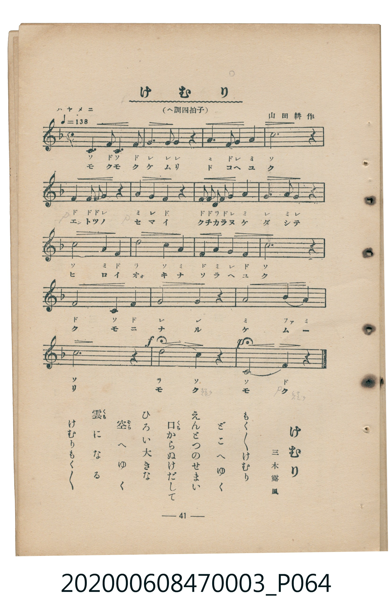

# けむり

<audio controls src="kemuri.mp3"></audio>

- 詞：三木露風
- 曲：山田耕作
- 臺灣教育會公認《新定兒童唱歌》尋常科第三學年用（2020.006.0847.0003）

- note

原書資訊與歌詞全文（對應 P064.jpg，書頁 p. 41，補充教材第 5 首）：
調性與拍號：へ調四拍子（每半小節設有小節線，以 2/4 拍記譜），ハヤメニ ♩=138

## 歌詞

```text
一
けむりよけむり　立ちのぼれ
むくむくむくむく　立ちのぼれ
風のお馬に　ついい乗つて
山の上まで　立ちのぼれ

二
けむりよけむり　白けむり
どんどんのぼれよ　空までも
高いお空の　雲のそば
おほきくひろがつて　消えてゆけ
```

## 原書掃描頁



## 調性分析

```text
================================================================================
📊 TMD Song Profile: [ けむり ]
================================================================================
⏱  Duration:       0:19 (19.1s), 22 measures total
🎼 Key & Tempo:    首調基準 F, != 138.0 BPM, <2/4>
   - 分析範圍：      由實際發聲的音符與和弦推測調性；播放脈絡另行呈現
🎤 人聲音域:    C4 (MIDI 60) – D5 (MIDI 74) [跨度: 14 個半音 / 1.2 個八度, 難度: moderate]
   - 最低音:  C4 in [Kemuri #1 @ m.1, 0:00]
   - 最高音: D5 in [Kemuri #1 @ m.12, 0:09]
   - 適合: soprano, mezzo-soprano, contralto, tenor, baritone, bass
🏛  結構:      Kemuri (19.1s)
⚡ 編曲密度:        Peak 1 軌道同時演奏
🗝  調性診斷：       F 大調（純淨自然大調，未偵測到可信轉調）
   - 風格氣質:    純淨自然大調（陽光明朗、易唱易記，無明顯調外色彩）
   - 轉調歷程:    全曲維持單一推測調性（未偵測到可信轉調）
   - 核心骨幹音:  C, F, G, A, D
   - 調性數值:    F 大調 [相關度: 0.83, 穩定度: Moderate, 自然音純度: 100.0%]
   - 候選調性 (K-S): F 大調 (0.83), C 大調 (0.79), A 小調 (0.57)
   - 五度圈歷程:   -1
   - 各段落調性細節:
     • [Kemuri #1]: F 大調 (r: 0.83, 自然音純度: 100.0%)

  [ 五度圈游移軌跡 ]
               C  
        [F ]*          G  
      Bb               D  
      Eb               A  
         Ab           E  
            Db       B  
               F# 
     (* = active key center)

  [ 十二半音累積音高分佈 ]
     C  : ████████████████████████  24.7%
     C# :                            0.0%
     D  : ██████                     6.5%
     D# :                            0.0%
     E  :                            0.0%
     F  : ████████████████████████  24.7%
     F# :                            0.0%
     G  : ███████████████████████   23.4%
     G# :                            0.0%
     A  : ██████████████████        18.2%
     A# : ███                        2.6%
     B  :                            0.0%
--------------------------------------------------------------------------------
Assignment 軌道音域：
  - Piano         : C4 – D5 (14 個半音 / 1.2 個八度, 53 個音符)
================================================================================
```

## ABC

```abc
X:1
T:けむり
C:曲：山田耕作
M:2/4
L:1/16
Q:1/4=138
K:F

V:V1 name="Piano" snm="Pia"

[V:V1]
z2 c2 f2 c2 | f2 g4 g2 | g4 z2 a2 | f2 g2 a4 |
c6 z2 | f2 f2 f2 g2 | a2 g2 f2 z2 | f2 f2 d2 f2 |
g2 a4 g2 | a2 g4 z2 | c4 a2 f2 | d4 c2 a2 |
f2 a2 g2 f2 | c6 z2 | f4 c2 f2 | g6 z2 |
g4 a4 | b4 a4 | c6 z2 | d4 c2 z2 |
c6 f2 | f4 z4 |
```

- [主旋律 TMD 檔案](kemuri.tmd)
- [鋼琴伴奏 TMD 檔案](kemuri_piano.tmd)
