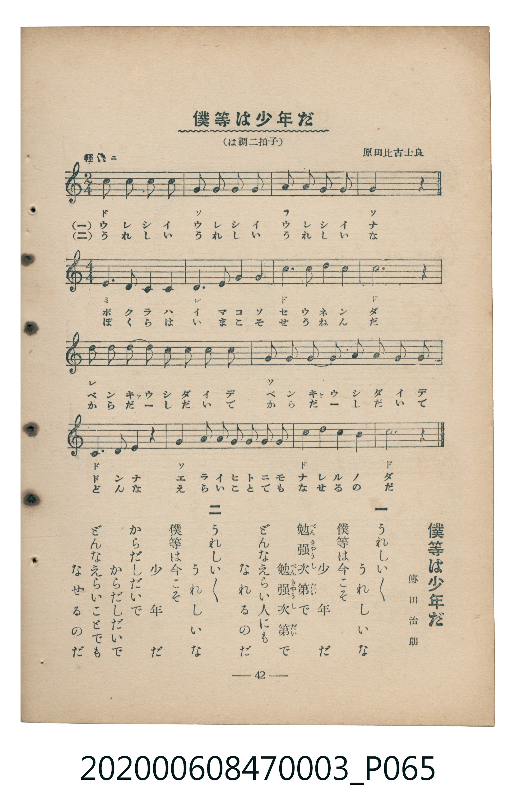

# 僕等は少年だ

> Re:Shōka 使用 AI 協助辨識與重建樂譜，可能會有錯誤。歡迎[回報](https://github.com/TMDLang/reshoka/issues)。

- **鋼琴伴奏版**：<br><audio controls src="bokura_wa_shonen_da.mp3"></audio>
- **NEUTRINO 歌聲合成版**：<br><audio controls src="bokura_wa_shonen_da_neutrino.mp3"></audio>

- 詞：傳田治朗
- 曲：原田比古士良
- 臺灣教育會公認《新定兒童唱歌》尋常科第三學年用（2020.006.0847.0003）

## 說明

原書資訊與歌詞全文（對應 P065.jpg，書頁 p. 42，補充教材第 6 首）：
調性與拍號：は調二拍子（C 大調，前 4 小節 2/4 拍，第 5 小節起轉 4/4 拍），輕快ニ


## 歌詞

```text
一
うれしい〳〵　うれしいな
僕等は今こそ　少年だ
勉強次第で　勉強次第で
どんなえらい人にも　なれるのだ

二
うれしい〳〵　うれしいな
僕等は今こそ　少年だ
からだ次第で　からだ次第で
どんなえらいことでも　なせるのだ
```

## ABC

<div class="abc-score" data-abc-src="bokura_wa_shonen_da.abc" aria-label="五線譜載入中"></div>

[下載 ABC 原始檔](bokura_wa_shonen_da.abc)

## TMD 檔案連結

- [主旋律 TMD 檔案](bokura_wa_shonen_da.tmd) [[在 TMD Studio 編輯](https://tmdlang.github.io/Tmd-TS/#tmd=s7IKdvYPcrWy4qpTUCpJTLdSSM7PyUlNLsnMz7MqzsjMK0nNjM_KTMmPL87Iz05Ugisry88pzU21Si9KTEmNN443MjAyiDcwMIs3sDAxBzIMjBFKi_NLi5JTrYqTM_Lzc-JLUitKkvLzsxHyBUX5Zal5iXlANQVFIBtTwIoQClLLMlNSQdKpKZkl-UWZiTlI7kgtKga7FWxJfElRYl5xclFmAcgDCFUlGalAx0JcgBAFGpWemWdVkpgJ9BzIg-WJ8bmJmXk5iXkpyKpKMvKB_izIqLTKyCwGOSA5MSc-OzEPKTig1hckpqdaBRiYmSpxaWkpPG2e-nxt5-PG9U83THy6c8vjxgUKWlpcirYKhgYWXPa2Cs5cNkb6JnYgQ16snPd-z6ynTZufT9nwbNPuZ3Omg81-NnsTSLhvPkh4_ZSn_UueLl79onM9WPJF-67njYufTZ35omnTsznNT1vXvFjV-7ih69m0DU_XzXraOun56qVPp2x8trbncUP30w3dT3fseL584vM1a57s6Hy6dgfQRc-nrHi_pwMUd3rAuNMDxR2QYWD8fk-nEheXvpaCLbUAl4KCAtAbz2bveLG5_cWKrhcd7UB3AX39tHXFs2ntQFc83dD7rL1TARR4elkF6e_39AAVv1zQqFCgp2BiBOS-WDznaWsr0LvP5k4AekLBTOHlsmlAlwIDCGT6i1X7nzUsB5nb3fti5nygKDDggYJPdvUARZ6unQC0w1nh6ZLlQDGgaU87exVMFJ5u6H--vkEBGAsKQEVAYZDBplDhF1u3v9jbqWACkwTa1PNiz9Sn-1c_bu7mAtn5ZEcDiHrc2Pa4qedx4_THjS2PGzY_btj6uKEBRbBxFTgAYOnhye6ux42THzfOBaqDpw2wiu7Op3u2P1uzEOiOx43LQdKoIhDrVj5uAupe9bix43ET0LyWJ7t2PW5c_bipCWzvKpC9Td2PG9eBTAW7c1cPdd35uLEbbPMCZKdiCmJ3LdjIFSA9cAc3zkY4GKiH8vQGBQpa-lxcTvnZpUWJVgGZiXn5DjUGNdUgKxRsLLTswAxgMg-uLC5JzVUwVNDI1TPUNdEBJQhNK4XHTcseN6953LT9cdMSfJzmLpA9ILNqFAzjEKgGmJQgsAaYWs2gLFMFXQUDIK4B6_AxrAGZBjRkDZDeDsRLgGqIEgFaq6sQjzDJCCjW2AaU7QHS04G4BaSKKJFVKCYhQsQIFCKmuhY6oFwACpHmOY-b1j9uXvm4uR_kjMfN8x43bX7ctBfI2Q0OlN7HzZuByhpgIVJtA9RpVwsNHWOgHbpAUw2BJAjXANkgEWNwqIAwOARBQkDKCMQCc-GiEIgWfM1zwKJAlwHZK0EsoOtAmkABBZZpngdkbwar2QuV2Q3VAwrWXrAakDzItAYkm9CDdw9EVyPI951g1nqILmBAQmT2AfFkMGsuVGY2VAYY7I1rwXaC5EEyC7DahAh-Y1DwW-oaGiDCfybQnY-b1j5uXgwKbmACbG4Ax0M7Xjl48gQGKRxhT6rwhIoUvjPBoQMxGhJkoFQIDChI8m8HBxthRUjh2A0OP0gIQBLiAnAYAksFcMjglUcLJRNwtjXUNQRmXFgwdYKCAphBHjetAKVWUChMetzcASy4HzcvAmUdUPZtBhbkfciJFZjMoAkUlFDBqQycKGFhAsnA4KSISJvmhNMnKKVAUhhSpgW5DSy6EhpCk4C4A4iBfge6EZbBQZkeRK4Gk31EpFFQDoCkMqSMDWR3gEVBoQoKR5DsCnB4AotheCEASa3AwhjMXoczndZycenaKUBKVgUgS5kLAA)]
- [鋼琴伴奏 TMD 檔案](bokura_wa_shonen_da_piano.tmd) [[在 TMD Studio 編輯](https://tmdlang.github.io/Tmd-TS/#tmd=s7IKdvYPcrWy4qpTUCpJTLdSyC8qychPL0osyKi0ysgsLskvykxOzInPTsxLVIIrKs4vLUpOjS9ITE-1CjAwM1Xi0tJSeNo89fnazseN659umPh055bHjQve7-l42b3n-YQtT_Zsebq0_3lnx_s9nQpaWlyKtgqGBhZc9rYKzlw2RvomdiCTX6yc937PrKdNm59P2fBs0-5nc6aDLXw2exNIuG8-SHj9lKf9S54uXv2icz1Y8kX7rueNi59NnfmiadOzOc1PW9e8WNX7uKHr2bQNT9fNeto66fnqpU-nbHy2tudxQ_fTDd1Pd-x4vnzi8zVrnuzofLp2B9CZz6esADrTyMDIQM_AwEzPwMLEHMgwMAa6VImLyyk_u7Qo0SogMzEvP8jDocagpppLAQhsLLTswAx9LYXgyuKS1FwFQwWNXD1DXRMdBaCHNK0UHjcte9y85nHT9sdNS_BxmrsUtPTBZtUoGMYhUI2CKRTWKJgBIYRlqqCrYADENWAdPoY1INOAhqwB0tuBeAlQDVEiQGt1FeIRJhkBxRrbgLI9QHo6ELeAVBElsgrFJESIGIFCxFTXQkfBBBIizXMeN61_3LzycXM_yBmPm-c9btr8uGkvkLMbHCi9j5s3A5U1wEKk2gao064WGjrGQDt0gaYaAkkQrgGyQSLG4FABYXAIgoSAlBGIBebCRSEQLfia54BFgS4DsleCWEDXgTSBAgos0zwPyN4MVrMXKrMbqgcUrL1gNSB5kGkNSDahB-8eiK5GkO87waz1EF3AgITI7APiyWDWXKjMbKgMMNgb14LtBMmDZBZgtQkR_Mag4LfUNTRAhP9MoDsfN6193LwYFNzABNjcAI6Hdrxy8OQJDFI4wp5U4QkVKXxngkMHYjQkyECpEBhQkOTfDg42woqQwrEbHH6QEIAkxAXgMHzcuBwcMnjl0ULJBJxtDXUNgRkXFkydoKAAZpDHTStAqRUUCpMeN3c8bu5-3LwIlHVA2bd59ePmPuTECkxm0AQKSqjgVAZOlLAwgWRgcFJEpE1zwukTlFIgKQwp04LcBhZdCQ2hSUDcAcRAvwPdCMvgoEwPIleDyT4i0igoB0BSGVLGBrI7wKKgUAWFI0h2BTg8Hzc1wQsBSGp93NQNZq_DmU5rUQtWH-SC1YRAwYoU2vEK0YaxyAyTeCDLJB7ENAUyDQiUSNhLGahpIAMgpoJZpkBTjWAMLIpAAiApII1pLVpORHgBbjS6X8A-AQkQSK2ooYFwAJgLCgkUg0ECcCsx3AyMFV07BUjERPsANSHxjMA8ZS4A)]

## 分析

```text
================================================================================
📊 TMD Song Profile: [ 僕等は少年だ ]
================================================================================
⏱  Duration:       0:26 (26.7s), 14 measures total
🎼 Key & Tempo:    首調基準 C, != 108.0 BPM, <2/4>
   - 分析範圍：      由實際發聲的音符與和弦推測調性；播放脈絡另行呈現
🎤 人聲音域:    C4 (MIDI 60) – D5 (MIDI 74) [跨度: 14 個半音 / 1.2 個八度, 難度: moderate]
   - 最低音:  C4 in [Bokura #1 @ m.5, 0:05]
   - 最高音: D5 in [Bokura #1 @ m.7, 0:10]
   - 適合: soprano, mezzo-soprano, contralto, tenor, baritone, bass
🏛  結構:      Bokura (26.7s)
⚡ 編曲密度:        Peak 1 軌道同時演奏
🗝  調性診斷：       C 大調（純淨自然大調，未偵測到可信轉調）
   - 風格氣質:    純淨自然大調（陽光明朗、易唱易記，無明顯調外色彩）
   - 轉調歷程:    全曲維持單一推測調性（未偵測到可信轉調）
   - 核心骨幹音:  C, G, D, E, A
   - 調性數值:    C 大調 [相關度: 0.89, 穩定度: High, 自然音純度: 100.0%]
   - 候選調性 (K-S): C 大調 (0.89), G 大調 (0.68), C 小調 (0.67)
   - 五度圈歷程:   +0
   - 各段落調性細節:
     • [Bokura #1]: C 大調 (r: 0.89, 自然音純度: 100.0%)

  [ 五度圈游移軌跡 ]
              [C ]*
         F            G  
      Bb               D  
      Eb               A  
         Ab           E  
            Db       B  
               F# 
     (* = active key center)

  [ 十二半音累積音高分佈 ]
     C  : ████████████████████████  42.0%
     C# :                            0.0%
     D  : ████████                  14.8%
     D# :                            0.0%
     E  : ████                       6.8%
     F  :                            0.0%
     F# :                            0.0%
     G  : ████████████████          27.3%
     G# :                            0.0%
     A  : ████                       6.8%
     A# :                            0.0%
     B  : █                          2.3%
--------------------------------------------------------------------------------
Assignment 軌道音域：
  - Piano         : C4 – D5 (14 個半音 / 1.2 個八度, 57 個音符)
================================================================================
```


## 原書掃描頁




