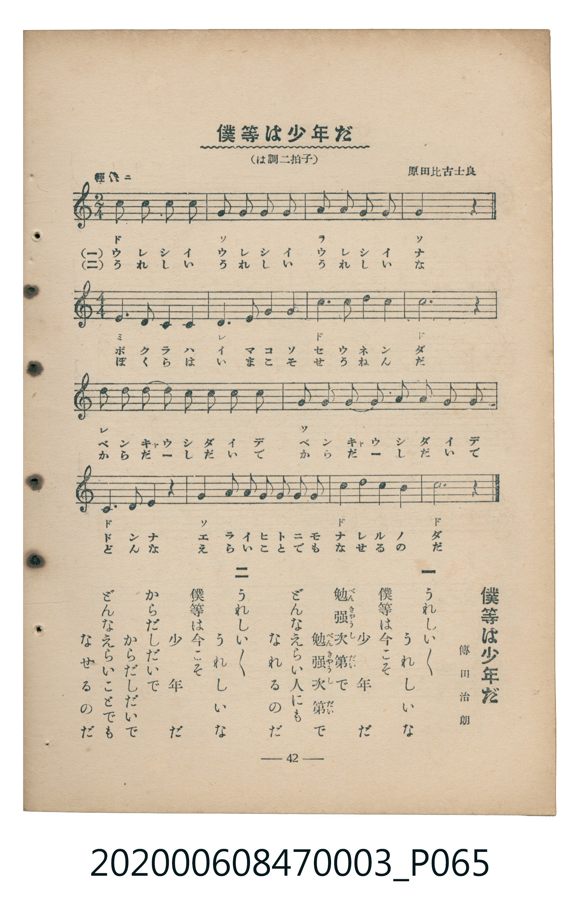

# 僕等は少年だ

> Re:Shōka 使用 AI 協助辨識與重建樂譜，可能會有錯誤。歡迎回報。

<audio controls src="bokura_wa_shonen_da.mp3"></audio>

- 詞：傳田治朗
- 曲：原田比古士良
- 臺灣教育會公認《新定兒童唱歌》尋常科第三學年用（2020.006.0847.0003）

## 說明

原書資訊與歌詞全文（對應 P065.jpg，書頁 p. 42，補充教材第 6 首）：
調性與拍號：は調二拍子（C 大調，前 4 小節 2/4 拍，第 5 小節起轉 4/4 拍），輕快ニ

## 歌詞

```text
一
うれしい〳〵　うれしいな
僕等は今こそ　少年だ
勉強次第で　勉強次第で
どんなえらい人にも　なれるのだ

二
うれしい〳〵　うれしいな
僕等は今こそ　少年だ
からだ次第で　からだ次第で
どんなえらいことでも　なせるのだ
```

## ABC

```abc
X:1
T:僕等は少年だ
C:曲：原田比古士良
M:2/4
L:1/16
Q:1/4=108
K:C
V:V1 name="Piano" snm="Pia"
[V:V1]
c2 c2 c2 c2 | G2 G2 G2 G2 | A2 A2 G2 G2 | G4 z4 |
w: 1.~ウ レ シ イ | ウ レ シ イ | ウ レ シ イ | ナ
w: 2.~う れ し い | う れ し い | う れ し い | な
[M:4/4] E6 D2 C4 C4 | D6 E2 G4 G4 | c6 c2 d4 c4 | c12 z4 |
w: 1.~ボ ク ラ ハ | イ マ コ ソ | セ ウ ネ ン | ダ
w: 2.~ぼ く ら は | い ま こ そ | せ う ね ん | だ
d2 d2 d2 d2 c2 c2 c2 c2 | G2 G2 G2 G2 A2 A2 G2 G2 | C6 D2 E4 z4 | G4 A2 A2 G2 G2 G2 G2 |
w: 1.~ベ ン キャ ウ シ ダ イ デ | ベ ン キャ ウ シ ダ イ デ | ド ン ナ | エ ラ イ ヒ ト ニ モ
w: 2.~か ら だ _ し だ い で | か ら だ _ し だ い で | ど ん な | え ら い こ と で も
c4 d4 c4 B4 | c12 z4 |
w: 1.~ナ レ ル ノ | ダ
w: 2.~な せ る の | だ
```

## TMD 檔案連結

- [主旋律 TMD 檔案](bokura_wa_shonen_da.tmd) [[在 TMD Studio 編輯](https://tmdlang.github.io/Tmd-TS/#tmd=s7IKdvYPcrWy4qpTUCpJTLdSSM7PyUlNLsnMz7MqzsjMK0nNjM_KTMmPL87Iz05Ugisry88pzU21Si9KTEmNN443MjAyiDcwMIs3sDAxBzIMjBFKi_NLi5JTrYqTM_Lzc-JLUitKkvLzsxHyBUX5Zal5iXlANQVFIBtTwIoQClLLMlNSQdKpKZkl-UWZiTlI7kgtKga7FWxJfElRYl5xclFmAcgDCFUlGalAx0JcoMSlpaXwtHnq87WdjxvXP90w8enOLY8bFyhoaXEp2ioYGlhw2dsqOHPZGOmb2IEMeLFy3vs9s542bX4-ZcOzTbufzZkONvfZ7E0g4b75IOH1U572L3m6ePWLzvVgyRftu543Ln42deaLpk3P5jQ_bV3zYlXv44auZ9M2PF0362nrpOerlz6dsvHZ2p7HDd1PN3Q_3bHj-fKJz9esebKj8-naHUAXPZ-y4v2eDlCw6gGDVQ8UrECGgfH7PZ1KXFz6Wgq21AJcCgoKQG88m73jxeb2Fyu6XnS0A90F9PXT1hXPprUDXfF0Q--z9k6FAAMzU72sgvT3e3qAil8uaFQo0FMwMQJyXyye87S1FejdZ3MnAD2hYKbwctk0oEuBAQQy_cWq_c8aloPM7e59MXM-UBQY8EDBJ7t6gCJP104A2uGs8HTJcqAY0LSnnb0KJgpPN_Q_X9-gAIwFBaAioDDIYFOo8Iut21_s7VQwgUkCbep5sWfq0_2rHzd3c4HsfLKjAUQ9bmx73NTzuHH648aWxw2bHzdsfdzQgCLYuAocALD08GR31-PGyY8b5wLVwdMGWEV359M925-tWQh0x-PG5SBpVBGIdSsfNwF1r3rc2PG4CWhey5Ndux43rn7c1AS2dxXI3qbux43rQKaC3bmrh7rufNzYDbZ5AbJTMQWxuxZs5AqQHriDG2cjHAzUQ3l6gwIFLX0uLqf87NKiRKuAzMS8fIcag5pqkBUKNhZadmAGMJkHVxaXpOYqGCpo5OoZ6progBKEppXC46Zlj5vXPG7a_rhpCT5OcxfIHpBZNQqGcQhUA0xKEFgDTK1mUJapgq6CARDXgHX4GNaATAMasgZIbwfiJUA1RIkArdVViEeYZAQUa2wDyvYA6elA3AJSRZTIKhSTECFiBAoRU10LHVAuAIVI85zHTesfN6983NwPcsbj5nmPmzY_btoL5OwGB0rv4-bNQGUNsBCptgHqtKuFho4x0A5doKmGQBKEa4BskIgxOFRAGByCICEgZQRigblwUQhEC77mOWBRoMuA7JUgFtB1IE2ggALLNM8DsjeD1eyFyuyG6gEFay9YDUgeZFoDkk3owbsHoqsR5PtOMGs9RBcwICEy-4B4Mpg1FyozGyoDDPbGtWA7QfIgmQVYbUIEvzEo-C11DQ0Q4T8T6M7HTWsfNy8GBTcwATY3gOOhHa8cPHkCgxSOsCdVeEJFCt-Z4NCBGA0JMlAqBAYUJPm3g4ONsCKkcOwGhx8kBCAJcQE4DIGlAjhk8MqjhZIJONsa6hoCMy4smDpBQQHMII-bVoBSKygUJj1u7gAW3I-bF4GyDij7NgML8j7kxApMZtAECkqo4FQGTpSwMIFkYHBSRKRNc8LpE5RSICkMKdOC3AYWXQkNoUlA3AHEQL8D3QjL4KBMDyJXg8k-ItIoKAdAUhlSxgayO8CioFAFhSNIdgU4PIHFMLwQgKRWYGEMZq_DmU5rubh07RQgJasCkKXMBQA)]
- [鋼琴伴奏 TMD 檔案](bokura_wa_shonen_da_piano.tmd) [[在 TMD Studio 編輯](https://tmdlang.github.io/Tmd-TS/#tmd=s7IKdvYPcrWy4tLSUnjaPPX52s7Hjeufbpj4dOeWx40L3u_peNm95_mELU_2bHm6tP95Z8f7PZ0KWlpcirYKhgYWXPa2Cs5cNkb6JnZcdQpKL1bOe79n1tOmzc-nbHi2afezOdOVQMLPZm8CCffNBwmvn_K0f8nTxatfdK4HS75o3_W8cfGzqTNfNG16Nqf5aeuaF6t6Hzd0PZu24em6WU9bJz1fvfTplI3P1vY8buh-uqH76Y4dz5dPfL5mzZMdnU_X7gA68_mUFUBnGhkYGegZGJjpGViYmAMZBsZAlypxcTnlZ5cWJVoFZCbm5Qd5ONQY1FRzKQCBjYWWHZihr6UQXFlckpqrYKigkatnqGuiowD0kKaVwuOmZY-b1zxu2v64aQk-TnOXgpY-2KwaBcM4BKpRMIXCGgUzIISwTBV0FQyAuAasw8ewBmQa0JA1QHo7EC8BqiFKBGitrkI8wiQjoFhjG1C2B0hPB-IWkCqiRFahmIQIESNQiJjqWugomEBCpHnO46b1j5tXPm7uBznjcfO8x02bHzftBXJ2gwOl93HzZqCyBliIVNsAddrVQkPHGGiHLtBUQyAJwjVANkjEGBwqIAwOQZAQkDICscBcuCgEogVf8xywKNBlQPZKEAvoOpAmUECBZZrnAdmbwWr2QmV2Q_WAgrUXrAYkDzKtAckm9ODdA9HVCPJ9J5i1HqILGJAQmX1APBnMmguVmQ2VAQZ741qwnSB5kMwCrDYhgt8YFPyWuoYGiPCfCXTn46a1j5sXg4IbmACbG8Dx0I5XDp48gUEKR9iTKjyhIoXvTHDoQIyGBBkoFQIDCpL828HBRlgRUjh2g8MPEgKQhLgAHIaPG5eDQwavPFoomYCzraGuITDjwoKpExQUwAzyuGkFKLWCQmHS4-aOx83dj5sXgbIOKPs2r37c3IecWIHJDJpAQQkVnMrAiRIWJpAMDE6KiLRpTjh9glIKJIUhZVqQ28CiK6EhNAmIO4AY6HegG2EZHJTpQeRqMNlHRBoF5QBIKkPK2EB2B1gUFKqgcATJrgCH5-OmJnghAEmtj5u6wex1ONNpLWrB6oNcsJoQKFiRQjteIdowFplhEg9kmcSDmKZApgGBEgl7KQM1DWQAxFQwyxRoqhGMgUURSAAkBaQxrUXLiQgvwI1G9wvYJyABAqkVNTQQDgBzQSGBYjBIAG4lhpuBsaJrpwCJmGgfoCYknhGYp8wFAA)]

## 分析

```text
================================================================================
📊 TMD Song Profile: [ 僕等は少年だ ]
================================================================================
⏱  Duration:       0:26 (26.7s), 14 measures total
🎼 Key & Tempo:    首調基準 C, != 108.0 BPM, <2/4>
   - 分析範圍：      由實際發聲的音符與和弦推測調性；播放脈絡另行呈現
🎤 人聲音域:    C4 (MIDI 60) – D5 (MIDI 74) [跨度: 14 個半音 / 1.2 個八度, 難度: moderate]
   - 最低音:  C4 in [Bokura #1 @ m.5, 0:05]
   - 最高音: D5 in [Bokura #1 @ m.7, 0:10]
   - 適合: soprano, mezzo-soprano, contralto, tenor, baritone, bass
🏛  結構:      Bokura (26.7s)
⚡ 編曲密度:        Peak 1 軌道同時演奏
🗝  調性診斷：       C 大調（純淨自然大調，未偵測到可信轉調）
   - 風格氣質:    純淨自然大調（陽光明朗、易唱易記，無明顯調外色彩）
   - 轉調歷程:    全曲維持單一推測調性（未偵測到可信轉調）
   - 核心骨幹音:  C, G, D, E, A
   - 調性數值:    C 大調 [相關度: 0.89, 穩定度: High, 自然音純度: 100.0%]
   - 候選調性 (K-S): C 大調 (0.89), G 大調 (0.68), C 小調 (0.67)
   - 五度圈歷程:   +0
   - 各段落調性細節:
     • [Bokura #1]: C 大調 (r: 0.89, 自然音純度: 100.0%)

  [ 五度圈游移軌跡 ]
              [C ]*
         F            G  
      Bb               D  
      Eb               A  
         Ab           E  
            Db       B  
               F# 
     (* = active key center)

  [ 十二半音累積音高分佈 ]
     C  : ████████████████████████  42.0%
     C# :                            0.0%
     D  : ████████                  14.8%
     D# :                            0.0%
     E  : ████                       6.8%
     F  :                            0.0%
     F# :                            0.0%
     G  : ████████████████          27.3%
     G# :                            0.0%
     A  : ████                       6.8%
     A# :                            0.0%
     B  : █                          2.3%
--------------------------------------------------------------------------------
Assignment 軌道音域：
  - Piano         : C4 – D5 (14 個半音 / 1.2 個八度, 57 個音符)
================================================================================
```


## 原書掃描頁




