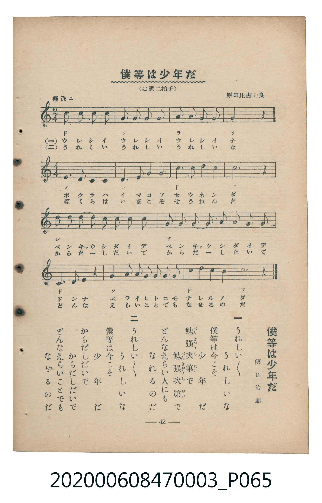

# 僕等は少年だ

<audio controls src="bokura_wa_shonen_da.mp3"></audio>

- 詞：傳田治朗
- 曲：原田比古士良
- 臺灣教育會公認《新定兒童唱歌》尋常科第三學年用（2020.006.0847.0003）

## 說明

原書資訊與歌詞全文（對應 P065.jpg，書頁 p. 42，補充教材第 6 首）：
調性與拍號：は調二拍子・四拍子（C 大調 2/4 轉 4/4 拍），♩=112

## 歌詞

```text
一
一二三四　五六七八　二二三四　五六
僕等は少年だ　進まうよ元氣で
風風吹け吹け　浪浪たてたて
進まう　なんでもこいこい　僕等は少年だ

二
一二三四　五六七八　二二三四　五六
僕等は少年だ　のぼらうよ元氣で
山山たかいぞ　坂坂けはしい
のぼらう　なんでもこいこい　僕等は少年だ
```

## ABC

```abc
X:1
T:僕等は少年だ
C:曲：原田比古士良
M:2/4
L:1/16
Q:1/4=112
K:C
V:V1 name="Piano" snm="Pia"
[V:V1]
c2 B2 A2 G2 | G2 F2 E2 D2 | A2 G2 F2 E2 | G4 z4 |
[M:4/4] E6 D2 C4 C4 | D6 E2 F4 G4 | c6 c2 B4 B4 | c12 z4 |
D2 D2 D2 D2 E4 D4 | C4 D4 E6 z2 | G2 G2 G2 G2 A4 G4 | F4 E4 D6 z2 |
C4 C4 D4 z4 | G2 G2 G2 G2 G2 G2 G2 G2 | c6 c2 d4 B4 | c12 z4 |
```

## TMD 檔案連結

- [主旋律 TMD 檔案](bokura_wa_shonen_da.tmd)
- [鋼琴伴奏 TMD 檔案](bokura_wa_shonen_da_piano.tmd)

## 分析

```text
================================================================================
📊 TMD Song Profile: [ 僕等は少年だ ]
================================================================================
⏱  Duration:       0:30 (30.0s), 16 measures total
🎼 Key & Tempo:    首調基準 C, != 112.0 BPM, <2/4>
   - 分析範圍：      由實際發聲的音符與和弦推測調性；播放脈絡另行呈現
🎤 人聲音域:    C4 (MIDI 60) – D5 (MIDI 74) [跨度: 14 個半音 / 1.2 個八度, 難度: moderate]
   - 最低音:  C4 in [BokuraWaShonenDa #1 @ m.5, 0:05]
   - 最高音: D5 in [BokuraWaShonenDa #1 @ m.15, 0:26]
   - 適合: soprano, mezzo-soprano, contralto, tenor, baritone, bass
🏛  結構:      BokuraWaShonenDa (30.0s)
⚡ 編曲密度:        Peak 1 軌道同時演奏
🗝  調性診斷：       C 大調（純淨自然大調，未偵測到可信轉調）
   - 風格氣質:    純淨自然大調（陽光明朗、易唱易記，無明顯調外色彩）
   - 轉調歷程:    全曲維持單一推測調性（未偵測到可信轉調）
   - 核心骨幹音:  C, G, D, E, B
   - 調性數值:    C 大調 [相關度: 0.90, 穩定度: High, 自然音純度: 100.0%]
   - 候選調性 (K-S): C 大調 (0.90), G 大調 (0.75), C 小調 (0.55)
   - 五度圈歷程:   +0
   - 各段落調性細節:
     • [BokuraWaShonenDa #1]: C 大調 (r: 0.90, 自然音純度: 100.0%)

  [ 五度圈游移軌跡 ]
              [C ]*
         F            G  
      Bb               D  
      Eb               A  
         Ab           E  
            Db       B  
               F# 
     (* = active key center)

  [ 十二半音累積音高分佈 ]
     C  : ████████████████████████  30.4%
     C# :                            0.0%
     D  : ███████████████           19.6%
     D# :                            0.0%
     E  : ██████████                12.7%
     F  : █████                      5.9%
     F# :                            0.0%
     G  : ████████████████          20.6%
     G# :                            0.0%
     A  : ███                        3.9%
     A# :                            0.0%
     B  : █████                      6.9%
--------------------------------------------------------------------------------
Assignment 軌道音域：
  - Piano         : C4 – D5 (14 個半音 / 1.2 個八度, 60 個音符)
================================================================================
```


## 原書掃描頁




