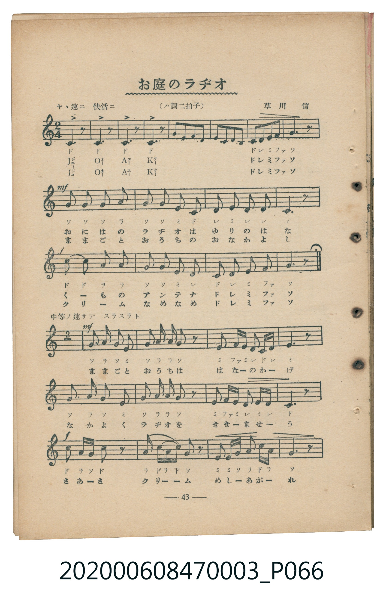
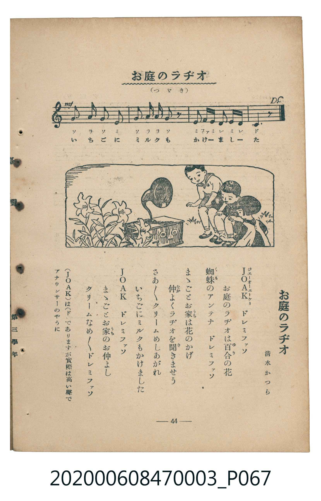

# お庭のラヂオ

> Re:Shōka 使用 AI 協助辨識與重建樂譜，可能會有錯誤。歡迎回報。

<audio controls src="oniwa_no_rajio.mp3"></audio>

- 詞：清水かつら
- 曲：草川信
- 臺灣教育會公認《新定兒童唱歌》尋常科第三學年用（2020.006.0847.0003）

## 說明

原書資訊與歌詞全文（對應 P066.jpg–P067.jpg，書頁 pp. 43–44，補充教材第 7 首）：
調性與拍號：は調二拍子（C 大調 2/4 拍），ヤヽ速ニ 快活ニ ♩=116 / 中等ノ速サデ スラスラト ♩=100
原書附註：（ＪＯＡＫ）は（ド）でありますが實際は高い聲でアナウンサーのやうに

## 歌詞

```text
ＪＯＡＫ　ドレミファソ
お庭のラヂオは百合の花
蜘蛛のアンテナ　ドレミファソ
まゝごとお家は花のかげ
仲よくラヂオを聞きませう
さあ〳〵クリームめしあがれ
いちごにミルクもかけました
ＪＯＡＫ　ドレミファソ
まゝごとお家のお仲よし
クリームなめ〳〵　ドレミファソ
```

## ABC

```abc
X:1
T:お庭のラヂオ
C:曲：草川信
M:2/4
L:1/16
Q:1/4=116
K:C
V:V1 name="Piano" snm="Pia"
[V:V1]
[Q:1/4=116] C6 z2 | C6 z2 | C6 z2 | C6 z2 |
w: 1.~ジェー | オー | エー | ケー
w: 2.~ジェー | オー | エー | ケー
G2 E2 F2 D2 | E2 C2 D2 B,2 | C2 D2 E2 F2 | G6 z2 |
w: 1.~_ _ _ _ | _ _ _ _ | ド レ ミ ファ | ソ
w: 2.~_ _ _ _ | _ _ _ _ | ド レ ミ ファ | ソ
!mf! G2 G2 G2 A2 | G2 G2 E2 C2 | D2 E2 D2 D2 | C6 z2 |
w: 1.~お に は の | ラ ヂ オ は | ゆ り の は | な
w: 2.~ま ま ご と | お う ち の | お な か よ | し
!f! c2 c2 A2 A2 | G2 G2 E2 D2 | C2 D2 E2 F2 | G6 z2 |
w: 1.~く _ も の | ア ン テ ナ | ド レ ミ ファ | ソ
w: 2.~ク リ _ ム | な め な め | ド レ ミ ファ | ソ
[Q:1/4=100] !mf! G3 A G2 E2 | G2 A A G2 z2 | E2 F E D2 C D | E6 z2 |
w: ま ま ご と | お う ち は | は な _ の か _ | げ
G3 A G2 E2 | G2 A A G2 z2 | E2 F E D2 E D | C6 z2 |
w: な か よ く | ラ ヂ オ を | き き _ ま せ _ | う
!f! c2 A G c2 z2 | A c A c G2 z2 | E2 E G A2 c A | G6 z2 |
w: さ あ _ さ | ク リ _ _ ム | め し _ あ が _ | れ
!mf! G3 A G2 E2 | G2 A A G2 z2 | E2 F E D2 E D | C6 z2 |
w: い ち ご に | ミ ル ク も | か け _ ま し _ | た
```

## TMD 檔案連結

- [主旋律 TMD 檔案](oniwa_no_rajio.tmd) [[在 TMD Studio 編輯](https://tmdlang.github.io/Tmd-TS/#tmd=s7IKdvYPcrWy4qpTUCpJTLdSSM7PyUlNLsnMz7MqzsjMK0nNjM_KTMmPL87Iz05Ugisry88pzU21Si9KTEmNN443MjAyiDcwMIs3sDAxBzIMjBFKi_NLi5JTrYqTM_Lzc-JLUitKkvLzsxHyBUX5Zal5iXlANQVFIBtTwIoQClLLMlNSQdKpKZkl-UWZiTlI7kgtKga7FWxJfElRYl5xclFmAcgDCFUlGalAx5akJmfk5efkp1eiy-SWFmcmK3FpaSk8bux6umvt48Z1j5tXPm5uety0SkFLi0vRVsHQ0IzL3lbBmcvGSN_EDqT_xcp57_fMeraj9dmGLY8bux83Lnnc1Ak2-dnsTUCZF72dT7fPfbJ_IVjsRfuu542Ln02d-aJp07M5zU9b17xY1fu4oevZtA1P18162jrp-eqlT6dsfLa253FD99MN3U937Hi-fOLzNWue7Oh8unbH051bnk9Z8X5PByik9YAhrQcKaSDDwPj9HqCtXPpaCrbUAlwKCgpP--Y_m73jxeb2Fyu6XnS0A90F9O_T1hXPprUDXfF0Q--z9k6FAAMzM72sgvRHDZOBTHMQ8_2eHqC-lwsaFQoK9BRMjIFSJiZAwReL5zxtbQX6_9ncCUBfKZgrvFw2Deh0YECBrHuxav-zhuUgi7p7X8ycDxR93LgeKPhkVw9Q5OnaCUBLnRWeLlkOFFMAxoACUBSsu-dx85LHzXtfNsx_3Nyt8HT_6mdbdoNYj2autAXGmYK-wpMda5-v7Xzc3AdS07T1cXO7wuOmnaD4hZDNHRDFBgYIf7-c2fJixW6gK4DWvt-z6v2e9e_3LHy_ZzXQSqC7gIKPm4F2A9nLHzcCE0nX48Z9jxtnPm7sebp-2ctZs4FqXq6e8bix5UXjJpCapkWPm7seNy173LwZ7II9oATW1PK4se1x42oukLXIljxuaAAa_7h5zeNmoKemPm5a-LhpL0gRZuIEWvR85r6nEzqAgi-6NoJDcs6MF7OBLgBaALR18-PmNpDduI3c97hp7uPGKY8bV4CMX7cNFO5dG0H6QWl6EkjRk92bHjcBrehH2Ns06UXjvMeNvWCPA21rgxg2FRQcDZsfN2x93LT-cfMqkFebFzxuanzcOB0k1djzuKkHohTo-4Vge1eD3bQapKEJqAJo6USwqUAN80kIGkx_AH3QBXP6dLAiZDc1Aj3RCHUrLlMpz0pQoKClz8UVkFhU4mgVkJmYl-9QY1BTDbJBwcZCyw7MqFYEpddaMBuYmYMri0tScxUMFTRy9Qx1LTStFLwU_BUcFbwVNF5Om_x0ab-mApqbgd7bC7IHZEANUKMuEBoQZJkqGCuYKBgBWcZAUSMF83iwtBFYGCQNVQg21sewBmjLjsdNy4GBCJYBqQalBxTuClTuRmRuPBQis4AeAeI1QDwfiMF-AenbC9MEsdto4OxGxIcRKD4sdQ2NgBECTF6g1Nu4Hi1HArW3gcsEYAIEyq0ClkHgBA1E0OQJzvjA1L8OYgZQUzcklSLirzo3rRYY-iBoBo4HUEQZAlmgmDECRxg8EhFx09gFxKuBGOgIoOkg760E4iZQOIFFQX5rA2KQOpDtYBGgEzFCunEfFE8B4hVgVSA9QL2NwJQGMRssAjK3G2hiB1hkOo5wMwanY2NdQzNwwAFLkj3g3I5SSqGnaFA0AMMOM9eCSWyqNdwy81I1kUIRGIiGcSBkhhSMkMDDk8Qb-4EiQPfBPNq0CGjZZiAGeh_oTJJSLDAmmkHhC3Q9NKzBbofSRBhVCyk5nDBKDkMzpKLDwAC96DABB7m5rpEBOMixJkBQMgElUWiVBEyGIMYkjGQIcosZmDYGYkiYgUIURBuARUDiJuCw1QWHLUQEBsFqIIECSVsgQVj6ArFWgA0BpSgQD5bK1oODACIDYkNSKihSQGQ3VGYSkkVg1WgBYQoKCCNDXSMTcEDAcxtKdQaUAFZmvWD_g6s0EKMNERCkhgEsleEMA0ieg-UdEAuU6CA5FpRaoHkW6DJEGPSC1UFIUBgC3QmVaSMQBmbgMDDVNQLVJNB6GuRDYHpD5C5QigTVuyAJcF0NyqQ9GLkJEgxgBsTfZpAMBiRQw8IYXHgB0wNIFhaEWANjKtgzTWASxIZ6GJ55INkHId4IVgkqbGC6eqAyIBpfQJiDA8JS1xhSgmNvhYCiBdQMgSYGSIjMV9Bw0XPWQy5dyMkcBBNGCzRhgDIAJHOshiaM-eBwABbvoHABuhKRMEBZAehgpIQBChuQDEgPangAyxNdOwVwY0QBynACMZS5AA)]
- [鋼琴伴奏 TMD 檔案](oniwa_no_rajio_piano.tmd) [[在 TMD Studio 編輯](https://tmdlang.github.io/Tmd-TS/#tmd=s7IKdvYPcrWy4tLSUnjc2PV019rHjeseN6983Nz0uGnV-z0dL7v3PJ-w5cmeLU-X9j_v7Hi_p1NBS4tL0VbB0NCMy95WwZnLxkjfxI6rTkHpxcp57_fMeraj9dmGLY8bux83Lnnc1KkEknk2exNQ5kVv59Ptc5_sXwgWe9G-63nj4mdTZ75o2vRsTvPT1jUvVvU-buh6Nm3D03WznrZOer566dMpG5-t7Xnc0P10Q_fTHTueL5_4fM2aJzs6n67d8XTnludTVgAdaGRgZKBnYGCmZ2BhYg5kGBgD3ajExRWQWFTiaBWQmZiXH-ThUGNQU82lAAQ2Flp2YEa1oi3QC7Vgtr6WQnBlcUlqroKhgkaunqGuhaaVgpeCv4KjgreCxstpk4Ge11R43Nz5uHnN4-b5j5unPm5aqPC4aa-Clj7YgBqgRl0gNCDIMlUwVjBRMAKyjIGiRgrm8WBpI7AwSBqqEGysj2EN0JYdj5uWP27eA5YBqQZGDCp3BSp3IzI3HgqRWUCPAPEaIJ4PxGC_gPTthWmC2G00cHYj4sMIFB-WuoZGwAgBps_HjasfN65HTqJALlB72-MmoNw6sNwqBX2g0n1gNOVx4wqwtrbHjQuBCiBmADV1P27qeNw4HRF_1blptcDQB0EzcDyAIsoQyALFjBE4wuCRiIibxi4gXg3EQEcATQd5byUQN4HCCSwK8lsbEIPUgWwHiwCdiBHSjfugeAoQrwCrAukB6m0EpjSI2WARkLndQBM7wCLTcYSbMTgdG-samoEDrh8YLY-bmkBB1LTocfPmx81tj5uBpqGmaFA0AMOuaf3jZlAsP25eAAqrpkYIiU21hltmXqomUigCA9EwDoTMkIIREnh4knhjP1AE6D6YR5sWAS3bDMRA7wOdSVKKBcZEMyh8ga6HhjXY7VCaCKNqUcoOHzLKDqRSIR7oUdN4bUNtY0g5QDofyjONBzPN47XBoUlQ3AwobgZigoMcSRGMhkUAtryG4gGogSbIBiKEESx0a7C7yxBIYbEbKb0iLEeyEoftuGwxIsb30Ih2wlJJGJohxbSBAXpMm4Bda65rZADOXVjLGlCJACqNQBkJVDJ1gxmTMEocULIzA9PGQAzJHqDMA6INwCIgcRNwNtIFZyOICAyC1UDSP6QYAQnCihIQawXYEFDhAeLBCpT14NQOkQGxIYUSKP-ByG6ozCQki8Cq0QLCFBQQRoa6RibggIAXrMDyBlY-N00CSvSCEMj_wHCaDWa0IQKC1DCAFSg4wwBSvMKKSRALVL5ACmdQwQAtnoEuQ4RBL1gdhASFIdCdUJk2AmFgBg4DU10jUKPhcePUx41NYB8CixZEQQoqfIClNVgCWAz3gMvjHoyCExIMYAbE32aQshRIoIYFMOkDhYHpASQLC0KsgTEV7JkmMAliQz0MLychJSVCvBGsElSvwHT1QGVANL6AMAcHhKWuMaSybgFnA2CuWA2uMlaDggNcxANbhhNhiQESIvMVNFz0nPWQKxJyMgfBhNECTRigDADJHKuhCWM-OByANTkoXICuRCQMUFYAOhgpYYDCBiQD0oMaHqglCs6qA2-Bgq3sRS5kcZTI0EIOX6EILHpBLCylL1I2pqn12OxGyj5YS35ky3EI43cTgVoPKdXSwe_AFKJrpwBuX0T7GMYqQDlOMAZQ1AgsqswFAA)]

## 分析

```text
================================================================================
📊 TMD Song Profile: [ お庭のラヂオ ]
================================================================================
⏱  Duration:       0:35 (35.8s), 32 measures total
🎼 Key & Tempo:    首調基準 C, != 116.0 BPM, <2/4>
   - 分析範圍：      由實際發聲的音符與和弦推測調性；播放脈絡另行呈現
🎤 人聲音域:    B3 (MIDI 59) – C5 (MIDI 72) [跨度: 13 個半音 / 1.1 個八度, 難度: moderate]
   - 最低音:  B3 in [PartA #1 @ m.6, 0:05]
   - 最高音: C5 in [PartA #1 @ m.13, 0:12]
   - 適合: soprano, mezzo-soprano, contralto, tenor, baritone, bass
🏛  結構:      PartA (16.6s) -> PartB (19.2s)
⚡ 編曲密度:        Peak 1 軌道同時演奏
🗝  調性診斷：       C 大調（純淨自然大調，未偵測到可信轉調）
   - 風格氣質:    純淨自然大調（陽光明朗、易唱易記，無明顯調外色彩）
   - 轉調歷程:    全曲維持單一推測調性（未偵測到可信轉調）
   - 核心骨幹音:  G, C, E, D, A
   - 調性數值:    C 大調 [相關度: 0.93, 穩定度: High, 自然音純度: 100.0%]
   - 候選調性 (K-S): C 大調 (0.93), G 大調 (0.74), E 小調 (0.64)
   - 五度圈歷程:   +0 -> +0
   - 各段落調性細節:
     • [PartA #1]: C 大調 (r: 0.94, 自然音純度: 100.0%)
     • [PartB #1]: C 大調 (r: 0.81, 自然音純度: 100.0%)

  [ 五度圈游移軌跡 ]
              [C ]*
         F            G  
      Bb               D  
      Eb               A  
         Ab           E  
            Db       B  
               F# 
     (* = active key center)

  [ 十二半音累積音高分佈 ]
     C  : ███████████████████████   27.7%
     C# :                            0.0%
     D  : █████████                 11.2%
     D# :                            0.0%
     E  : ███████████████           17.9%
     F  : ███                        4.0%
     F# :                            0.0%
     G  : ████████████████████████  29.0%
     G# :                            0.0%
     A  : ████████                   9.4%
     A# :                            0.0%
     B  : █                          0.9%
--------------------------------------------------------------------------------
Assignment 軌道音域：
  - Piano         : B3 – C5 (13 個半音 / 1.1 個八度, 104 個音符)
================================================================================
```


## 原書掃描頁






