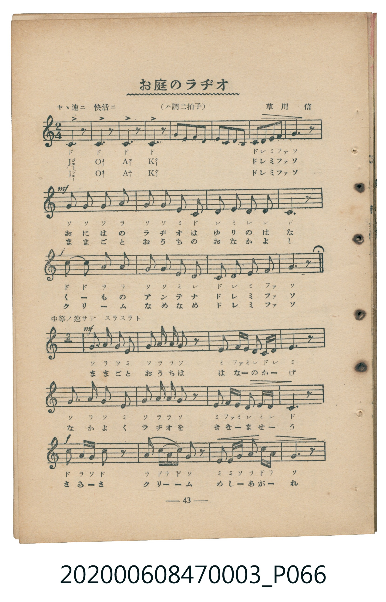
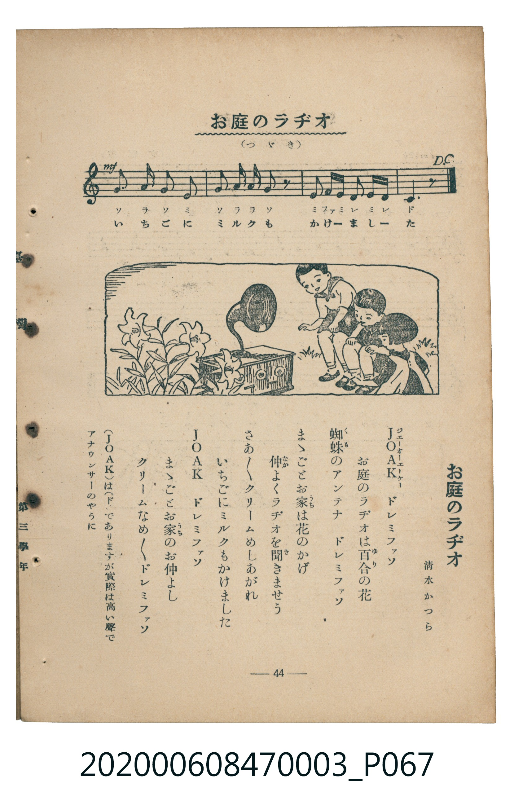

# お庭のラヂオ

> Re:Shōka 使用 AI 協助辨識與重建樂譜，可能會有錯誤。歡迎回報。

- **鋼琴伴奏版**：<br><audio controls src="oniwa_no_rajio.mp3"></audio>
- **NEUTRINO 歌聲合成版**：<br><audio controls src="oniwa_no_rajio_neutrino.mp3"></audio>

- 詞：清水かつら
- 曲：草川信
- 臺灣教育會公認《新定兒童唱歌》尋常科第三學年用（2020.006.0847.0003）

## 說明

原書資訊與歌詞全文（對應 P066.jpg–P067.jpg，書頁 pp. 43–44，補充教材第 7 首）：
調性與拍號：は調二拍子（C 大調 2/4 拍），ヤヽ速ニ 快活ニ ♩=116 / 中等ノ速サデ スラスラト ♩=100
原書附註：（ＪＯＡＫ）は（ド）でありますが實際は高い聲でアナウンサーのやうに


## 歌詞

```text
ＪＯＡＫ　ドレミファソ
お庭のラヂオは百合の花
蜘蛛のアンテナ　ドレミファソ
まゝごとお家は花のかげ
仲よくラヂオを聞きませう
さあ〳〵クリームめしあがれ
いちごにミルクもかけました
ＪＯＡＫ　ドレミファソ
まゝごとお家のお仲よし
クリームなめ〳〵　ドレミファソ
```

## ABC

<div class="abc-score" data-abc-src="oniwa_no_rajio.abc" aria-label="五線譜載入中"></div>

[下載 ABC 原始檔](oniwa_no_rajio.abc)

## TMD 檔案連結

- [主旋律 TMD 檔案](oniwa_no_rajio.tmd) [[在 TMD Studio 編輯](https://tmdlang.github.io/Tmd-TS/#tmd=s7IKdvYPcrWy4qpTUCpJTLdSSM7PyUlNLsnMz7MqzsjMK0nNjM_KTMmPL87Iz05Ugisry88pzU21Si9KTEmNN443MjAyiDcwMIs3sDAxBzIMjBFKi_NLi5JTrYqTM_Lzc-JLUitKkvLzsxHyBUX5Zal5iXlANQVFIBtTwIoQClLLMlNSQdKpKZkl-UWZiTlI7kgtKga7FWxJfElRYl5xclFmAcgDCFUlGalAx5akJmfk5efkp1eiy-SWFmcmIwSBdqRn5lmVJGYCfQ3yeXlifG5iZl5OYl4KsqqSjHxgABRkVFplZBaDXJacmBOfnZiHFE5QdxUkpqdaBRiYmekCCXMlLi0thceNXU93rX3cuO5x88rHzU2Pm1YpaGlxKdoqGBqacdnbKjhz2Rjpm9iBTHqxct77PbOe7Wh9tmHL48bux41LHjd1gu14NnsTUOZFb-fT7XOf7F8IFnvRvut54-JnU2e-aNr0bE7z09Y1L1b1Pm7oejZtw9N1s562Tnq-eunTKRufre153ND9dEP30x07ni-f-HzNmic7Op-u3fF055bnU1a839MBilM9YJzqgeIUyDAwfr8HaCuXvpaCLbUAl4KCwtO--c9m73ixuf3Fiq4XHe1AdwH9-7R1xbNp7UBXPN3Q-6y9UwEUdnpZBemPGiaDQhDEfL-nB6jv5YJGhYICPQUTY6CUiQlQ8MXiOU9bW4H-fzZ3AtBXCuYKL5dNAzodGFAg616s2v-sYTnIou7eFzPnA0UfN64HCj7Z1QMUebp2AtBSZ4WnS5YDxRSAMaAAFAXr7nncvORx896XDfMfN3crPN2_-tmW3SDWo5krbYFxpqCv8GTH2udrOx8394HUNG193Nyu8LhpJyh-IWRzB0SxgQHC3y9ntrxYsRvoCqC17_eser9n_fs9C9_vWQ20EuguoODjZqDdQPbyx43ARNL1uHHf48aZjxt7nq5f9nLWbKCal6tnPG5sedG4CaSmadHj5q7HTcseN28Gu2APKIE1tTxubHvcuJoLZC2yJY8bGoDGP25e87gZ6Kmpj5sWPm7aC1KEmTiBFj2fue_phA6g4IuujeCQnDPjxWygC4AWAG3d_Li5DWQ3biP3PW6a-7hxyuPGFSDj120DhXvXRpB-UJqeBFL0ZPemx01AK_oR9jZNetE473FjL9jjQNvaIIZNBQVHw-bHDVsfN61_3LwK5NXmBY-bGh83TgdJNfY8buqBKAX6fiHY3tVgN60GaWgCqgBaOhFsKlDDfBKCBtMfQB90wZw-HawI2U2NQE80Qt2Ky1TKsxIUKGjpc3EFJBaVOFoFZCbm5TvUGNRUg2xQsLHQsgMzqhVB6bUWzAZm5uDK4pLUXAVDBY1cPUNdC00rBS8FfwVHBW8FjZfTJj9d2q-pgOZmoPf2guwBGVAD1KgLhAYEWaYKxgomCkZAljFQ1EjBPB4sbQQWBklDFYKN9TGsAdqy43HTcmAggmVAqkHpAYW7ApW7EZkbD4XILKBHgHgNEM8HYrBfQPr2wjRB7DYaOLsR8WEEig9LXUMjYIQAkxco9TauR8uRQO1t4DIBmACBcquAZRA4QQMRNHmCMz4w9a-DmAHU1A1JpYj4q85NqwWGPgiageMBFFGGQBYoZozAEQaPRETcNHYB8WogBjoCaDrIeyuBuAkUTmBRkN_agBikDmQ7WAToRIyQbtwHxVOAeAVYFUgPUG8jMKVBzAaLgMztBprYARaZjiPcjMHp2FjX0AwccMCSZA84t6OUUugpGhQNwLDDzLVgEptqDbfMvFRNpFAEBqJhHAiZIQUjJPDwJPHGfqAI0H0wjzYtAlq2GYiB3gc6k6QUC4yJZlD4Al0PDWuw26E0EUbVQkoOJ4ySw9AMqegwMEAvOkzAQW6ua2QADnKsCRCUTEBJFFolAZMhiDEJIxmC3GIGpo2BGBJmoBAF0QZgEZC4CThsdcFhCxGBQbAaSKBA0hZIEJa-QKwVYENAKQrEg6Wy9eAggMiA2JCUCooUENkNlZmEZBFYNVpAmIICwshQ18gEHBDw3IZSnQElgJVZL9j_4CoNxGhDBASpYQBLZTjDAJLnYHkHxAIlOkiOBaUWaJ4FugwRBr1gdRASFIZAd0Jl2giEgRk4DEx1jUA1CbSeBvkQmN4QuQuUIkH1LkgCXFeDMmkPRm6CBAOYAfG3GSSDAQnUsDAGF17A9ACShQUh1sCYCvZME5gEsaEehmceSPZBiDeCVYIKG5iuHqgMiMYXEObggLDUNYaU4NhbIaBoATVDoIkBEiLzFTRc9Jz1kEsXcjIHwYTRAk0YoAwAyRyroQljPjgcgMU7KFyArkQkDFBWADoYKWGAwgYkA9KDGh7A8kTXTgHcGFGAMpxADGUuAA)]
- [鋼琴伴奏 TMD 檔案](oniwa_no_rajio_piano.tmd) [[在 TMD Studio 編輯](https://tmdlang.github.io/Tmd-TS/#tmd=s7IKdvYPcrWy4qpTUCpJTLdSyC8qychPL0osyKi0ysgsLskvykxOzInPTsxLVIIrKs4vLUpOjS9ITE-1CjAwM9MFEuZKXFpaCo8bu57uWvu4cd3j5pWPm5seN616v6fjZfee5xO2PNmz5enS_uedHe_3dCpoaXEp2ioYGppx2dsqOHPZGOmb2IGMf7Fy3vs9s57taH22Ycvjxu7HjUseN3WCLX42exNQ5kVv59Ptc5_sXwgWe9G-63nj4mdTZ75o2vRsTvPT1jUvVvU-buh6Nm3D03WznrZOer566dMpG5-t7Xnc0P10Q_fTHTueL5_4fM2aJzs6n67d8XTnludTVgAdaGRgZKBnYGCmZ2BhYg5kGBgD3ajExRWQWFTiaBWQmZiXH-ThUGNQU82lAAQ2Flp2YEa1oi3QC7Vgtr6WQnBlcUlqroKhgkaunqGuhaaVgpeCv4KjgreCxstpk4Ge11R43Nz5uHnN4-b5j5unPm5aqPC4aa-Clj7YgBqgRl0gNCDIMlUwVjBRMAKyjIGiRgrm8WBpI7AwSBqqEGysj2EN0JYdj5uWP27eA5YBqQZGDCp3BSp3IzI3HgqRWUCPAPEaIJ4PxGC_gPTthWmC2G00cHYj4sMIFB-WuoZGwAgBps_HjasfN65HTqJALlB72-MmoNw6sNwqBX2g0n1gNOVx4wqwtrbHjQuBCiBmADV1P27qeNw4HRF_1blptcDQB0EzcDyAIsoQyALFjBE4wuCRiIibxi4gXg3EQEcATQd5byUQN4HCCSwK8lsbEIPUgWwHiwCdiBHSjfugeAoQrwCrAukB6m0EpjSI2WARkLndQBM7wCLTcYSbMTgdG-samoEDrh8YLY-bmkBB1LTocfPmx81tj5uBpqGmaFA0AMOuaf3jZlAsP25eAAqrpkYIiU21hltmXqomUigCA9EwDoTMkIIREnh4knhjP1AE6D6YR5sWAS3bDMRA7wOdSVKKBcZEMyh8ga6HhjXY7VCaCKNqUcoOHzLKDqRSIR7oUdN4bUNtY0g5QDofyjONBzPN47XBoUlQ3AwobgZigoMcSRGMhkUAtryG4gGogSbIBiKEESx0a7C7yxBIYbEbKb0iLEeyEoftuGwxIsb30Ih2wlJJGJohxbSBAXpMm4Bda65rZADOXVjLGlCJACqNQBkJVDJ1gxmTMEocULIzA9PGQAzJHqDMA6INwCIgcRNwNtIFZyOICAyC1UDSP6QYAQnCihIQawXYEFDhAeLBCpT14NQOkQGxIYUSKP-ByG6ozCQki8Cq0QLCFBQQRoa6RibggIAXrMDyBlY-N00CSvSCEMj_wHCaDWa0IQKC1DCAFSg4wwBSvMKKSRALVL5ACmdQwQAtnoEuQ4RBL1gdhASFIdCdUJk2AmFgBg4DU10jUKPhcePUx41NYB8CixZEQQoqfIClNVgCWAz3gMvjHoyCExIMYAbE32aQshRIoIYFMOkDhYHpASQLC0KsgTEV7JkmMAliQz0MLychJSVCvBGsElSvwHT1QGVANL6AMAcHhKWuMaSybgFnA2CuWA2uMlaDggNcxANbhhNhiQESIvMVNFz0nPWQKxJyMgfBhNECTRigDADJHKuhCWM-OByANTkoXICuRCQMUFYAOhgpYYDCBiQD0oMaHqglCs6qA2-Bgq3sRS5kcZTI0EIOX6EILHpBLCylL1I2pqn12OxGyj5YS35ky3EI43cTgVoPKdXSwe_AFKJrpwBuX0T7GMYqQDlOMAZQ1AgsqswFAA)]

## 分析

```text
================================================================================
📊 TMD Song Profile: [ お庭のラヂオ ]
================================================================================
⏱  Duration:       0:35 (35.8s), 32 measures total
🎼 Key & Tempo:    首調基準 C, != 116.0 BPM, <2/4>
   - 分析範圍：      由實際發聲的音符與和弦推測調性；播放脈絡另行呈現
🎤 人聲音域:    B3 (MIDI 59) – C5 (MIDI 72) [跨度: 13 個半音 / 1.1 個八度, 難度: moderate]
   - 最低音:  B3 in [PartA #1 @ m.6, 0:05]
   - 最高音: C5 in [PartA #1 @ m.13, 0:12]
   - 適合: soprano, mezzo-soprano, contralto, tenor, baritone, bass
🏛  結構:      PartA (16.6s) -> PartB (19.2s)
⚡ 編曲密度:        Peak 1 軌道同時演奏
🗝  調性診斷：       C 大調（純淨自然大調，未偵測到可信轉調）
   - 風格氣質:    純淨自然大調（陽光明朗、易唱易記，無明顯調外色彩）
   - 轉調歷程:    全曲維持單一推測調性（未偵測到可信轉調）
   - 核心骨幹音:  G, C, E, D, A
   - 調性數值:    C 大調 [相關度: 0.93, 穩定度: High, 自然音純度: 100.0%]
   - 候選調性 (K-S): C 大調 (0.93), G 大調 (0.74), E 小調 (0.64)
   - 五度圈歷程:   +0 -> +0
   - 各段落調性細節:
     • [PartA #1]: C 大調 (r: 0.94, 自然音純度: 100.0%)
     • [PartB #1]: C 大調 (r: 0.81, 自然音純度: 100.0%)

  [ 五度圈游移軌跡 ]
              [C ]*
         F            G  
      Bb               D  
      Eb               A  
         Ab           E  
            Db       B  
               F# 
     (* = active key center)

  [ 十二半音累積音高分佈 ]
     C  : ███████████████████████   27.7%
     C# :                            0.0%
     D  : █████████                 11.2%
     D# :                            0.0%
     E  : ███████████████           17.9%
     F  : ███                        4.0%
     F# :                            0.0%
     G  : ████████████████████████  29.0%
     G# :                            0.0%
     A  : ████████                   9.4%
     A# :                            0.0%
     B  : █                          0.9%
--------------------------------------------------------------------------------
Assignment 軌道音域：
  - Piano         : B3 – C5 (13 個半音 / 1.1 個八度, 104 個音符)
================================================================================
```


## 原書掃描頁






