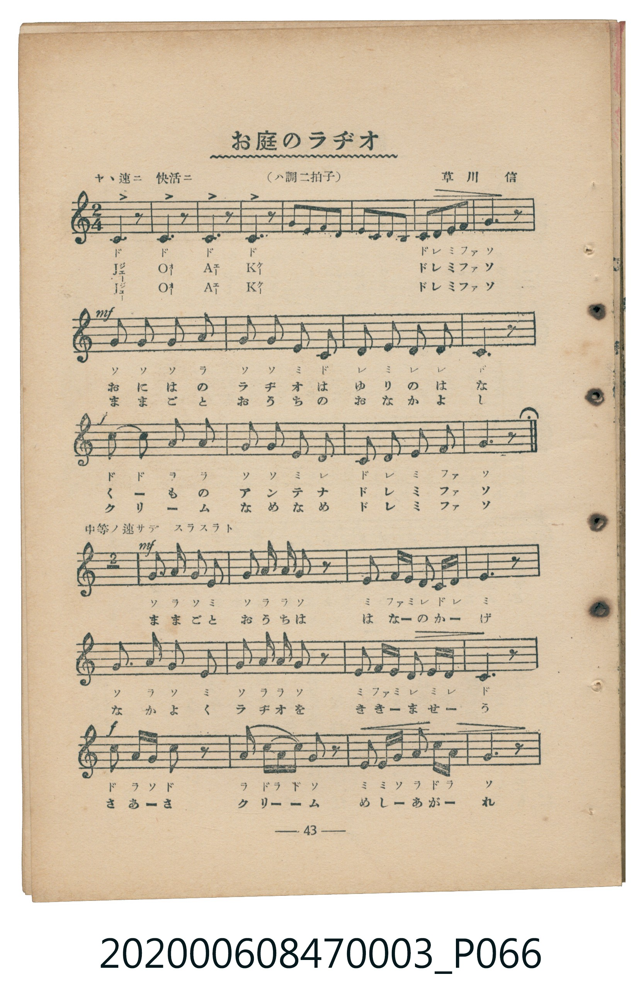
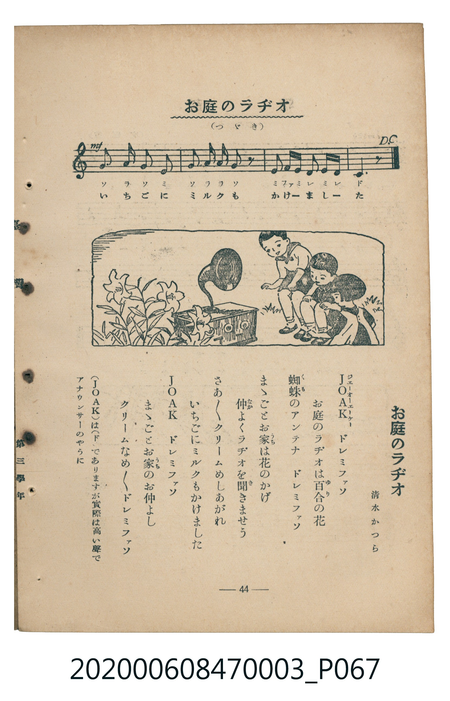

# お庭のラヂオ

<audio controls src="oniwa_no_rajio.mp3"></audio>

- 詞：清水かつら
- 曲：草川信
- 臺灣教育會公認《新定兒童唱歌》尋常科第三學年用（2020.006.0847.0003）

## 說明

原書資訊與歌詞全文（對應 P066.jpg–P067.jpg，書頁 pp. 43–44，補充教材第 7 首）：
調性與拍號：は調二拍子（C 大調 2/4 拍），ヤヽ速ニ 快活ニ ♩=116 / 中等ノ速サデ スラスラト ♩=100

## 歌詞

```text
ＪＯＡＫ　ドレミファソ
お庭のラヂオは百合の花
蜘蛛のアンテナ　ドレミファソ
まゝごとお家は花のかげ
仲よくラヂオを聞きませう
さあさあクリームめしあがれ
いちごにミルクもかけました
ＪＯＡＫ　ドレミファソ
まゝごとお家のお仲よし
クリームなめなめ　ドレミファソ
```

## ABC

```abc
X:1
T:お庭のラヂオ
C:曲：草川信
M:2/4
L:1/16
Q:1/4=116
K:C
V:V1 name="Piano" snm="Pia"
[V:V1]
[Q:1/4=116] c2 z2 c2 z2 | c2 z2 c2 z2 | C2 D2 E2 F2 | C2 D2 E2 F2 |
G6 z2 | G2 G2 G2 A2 | G2 G2 E2 C2 | D2 E2 D2 D2 |
C6 z2 | c2 c2 A2 A2 | G2 G2 E2 D2 | C2 D2 E2 F2 |
G6 z2 | [Q:1/4=100] G2 A G E4 | G2 A A G2 z2 | E2 F E D C D2 |
E6 z2 | G2 A G E4 | G2 A A G2 z2 | E2 F E D E D2 |
C6 z2 | c2 A G c2 z2 | A2 c A c G z2 | E2 E2 G A c A |
G6 z2 | G2 A G E4 | G2 A A G2 z2 | E2 F E D E D2 |
C6 z2 | [Q:1/4=116] c2 z2 c2 z2 | c2 z2 c2 z2 | C2 D2 E2 F2 |
C2 D2 E2 F2 | G6 z2 | G2 G2 G2 A2 | G2 G2 E2 C2 |
D2 E2 D2 D2 | C6 z2 | c2 c2 A2 A2 | G2 G2 E2 D2 |
C2 D2 E2 F2 | G6 z2 |
```

## TMD 檔案連結

- [主旋律 TMD 檔案](oniwa_no_rajio.tmd) [[在 TMD Studio 編輯](https://tmdlang.github.io/Tmd-TS/#tmd=s7IKdvYPcrWy4qpTUCpJTLdSSM7PyUlNLsnMz7MqzsjMK0nNjM_KTMmPL87Iz05Ugisry88pzU21Si9KTEmNN443MjAyiDcwMIs3sDAxBzIMjBFKi_NLi5JTrYqTM_Lzc-JLUitKkvLzsxHyBUX5Zal5iXlANQVFIBtTwIoQClLLMlNSQdKpKZkl-UWZiTlI7kgtKga7FWxJfElRYl5xclFmAcgDCFUlGalAx5akJmfk5efkp1eiy-SWFmcmK3FpaSk8bux6umvt48Z1j5tXPm5uety0SkFLi0vRVsHQ0IzL3lbBmcvGSN_EDqT_xcp57_fMeraj9dmGLY8bux83Lnnc1Ak2-dnsTUCZF72dT7fPfbJ_IVjsRfuu542Ln02d-aJp07M5zU9b17xY1fu4oevZtA1P18162jrp-eqlT6dsfLa253FD99MN3U937Hi-fOLzNWue7Oh8unbH051bnk9Z8X5PByik9YAhrQcKaSDDwPj9HqCtXPpaCrbUAlwKCgpP--Y_m73jxeb2Fyu6XnS0A90F9O_T1hXPprUDXfF0Q--z9k6FAAMzM72sgvRHDZOBTHMQ8_2eHqC-lwsaFQoK9BRMjIFSJiZAwReL5zxtbQX6_9ncCUBfKZgrvFw2Deh0YECBrHuxav-zhuUgi7p7X8ycDxR93LgeKPhkVw9Q5OnaCUBLnRWeLlkOFFMAxoACUBSsu-dx85LHzXtfNsx_3Nyt8HT_6mdbdoNYj2autAXGmYK-wpMda5-v7Xzc3AdS07T1cXO7wuOmnaD4hZDNHRDFBgZcIJe837Pq_Z717_csfL9n9eOGhsfNQK1rHjcDjZ_6uGnh46a9IEWYyQTo3Ocz9z2d0AEUfNG1EeynOTNezJ4NUtS06HHz5sfNbY-bu_AYue9x09zHjVMeN64AGb9uGygEujaC9INS1ySQoie7Nz1uAlrRj7C3adKLxnmPG3tB-huBtrVBDJv6uLEJSjatf9y86nHznsfNCx43NT5unA6W6nnc1ANR2vK4cSHY3tVgN60GaWgCqgBaOhFsKlDDfBKCBtMfQB90wZw-HawI2U2NQE8AnQUmcZlKeaKGAgUtfS6ugMSiEkergMzEvHyHGoMahWqQFQo2Flp2YEY1JL_XgjnAjBVcWVySmqtgqKBhqpCUWFSsaaXg5e_orYDpVJDpIE01CoZxCgYQAo2tYKRgrGCCwjJV0AVCoCyahUYKGiYwC4EhCIqgxvVoiQ4YlG2Pm4BywDAGygGLK5gLTMHQDMoyBtpXA7bRCAhBtmO30xjFzn5wQkBJwNh8reGWmZeqieJ5IDJDshxiJaaHayGR4UQgMgwM0CPDBMWdwEQKRNAkB8wD4BQNDBtwkMBzEHLYaJgpmGqqauhqAp2kCxMxg4iYgmMKHBLGEBENIwVDCAvkEZAObGEHNAPJTUB7uzEzK1ACmFURuZUiN0FZ-OLTDMVN2EsFYBpCKRZQIhLhKGgKBpoIilyoI4BMqDTEfUAXAhMdQhLKxJ3IzVEciL0sAkqgFEYKGi56znpICY5aYQdMjrp2CuDiQQHKcIIxwCLKXFwA)]
- [鋼琴伴奏 TMD 檔案](oniwa_no_rajio_piano.tmd) [[在 TMD Studio 編輯](https://tmdlang.github.io/Tmd-TS/#tmd=s7IKdvYPcrWy4tLSUnjc2PV019rHjeseN6983Nz0uGnV-z0dL7v3PJ-w5cmeLU-X9j_v7Hi_p1NBS4tL0VbB0NCMy95WwZnLxkjfxI6rTkHpxcp57_fMeraj9dmGLY8bux83Lnnc1KkEknk2exNQ5kVv59Ptc5_sXwgWe9G-63nj4mdTZ75o2vRsTvPT1jUvVvU-buh6Nm3D03WznrZOer566dMpG5-t7Xnc0P10Q_fTHTueL5_4fM2aJzs6n67d8XTnludTVgAdaGRgZKBnYGCmZ2BhYg5kGBgD3ajExRWQWFTiaBWQmZiXH-ThUGNQo1DNpQAENhZadmBGNcQTtWBOjYJhnIIBhEBjKxgpGCuYoLBMFXSBECgL1WsKhmZQljFQZQ1YrREQgvShqgYaDERmSOohqjBNr0Xxhg-KN0xweCMehFDoaMNYZIZpfDyyY4DCJhjy0abxUDGEShNklXB5iBDMTKiDnQiGu4EBzMGmChpmCqaaqhq6mkD_68JEzCAipuA4MFbQMFEwhohoGCkYQligUAPpQI0Jkk2DsnDEFMI4aHowU9AAxR5UO5AJlYaYDDQbmBAQklAmtiRDHYeihjieJIIIcXhMg2IUnjawxDgpCkHuBSqDpzmUZEG0cUDf6NopgNO8ApThBGOARZS5uAA)]

## 分析

```text
================================================================================
📊 TMD Song Profile: [ お庭のラヂオ ]
================================================================================
⏱  Duration:       0:46 (46.1s), 42 measures total
🎼 Key & Tempo:    首調基準 C, != 116.0 BPM, <2/4>
   - 分析範圍：      由實際發聲的音符與和弦推測調性；播放脈絡另行呈現
🎤 人聲音域:    C4 (MIDI 60) – C5 (MIDI 72) [跨度: 12 個半音 / 1.0 個八度, 難度: easy]
   - 最低音:  C4 in [PartA #1 @ m.3, 0:02]
   - 最高音: C5 in [PartA #1 @ m.1, 0:00]
   - 適合: soprano, mezzo-soprano, contralto, tenor, baritone, bass
🏛  結構:      PartA (13.4s) -> PartB (19.2s) -> PartA (13.4s)
⚡ 編曲密度:        Peak 1 軌道同時演奏
🗝  調性診斷：       C 大調（純淨自然大調，未偵測到可信轉調）
   - 風格氣質:    純淨自然大調（陽光明朗、易唱易記，無明顯調外色彩）
   - 轉調歷程:    全曲維持單一推測調性（未偵測到可信轉調）
   - 核心骨幹音:  G, C, E, D, A
   - 調性數值:    C 大調 [相關度: 0.92, 穩定度: High, 自然音純度: 100.0%]
   - 候選調性 (K-S): C 大調 (0.92), G 大調 (0.75), E 小調 (0.66)
   - 五度圈歷程:   +0 -> +4 -> +0
   - 各段落調性細節:
     • [PartA #1]: C 大調 (r: 0.93, 自然音純度: 100.0%)
     • [PartB #1]: E 調性不明確 (r: 0.81, 自然音純度: 97.3%, 調外音: F)
     • [PartA #2]: C 大調 (r: 0.93, 自然音純度: 100.0%)

  [ 五度圈游移軌跡 ]
              [C ]*
         F            G  
      Bb               D  
      Eb               A  
         Ab          [E ]*
            Db       B  
               F# 
     (* = active key center)

  [ 十二半音累積音高分佈 ]
     C  : █████████████████████     24.8%
     C# :                            0.0%
     D  : ███████████               12.8%
     D# :                            0.0%
     E  : █████████████████         19.7%
     F  : ████                       5.2%
     F# :                            0.0%
     G  : ████████████████████████  28.3%
     G# :                            0.0%
     A  : ████████                   9.3%
     A# :                            0.0%
     B  :                            0.0%
--------------------------------------------------------------------------------
Assignment 軌道音域：
  - Piano         : C4 – C5 (12 個半音 / 1.0 個八度, 139 個音符)
================================================================================
```


## 原書掃描頁






