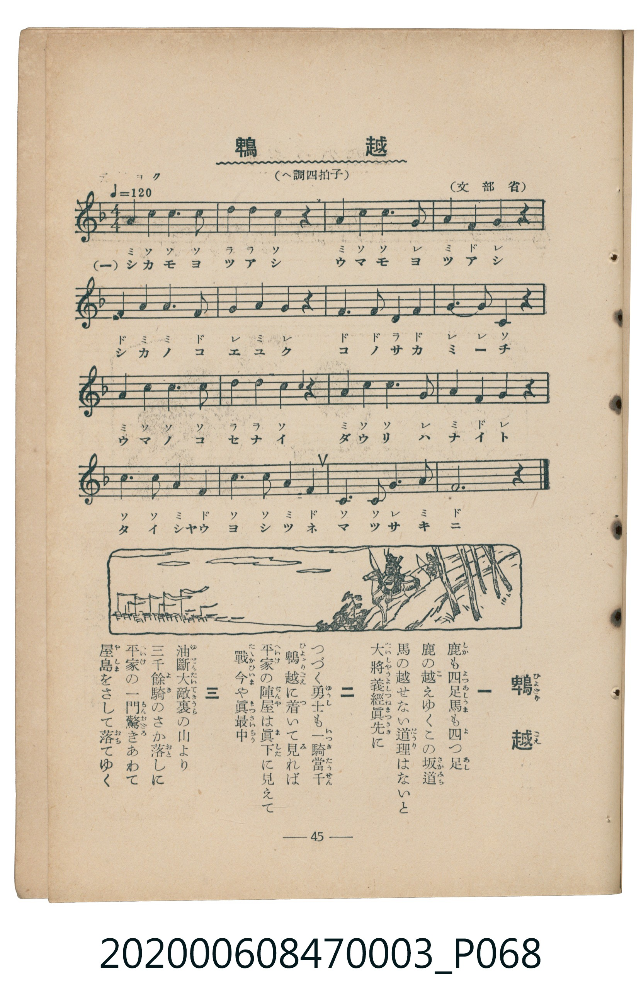

# 鵯越

> Re:Shōka 使用 AI 協助辨識與重建樂譜，可能會有錯誤。歡迎回報。

- **NEUTRINO 歌聲合成版**：<br><audio controls src="hiyodorigoe_neutrino.mp3"></audio>
- **鋼琴伴奏版**：<br><audio controls src="hiyodorigoe.mp3"></audio>


- 文部省唱歌
- 臺灣教育會公認《新定兒童唱歌》尋常科第三學年用（2020.006.0847.0003）

## 說明

原書資訊與歌詞全文（對應 P068.jpg，書頁 p. 45，補充教材第 8 首）：
調性與拍號：へ調四拍子（F 大調 4/4 拍），元氣ヨク ♩=120
（原書標題漢字印作「鴨越」，振假名標註「ひよどりごえ」）


## 歌詞

```text
一
鹿も四つ足馬も四つ足
鹿の越えゆくこの坂道
馬の越せない道理はないと
大將義經眞先に

二
つづく勇士も一騎當千
鵯越に着いて見れば
平家の陣屋は眞下に見えて
戰今や眞最中

三
油斷大敵裏の山より
三千餘騎のさか落しに
平家の一門驚きあわて
屋島をさして落てゆく
```

## ABC

```abc
X:1
T:鵯越
M:4/4
L:1/16
Q:1/4=120
K:F
V:V1 name="Piano" snm="Pia"
[V:V1]
A4 c4 c6 c2 | d4 d4 c4 z4 | A4 c4 c6 G2 | A4 F4 G4 z4 |
w: 1.~シ カ モ ヨ | ツ ア シ | ウ マ モ ヨ | ツ ア シ
w: 2.~つ づ く ゆ | う し も | い つ き た | う せ ん
w: 3.~ゆ だ ん た | い て き | う ら の や | ま よ り
F4 A4 A6 F2 | G4 A4 G4 z4 | F6 F2 D4 F4 | G6 G2 C4 z4 |
w: 1.~シ カ ノ コ | エ ユ ク | コ ノ サ カ | ミ _ チ
w: 2.~ひ よ ど り | ご え に | つ い て み | れ _ ば
w: 3.~さ ん ぜ ん | よ き の | さ か お と | し _ に
A4 c4 c6 c2 | d4 d4 c4 z4 | A4 c4 c6 G2 | A4 F4 G4 z4 |
w: 1.~ウ マ ノ コ | セ ナ イ | ダ ウ リ ハ | ナ イ ト
w: 2.~へ い け の | ぢん や は | ま し た に | み え て
w: 3.~へ い け の | い ち もん | お ど ろ き | あ わ て
c6 c2 A4 F4 | c6 c2 A4 F4 | C6 C2 G6 A2 | F12 z4 |
w: 1.~タ イ シヤ ウ | ヨ シ ツ ネ | マ ツ サ キ | ニ
w: 2.~た た か ひ | い ま や _ | ま つ さ い | ちう
w: 3.~や し ま を | さ し て _ | お ち て ゆ | く
```

## TMD 檔案連結

- [主旋律 TMD 檔案](hiyodorigoe.tmd) [[在 TMD Studio 編輯](https://tmdlang.github.io/Tmd-TS/#tmd=s7IKdvYPcrWy4qpTUCpJTLdSSM7PyUlNLsnMz7MqzsjMK0nNjM_KTMmPL87Iz05Ugisry88pzU21Si9KTEmNN443MjAyiDcwMIs3sDAxBzIMjBFKi_NLi5JTrYqTM_Lzc-JLUitKkvLzsxHyBUX5Zal5iXlANQVFIBtTwIoQClLLMlNSQdKpKZkl-UWZiTlI7kgtKga7FWxJfElRYl5xclFmAcgDCFUlGalAx2ZkFgO1V6ILF-QkJqciBIEWpGfmWeXm5yWVAj2txKWlpfBy6_oX27oUtLS4FG0VDI0MuOxtFdy4bEz0TexA-p5Na3_ZvOL5nManUzY-W9sDNutF-67njYufTZ35omnTsznNT1vXvFjV-7ih69m0DU_XzXraOun56qUQ5Y8bup9u6H66Y8fz5ROfr1nzZEfn07U7nu7c8nzKivd7OkAhqwcMWT1QyAIZBsbv93QqcXHpaynYUgtwKSgoPO2b_2z2jheb21-s6HrR0Q5014uV8562rgD6DeiKpxt6n7V3KgQYmFnoZRWkv9_TA1T8ckGjQoGegokpkPti8Zynra1A7z6bOwHoCQULhZfLpgFd-n7PLJDpL1btf9awHGRud--LmfOBoo8bdwAFn86eDRR5unYC0A43hadLlgPFFIDBqgAUBevuedra_GzD4sfNKx43rVd4NHOlLSj4gSaCHAV28rMVM18u7Hm2Z9HTtdOf9m54snfO44ael1tWACPscQPQkJ5nPeufNrY_ndALVPlixW6g7OPGTY-bOh43rnzc1PW4ccrjxg6wyk4ukMFPdjSAqJc79z9uagK673HjkhfbNr9ctgaZC1PRuA5kDVB_U9vjxv7HjZOBIk_nNr1snAxWAdQEVQHUt-pxYwtQ4vkEoNL1EO7jxhXgsF-y_OmG9uf7Vj7fNvn5HGCoA922GuKYXT0gCmjp48alQBuedrc_Xbwa6BKgK1-u6Hs-ddvT3mawVeAUCtT2fG4D2OBlL5Z1P24CenUD2Iadm5-u2wZ0zMuZi59u7AY6AGjPkx1AxmqQOqAHGpeB1D3r2PBkd9fjphag9LM5DU92rIWGSSdYdtPOZ9O2A137bOrWF4uB3l33dONGUEg2dUFVAV3zcskMoMuAco8bpz5u7H4xYe_jxukg_yA7A-T8aQ0vVwKTQe_jxqbHTUDDwA4AOu7p5m2PmyaBdQP1LQMbsAwSwCAVlCd3KFDQ0ufi8siszE8BZfn8VKuAzMS8fIcag5pqkD0KNhZadmAGMKsFVxaXpOYqGCpo5OoZ6ppoWik8btr-uGn14-ZFoKTZ3PK4aRFQBCi67HHzPHRRoEUgc2oUjBV0FUyhGETWKJgBaRAGiRgAMboaI6iIIZgNVQM2zcewBuQIIB_oDhDZvAisA2gzUA_QcrAMSAyiKh5sOtCBYDXziNUBscsIKN-4BCTTuBRM9kN0NrWBdDa2gcWmg0WaEHY1gk2E6uuF6Gicj6RjNljHZFS7jEGuhMgvgMsjdELMBPsCbCbMLrCOpk6w-Dqo61rAMvvA7A4w2YViFyJmjUAxa6prgRSzfY-bNj9uAkYjMPGtB4puBgttBcvNf9y853FzIyJmQfEDiicQBsVWDTi2QDx4rIHVgOTMQA4AcSCKQEpMQUL44rYP6qPN4DhcARYDhwHQaYi43QyNzz4geytcNyhu54NlQHKNqKENjtlNiBBqXAm1qQscdlPAYhAZkFmw0AbFKUisBR4X-6Fu6IHZ1LgB1SZQvDZOBZsNitHHjXOgNk0G64PYAYpRSPzBbALpAIl1AzEo9oBlJlQGlN4gcnCXocWqMShWLXUNjcDRCsmakGjd_bgZWMwtAYZHA1hi1ePmfojQ4-YOWmZY5OyHGqm7wWJgLwIdBg-A5gawCETfKmgk9oNlEGpBjsaM1h3QKAKRE6FBtQ4cdMBiCRwHwBwCEkRKQ5DcAsnLwBwHC1-QDCiGYWkB5Bz0uMVtHURsIdhGYGEPz_DwKAUlusdNsCKiFywDKkiAFQMW6xARbAIukI11Dc3AMQysspeAsm8zkARGKrDNAGS3PG7uBQU5uDwGZt-1j5u7ETEMi1lYnGEVAVkNFIqH5ldjeGaGQPQ4BgUUJGYgjoFHICjSQKkXxAdWFpASF-g6iAwoUYD4wDwFzr0gVWvBMt1IlqFHMiyO5oPzCIgFys2wUAfx90HjGQRhMQwSBzoPnrsgJeVCSDGKxSpwoQwzcDq8UJ0ENRJmDEgG5FGYVaDYhUQ9TBxWZUAqEGR7arm4dO0UkCpkBSBXmQsA)]
- [鋼琴伴奏 TMD 檔案](hiyodorigoe_piano.tmd) [[在 TMD Studio 編輯](https://tmdlang.github.io/Tmd-TS/#tmd=s7IKdvYPcrWy4tLSUni5df2LbV3v93S87N7zfMKWJ3u2PF3a_7yz4_2eTgUtLS5FWwVDIwMue1sFNy4bE30TO646BaVn09pfNq94Pqfx6ZSNz9b2KIHEXrTvet64-NnUmS-aNj2b0_y0dc2LVb2PG7qeTdvwdN2sp62Tnq9eClH-uKH76Ybupzt2PF8-8fmaNU92dD5du-Ppzi3Pp6wAOsPIwMhAz8DATM_AwsQcyDAwBrpEiYvLI7MyPyW_KDM9P9UqIDMxLz_Iw6HGoKaaSwEIbCy07MAMfS2F4MriktRcBUMFjVw9Q10TTSuFx03bHzetfty86HHzisfNLY-bFgFFgKLLHjfPQxfV0gebU6NQnVarYKygq2AKxSCyRsEMSIMwSMQAiGvQ1BhBRQzBbKgasIk-hjUghwD5QLeAyOZFYB1A24F6gA4Ay4DEIKriwaYDHQlWM49YHRC7jIDyjUtAMo1LwWQ_RGdTG0hnYxtYbDpYpAlhVyPYRKi-XoiOxvlIOmaDdUxGtcsY5EqI_AK4PEInxEywL8BmwuwC62jqBIuvg7quBSyzD8zuAJNdKHYhYtcIFLumuhZIsdv3uGnz4yZgVC573LQeKLoZLLQVLDf_cfOex82NSLGbC4xeUCSBIguEQVFWA44yEA8edWA1IDkzkCtAHIgikBJTkBC-CO6DemszOCJXgMXAAQF0HyKCN0MjtQ_I3grXDYrg-WAZkFwjapCDo3cTIpgaV0Jt6gIH4BSwGEQGZBYsyEERCxJrgUfIfqgbemA2NW5AtQkUuY1TwWaDovVx4xyoTZPB-iB2gKIVEokwm0A6QGLdQAyKwseNIN-DZECJDiIHdxla1BqDotZS19AIHLeQPAqJ292Pm7seNy0BhkcDWGLV4-Z-iNDj5g5a51zkfIgasbvBYmBvAh0HD4TmBrAIRN8qaET2g2UQakEOx4zaHdBoApETocG1Dhx8wDIKHA_ArAISREpHkGwDydTArAcLY5AMKJZh6QHkHPT4xW0dRGwh2MYmpJwPj1ZQwnvcBCsresEyoBLlcROoxEG3DhHJJuDS2VjX0Awcy_tBcQjMx81AEhixK8DslsfNvaAgBxfOwHy89nFzN3IsA6MZFr2wiKvBJgKyHygUD824xvBcDYHoEQ0KLUj0QFwEj0VQzIGSMYgPrD4g5S_QiRAZUMoA8YGZC5yNQarWgmW6kSxDj2lYRM0HZxYQC5StYUEP4u-DRjYIwqIZJA50HjybQcrNhZBCFYtV4CIaZuB0eBE7CWokzBiQDMijMKtAUQyJf5g4rAKBVCfI9tRiqaF9iKyhEZFqCDLMND5e2zBe2xhc4qIL1CiYxINoIKltBhbHVGWAzSQgGypiDsRGELPAqiDG4FAFNAtX1UOas7HYj80ykGvQ3ITFw8BKCK7MKF7bhEinI4rWoRXkSKUFaQ7HEMIMXVjMQByC28kQGaAusHFAJqTcAKZ7XTsFpKQf7WMYq4AuZIQpZAwWUuYCAA)]

## 分析

```text
================================================================================
📊 TMD Song Profile: [ 鵯越 ]
================================================================================
⏱  Duration:       0:32 (32.0s), 16 measures total
🎼 Key & Tempo:    首調基準 F, != 120.0 BPM, <4/4>
   - 分析範圍：      由實際發聲的音符與和弦推測調性；播放脈絡另行呈現
🎤 人聲音域:    C4 (MIDI 60) – D5 (MIDI 74) [跨度: 14 個半音 / 1.2 個八度, 難度: moderate]
   - 最低音:  C4 in [Hiyodorigoe #1 @ m.8, 0:15]
   - 最高音: D5 in [Hiyodorigoe #1 @ m.2, 0:02]
   - 適合: soprano, mezzo-soprano, contralto, tenor, baritone, bass
🏛  結構:      Hiyodorigoe (32.0s)
⚡ 編曲密度:        Peak 1 軌道同時演奏
🗝  調性診斷：       C 調性不明確（純淨自然大調，未偵測到可信轉調）
   - 風格氣質:    純淨自然大調（陽光明朗、易唱易記，無明顯調外色彩）
   - 轉調歷程:    全曲維持單一推測調性（未偵測到可信轉調）
   - 核心骨幹音:  C, A, F, G, D
   - 調性數值:    C 調性不明確 [相關度: 0.83, 穩定度: Ambiguous, 自然音純度: 100.0%]
   - 候選調性 (K-S): C 大調 (0.83), F 大調 (0.80), A 小調 (0.71)
   - 五度圈歷程:   +0
   - 各段落調性細節:
     • [Hiyodorigoe #1]: C 調性不明確 (r: 0.83, 自然音純度: 100.0%)

  [ 五度圈游移軌跡 ]
              [C ]*
         F            G  
      Bb               D  
      Eb               A  
         Ab           E  
            Db       B  
               F# 
     (* = active key center)

  [ 十二半音累積音高分佈 ]
     C  : ████████████████████████  35.1%
     C# :                            0.0%
     D  : ██████                     8.8%
     D# :                            0.0%
     E  :                            0.0%
     F  : ██████████████            20.2%
     F# :                            0.0%
     G  : ██████████                14.9%
     G# :                            0.0%
     A  : ██████████████            21.1%
     A# :                            0.0%
     B  :                            0.0%
--------------------------------------------------------------------------------
Assignment 軌道音域：
  - Piano         : C4 – D5 (14 個半音 / 1.2 個八度, 55 個音符)
================================================================================
```


## 原書掃描頁




