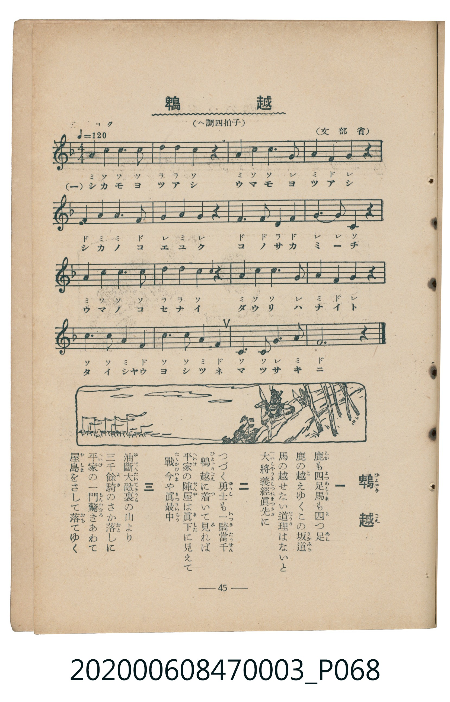

# 鵯越

> Re:Shoka 使用 AI 辨識樂譜，可能會有錯誤。歡迎回報。

<audio controls src="hiyodorigoe.mp3"></audio>

- 文部省唱歌
- 臺灣教育會公認《新定兒童唱歌》尋常科第三學年用（2020.006.0847.0003）

## 說明

原書資訊與歌詞全文（對應 P068.jpg，書頁 p. 45，補充教材第 8 首）：
調性與拍號：へ調四拍子（F 大調 4/4 拍），元氣ヨク ♩=120
（原書標題漢字印作「鴨越」，振假名標註「ひよどりごえ」）

## 歌詞

```text
一
鹿も四つ足　馬も四つ足
鹿の越す坂　馬の越せぬ道理なしと
大將義經　眞先に　つづく勇士も　一さんに
かけおりる　かけおりる　鵯越をかけおりる

二
頃は元暦　一ノ谷の戰
前は大海　うしろはけはしき鵯越
平家の陣屋は　あはや今　不意におそはれ　あわてふためき
せめやぶる　せめやぶる　平家の陣屋をせめやぶる
```

## ABC

```abc
X:1
T:鵯越
M:4/4
L:1/16
Q:1/4=120
K:F
V:V1 name="Piano" snm="Pia"
[V:V1]
A3 c c2 c2 d2 d2 c2 z2 | A3 c c2 G2 A2 F2 G2 z2 | F3 A A2 F2 G2 A2 G2 z2 | F3 F D2 F2 G2 G2 C2 z2 |
A3 c c2 c2 d2 d2 c2 z2 | A3 c c2 G2 A2 F2 G2 z2 | c3 c A2 F2 c3 c A2 F2 | c3 c G2 A2 F4 z4 |
```

## TMD 檔案連結

- [主旋律 TMD 檔案](hiyodorigoe.tmd) [[在 TMD Studio 編輯](https://tmdlang.github.io/Tmd-TS/#tmd=s7IKdvYPcrWy4qpTUCpJTLdSSM7PyUlNLsnMz7MqzsjMK0nNjM_KTMmPL87Iz05Ugisry88pzU21Si9KTEmNN443MjAyiDcwMIs3sDAxBzIMjBFKi_NLi5JTrYqTM_Lzc-JLUitKkvLzsxHyBUX5Zal5iXlANQVFIBtTwIoQClLLMlNSQdKpKZkl-UWZiTlI7kgtKga7FWxJfElRYl5xclFmAcgDCFUlGalAx2ZkFgO1V6ILF-QkJqcqcWlpKbzcuv7Fti4FLS0uRVsFQyMDLntbBTcuGxN9EzuQnmfT2l82r3g-p_HplI3P1vaAzXnRvut54-JnU2e-aNr0bE7z09Y1L1b1Pm7oejZtw9N1s562Tnq-eilE-eOG7qcbup_u2PF8-cTna9Y82dH5dO2Opzu3PJ-y4v2eDlAA6gEDUA8UgECGgfH7PZ1KXFz6Wgq21AJcCgoKT_vmP5u948Xm9hcrul50tAPd9WLlvKetK4B-A7ri6YbeZ-2dCgEGZhZ6WQXp7_f0ABW_XNCoUKCnYGIK5L5YPOdpayvQu8_mTgB6QsFC4eWyaUCXvt8zC2T6i1X7nzUsB5nb3fti5nyg6OPGHUDBp7NnA0Werp0AtMNN4emS5UAxBWCwKgBFwbp7nrY2P9uw-HHzisdN6xUezVxpCwp-oIkgR4Gd_GzFzJcLe57tWfR07fSnvRue7J3zuKHn5ZYVwAh73AA0pOdZz_qnje1PJ_QCVb5YsRso-7hx0-OmjseNKx83dT1unPK4sQOsspMLZPCTHQ0g6uXO_Y-bmoDue9y45MW2zY8bGl4uW4MsAlPUuA5kU-PMp3OboIqgIkB1a142Tn4-oe1x46rHjdMfN64AB_SS5U83tD_ft_L5tslADc_nAEMZ6JbVQDbQ4MeNSx839j_tbn-6eDXQNqAg0D2PG6c-bpoMVAPS_7ix-3HjxMeNXSDHN3WDtaGLQNLr46ZJaFIQD-7qAbt9QfPjxvWg4J21DGpNc9-LDduBzn_WsQHs0s5ekIoly59t3Q62BuiR6Y-bQIJgQ4Ek0FO9EMvAGnZufrpuG9CAlzMXP90ItHk9WFsTiNHU8mQ3MEKA9vQ-a-kH-RfoqMa5YClgFgArawKKL3vcuPVx4_zHTY1AoyH-nQ3iNLU8btwG8y-6CLrFII-jqAEZRHk-gQIFLX0uLo_MyvwUYJmTnp9qFZCZmJfvUGNQo1ANskjBxkLLDswAZlJDXSMroB-AAQV0FtCLwKgGRjIwSKYDRYEBug9dFGg4SGuNgoaxgq6ugqmmqoaurqaCKRCaAaGpggEWOSMFYwVDIAmUg1lsrGsCt7hx3eNGYPqZCUpIjd0wi6GioHT6uHEBSBCUHaBJFckdhiC7jKF2QewxhtgFlTOEypnFgyWNFEzjkV1iqmsGcsn8x43A2AAmICAJtAroZaA9QF-vBcoBHQNkAR0HTFyrgXxoPnjcBHQoJNU1AUWBGhfC8wLVAspc1wLkPJSMgoWPUWRg5C4kF5ki2wqyEVMEXRXEZbpAl-kC3VbLxaVrp4CUyBSAXGUuLgA)]
- [鋼琴伴奏 TMD 檔案](hiyodorigoe_piano.tmd) [[在 TMD Studio 編輯](https://tmdlang.github.io/Tmd-TS/#tmd=s7IKdvYPcrWy4tLSUni5df2LbV3v93S87N7zfMKWJ3u2PF3a_7yz4_2eTgUtLS5FWwVDIwMue1sFNy4bE30TO646BaVn09pfNq94Pqfx6ZSNz9b2KIHEXrTvet64-NnUmS-aNj2b0_y0dc2LVb2PG7qeTdvwdN2sp62Tnq9eClH-uKH76Ybupzt2PF8-8fmaNU92dD5du-Ppzi3Pp6wAOsPIwMhAz8DATM_AwsQcyDAwBrpEiYvLI7MyPyW_KDM9P9UqIDMxLz_Iw6HGoEahmksBCGwstOzAjBoFDWMFXV0FU01VDV1dTQVTIDQDQlMFAyxyRgrGCoZAEigH020IUmEMVQGRNYaogMoZQuXM4sGSRgqm8cj6KbPdFFkFSBZTBF0VxBRdoCm6QHNqsYSUD0pImcBDyjBeIdowVsEkHkJDBEzjY0G0KVAQ5iqoOpAQWLoG6Hcg0yRWwQhIY1FJrIlQqgZhNFAEFBpAX-jaKSB5RAGTq8zFBQA)]

## 分析

```text
================================================================================
📊 TMD Song Profile: [ 鵯越 ]
================================================================================
⏱  Duration:       0:16 (16.0s), 8 measures total
🎼 Key & Tempo:    首調基準 F, != 120.0 BPM, <4/4>
   - 分析範圍：      由實際發聲的音符與和弦推測調性；播放脈絡另行呈現
🎤 人聲音域:    C4 (MIDI 60) – D5 (MIDI 74) [跨度: 14 個半音 / 1.2 個八度, 難度: moderate]
   - 最低音:  C4 in [Hiyodorigoe #1 @ m.4, 0:07]
   - 最高音: D5 in [Hiyodorigoe #1 @ m.1, 0:01]
   - 適合: soprano, mezzo-soprano, contralto, tenor, baritone, bass
🏛  結構:      Hiyodorigoe (16.0s)
⚡ 編曲密度:        Peak 1 軌道同時演奏
🗝  調性診斷：       F 調性不明確（純淨自然大調，未偵測到可信轉調）
   - 風格氣質:    純淨自然大調（陽光明朗、易唱易記，無明顯調外色彩）
   - 轉調歷程:    全曲維持單一推測調性（未偵測到可信轉調）
   - 核心骨幹音:  C, A, F, G, D
   - 調性數值:    F 調性不明確 [相關度: 0.81, 穩定度: Ambiguous, 自然音純度: 100.0%]
   - 候選調性 (K-S): F 大調 (0.81), C 大調 (0.79), A 小調 (0.74)
   - 五度圈歷程:   -1
   - 各段落調性細節:
     • [Hiyodorigoe #1]: F 調性不明確 (r: 0.81, 自然音純度: 100.0%)

  [ 五度圈游移軌跡 ]
               C  
        [F ]*          G  
      Bb               D  
      Eb               A  
         Ab           E  
            Db       B  
               F# 
     (* = active key center)

  [ 十二半音累積音高分佈 ]
     C  : ████████████████████████  30.4%
     C# :                            0.0%
     D  : ███████                    8.9%
     D# :                            0.0%
     E  :                            0.0%
     F  : ████████████████          20.5%
     F# :                            0.0%
     G  : █████████████             16.1%
     G# :                            0.0%
     A  : ███████████████████       24.1%
     A# :                            0.0%
     B  :                            0.0%
--------------------------------------------------------------------------------
Assignment 軌道音域：
  - Piano         : C4 – D5 (14 個半音 / 1.2 個八度, 55 個音符)
================================================================================
```


## 原書掃描頁




