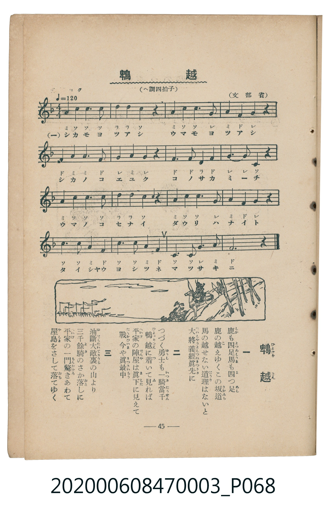

# 鵯越

> Re:Shōka 使用 AI 協助辨識與重建樂譜，可能會有錯誤。歡迎回報。

- **鋼琴伴奏版**：<br><audio controls src="hiyodorigoe.mp3"></audio>
- **NEUTRINO 歌聲合成版**：<br><audio controls src="hiyodorigoe_neutrino.mp3"></audio>

- 文部省唱歌
- 臺灣教育會公認《新定兒童唱歌》尋常科第三學年用（2020.006.0847.0003）

## 說明

原書資訊與歌詞全文（對應 P068.jpg，書頁 p. 45，補充教材第 8 首）：
調性與拍號：へ調四拍子（F 大調 4/4 拍），元氣ヨク ♩=120
（原書標題漢字印作「鴨越」，振假名標註「ひよどりごえ」）


## 歌詞

```text
一
鹿も四つ足馬も四つ足
鹿の越えゆくこの坂道
馬の越せない道理はないと
大將義經眞先に

二
つづく勇士も一騎當千
鵯越に着いて見れば
平家の陣屋は眞下に見えて
戰今や眞最中

三
油斷大敵裏の山より
三千餘騎のさか落しに
平家の一門驚きあわて
屋島をさして落てゆく
```

## ABC

<div class="abc-score" data-abc-src="hiyodorigoe.abc" aria-label="五線譜載入中"></div>

[下載 ABC 原始檔](hiyodorigoe.abc)

## TMD 檔案連結

- [主旋律 TMD 檔案](hiyodorigoe.tmd) [[在 TMD Studio 編輯](https://tmdlang.github.io/Tmd-TS/#tmd=s7IKdvYPcrWy4qpTUCpJTLdSSM7PyUlNLsnMz7MqzsjMK0nNjM_KTMmPL87Iz05Ugisry88pzU21Si9KTEmNN443MjAyiDcwMIs3sDAxBzIMjBFKi_NLi5JTrYqTM_Lzc-JLUitKkvLzsxHyBUX5Zal5iXlANQVFIBtTwIoQClLLMlNSQdKpKZkl-UWZiTlI7kgtKga7FWxJfElRYl5xclFmAcgDCFUlGalAx2ZkFgO1V6ILF-QkJqciBIEWpGfmWeXm5yWVAj2NLFGSkQ_0cEFGJdSozOTEnPjsxDykcIG6oyAxPdUqwMDMQolLS0vh5db1L7Z1KWhpcSnaKhgaGXDZ2yq4cdmY6JvYgTQ-m9b-snnF8zmNT6dsfLa2B2zYi_ZdzxsXP5s680XTpmdzmp-2rnmxqvdxQ9ezaRuerpv1tHXS89VLIcofN3Q_3dD9dMeO58snPl-z5smOzqdrdzzdueX5lBXv93SAIkYPGDF6oIgBMgyM3-_pVOLi0tdSsKUW4FJQUHjaN__Z7B0vNre_WNH1oqMd6K4XK-c9bV0B9BvQFU839D5r71QABYheVkH6-z09QMUvFzQqFOgpmJgCuS8Wz3na2gr07rO5E4CeULBQeLlsGtCl7_fMApn-YtX-Zw3LQeZ2976YOR8o-rhxB1Dw6ezZQJGnaycA7XBTeLpkOVBMARisCkBRsO6ep63NzzYsfty84nHTeoVHM1fagoIfaCLIUWAnP1sx8-XCnmd7Fj1dO_1p74Yne-c8buh5uWUFMMIeNwAN6XnWs_5pY_vTCb1AlS9W7AbKPm7c9Lip43HjysdNXY8bpzxu7ACr7OQCGfxkRwOIerlz_-OmJqD7HjcuebFt88tla5C5MBWN60DWAPU3tT1u7H_cOBko8nRu08vGyWAVQE1QFUB9qx43tgAlnk8AKl0P4T5uXAEO-yXLn25of75v5fNtk5_PAYY60G2rIY7Z1QOigJY-blwKtOFpd_vTxauBLgG68uWKvudTtz3tbQZbBU6hQG3P5zaADV72Yln34yagVzeAbdi5-em6bUDHvJy5-OnGbqADgPY82QFkrAapA3qgcRlI3bOODU92dz1uagFKP5vT8GTHWmiYdIJlN-18Nm070LXPpm59sRjo3XVPN24EhWRTF1QV0DUvl8wAugwo97hx6uPG7hcT9j5unA7yD7IzQM6f1vByJTAZ9D5ubHrcBDQM7ACg455u3va4aRJYN1DfMrAByyABDFJBeXKHAgUtfS4uj8zK_BRQiZEPzO6ZiXn5DjUGNdUgexRsLLTswAxgVguuLC5JzVUwVNDI1TPUNdG0UnjctP1x0-rHzYtASbO55XHTIqAIUHTZ4-Z56KJAi0Dm1CgYK-gqmEIxiKxRMAPSIAwSMQBidDVGUBFDMBuqBmyaj2ENyBFAPtAdILJ5EVgH0GagHqDlYBmQGERVPNh0oAPBauYRqwNilxFQvnEJSKZxKZjsh-hsagPpbGwDi00HizQh7GoEmwjV1wvR0TgfScdssI7JqHYZg1wJkV8Al0fohJgJ9gXYTJhdYB1NnWDxdVDXtYBl9oHZHWCyC8UuRMwagWLWVNcCKWb7HjdtftwEjEZg4lsPFN0MFtoKlpv_uHnP4-ZGRMyC4gcUTyAMiq0acGyBePBYA6sByZmBHADiQBSBlJiChPDFbR_UR5vBcbgCLAYOA6DTEHG7GRqffUD2VrhuUNzOB8uA5BpRQxscs5sQIdS4EmpTFzjspoDFIDIgs2ChDYpTkFgLPC72Q93QA7OpcQOqTaB4bZwKNhsUo48b50BtmgzWB7EDFKOQ-IPZBNIBEusGYlDsActMqAwovUHk4C5Di1VjUKxa6hoagaMVkjUh0br7cTOwmFsCDI8GsMSqx839EKHHzR20zLDI2Q81UneDxcBeBDoMHgDNDWARiL5V0EjsB8sg1IIcjRmtO6BRBCInQoNqHTjogMUSOA6AOQQkiJSGILkFkpeBOQ4WviAZUAzD0gLIOehxi9s6iNhCsI3Awh6e4eFRCkp0j5tgRUQvWAZUkAArBizWISLYBFwgG-samoFjGFhlLwFl32YgCYxUYJsByG553NwLCnJweQzMvmsfN3cjYhgWs7A4wyoCshooFA_Nr8bwzAyB6HEMCihIzEAcA49AUKSBUi-ID6wsICUu0HUQGVCiAPGBeQqce0Gq1oJlupEsQ49kWBzNB-cREAuUm2GhDuLvg8YzCMJiGCQOdB48d0FKyoWQYhSLVeBCGWbgdHihOglqJMwYkAzIozCrQLELiXqYOKzKgFQgyPbUcnHp2ikgVcgKQK4yFwA)]
- [鋼琴伴奏 TMD 檔案](hiyodorigoe_piano.tmd) [[在 TMD Studio 編輯](https://tmdlang.github.io/Tmd-TS/#tmd=s7IKdvYPcrWy4qpTUCpJTLdSyC8qychPL0osyKi0ysgsLskvykxOzInPTsxLVIIrKs4vLUpOjS9ITE-1CjAws1Di0tJSeLl1_YttXe_3dLzs3vN8wpYne7Y8Xdr_vLPj_Z5OBS0tLkVbBUMjAy57WwU3LhsTfRM7kGnPprW_bF7xfE7j0ykbn63tAdvwon3X88bFz6bOfNG06dmc5qeta16s6n3c0PVs2oan62Y9bZ30fPVSiPLHDd1PN3Q_3bHj-fKJz9esebKj8-naHU93bnk-ZQXQGUYGRgZ6BgZmegYWJuZAhoEx0CVKXFwemZX5KUBvpecDHZ-ZmJcf5OFQY1BTzaUABDYWWnZghr6WQnBlcUlqroKhgkaunqGuiaaVwuOm7Y-bVj9uXvS4ecXj5pbHTYuAIkDRZY-b56GLaumDzalRqE6rVTBW0FUwhWIQWaNgBqRBGCRiAMQ1aGqMoCKGYDZUDdhEH8MakEOAfKBbQGTzIrAOoO1APUAHgGVAYhBV8WDTgY4Eq5lHrA6IXUZA-cYlIJnGWWCyH6KzqQ2ks7ENLDYdLNKEsKsRbCJUXy9ER-N8JB2zwTomo9plDHIlRH4BXB6hE2Im2BdgM2F2gXU0dYLF10Fd1wKW2Qdmd4DJLhS7ELFrBIpdU10LpNjte9y0-XETMCqXPW5aDxTdDBbaCpab_7h5z-PmRqTYzQVGLyiSQJEFwqAoqwFHGYgHjzqwGpCcGcgVIA5EEUiJKUgIXwT3Qb21GRyRK8Bi4IAAug8RwZuhkdoHZG-F6wZF8HywDEiuETXIwdG7CRFMjSuhNnWBA3AKWAwiAzILFuSgiAWJtcAjZD_UDT0wmxo3oNoEitzGqWCzQdH6uHEO1KbJYH0QO0DRColEmE0gHSCxbiAGReHjRpDvQTKgRAeRg7sMLWqNQVFrqWtoBI5bSB6FxO3ux81dj5uWAMOjASyx6nFzP0TocXMHrXMucj5EjdjdYDGwN4GOgwdCcwNYBKJvFTQi-8EyCLUgh2NG7Q5oNIHIidDgWgcOvhnQeABmFZAgUjqCZBtIpgZmPVgYg2RAsQxLDyDnoMcvbusgYgvBNjYh5Xx4tIIS3uMmWFnRC5YBlSiPm0AlDrp1iEg2AZfOxrqGZuBY3g-KQ2A-bgaSwIhdAWa3PG7uBQU5uHAG5uO1j5u7kWMZGM2w6IVFXA02EZD9QKF4aMY1hudqCESPaFBoQaIH4iJ4LIJiDpSMQXxg9QEpf4FOhMiAUgaID8xc4GwMUrUWLNONZBl6TMMiaj44s4BYoGwNC3oQfx80skEQFs0gcaDz4NkMUm4uhBSqWKwCF9EwA6fDi9hJUCNhxoBkQB6FWQWKYkj8w8RhFQikOkG2pxZLDe1DZA2NiFRDkGGm8fHahvHaxuASF12gRsEkHkQDSW0zsDimKgNsJgHZUBFzIDaCmAVWBTEGhyqgWbiqHtKcjcV-bJaBXIPmJiweBlZCcGVG8domRDodUbQOrSBHKi1IcziGEGbowmIG4hDcTobIAHWBjQMyIeUGMN3r2ikgJf1oH8NYBXQhI0whY7CQMhcA)]

## 分析

```text
================================================================================
📊 TMD Song Profile: [ 鵯越 ]
================================================================================
⏱  Duration:       0:32 (32.0s), 16 measures total
🎼 Key & Tempo:    首調基準 F, != 120.0 BPM, <4/4>
   - 分析範圍：      由實際發聲的音符與和弦推測調性；播放脈絡另行呈現
🎤 人聲音域:    C4 (MIDI 60) – D5 (MIDI 74) [跨度: 14 個半音 / 1.2 個八度, 難度: moderate]
   - 最低音:  C4 in [Hiyodorigoe #1 @ m.8, 0:15]
   - 最高音: D5 in [Hiyodorigoe #1 @ m.2, 0:02]
   - 適合: soprano, mezzo-soprano, contralto, tenor, baritone, bass
🏛  結構:      Hiyodorigoe (32.0s)
⚡ 編曲密度:        Peak 1 軌道同時演奏
🗝  調性診斷：       C 調性不明確（純淨自然大調，未偵測到可信轉調）
   - 風格氣質:    純淨自然大調（陽光明朗、易唱易記，無明顯調外色彩）
   - 轉調歷程:    全曲維持單一推測調性（未偵測到可信轉調）
   - 核心骨幹音:  C, A, F, G, D
   - 調性數值:    C 調性不明確 [相關度: 0.83, 穩定度: Ambiguous, 自然音純度: 100.0%]
   - 候選調性 (K-S): C 大調 (0.83), F 大調 (0.80), A 小調 (0.71)
   - 五度圈歷程:   +0
   - 各段落調性細節:
     • [Hiyodorigoe #1]: C 調性不明確 (r: 0.83, 自然音純度: 100.0%)

  [ 五度圈游移軌跡 ]
              [C ]*
         F            G  
      Bb               D  
      Eb               A  
         Ab           E  
            Db       B  
               F# 
     (* = active key center)

  [ 十二半音累積音高分佈 ]
     C  : ████████████████████████  35.1%
     C# :                            0.0%
     D  : ██████                     8.8%
     D# :                            0.0%
     E  :                            0.0%
     F  : ██████████████            20.2%
     F# :                            0.0%
     G  : ██████████                14.9%
     G# :                            0.0%
     A  : ██████████████            21.1%
     A# :                            0.0%
     B  :                            0.0%
--------------------------------------------------------------------------------
Assignment 軌道音域：
  - Piano         : C4 – D5 (14 個半音 / 1.2 個八度, 55 個音符)
================================================================================
```


## 原書掃描頁




