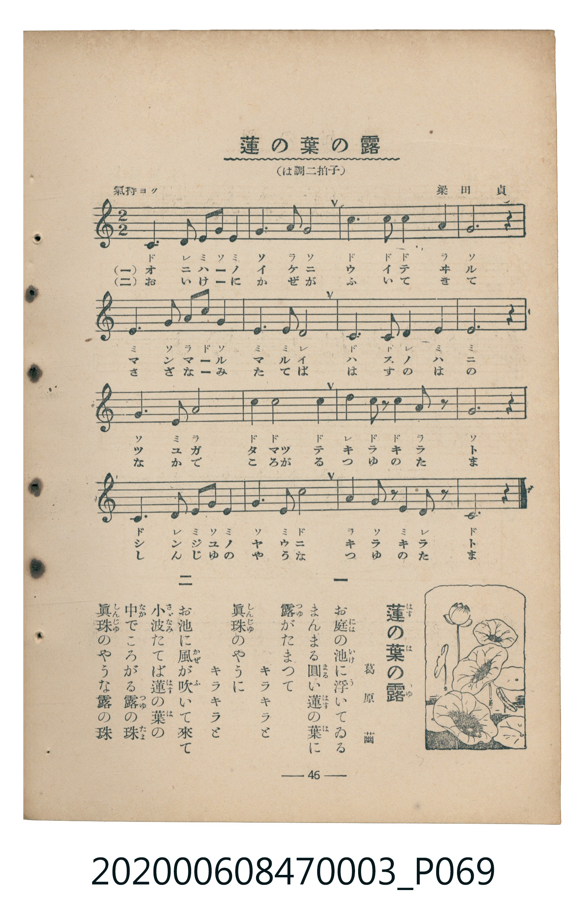

# 蓮の葉の露

<audio controls src="hasu_no_ha_no_tsuyu.mp3"></audio>

- 詞：葛原齒
- 曲：梁田貞
- 臺灣教育會公認《新定兒童唱歌》尋常科第三學年用（2020.006.0847.0003）

## 說明

原書資訊與歌詞全文（對應 P069.jpg，書頁 p. 46，補充教材第 9 首）：
調性與拍號：は調二拍子（2/2 拍，以 4/4 拍記譜），氣持ヨク ♩=100

## 歌詞

```text
一
あの蓮の葉の　露の玉
ほんとにきれいな　露の玉
小さな玉が　あつまつて
大きな玉に　なりました

二
あの蓮の葉の　露の玉
ほんとにきれいな　露の玉
朝風そつと　吹いたれば
ころころ落ちて　ゆきました
```

## ABC

```abc
X:1
T:蓮の葉の露
C:曲：梁田貞
M:4/4
L:1/16
Q:1/4=100
K:C
V:V1 name="Piano" snm="Pia"
[V:V1]
c6 d2 e3 g e4 | g4 a4 g6 z2 | c6 c2 c4 a4 | g12 z4 |
e6 g2 a3 c g4 | e4 e4 d6 z2 | c6 c2 d4 e4 | e12 z4 |
g6 e2 a8 | c4 c4 c6 z2 | d4 c2 z2 c4 a2 z2 | g12 z4 |
c6 d2 e3 g e4 | g4 e4 c6 z2 | a4 g2 z2 e4 d2 z2 | c12 z4 |
```

## TMD 檔案連結

- [主旋律 TMD 檔案](hasu_no_ha_no_tsuyu.tmd)
- [鋼琴伴奏 TMD 檔案](hasu_no_ha_no_tsuyu_piano.tmd)

## 分析

```text
================================================================================
📊 TMD Song Profile: [ 蓮の葉の露 ]
================================================================================
⏱  Duration:       0:38 (38.4s), 16 measures total
🎼 Key & Tempo:    首調基準 C, != 100.0 BPM, <4/4>
   - 分析範圍：      由實際發聲的音符與和弦推測調性；播放脈絡另行呈現
🎤 人聲音域:    C4 (MIDI 60) – D5 (MIDI 74) [跨度: 14 個半音 / 1.2 個八度, 難度: moderate]
   - 最低音:  C4 in [HasuNoHaNoTsuyu #1 @ m.1, 0:00]
   - 最高音: D5 in [HasuNoHaNoTsuyu #1 @ m.11, 0:24]
   - 適合: soprano, mezzo-soprano, contralto, tenor, baritone, bass
🏛  結構:      HasuNoHaNoTsuyu (38.4s)
⚡ 編曲密度:        Peak 1 軌道同時演奏
🗝  調性診斷：       C 大調（純淨自然大調，未偵測到可信轉調）
   - 風格氣質:    純淨自然大調（陽光明朗、易唱易記，無明顯調外色彩）
   - 轉調歷程:    全曲維持單一推測調性（未偵測到可信轉調）
   - 核心骨幹音:  C, E, G, A, D
   - 調性數值:    C 大調 [相關度: 0.91, 穩定度: High, 自然音純度: 100.0%]
   - 候選調性 (K-S): C 大調 (0.91), E 小調 (0.68), G 大調 (0.63)
   - 五度圈歷程:   +0
   - 各段落調性細節:
     • [HasuNoHaNoTsuyu #1]: C 大調 (r: 0.91, 自然音純度: 100.0%)

  [ 五度圈游移軌跡 ]
              [C ]*
         F            G  
      Bb               D  
      Eb               A  
         Ab           E  
            Db       B  
               F# 
     (* = active key center)

  [ 十二半音累積音高分佈 ]
     C  : ████████████████████████  31.7%
     C# :                            0.0%
     D  : ███████                    8.9%
     D# :                            0.0%
     E  : ██████████████████        24.1%
     F  :                            0.0%
     F# :                            0.0%
     G  : ██████████████████        24.1%
     G# :                            0.0%
     A  : ████████                  11.2%
     A# :                            0.0%
     B  :                            0.0%
--------------------------------------------------------------------------------
Assignment 軌道音域：
  - Piano         : C4 – D5 (14 個半音 / 1.2 個八度, 50 個音符)
================================================================================
```


## 原書掃描頁




