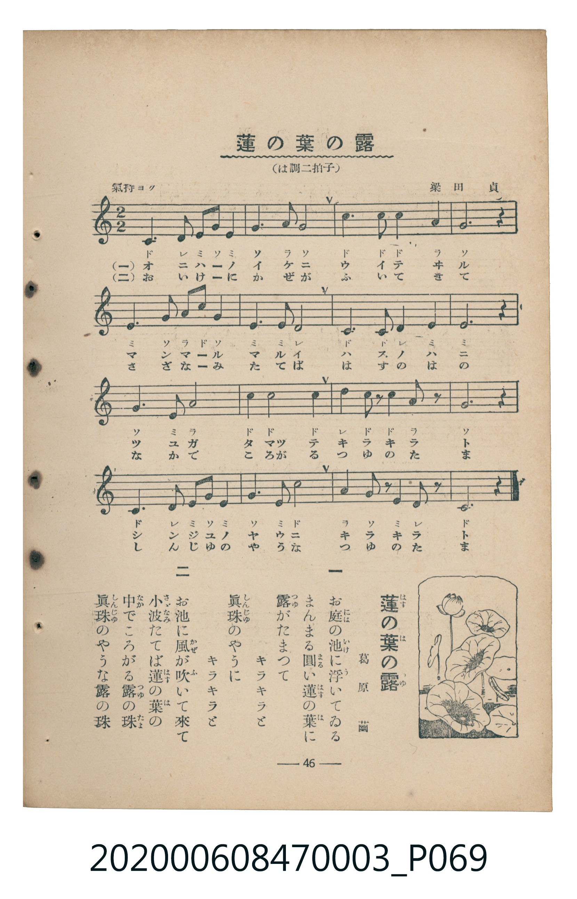

# 蓮の葉の露

> Re:Shōka 使用 AI 協助辨識與重建樂譜，可能會有錯誤。歡迎回報。

- **鋼琴伴奏版**：<br><audio controls src="hasu_no_ha_no_tsuyu.mp3"></audio>
- **NEUTRINO 歌聲合成版**：<br><audio controls src="hasu_no_ha_no_tsuyu_neutrino.mp3"></audio>

- 詞：葛原𦱳
- 曲：梁田貞
- 臺灣教育會公認《新定兒童唱歌》尋常科第三學年用（2020.006.0847.0003）

## 說明

原書資訊與歌詞全文（對應 P069.jpg，書頁 p. 46，補充教材第 9 首）：
調性與拍號：は調二拍子（2/2 拍，以 4/4 拍記譜），氣持ヨク ♩=100


## 歌詞

```text
一
あの蓮の葉の　露の玉
ほんとにきれいな　露の玉
小さな玉が　あつまつて
大きな玉に　なりました

二
あの蓮の葉の　露の玉
ほんとにきれいな　露の玉
朝風そつと　吹いたれば
ころころ落ちて　ゆきました
```

## ABC

<div class="abc-score" data-abc-src="hasu_no_ha_no_tsuyu.abc" aria-label="五線譜載入中"></div>

[下載 ABC 原始檔](hasu_no_ha_no_tsuyu.abc)

## TMD 檔案連結

- [主旋律 TMD 檔案](hasu_no_ha_no_tsuyu.tmd) [[在 TMD Studio 編輯](https://tmdlang.github.io/Tmd-TS/#tmd=s7IKdvYPcrWy4qpTUCpJTLdSSM7PyUlNLsnMz7MqzsjMK0nNjM_KTMmPL87Iz05Ugisry88pzU21Si9KTEmNN443MjAyiDcwMIs3sDAxBzIMjBFKi_NLi5JTrYqTM_Lzc-JLUitKkvLzsxHyBUX5Zal5iXlANQVFIBtTwIoQClLLMlNSQdKpKZkl-UWZiTlI7kgtKga7FWxJfElRYl5xclFmAcgDCFUlGalAx5anJgIZRejCxamJxfl5xQhhoBXpmXlWJYmZQE-DPF6eGJ-bmJmXk5iXgqyqJCMf6P-CjEqrjMxikMOSE3PisxPzkIIJ6qyCxPRUqwADM0slLi0thReT1z1uXPdiYieQfDlnk4KWFpeirYKhgQGXva2CM5eNib6JHciEFyvnvd8z68XE2U_75n9YtnEz2NhnszcBBZ8tanw-ZcOLTfPAYi_adz1vXPxs6swXTZuezWl-2rrmxarexw1dz6ZteLpu1tPWSc9XL306ZeOztT2PG7qfbuh-umPH8-UTn69Z82RH59O1O57u3PJ8yor3ezpAsagHjEU9UCwCGQbG7_d0KnFx6Wsp2FILcCkoKAD982z2jheb21-s6HrR0Q50F9CrT1tXPJvWDnTF0w29z9o7FUDBpZdVkP5-Tw9Q8csFjQoFegomZkDui8Vznra2Ar37bO4EoCcULBVeLpsGdCkwXECmv1i1_1nDcpC53b0vZs4Hij5uXA8UfLKrByjydO0EkE_1jRSAHKBhT3YvVQAGOIj3YsWMF2vngA3qebZh8bOexsfNKx43rVd4NHOlLSh6QKY_2dEAoh43NoHiECkmHzc0ACMTyHje1wlRsftx0-THjSseN65-3Nj7uKnncWPL48ZV6Oqebuh_3DgVKAHkP24ExlAD2Owljxv3gcllYEVLloPMgCpaDVa06nFTF1jR9MeN8yFu29VDXbc9mzP35SKgorlgl6wASj-dsBOsdD5YzwaIYZMfNwHdBiJfTNj7uHEh0NEgFza1gd0McyFQKeXJBwoUtPS5uDwSi0v98j0S_fJDiksrS60CMhPz8h1qDGqqQXYp2Fho2YEZwORrqGtiBQ0XYGJ43DgTxlgHFF0CdimQPx_oWJDJIE01CoYKukBopKBhDGaYaqpq6OpqKoB4NQqmYDEzKA0SMYwDM4AUmGWGpAwCDUAiYLN9DGsUHjetAos-bu5W0Hjc3A9RpAnk94F1Pm5aApFv2ghWA7PmcdMyqPgSoHgb2IQNEJnm1Ui2xSNsMwLKNXZBdDW2AG1rnAi3rRGkByQPseFx4xwg7kHY1rgVrg8Yq2BWL1QG4g5024CBbaprAQps7EkMd3hDgxkYcsAABAUcTMgYGAnwUIYEMlgEEhMQNViDuHkeNIg3Q9mQIEKWWQ0PaIg4JB4eN-2ERgREBCQDiwJsgTsVGkjTgBgUrY8b90MDaT5UZhkQg6IJFqzroeIzgXgdmAUSAcmAeFiD1VLX0AgUrsDsBcyioBIDEoKg-EIqMhaDLIMHKiQBGoOTI1I6hSZWKKNGwQgqaABLvAb4E29zCzT8gP5qWoPwVxPI38DQhSkAcUBpFCS1FsxbCfQUMhtkWAeeoIXmEmD6fNy4HCkAJ4NEQcUOLLE-bgLFEEgKFJ_AJAayCBq28yEWAVMbjrA1NNY1NAMFLrBE3Q0paWGBC0whqEUtZglhDAwq5GLBGCoDEgEFvCkw-EDyRuBghclhCdam7dAwAybYph2Q4IWVB82w8gAkhlwekBeu06GmTQayZ4CDCxJYIBOhkdsIEoOEP-kBW8vFpWungFZEKwCFlLkA)]
- [鋼琴伴奏 TMD 檔案](hasu_no_ha_no_tsuyu_piano.tmd) [[在 TMD Studio 編輯](https://tmdlang.github.io/Tmd-TS/#tmd=s7IKdvYPcrWy4qpTUCpJTLdSyC8qychPL0osyKi0ysgsLskvykxOzInPTsxLVIIrKs4vLUpOjS9ITE-1CjAws1Ti0tJSeDF53ePGdS8mdgLJl3M2vd_T8bJ7z_MJW57s2fJ0af_zzo73ezoVtLS4FG0VDA0MuOxtFZy5bEz0TexAxr5YOe_9nlkvJs5-2jf_w7KNm8F2PZsNNGXWs0WNz6dseLFpHljsRfuu542Ln02d-aJp07M5zU9b17xY1fu4oevZtA1P18162jrp-eqlT6dsfLa253FD99MN3U937Hi-fOLzNWue7Oh8unbH051bnk9ZAXSbkYGRgZ6BgZmegYWJOZBhYAx0nhIXl0dicalfvkeiX35IcWllqVVAZmJefpCHQ41BTTWXAhDYWGjZgRn6WgqGuiZWCo8bm4A-fty4_nHjTBhjHVB0yeOmNjB__uPGfQpa-mBNNQqGCrpAaKSgYQxmmGqqaujqaiqAeDUKpmAxMygNEjGMAzOAFJhlhqQMAg1AImCzfQxrFB43rQKLPm7uVtB43NwPUaQJ5PeBdT5uWgKRb9oIVgOz5nHTMqj4EqB4G9iEDRCZ5tVItsUjbDMCyjV2QXQ1tgBta5wIt60RpAckD7HhceMcIO5B2Na4Fa7vcSPI5seNvVAZiDvQbQMGtqmuBSiwdz9umvy4cQXQCqCex009QDMeN67CHd7QYAaGHDAAQQEHEzIGRgI8lCGBDBaBxAREDdYgbp4HDeLNUDYkiJBlVsMDGiIOiYfHTTuhEQERAcnAogBb4E6FBtI0IAZF6-PG_dBAmg-VWQbEoGiCBet6qPhMIF4HZoFEQDIgHtZgtdQ1NAKF68LHjZuAVgJtgoQgKL7ASXsJmLMYZBk8UCEJ0BicHJHSKTSxQhk1CkZQQQNY4jXAn3ibW6DhB_RX0xqEv5pA_gaGLkwBiANKoyCptWDeSqCnkNkgwzrwBC00lwDT5-PG5UgBOBkk2tSLSKyPm0AxBJICxScwiYEsgobtfIhFwNSGI2wNjXUNzUCB2wVKt8DkighcYAoBcpqAEkDOdJBZGCWEMTCokIsFY6gMSAQU8KbA4APJG4GDFSaHJVibtkPDDJhgm3ZAghdWHjTDygOQGHJ5QF64ToeaNhnIngEOLkhggUyERm4jSAwS_qQHbC2OEtoHuYQ2gZbQwECJV4g2jIVREL4JmA8KMhMID0ohqwbKopoAUgM3AcgwjYcYYQako83icyEiKEpwGQO2CmE1OEugyYLNMo2HW4PHN0AGyA0Q7yDcBtaN7hRg4OnaKaCFX7QPUAE2YSOwsDIXAA)]

## 分析

```text
================================================================================
📊 TMD Song Profile: [ 蓮の葉の露 ]
================================================================================
⏱  Duration:       0:38 (38.4s), 16 measures total
🎼 Key & Tempo:    首調基準 C, != 100.0 BPM, <4/4>
   - 分析範圍：      由實際發聲的音符與和弦推測調性；播放脈絡另行呈現
🎤 人聲音域:    C4 (MIDI 60) – D5 (MIDI 74) [跨度: 14 個半音 / 1.2 個八度, 難度: moderate]
   - 最低音:  C4 in [HasuNoHaNoTsuyu #1 @ m.1, 0:00]
   - 最高音: D5 in [HasuNoHaNoTsuyu #1 @ m.11, 0:24]
   - 適合: soprano, mezzo-soprano, contralto, tenor, baritone, bass
🏛  結構:      HasuNoHaNoTsuyu (38.4s)
⚡ 編曲密度:        Peak 1 軌道同時演奏
🗝  調性診斷：       C 大調（純淨自然大調，未偵測到可信轉調）
   - 風格氣質:    純淨自然大調（陽光明朗、易唱易記，無明顯調外色彩）
   - 轉調歷程:    全曲維持單一推測調性（未偵測到可信轉調）
   - 核心骨幹音:  C, G, E, D, A
   - 調性數值:    C 大調 [相關度: 0.92, 穩定度: High, 自然音純度: 100.0%]
   - 候選調性 (K-S): C 大調 (0.92), G 大調 (0.66), E 小調 (0.66)
   - 五度圈歷程:   +0
   - 各段落調性細節:
     • [HasuNoHaNoTsuyu #1]: C 大調 (r: 0.92, 自然音純度: 100.0%)

  [ 五度圈游移軌跡 ]
              [C ]*
         F            G  
      Bb               D  
      Eb               A  
         Ab           E  
            Db       B  
               F# 
     (* = active key center)

  [ 十二半音累積音高分佈 ]
     C  : ████████████████████████  32.8%
     C# :                            0.0%
     D  : ███████                    9.5%
     D# :                            0.0%
     E  : ████████████████          22.0%
     F  :                            0.0%
     F# :                            0.0%
     G  : ███████████████████       26.3%
     G# :                            0.0%
     A  : ███████                    9.5%
     A# :                            0.0%
     B  :                            0.0%
--------------------------------------------------------------------------------
Assignment 軌道音域：
  - Piano         : C4 – D5 (14 個半音 / 1.2 個八度, 50 個音符)
================================================================================
```


## 原書掃描頁




