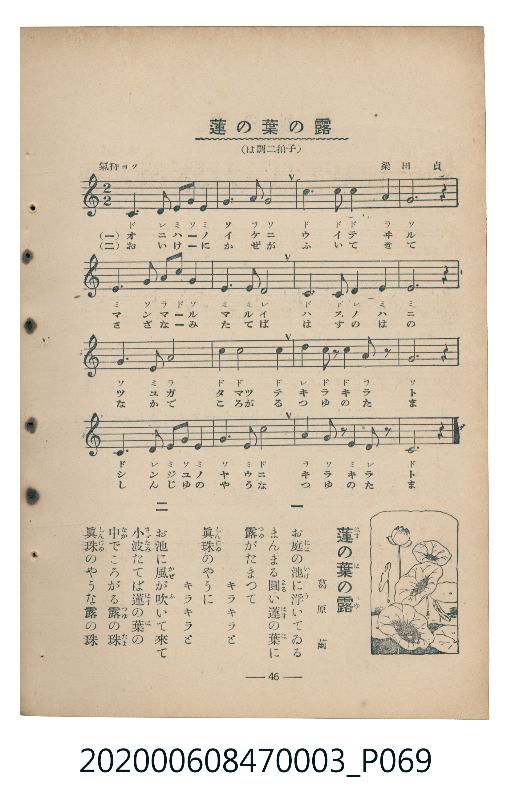

# 蓮の葉の露

> Re:Shōka 使用 AI 協助辨識與重建樂譜，可能會有錯誤。歡迎回報。

- **NEUTRINO 歌聲合成版**：<br><audio controls src="hasu_no_ha_no_tsuyu_neutrino.mp3"></audio>
- **鋼琴伴奏版**：<br><audio controls src="hasu_no_ha_no_tsuyu.mp3"></audio>


- 詞：葛原齒
- 曲：梁田貞
- 臺灣教育會公認《新定兒童唱歌》尋常科第三學年用（2020.006.0847.0003）

## 說明

原書資訊與歌詞全文（對應 P069.jpg，書頁 p. 46，補充教材第 9 首）：
調性與拍號：は調二拍子（2/2 拍，以 4/4 拍記譜），氣持ヨク ♩=100


## 歌詞

```text
一
あの蓮の葉の　露の玉
ほんとにきれいな　露の玉
小さな玉が　あつまつて
大きな玉に　なりました

二
あの蓮の葉の　露の玉
ほんとにきれいな　露の玉
朝風そつと　吹いたれば
ころころ落ちて　ゆきました
```

## ABC

```abc
X:1
T:蓮の葉の露
C:曲：梁田貞
M:4/4
L:1/16
Q:1/4=100
K:C
V:V1 name="Piano" snm="Pia"
[V:V1]
C6 D2 E3 G E4 | G6 A2 G8 | c6 c2 c4 A4 | G12 z4 |
w: 1.~オ ニ ハ _ ノ | イ ケ ニ | ウ イ テ ヰ | ル
w: 2.~お い け _ に | か ぜ が | ふ い て き | て
E6 G2 A2 c2 G4 | E6 E2 D8 | C6 C2 D4 E4 | E12 z4 |
w: 1.~マ ン マ _ ル | マ ル イ | ハ ス ノ ハ | ニ
w: 2.~さ ざ な _ み | た て ば | は す の は | の
G6 E2 A8 | c4 c8 c4 | d4 c2 z2 c4 A2 z2 | G12 z4 |
w: 1.~ツ ユ ガ | タ マツ テ | キ ラ キ ラ | ト
w: 2.~な か で | こ ろが る | つ ゆ の た | ま
C6 D2 E2 G2 E4 | G6 E2 C8 | A4 G2 z2 E4 D2 z2 | C12 z4 |
w: 1.~シ ン ジ ユ ノ | ヤ ウ ニ | キ ラ キ ラ | ト
w: 2.~し ん じ ゆ の | や う な | つ ゆ の た | ま
```

## TMD 檔案連結

- [主旋律 TMD 檔案](hasu_no_ha_no_tsuyu.tmd) [[在 TMD Studio 編輯](https://tmdlang.github.io/Tmd-TS/#tmd=s7IKdvYPcrWy4qpTUCpJTLdSSM7PyUlNLsnMz7MqzsjMK0nNjM_KTMmPL87Iz05Ugisry88pzU21Si9KTEmNN443MjAyiDcwMIs3sDAxBzIMjBFKi_NLi5JTrYqTM_Lzc-JLUitKkvLzsxHyBUX5Zal5iXlANQVFIBtTwIoQClLLMlNSQdKpKZkl-UWZiTlI7kgtKga7FWxJfElRYl5xclFmAcgDCFUlGalAx5anJgIZRejCxamJxfl5xUpcWloKLyave9y47sXETiD5cs4mBS0tLkVbBUMDAy57WwVnLhsTfRM7kPYXK-e93zPrxcTZT_vmv9w7CWzks9mbgGLPFjU-n7LhxaZ5YLEX7bueNy5-NnXmi6ZNz-Y0P21d82JV7-OGrmfTNjxdN-tp66Tnq5c-nbLx2dqexw3dTzd0P92x4_nyic_XrHmyo_Pp2h1Pd255PmXF-z0doPDVA4avHih8gQwD4_d7OpW4uPS1FGypBbgUFBSA3nk2e8eLze0vVnS96GgHugvo06etK55Nawe64umG3mftnQoBBmaWelkF6e_39AAVv1zQqFCgp2BiBuS-WDznaWsr0LvP5k4AekLBUuHlsmlAlwLDBWT6i1X7nzUsB5nb3fti5nyg6OPG9UDBJ7t6gCJP104A-VTfSAHIARr2ZPdSBWB4g3gvVsx4sXYO2KCeZxsWP-tpfNy84nHTeoVHM1fagmIHZPqTHQ0g6nFjEygKkSLycUMDMC6BjOd9nRAVux83TX7cuOJx4-rHjb2Pm3oeN7Y8blyFru7phv7HjVOBEkD-40ZgDDWAzV7yuHEfmFwGVrRkOcgMqKLVYEWrHjd1gRVNf9w4H-K2XT3UdduzOXNfLgIqmgt2yQqg9NMJO8FK54P1bIAYNvlxE9BtIPLFhL2PGxcCHQ1yYVMb2M0wFwKVUp58oEBBS5-LyyOxuNQv3yPRLz-kuLSy1CogMzEv36HGoKYaZJeCjYWWHZgBTL6GuiZW0HABJobHjTNhjHVA0SVglwL584GOBZkM0lSjYKigC4RGChrGYIappqqGrq6mAohXo2AKFjOD0iARwzgwA0iBWWZIyiDQACQCNtvHsEbhcdMqsOjj5m4FjcfN_RBFmkB-H1jn46YlEPmmjWA1MGseNy2Dii8BireBTdgAkWlejWRbPMI2I6BcYxdEV2ML0LbGiXDbGkF6QPIQGx43zgHiHoRtjVvh-oCxCmb1QmUg7kC3DRjYproWoMDGnsRwhzc0mIEhBwxAUMDBhIyBkQAPZUggg0UgMQFRgzWIm-dBg3gzlA0JImSZ1fCAhohD4uFx005oREBEQDKwKMAWuFOhgTQNiEHR-rhxPzSQ5kNllgExKJpgwboeKj4TiNeBWSARkAyIhzVYLXUNjUDhCsxewCwKKjEgIQiKL6QiYzHIMnigQhKgMTg5IqVTaGKFMmoUjKCCBrDEa4A_8Ta3QMMP6K-mNQh_NYH8DQxdmAIQB5RGQVJrwbyVQE8hs0GGdeAJWmguAabPx43LkQJwMkgUVOzAEuvjJlAMgaRA8QlMYiCLoGE7H2IRMLXhCFtDY11DM1DgAkvU3ZCSFha4wBSCWtRilhDGwKBCLhaMoTIgEVDAmwKDDyRvBA5WmByWYG3aDg0zYIJt2gEJXlh50AwrD0BiyOUBeeE6HWraZCB7Bji4IIEFMhEauY0gMUj4kx6wtVxcunYKaEW0AlBImQsA)]
- [鋼琴伴奏 TMD 檔案](hasu_no_ha_no_tsuyu_piano.tmd) [[在 TMD Studio 編輯](https://tmdlang.github.io/Tmd-TS/#tmd=s7IKdvYPcrWy4tLSUngxed3jxnUvJnYCyZdzNr3f0_Gye8_zCVue7NnydGn_886O93s6FbS0uBRtFQwNDLjsbRWcuWxM9E3suOoUlF6snPd-z6wXE2c_7Zv_cu8kJZDYs9lAQ2Y9W9T4fMqGF5vmgcVetO963rj42dSZL5o2PZvT_LR1zYtVvY8bup5N2_B03aynrZOer176dMrGZ2t7Hjd0P93Q_XTHjufLJz5fs-bJjs6na3c83bnl-ZQVQKcZGRgZ6BkYmOkZWJiYAxkGxkDXKXFxeSQWl_rleyT65YcUl1aWWgVkJublB3k41BjUVHMpAIGNhZYdmKGvpWCoa2Kl8LixCejhx43rHzfOhDHWAUWXPG5qA_PnP27cp6ClD9ZUo2CooAuERgoaxmCGqaaqhq6upgKIV6NgChYzg9IgEcM4MANIgVlmSMog0AAkAjbbx7BG4XHTKrDo4-ZuBY3Hzf0QRZpAfh9Y5-OmJRD5po1gNTBrHjctg4ovAYq3gU3YAJFpXo1kWzzCNiOgXGMXRFdjC9C2xolw2xpBekDyEBseN84B4h6EbY1b4foeN4JsftzYC5WBuAPdNmBgm-pagAJ79-OmyY8bVwCtAOp53NQDNONx4yrc4Q0NZmDIAQMQFHAwIWNgJMBDGRLIYBFITEDUYA3i5nnQIN4MZUOCCFlmNTygIeKQeHjctBMaERARkAwsCrAF7lRoIE0DYlC0Pm7cDw2k-VCZZUAMiiZYsK6His8E4nVgFkgEJAPiYQ1WS11DI1C4LnzcuAloJdAmSAiC4guctJeAOYtBlsEDFZIAjcHJESmdQhMrlFGjYAQVNIAlXgP8ibe5BRp-QH81rUH4qwnkb2DowhSAOKA0CpJaC-atBHoKmQ0yrANP0EJzCTB9Pm5cjhSAk0GiTb2IxPq4CRRDIClQfAKTGMgiaNjOh1gETG04wtbQWNfQDBS4XaB0C0yuiMAFphAgpwkoAeRMB5mFUUIYA4MKuVgwhsqAREABbwoMPpC8EThYYXJYgrVpOzTMgAm2aQckeGHlQTOsPACJIZcH5IXrdKhpk4HsGeDgggQWyERo5DaCxCDhT3rA1uIooX2QS2gTaAkNDJR4hWjDWBgF4ZuA-aAgM4HwoBSyaqAsqgkgNXATgAzTeIgRZkA62iw-FyKCogSXMWCrEFaDswSaLNgs03i4NXh8A2SA3ADxDsJtYN3oTgEGnq6dAlr4RfsAFWATNgILK3MBAA)]

## 分析

```text
================================================================================
📊 TMD Song Profile: [ 蓮の葉の露 ]
================================================================================
⏱  Duration:       0:38 (38.4s), 16 measures total
🎼 Key & Tempo:    首調基準 C, != 100.0 BPM, <4/4>
   - 分析範圍：      由實際發聲的音符與和弦推測調性；播放脈絡另行呈現
🎤 人聲音域:    C4 (MIDI 60) – D5 (MIDI 74) [跨度: 14 個半音 / 1.2 個八度, 難度: moderate]
   - 最低音:  C4 in [HasuNoHaNoTsuyu #1 @ m.1, 0:00]
   - 最高音: D5 in [HasuNoHaNoTsuyu #1 @ m.11, 0:24]
   - 適合: soprano, mezzo-soprano, contralto, tenor, baritone, bass
🏛  結構:      HasuNoHaNoTsuyu (38.4s)
⚡ 編曲密度:        Peak 1 軌道同時演奏
🗝  調性診斷：       C 大調（純淨自然大調，未偵測到可信轉調）
   - 風格氣質:    純淨自然大調（陽光明朗、易唱易記，無明顯調外色彩）
   - 轉調歷程:    全曲維持單一推測調性（未偵測到可信轉調）
   - 核心骨幹音:  C, G, E, D, A
   - 調性數值:    C 大調 [相關度: 0.92, 穩定度: High, 自然音純度: 100.0%]
   - 候選調性 (K-S): C 大調 (0.92), G 大調 (0.66), E 小調 (0.66)
   - 五度圈歷程:   +0
   - 各段落調性細節:
     • [HasuNoHaNoTsuyu #1]: C 大調 (r: 0.92, 自然音純度: 100.0%)

  [ 五度圈游移軌跡 ]
              [C ]*
         F            G  
      Bb               D  
      Eb               A  
         Ab           E  
            Db       B  
               F# 
     (* = active key center)

  [ 十二半音累積音高分佈 ]
     C  : ████████████████████████  32.8%
     C# :                            0.0%
     D  : ███████                    9.5%
     D# :                            0.0%
     E  : ████████████████          22.0%
     F  :                            0.0%
     F# :                            0.0%
     G  : ███████████████████       26.3%
     G# :                            0.0%
     A  : ███████                    9.5%
     A# :                            0.0%
     B  :                            0.0%
--------------------------------------------------------------------------------
Assignment 軌道音域：
  - Piano         : C4 – D5 (14 個半音 / 1.2 個八度, 50 個音符)
================================================================================
```


## 原書掃描頁




