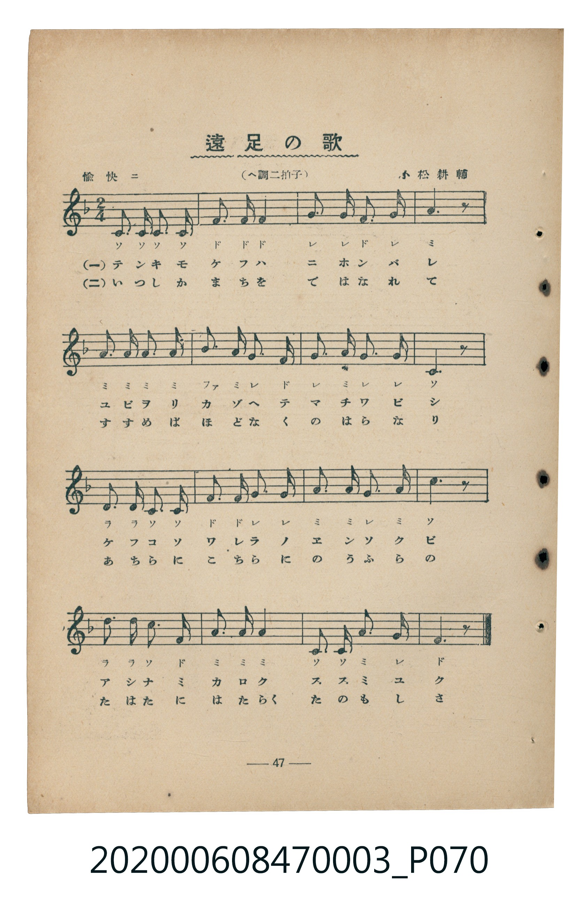
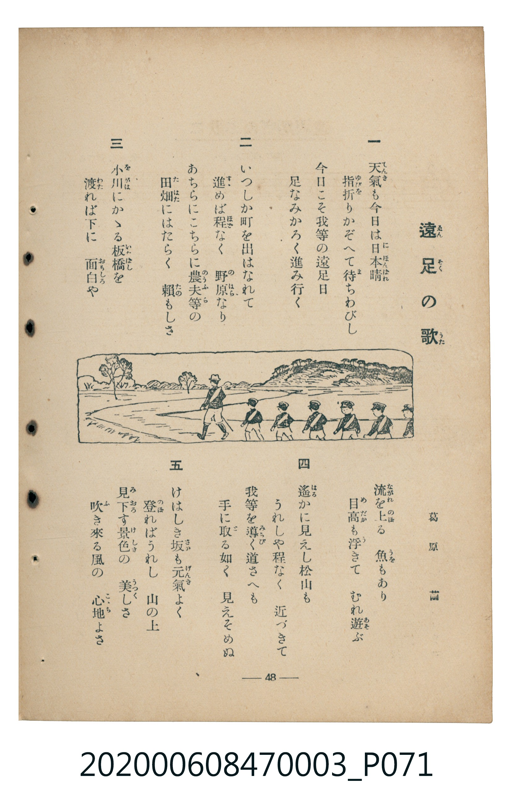

# 遠足の歌

> Re:Shōka 使用 AI 協助辨識與重建樂譜，可能會有錯誤。歡迎回報。

- **鋼琴伴奏版**：<br><audio controls src="ensoku_no_uta.mp3"></audio>
- **NEUTRINO 歌聲合成版**：<br><audio controls src="ensoku_no_uta_neutrino.mp3"></audio>

- 詞：葛原𦱳
- 曲：小松耕輔
- 臺灣教育會公認《新定兒童唱歌》尋常科第三學年用（2020.006.0847.0003）

## 說明

原書資訊與歌詞全文（對應 P070.jpg–P071.jpg，書頁 pp. 47–48，補充教材第 10 首）：
調性與拍號：へ調二拍子（F 大調 2/4 拍），愉快ニ ♩=116


## 歌詞

```text
一
天氣も今日は日本晴
指折りかぞへて待ちわびし
今日こそ我等の遠足日
足なみかろく進み行く

二
いつしか町を出はなれて
進めば程なく　野原なり
あちらにこちらに農夫等の
田畑にはたらく　頼もしさ

三
小川にかゝる板橋を
渡れば下に　面白や
流を上る　魚もあり
目高も浮きて　むれ遊ぶ

四
遙かに見えし松山も
うれしや程なく　近づきて
我等を導く道さへも
手に取る如く　見えそめぬ

五
けはしき坂も元氣よく
登ればうれし　山の上
見下す景色の　美しさ
吹き來る風の　心地よさ
```

## ABC

<div class="abc-score" data-abc-src="ensoku_no_uta.abc" aria-label="五線譜載入中"></div>

[下載 ABC 原始檔](ensoku_no_uta.abc)

## TMD 檔案連結

- [主旋律 TMD 檔案](ensoku_no_uta.tmd) [[在 TMD Studio 編輯](https://tmdlang.github.io/Tmd-TS/#tmd=s7IKdvYPcrWy4qpTUCpJTLdSSM7PyUlNLsnMz7MqzsjMK0nNjM_KTMmPL87Iz05Ugisry88pzU21Si9KTEmNN443MjAyiDcwMIs3sDAxBzIMjBFKi_NLi5JTrYqTM_Lzc-JLUitKkvLzsxHyBUX5Zal5iXlANQVFIBtTwIoQClLLMlNSQdKpKZkl-UWZiTlI7kgtKga7FWxJfElRYl5xclFmAcgDCFUlGalAx0JdkJOZloqQApqXnplnVZKYCfQhyJflifG5iZl5OYl5KciqSjLygZ4tyKi0ysgsBrkiOTEnPjsxDylMoG4oSExPtQowMDfQBRKGSlxaWgovGxe82Lb5ceO6Z2t7FLS0uBRtFQwNzbjsbRXcuGyM9E3sQGa8WDnv_Z5ZLybOfto3_8OyjZvBBj-bvQko-HRD_7O5-140TH2xZwpY-EX7rueNi59NnfmiadOzOc1PW9e8WNX7uKHr2bQNT9fNeto66fnqpU-nbARa97ih--mG7qc7djxfPvH5mjVPdnQ-Xbvj6c4tz6eseL-nAxRvesB40wPFG5BhYPx-T6cSF5e-loIttQCXgoIC0EvPZu94sbn9xYquFx3tQHcBffu0dcWzae1AVzzd0PusvVMBFGZ6WQXpjxomg0IOxHy_pweo7-WCRoWCAj0FE3OglIkFUPDF4jlPW1uB_n82dwLQVwqGBgovl00Duh0YWCD7Xqza_6xhOcim7t4XM-cDRR837gAKPtnVAxR5unYC0FY3hadLlgPFFIARoAAUBevuedbS-XT_6sfN3QqPZq60BcUSyLwnOxrA3liy8tmGxY-bmp7s7no2fenjxvVA8tmcNc9mbgFJP-tpf9Y143FT1-PG7seN84BWPm5c9nRf6-PGhY-b-h83AlPAdLBpUN2THzfOfdYx8fnaTmDSgKQRoDjY_aDUsupx436QSU29jxv7XzZsAnJfLOwBsiFO2tUDoh43tjxuXAI0GKjy-ZRdj5smPW3fBXQYSHsTUPEykCKQ5qbGx40bnq8AOgxobv_jhoaX7X3AaAGr64KY1AR2KNAxq8Fug7Jf7Nv0dMlqiCNB6p5P2fB86kSwIqAt88GKwOYt2AMMGbBLpkIDrRMcaBv6n26fC1YP9Mvcx03dz-buf7YSyJ4EDrQdQHuADt3wZAfQbatBBs1d9Hzm3sdNLWDprY1AhU92dAH1geTWzgJb0gR19PPZ616uBgZ507Ot6x43AgNqGVDR4yYg6nnZCIyHbWCXPJ09GxwMjTPBMbP6xTIg2QF0KjBXPd24EagdEgBtYJdMB1qNHFAv9gN9C4wukOlgJ0GiDBjSG_pAMQMKq6mgyIYY86wTZMXT_mlAFz9dBnQr2AyojUDvA-NhDTQGp0CsBRoPDElguPU-nQv0WNPT1mZwMgOq7wd7cuZuSBAhXNjQAHJ34zpgwIDTy7JucPDNfDZz_YtOYEpZB1TxfB_QeeDYAAXBhJ1A85_sAxrQ_XLRCoiKp_ubn87ZALYIrIjyzA4FClr6XFyuecX52aV--aEliVYBmYl5-Q41BjXVIHsUbCy07MAMYEFjqGtiBQyEZY-bgOHYC45dYIBsBYYJUBSYaIB-B0oAXQksOvXBmmoUNEzjFXSB0DReU1VDV1cTUwCoxhAsYggVAPGAgkZgQSOYNogaGLdGwRjMN1CoAVvkYwjU8bi5DSz4uHkzUMPjprVQ3iKwJY-bNkL5UzWBRD_EFlD5ARGdDdLTvBnKmwDS87h5DZgbD7PFCKSjsQWipnEJSEfjdCivG2JL4z4ofyHQlqZJUFsal0NF14P1rILwmnrAtjQuQ7XFGOxakFaQDqAaoI71UN5qqC1QV4NsBaYTmC0wl80H69kA5U0H2wI1EG6LCVgH1NwmoDlIpsJs2Q_ldwBtAXsUxYdg_zfB7NwHsaUJ1RZTsI6JKL6HhVgv1JapyH4B6QeLQv3fNBmspxfKA7oEFGKg2EPYAkybproWwLTZ1AYqu5smoZXsINchF-1IyROSjIxhqQyVC5Q3QZWHJEpYSoWnUjR5RCqFJna0ZAqJ78fNYK81b4LyVkGT6WqoV4EBCpSdAZVtg8g2z4PyG8Gy0OgDmQQK_O2ogQ9JrjOhwTsTHF2NUN4GaODvhvJXIifMxn6o7DrkiGvqhPLALgWGMaptkGQLiRloEgSWBKi2waIekkAhPoUE5ONGiHHAFICcSJrAiQSWytASLzS7g7IRko4Wony2EMqHJPylUB7ENvQMCUnEsLDYg9Vn2NwC9RlyFkEyBxyjwASKYhcwKVvqGhqByllI2QpqeoASLrA2AdXf60C5EVzOAitqUHJGSstmkMRmRnxRi5Fe0fMDavIGpmcwHzU5I5erQB60BG3aC02wsCS6BpxgV0J5fdCgWQHlQ0rsvVC9wOQGKn0no0YDJDlDChhw-YqUJGElFkQLLlmkoAfytkJt64REBEQSNTnDkw04WmGR3jQJzTxIkoCUnrDkDEsQQLVAOZirgYkbS9YBJ2dY1oEkIZjb4XbBymKwz4DxjpqcUWVhJeoOPGUyTEcX2LZeKA9YSKCU2MC6A1H6Nq5D9Ru0BoRleUg9A7UcKUEbGusamoFSNKTNidJaBlkJRvvBhXc_cnIGm2MGT8xgLlLRi5pUQTxszQ2IKkQKh2QAtBS8CBrW28FpFFoQNQMLKeQCuXktqH4CJWew6E6onp1gPfOhapZBQhyS6NFSLlQNtBaE8WBpE1bDA22FtNShFsEVAgMfKSFhDWxoGQwr4xcgV-qgchUl8oBlHaSkA-tpgKqClF8wW-ZCbNmGaguk9IXWYiAPAHnQjAxqSIBlp0BlV4BsgfsFqUEB5M2F6gHWZSBb0BpbkGQKzaQg1yKSGtwWWINlDsgWUG5EKQQgTQdoSQ9rOiBCrJaLS9dOAanxqwDkKnMBAA)]
- [鋼琴伴奏 TMD 檔案](ensoku_no_uta_piano.tmd) [[在 TMD Studio 編輯](https://tmdlang.github.io/Tmd-TS/#tmd=s7IKdvYPcrWy4qpTUCpJTLdSyC8qychPL0osyKi0ysgsLskvykxOzInPTsxLVIIrKs4vLUpOjS9ITE-1CjAwN9AFEoZKXFpaCi8bF7zYtvlx47pna3ve7-l42b3n-YQtT_Zsebq0_3lnx_s9nQpaWlyKtgqGhmZc9rYKblw2RvomdiCDX6yc937PrBcTZz_tm_9h2cbNYNuezd4EFHy6of_Z3H0vGqa-2DMFLPyifdfzxsXPps580bTp2Zzmp61rXqzqfdzQ9WzahqfrZj1tnfR89dKnUzYC3fC4ofvphu6nO3Y8Xz7x-Zo1T3Z0Pl274-nOLc-nrAA6z8jAyEDPwMBMz8DCxBzIMDAGulCJi8s1rzg_u9QvP7Qk0SogMzEvP8jDocagpppLAQhsLLTswIwaBQ3TeAVdIDSN11TV0NXVxBQAqjEEixhCBUA8oKARWNAIpg2iBsatUTAG8w0UasAW-RgCdTxubgMLPm7eDNTwuGktlLcIbMnjpo1Q_lRNINEPseVxczdUdDZIT_NmKG8CSM_j5jVgbjzMFiOQjsYWiJrGJSAdjdOhvG6ILY37oPyFQFuaJkFtaVwOFV0P1rMKwmvqAdvSuAzVFmOwa0FaQTqAaoA61kN5q6G2QF0NsvVxE4iD4rL5YD0boLzpYFugBsJtMQHrgJrbBDQHyVSYLfuh_A6gLWCPovgQ7P8mmJ37ILY0odpiCtYxEcX3sBDrhdoyFdkvIP1gUaj_myaD9fRCeUCXgEIMFHsIW4DqIcnBGJZaULlAeRNUeUjigqU4eGpDk0ekNmiiRUtukHh73Ax2YvMmKG8VNLmthjoZGDBA2RlQ2TaIbPM8KL8RLAuNBpBJoEDcjhqIkGQ3ExpMM8HB3gjlbYAG4m4ofyVyAmvsh8quQ46Apk4oD-zSx01dqLZBkh8khKFJqakHzTZYFEISGsSnkIB83AgxDhiTyJHdBI5sWGpBS4TQbAvKDkg6Wojy2UIoH5KAZ0F5ENvQMxYkMcLCYg9Wn2FzC9RnyEkdyRxwjD5u3IFiF1C9GSTNmBFf8mEkO_RkjZpKgckSzEdNlcjFHJAHLdCa9kLTHSylrQGnu5VQXh_UhyugfEgBuheqF5hqQIXhZNTQhKRKSH4HF3dIKQtWgEC04JJFCkEgbyvUtk5IeEIkUVMlPPbBsQOLu6ZJaOZBYhZSmMFSJSxegWqBcjBXA9MolhwATpWwHABJCTC3w-2CFY1gnzVCQxmeKlFlYQXcDjxFJExHF9i2XigPmNdRClBgUY4oDBvXofoNWiHBci6k2IdajpwuwQJm8FQJ5iIVhahpDsTDVo1DVCGSKiQloyXFRdBA2w5ObNCCoRlYaCAXkM1rQeU-KF2CRXdC9ewE65kPVbMMEnSQ1IuWBKFqoLULjAdLZLCaE2grMBYhwYOiDRiKSCkCa6hBy0RYmbsAubIElXMosQAseyAlD1hPA1QVpDyB2TIXYss2VFsgpSG0VgF5AMiD5khQBQ2WnQKVXQGyBe4XpIoayJsL1QOsW0C2oDViIOkNmttArkWkGbgtsIbAHJAtoGyFkpshVTK05IVVyYgQq8XSPPRBbh6awJuHhvEK0abxsVCWIYhhGo8sBktQSApMQArM4nNBbCMQ2wisGKQPoRqsCKzcDMU8bCYj1OJxBNBTunYKSP6K9jGMBRuALmyEXdgYu7AJdmFTuLAyFwA)]

## 分析

```text
================================================================================
📊 TMD Song Profile: [ 遠足の歌 ]
================================================================================
⏱  Duration:       0:16 (16.6s), 16 measures total
🎼 Key & Tempo:    首調基準 F, != 116.0 BPM, <2/4>
   - 分析範圍：      由實際發聲的音符與和弦推測調性；播放脈絡另行呈現
🎤 人聲音域:    C4 (MIDI 60) – D5 (MIDI 74) [跨度: 14 個半音 / 1.2 個八度, 難度: moderate]
   - 最低音:  C4 in [EnsokuNoUta #1 @ m.1, 0:00]
   - 最高音: D5 in [EnsokuNoUta #1 @ m.13, 0:12]
   - 適合: soprano, mezzo-soprano, contralto, tenor, baritone, bass
🏛  結構:      EnsokuNoUta (16.6s)
⚡ 編曲密度:        Peak 1 軌道同時演奏
🗝  調性診斷：       F 大調（純淨自然大調，未偵測到可信轉調）
   - 風格氣質:    純淨自然大調（陽光明朗、易唱易記，無明顯調外色彩）
   - 轉調歷程:    全曲維持單一推測調性（未偵測到可信轉調）
   - 核心骨幹音:  A, C, F, G, D
   - 調性數值:    F 大調 [相關度: 0.79, 穩定度: Moderate, 自然音純度: 100.0%]
   - 候選調性 (K-S): F 大調 (0.79), C 大調 (0.75), A 小調 (0.74)
   - 五度圈歷程:   -1
   - 各段落調性細節:
     • [EnsokuNoUta #1]: F 大調 (r: 0.79, 自然音純度: 100.0%)

  [ 五度圈游移軌跡 ]
               C  
        [F ]*          G  
      Bb               D  
      Eb               A  
         Ab           E  
            Db       B  
               F# 
     (* = active key center)

  [ 十二半音累積音高分佈 ]
     C  : ███████████████████████   25.8%
     C# :                            0.0%
     D  : ██████                     6.7%
     D# :                            0.0%
     E  :                            0.0%
     F  : █████████████████         19.2%
     F# :                            0.0%
     G  : █████████████████         19.2%
     G# :                            0.0%
     A  : ████████████████████████  26.7%
     A# : ██                         2.5%
     B  :                            0.0%
--------------------------------------------------------------------------------
Assignment 軌道音域：
  - Piano         : C4 – D5 (14 個半音 / 1.2 個八度, 50 個音符)
================================================================================
```


## 原書掃描頁






