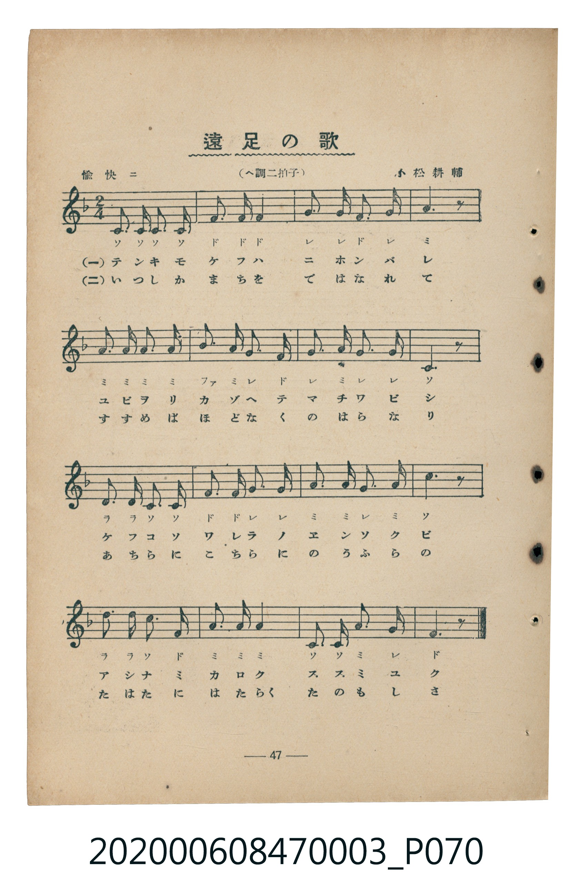
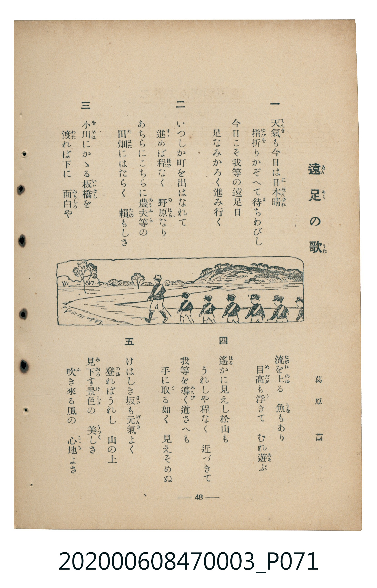

# 遠足の歌

> Re:Shōka 使用 AI 協助辨識與重建樂譜，可能會有錯誤。歡迎回報。

- **鋼琴伴奏版**：<br><audio controls src="ensoku_no_uta.mp3"></audio>
- **NEUTRINO 歌聲合成版**：<br><audio controls src="ensoku_no_uta_neutrino.mp3"></audio>

- 詞：葛原齒
- 曲：小松耕輔
- 臺灣教育會公認《新定兒童唱歌》尋常科第三學年用（2020.006.0847.0003）

## 說明

原書資訊與歌詞全文（對應 P070.jpg–P071.jpg，書頁 pp. 47–48，補充教材第 10 首）：
調性與拍號：へ調二拍子（F 大調 2/4 拍），愉快ニ ♩=116

## 歌詞

```text
一
天氣も今日は日本晴
指折りかぞへて待ちわびし
今日こそ我等の遠足日
足なみかろく進み行く

二
いつしか町を出はなれて
進めば程なく　野原なり
あちらにこちらに農夫等の
田畑にはたらく　頼もしさ

三
小川にかゝる板橋を
渡れば下に　面白や
流を上る　魚もあり
目高も浮きて　むれ遊ぶ

四
遙かに見えし松山も
うれしや程なく　近づきて
我等を導く道さへも
手に取る如く　見えそめぬ

五
けはしき坂も元氣よく
登ればうれし　山の上
見下す景色の　美しさ
吹き來る風の　心地よさ
```

## ABC

```abc
X:1
T:遠足の歌
C:曲：小松耕輔
M:2/4
L:1/16
Q:1/4=116
K:F
V:V1 name="Piano" snm="Pia"
[V:V1]
C3 C C3 C | F3 F F4 | G3 G F3 G | A6 z2 |
w: 1.~テ ン キ モ | ケ フ ハ | ニ ホ ン バ | レ
w: 2.~い つ し か | ま ち を | で は な れ | て
w: 3.~を が は に | か か る | い た ば し | を
w: 4.~は る か に | み え し | ま つ や ま | も
w: 5.~け は し き | さ か も | げ ん き よ | く
A3 A A3 A | B3 A G3 F | G3 A G3 G | C6 z2 |
w: 1.~ユ ビ ヲ リ | カ ゾ ヘ テ | マ チ ワ ビ | シ
w: 2.~す す め ば | ほ ど な く | の は ら な | り
w: 3.~わ た れ ば | し た に _ | お も し ろ | や
w: 4.~う れ し や | ほ ど な く | ち か づ き | て
w: 5.~の ぼ れ ば | う れ し _ | や ま の う | へ
D3 D C3 C | F3 F G3 G | A3 A G3 A | c6 z2 |
w: 1.~ケ フ コ ソ | ワ レ ラ ノ | エ ン ソ ク | ビ
w: 2.~あ ち ら に | こ ち ら に | の う ふ ら | の
w: 3.~な が れ を | の ぼ る _ | う を も あ | り
w: 4.~わ れ ら を | み ち び く | み ち さ へ | も
w: 5.~み お ろ す | け し き の | う つ く し | さ
d3 d c3 F | A3 A A4 | C3 C A3 G | F6 z2 |
w: 1.~ア シ ナ ミ | カ ロ ク | ス ス ミ ユ | ク
w: 2.~た は た に | は た らく | た の も し | さ
w: 3.~め だ か も | う き て | む れ あ そ | ぶ
w: 4.~て に と る | ご と く | み え そ め | ぬ
w: 5.~ふ き く る | か ぜ の | こ こ ち よ | さ
```

## TMD 檔案連結

- [主旋律 TMD 檔案](ensoku_no_uta.tmd) [[在 TMD Studio 編輯](https://tmdlang.github.io/Tmd-TS/#tmd=s7IKdvYPcrWy4qpTUCpJTLdSSM7PyUlNLsnMz7MqzsjMK0nNjM_KTMmPL87Iz05Ugisry88pzU21Si9KTEmNN443MjAyiDcwMIs3sDAxBzIMjBFKi_NLi5JTrYqTM_Lzc-JLUitKkvLzsxHyBUX5Zal5iXlANQVFIBtTwIoQClLLMlNSQdKpKZkl-UWZiTlI7kgtKga7FWxJfElRYl5xclFmAcgDCFUlGalAx0JdkJOZlqrEpaWl8LJxwYttmx83rnu2tkdBS4tL0VbB0NCMy95WwY3LxkjfxA6k_8XKee_3zHoxcfbTvvkv904Cm_ls9iag2NMN_c_m7nvRMPXFnilg4Rftu543Ln42deaLpk3P5jQ_bV3zYlXv44auZ9M2PF0362nrpOerlz6dshFo2-OG7qcbup_u2PF8-cTna9Y82dH5dO2Opzu3PJ-y4v2eDlBg6gEDUw8UmECGgfH7PZ1KXFz6Wgq21AJcCgoKQB89m73jxeb2Fyu6XnS0A90F9OzT1hXPprUDXfF0Q--z9k6FAANzA72sgvRHDZOBTEMQ8_2eHqC-lwsaFQoK9BRMzIFSJhZAwReL5zxtbQX6_9ncCUBfKRgaKLxcNg3odmBggex7sWr_s4blIJu6e1_MnA8Ufdy4Ayj4ZFcPUOTp2glAW90Uni5ZDhRTAIa_AlAUrLvnWUvn0_2rHzd3KzyaudIWFEkg857saAB7Y8nKZxsWP25qerK769n0pY8b1wPJZ3PWPJu5BST9rKf9WdeMx01djxu7HzfOA1r5uHHZ032tjxsXPm7qf9wITADTwaZBdU9-3Dj3WcfE52s7gSkDkkSA4mD3gxLLqseN-0EmNfU-bux_2bAJyH2xsAfIhjhpVw-IetzY8rhxCdBgoMrnU3Y9bpr0tH0X0GEg7U1AxctAikCamxofN254vgLoMKC5_Y8bGl629wGjBayuC2JSE9ihQMesBrsNyn6xb9PTJashjgSpez5lw_OpE8GKgLbMBysCm7dgDzBkwC6ZCg20TnCgbeh_un0uWD3QL3MfN3U_m7v_2UogexI40HYA7QE6dMOTHUC3rQYZNHfR85l7Hze1gKW3NgIVPtnRBdQHkls7C2xJE9TRz2eve7kaGORNz7aue9wIDKhlQEWPm4Co52UjMB62gV3ydPZscDA0zgTHzOoXy4BkB9CpwFz1dONGoHZIALSBXTIdaDVyQL3YD_QtMLpApoOdBIkyYEhv6APFDCispoIiG2LMs06QFU_7pwFd_HQZ0K1gM6A2Ar0PjIc10BicArEWaDwwJIHh1vt0LtBjTU9bm8HJDKi-H-zJmbshQYRwYUMDyN2N64ABA04vy7rBwTfz2cz1LzqBKWUdUMXzfUDngWMDFAQTdgLNf7IPaED3y0UrICqe7m9-OmcD2CKwIsozOxQoaOlzcbnmFednl_rlh5YkWgVkJublO9QY1FSD7FGwsdCyAzOABY2hrokVMBCWPW4ChmMvOHaBAbIVGCZAUWCiAfodKAF0JbDk1AdrqlHQMI1X0AVC03hNVQ1dXU1MAaAaQ7CIIVQAxAMKGoEFjWDaIGpg3BoFYzDfQKEGbJGPIVDH4-Y2sODj5s1ADY-b1kJ5i8CWPG7aCOVP1QQS_RBbQOUHRHQ2SE_zZihvAkjP4-Y1YG48zBYjkI7GFoiaxiUgHY3TobxuiC2N-6D8hUBbmiZBbWlcDhVdD9azCsJr6gHb0rgM1RZjsGtBWkE6gGqAOtZDeauhtkBdDbIVmE5gtsBcNh-sZwOUNx1sC9RAuC0mYB1Qc5uA5iCZCrNlP5TfAbQF7FEUH4L93wSzcx_EliZUW0zBOiai-B4WYr1QW6Yi-wWkHywK9X_TZLCeXigP6BJQiIFiD2ELMG2a6loA02ZTG6jsbpqEVrKDXIdctCMlT0gyMoalMlQuUN4EVR6SKGEpFZ5K0eQRqRSa2NGSKSS-HzeDvda8CcpbBU2mq6FeBQYoUHYGVLYNIts8D8pvBMtCow9kEijwt6MGPiS5zoQG70xwdDVCeRuggb8byl-JnDAb-6Gy65AjrqkTygO7FBjGqLZBki0kZqBJEFgSoNoGi3pIAoX4FBKQjxshxgFTAHIiaQInElgqQ0u80OwOykZIOlqI8tlCKB-S8JdCeRDb0DMkJBHDwmIPVp9hcwvUZ8hZBMkccIwCEyiKXcCkbKlraAQqZyFlK6jpAUq4wNoEVH-vA-VGcDkLrKhByRkpLZtBEpsZ8UUtRnpFzw-oyRuYnsF81OSMXK4CedAStGkvNMHCkugacIJdCeX1QYNmBZQPKbH3QvUCkxuo9J2MGg2Q5AwpYMDlK1KShJVYEC24ZJGCHsjbCrWtExIREEnU5AxPNuBohUV60yQ08yBJAlJ6wpIzLEEA1QLlYK4GJm4sWQecnGFZB5KEYG6H2wUri8E-A8Y7anJGlYWVqDvwlMkwHV1g23qhPGAhgVJiA-sOROnbuA7Vb9AaEJblIfUM1HKkBG1orGtoBkrRkDYnSmsZZCUY7QcX3v3IyRlsjhk8MYO5SEUvalIF8bA1NyCqECkckgHQUvAiaFhvB6dRaEHUDCykkAvk5rWg-gmUnMGiO6F6doL1zIeqWQYJcUiiR0u5UDXQWhDGg6VNWA0PtBXSUodaBFcIDHykhIQ1sKFlMKyMX4BcqYPKVZTIA5Z1kJIOrKcBqgpSfsFsmQuxZRuqLZDSF1qLgTwA5EEzMqghAZadApVdAbIF7hekBgWQNxeqB1iXgWxBa2xBkik0k4Jci0hqcFtgDZY5IFtAuRGlEIA0HaAlPazpgAixWi4uXTsFpMavApCrzAUA)]
- [鋼琴伴奏 TMD 檔案](ensoku_no_uta_piano.tmd) [[在 TMD Studio 編輯](https://tmdlang.github.io/Tmd-TS/#tmd=s7IKdvYPcrWy4tLSUnjZuODFts2PG9c9W9vzfk_Hy-49zydsebJny9Ol_c87O97v6VTQ0uJStFUwNDTjsrdVcOOyMdI3seOqU1B6sXLe-z2zXkyc_bRv_su9k5RAYs9mbwKKPd3Q_2zuvhcNU1_smQIWftG-63nj4mdTZ75o2vRsTvPT1jUvVvU-buh6Nm3D03WznrZOer566dMpG4FOeNzQ_XRD99MdO54vn_h8zZonOzqfrt3xdOeW51NWAF1nZGBkoGdgYKZnYGFiDmQYGAMdqMTF5ZpXnJ9d6pcfWpJoFZCZmJcf5OFQY1BTzaUABDYWWnZgRo2Chmm8gi4QmsZrqmro6mpiCgDVGIJFDKECIB5Q0AgsaATTBlED49YoGIP5Bgo1YIt8DIE6Hje3gQUfN28GanjctBbKWwS25HHTRih_qiaQ6IfY8ri5Gyo6G6SneTOUNwGk53HzGjA3HmaLEUhHYwtETeMSkI7G6VBeN8SWxn1Q_kKgLU2ToLY0LoeKrgfrWQXhNfWAbWlchmqLMdi1IK0gHUA1QB3robzVUFugrgbZ-rgJxEFx2Xywng1Q3nSwLVAD4baYgHVAzW0CmoNkKsyW_VB-B9AWsEdRfAj2fxPMzn0QW5pQbTEF65iI4ntYiPVCbZmK7BeQfrAo1P9Nk8F6eqE8oEtAIQaKPYQtQPWQ5GAMSy2oXKC8Cao8JHHBUhw8taHJI1IbNNGiJTdIvD1uBjuxeROUtwqa3FZDnQwMGKDsDKhsG0S2eR6U3wiWhUYDyCRQIG5HDURIspsJDaaZ4GBvhPI2QANxN5S_EjmBNfZDZdchR0BTJ5QHdunjpi5U2yDJDxLC0KTU1INmGywKIQkN4lNIQD5uhBgHjEnkyG4CRzYstaAlQmi2BWUHJB0tRPlsIZQPScBLoTyIbegZC5IYYWGxB6vPsLkF6jPkpI5kDjhGHzfuQLELqN4MkmbMiC_5MJIderJGTaXAZAnmo6ZK5GIOyIMWaE17oekOltLWgNPdSiivD-rDFVA-pADdC9ULTDWgwnAyamhCUiUkv4OLO6SUBStAIFpwySKFIJC3FWpbJyQ8IZKoqRIe--DYgcVd0yQ08yAxCynMYKkSFq9AtUA5mKuBaRRLDgCnSlgOgKQEmNvhdsGKRrDPGqGhDE-VqLKwAm4HniISpqMLbFsvlAfM6ygFKLAoRxSGjetQ_QatkGA5F1LsQy1HTpdgATN4qgRzkYpC1DQH4mGrxiGqEEkVkpLRkuIiaKBtByc2aMHQDCw0kAvI5rWgch-ULsGiO6F6doL1zIeqWQYJOkjqRUuCUDXQ2gXGgyUyWM0JtBUYi5DgQdEGDEWkFIE11KBlIqzMXYBcWYLKOZRYAJY9kJIHrKcBqgpSnsBsmQuxZRuqLZDSEFqrgDwA5EFzJKiCBstOgcquANkC9wtSRQ3kzYXqAdYtIFvQGjGQ9AbNbSDXItIM3BZYQ2AOyBZQtkLJzZAqGVrywqpkRIjVYmke-iA3D03gzUPDeIVo0_hYKMsQxDCNRxaDJSgkBSYgBWbxuSC2EYhtBFYM0odQDVYEVm6GYh42kxFq8TgC6CldOwUkf0X7GMaCDUAXNsIubIxd2AS7sClcWJkLAA)]

## 分析

```text
================================================================================
📊 TMD Song Profile: [ 遠足の歌 ]
================================================================================
⏱  Duration:       0:16 (16.6s), 16 measures total
🎼 Key & Tempo:    首調基準 F, != 116.0 BPM, <2/4>
   - 分析範圍：      由實際發聲的音符與和弦推測調性；播放脈絡另行呈現
🎤 人聲音域:    C4 (MIDI 60) – D5 (MIDI 74) [跨度: 14 個半音 / 1.2 個八度, 難度: moderate]
   - 最低音:  C4 in [EnsokuNoUta #1 @ m.1, 0:00]
   - 最高音: D5 in [EnsokuNoUta #1 @ m.13, 0:12]
   - 適合: soprano, mezzo-soprano, contralto, tenor, baritone, bass
🏛  結構:      EnsokuNoUta (16.6s)
⚡ 編曲密度:        Peak 1 軌道同時演奏
🗝  調性診斷：       F 大調（純淨自然大調，未偵測到可信轉調）
   - 風格氣質:    純淨自然大調（陽光明朗、易唱易記，無明顯調外色彩）
   - 轉調歷程:    全曲維持單一推測調性（未偵測到可信轉調）
   - 核心骨幹音:  A, C, F, G, D
   - 調性數值:    F 大調 [相關度: 0.79, 穩定度: Moderate, 自然音純度: 100.0%]
   - 候選調性 (K-S): F 大調 (0.79), C 大調 (0.75), A 小調 (0.74)
   - 五度圈歷程:   -1
   - 各段落調性細節:
     • [EnsokuNoUta #1]: F 大調 (r: 0.79, 自然音純度: 100.0%)

  [ 五度圈游移軌跡 ]
               C  
        [F ]*          G  
      Bb               D  
      Eb               A  
         Ab           E  
            Db       B  
               F# 
     (* = active key center)

  [ 十二半音累積音高分佈 ]
     C  : ███████████████████████   25.8%
     C# :                            0.0%
     D  : ██████                     6.7%
     D# :                            0.0%
     E  :                            0.0%
     F  : █████████████████         19.2%
     F# :                            0.0%
     G  : █████████████████         19.2%
     G# :                            0.0%
     A  : ████████████████████████  26.7%
     A# : ██                         2.5%
     B  :                            0.0%
--------------------------------------------------------------------------------
Assignment 軌道音域：
  - Piano         : C4 – D5 (14 個半音 / 1.2 個八度, 50 個音符)
================================================================================
```


## 原書掃描頁






