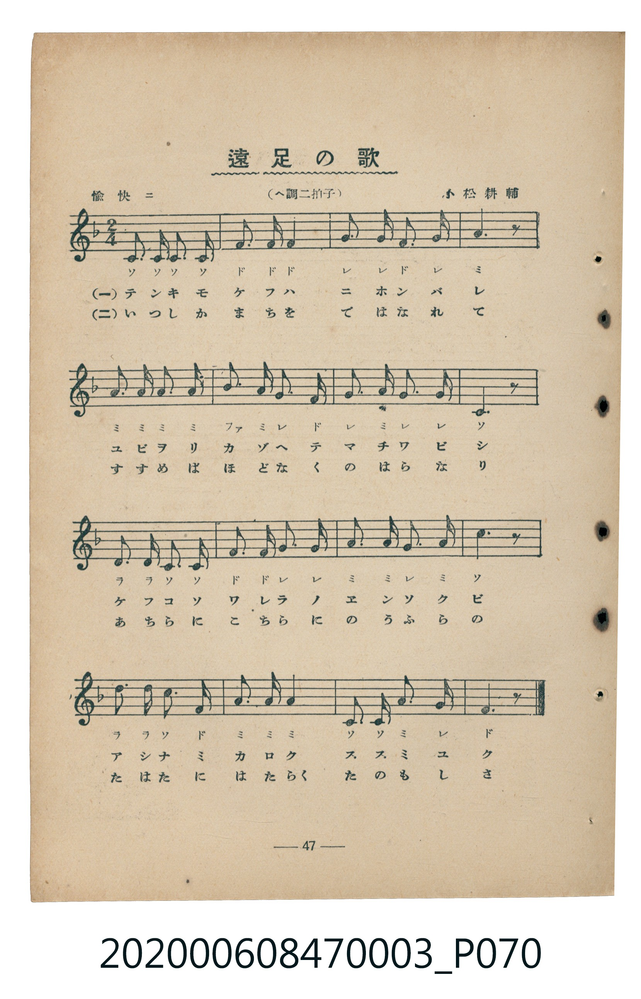
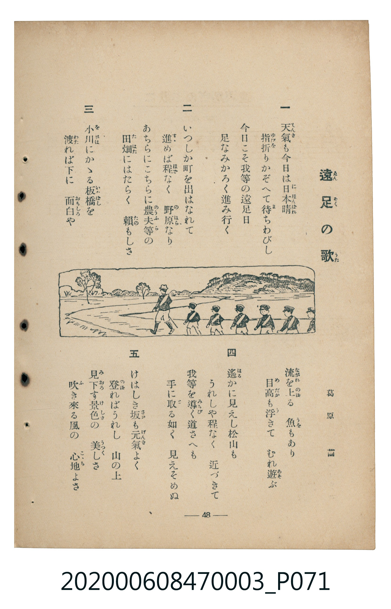

# 遠足の歌

<audio controls src="ensoku_no_uta.mp3"></audio>

- 詞：葛原齒
- 曲：小松耕輔
- 臺灣教育會公認《新定兒童唱歌》尋常科第三學年用（2020.006.0847.0003）

## 說明

原書資訊與歌詞全文（對應 P070.jpg–P071.jpg，書頁 pp. 47–48，補充教材第 10 首）：
調性與拍號：へ調二拍子（F 大調 2/4 拍），愉快ニ ♩=116

## 歌詞

```text
一
天氣も今日は日本晴
指折りかぞへて待ちわびし
今日こそ我等の遠足日
足なみかろく進み行く

二
いつしか町を出はなれて
進めば程なく　野原なり
あちらにこちらに農夫等の
田畑にはたらく　頼もしさ

三
小川にかゝる板橋を
渡れば下に　面白や
流を上る　魚もあり
目高も浮きて　むれ遊ぶ

四
遙かに見えし松山も
うれしや程なく　近づきて
我等を導く道さへも
手に取る如く　見えそめぬ

五
けはしき坂も元氣よく
登ればうれし　山の上
見下す景色の　美しさ
吹き來る風の　心地よさ
```

## ABC

```abc
X:1
T:遠足の歌
C:曲：小松耕輔
M:2/4
L:1/16
Q:1/4=116
K:F
V:V1 name="Piano" snm="Pia"
[V:V1]
C3 C C3 C | F3 F F4 | G3 G F3 G | A6 z2 |
A3 A A3 A | B3 A G3 F | G3 A G3 G | C6 z2 |
D3 D C3 C | F3 F G3 G | A3 A G3 A | c6 z2 |
d3 d c3 F | A3 A A4 | C3 C A3 G | F6 z2 |
```

## TMD 檔案連結

- [主旋律 TMD 檔案](ensoku_no_uta.tmd) [[在 TMD Studio 編輯](https://tmdlang.github.io/Tmd-TS/#tmd=s7IKdvYPcrWy4tLSUnjZuODFts2PG9c9W9ujoKXFpWirYGhoxmVvq-DGZWOkb2LHVaeg9GLlvPd7Zr2YOPtp3_yXeycpgcSezd4EFHu6of_Z3H0vGqa-2DMFLPyifdfzxsXPps580bTp2Zzmp61rXqzqfdzQ9WzahqfrZj1tnfR89dKnUzYCbXvc0P10Q_fTHTueL5_4fM2aJzs6n67d8XTnludTVrzf02FkYGSgZ2BgpmdgYWIOZBgYv9_TqcTFpa-lYEstwKWgoAD00bPZO15sbn-xoutFRzvQXUDPPm1d8WxaO9AVTzf0PmvvVAgwMDfQyypIf9QwGcg0BDHf7-kB6nu5oFGhoEBPwcQcKGViARR8sXjO09ZWoP-fzZ0A9JWCoYHCy2XTgG4HBhbIvher9j9rWA6yqbv3xcz5QNHHjTuAgk929QBFnq6dALTVTeHpkuVAMQVg-CsARcG6e561dD7dv_pxc7fCo5krbUGRBDLvyY4GsDeWrHy2YfHjpqYnu7ueTV_6uHE9kHw2Z82zmVtA0s962p91zXjc1PW4sftx4zyglY8blz3d1_q4ceHjpv7HjcAEMB1sGlT35MeNc591THy-thOYMiBJBCgOdj8osax63LgfZFJT7-PG_pcNm4DcFwt7gGyIk3b1gKjHjS2PG5cADQaqfD5l1-OmSU_bdwEdBtLeBFS8DKQIpLmp8XHjhucrgA4Dmtv_uKHhZXsfMFrA6rogJjWBHQp0zGqw26DsF_s2PV2yGuJIkLrnUzY8nzoRrAhoy3ywIrB5C_YAQwbskqnQQOsEB9qG_qfb54LVA_0y93FT97O5-5-tBLIngQNtB9AeoEM3PNkBdNtqkEFzFz2fufdxUwtYemsjUOGTHV1AfSC5tbPAljRBHf189rqXq4FB3vRs67rHjcCAWgZU9LgJiHpeNgLjYRvYJU9nzwYHQ-NMcMysfrEMSHYAnQrMVU83bgRqhwRAG9gl04FWIwfUi_1A3wKjC2Q62EmQKAOG9IY-UMyAwmoqKLIhxjzrBFnxtH8a0MVPlwHdCjYDaiPQ-8B4WAONwSkQa4HGA0MSGG69T-cCPdb0tLUZnMyA6vvBnpy5GxJECBc2NIDc3bgOGDDg9LKsGxx8M5_NXP-iE5hS1gFVPN8HdB44NkBBMGEn0Pwn-4AGdL9ctAKi4un-5qdzNoAtAiuiPLNDgYKWPheXa15xfnapX35oSaJVQGZiXr5DjUGNQjXIIgUbCy07MANY0hjqmlgBQ2HZ4yZgQPaCoxcYIluBgQIUBaYaoOeBEkBnAotOfbCmGgUN03gFXV0F03hNVQ1dXU0MPlCFIUjAEMoHckBiRiAxI5gesAoYr0bBGKhGV8FAoQbmMFNdC6DDmtpAObdpElq-BrptH3LGRnIb0CBdBWOYLSg8oKwJiizYRTBXwlyIKotwIciTqE601DU0AgUeJMBABQrIQcA0AsqV64ASHeDAA2Y_kDOR3GgGDi8zYsMP3SVofkRxNdCd6M40NNY1NAO5E1I-oJRsQFFgtgSi_eCg7kd2JNiNcCeiBRWKE0CRhyVZgNUgnA1KBhCH1XJx6dopICVRBSBXmYsLAA)]
- [鋼琴伴奏 TMD 檔案](ensoku_no_uta_piano.tmd) [[在 TMD Studio 編輯](https://tmdlang.github.io/Tmd-TS/#tmd=s7IKdvYPcrWy4tLSUnjZuODFts2PG9c9W9vzfk_Hy-49zydsebJny9Ol_c87O97v6VTQ0uJStFUwNDTjsrdVcOOyMdI3seOqU1B6sXLe-z2zXkyc_bRv_su9k5RAYs9mbwKKPd3Q_2zuvhcNU1_smQIWftG-63nj4mdTZ75o2vRsTvPT1jUvVvU-buh6Nm3D03WznrZOer566dMpG4FOeNzQ_XRD99MdO54vn_h8zZonOzqfrt3xdOeW51NWAF1nZGBkoGdgYKZnYGFiDmQYGAMdqMTF5ZpXnJ9d6pcfWpJoFZCZmJcf5OFQY1CjUM2lAAQ2Flp2YEaNgoZpvIKuroJpvKaqhq6uJgYfqMIQJGAI5QM5IDEjkJgRTA9YBYxXo2AMVKOrYKBQA7MDKKCrYAxTjcIDypqgyIJNhtkGswlVFmETyLGoVpmBnW9GrHfQDURzKorlQOswbANbBrcLzekoZoECBUtwg9Ug7AcFL8SGWiyR6IMSiSbwSDSMV4g2jY-FsgxBDNN4ZDGEk-EKTEAKzOJzQWwjENsIrBikD6EarAis3AzFPGwmI9TicQTQV7p2CkgeU8DkKnNxAQA)]

## 分析

```text
================================================================================
📊 TMD Song Profile: [ 遠足の歌 ]
================================================================================
⏱  Duration:       0:16 (16.6s), 16 measures total
🎼 Key & Tempo:    首調基準 F, != 116.0 BPM, <2/4>
   - 分析範圍：      由實際發聲的音符與和弦推測調性；播放脈絡另行呈現
🎤 人聲音域:    C4 (MIDI 60) – D5 (MIDI 74) [跨度: 14 個半音 / 1.2 個八度, 難度: moderate]
   - 最低音:  C4 in [EnsokuNoUta #1 @ m.1, 0:00]
   - 最高音: D5 in [EnsokuNoUta #1 @ m.13, 0:12]
   - 適合: soprano, mezzo-soprano, contralto, tenor, baritone, bass
🏛  結構:      EnsokuNoUta (16.6s)
⚡ 編曲密度:        Peak 1 軌道同時演奏
🗝  調性診斷：       F 大調（純淨自然大調，未偵測到可信轉調）
   - 風格氣質:    純淨自然大調（陽光明朗、易唱易記，無明顯調外色彩）
   - 轉調歷程:    全曲維持單一推測調性（未偵測到可信轉調）
   - 核心骨幹音:  A, C, F, G, D
   - 調性數值:    F 大調 [相關度: 0.79, 穩定度: Moderate, 自然音純度: 100.0%]
   - 候選調性 (K-S): F 大調 (0.79), C 大調 (0.75), A 小調 (0.74)
   - 五度圈歷程:   -1
   - 各段落調性細節:
     • [EnsokuNoUta #1]: F 大調 (r: 0.79, 自然音純度: 100.0%)

  [ 五度圈游移軌跡 ]
               C  
        [F ]*          G  
      Bb               D  
      Eb               A  
         Ab           E  
            Db       B  
               F# 
     (* = active key center)

  [ 十二半音累積音高分佈 ]
     C  : ███████████████████████   25.8%
     C# :                            0.0%
     D  : ██████                     6.7%
     D# :                            0.0%
     E  :                            0.0%
     F  : █████████████████         19.2%
     F# :                            0.0%
     G  : █████████████████         19.2%
     G# :                            0.0%
     A  : ████████████████████████  26.7%
     A# : ██                         2.5%
     B  :                            0.0%
--------------------------------------------------------------------------------
Assignment 軌道音域：
  - Piano         : C4 – D5 (14 個半音 / 1.2 個八度, 50 個音符)
================================================================================
```


## 原書掃描頁






