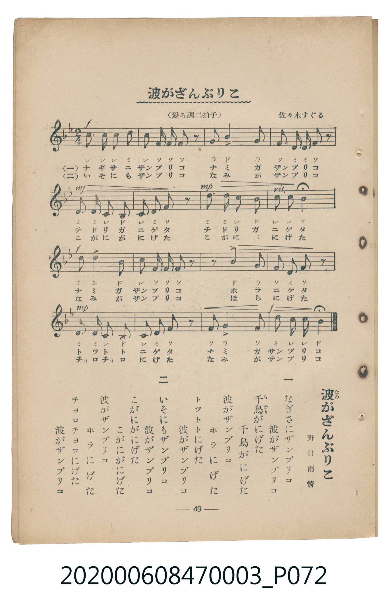

# 波がざんぶりこ

> Re:Shōka 使用 AI 協助辨識與重建樂譜，可能會有錯誤。歡迎[回報](https://github.com/TMDLang/reshoka/issues)。

- **鋼琴伴奏版**：<br><audio controls src="nami_ga_zanburiko.mp3"></audio>
- **NEUTRINO 歌聲合成版**：<br><audio controls src="nami_ga_zanburiko_neutrino.mp3"></audio>

- 詞：野口雨情
- 曲：佐々木のぼる
- 臺灣教育會公認《新定兒童唱歌》尋常科第三學年用（2020.006.0847.0003）

## 說明

原書資訊與歌詞全文（對應 P072.jpg，書頁 p. 49，補充教材第 11 首）：
調性與拍號：變ろ調二拍子（Bb 大調 2/4 拍），♩=108


## 歌詞

```text
一
波がざんぶりこ　どんどと打てば
岩がむつくりこ　顔を出した

二
波はあとから　またざんぶりこ
沖の鴎も　飛んで来た

三
お日が出た出た　波ざんぶりこ
舟が鴎と　浮いて来た
```

## ABC

<div class="abc-score" data-abc-src="nami_ga_zanburiko.abc" aria-label="五線譜載入中"></div>

[下載 ABC 原始檔](nami_ga_zanburiko.abc)

## TMD 檔案連結

- [主旋律 TMD 檔案](nami_ga_zanburiko.tmd) [[在 TMD Studio 編輯](https://tmdlang.github.io/Tmd-TS/#tmd=s7IKdvYPcrWy4qpTUCpJTLdSSM7PyUlNLsnMz7MqzsjMK0nNjM_KTMmPL87Iz05Ugisry88pzU21Si9KTEmNN443MjAyiDcwMIs3sDAxBzIMjBFKi_NLi5JTrYqTM_Lzc-JLUitKkvLzsxHyBUX5Zal5iXlANQVFIBtTwIoQClLLMlNSQdKpKZkl-UWZiTlI7kgtKga7FWxJfElRYl5xclFmAcgDCFUlGalAx-YllpQWpaKLlieWpBYhBIHmp2fmWZUkZgJ9DPJ1eWJ8bmJmXk5iXgqyqpKMfKDnCzIqrTIyi0GuSk7Mic9OzEMKI6ibChLTU60CDMyNlLi0tBSebV70uLHnceO0x02THzdue9zU9bhxsoKWFpeirYKhgQWXva2CUxKXjZG-iR3IoBcr573fM-tle9_T_sUvZ6941twKNv_Z7E1A4Sd7JzxuaH02Z8XjxnWPG_c8buoGS75o3_W8cfGzqTNfNG16Nqf5aeuaF6t6Hzd0PZu24em6WU9bJz1fvfTplI3P1vY8buh-uqH76Y4dz5dPfL5mzZMdnU_X7ni6c8vzKSve7-kARaoeMFL1QJEKZBgYv9_TqcTFpa-lYEstwKWgoPC0b_6z2TtebG5_saLrRUc70F1AXz9tXfFsWjvQFU839D5r71QABaBeVkH6-z09QMUvFzQqFOgpmFgCuS8Wz3na2gr07rO5E4CeUDA0VHi5bBrQqcAQAhn_YtX-Zw3LQQZ3976YOR8o-mJd1-OmXqD4k109QMGnaycA7XFKUni6ZDlQUAEY9gpAYbAJPY9mrrQFxQvIpCc7GkAU1ih83NDwuHElWGTl48YVzzqBjGWPGzeAPbgJKNTzuAmoYsnjxn64hpcLpzxumvS0fdfjxumPG-dD7NjVA7dj_ePGJqBZjxu7Hzd1gi3YB1SGZjFY9aZpwCTwckvf46YmkLmLZ4NVLH82dync3B2dIOpxY9ez6UDBHrCt8yEkUAvYPgxzX3QAbesBmQt0BVDRVmAyawH6C2ouUAXlKQAKFLT0ubj8EnMz3ROjEvOSSosys_OtAjIT8_IdagxqqkF2KdhYaNmBGcAUaKhrYgX0zarHjfux5CfkqHjc2AaJCpAVIN01CtVptQpGYGgM5BkpaJjGK5jGa6pq6GoCaQUDoKBZvIIhiNAFsoFCGsbxCsYoKsBG-RjWKDxu7lJ43LQOiLcC2d1A9Y-btj1u3qyg8bh5GlBklSZQYLNCPEgCpLR5PpC_BmwwLoUQs42AChpbgHguEK8GyjXhNbtxFRDvB-IewmYDA9BU1wIUgMDoBCYzSOJcDE-cQInux427ganzceMCSOpECr1cYPCBAkQXCCGBAgwVI2CAgdwBpIFS0FCszi2oBYaxMTCMDcEhDaKBroMHHtB5jWBzHjd3Ap3YDPQDMGxAIdUNZG0C4v3QkGsEKcGhAm4iMMg0QM4Hm9jYAzQRFHDAEAGFD4g1CYjnQ8ML5MseHCpgJgIDylLX0AiR1FDyJFAUS45ETWcg3-tCfY8lnRmAAwSY0MDJDB5yqKkLmGSA_oF4G1f8xwO5s8EBuRIz_JASFCSVgIOHgHGNu8G2dmIGHjwTGusamoHCBujtXnAlBAyVpsdNjaC0CgolcCkElkNJP8BEQVz6AVLgPAika4DhqAFMQJDQw0hFHdBU1AJKRR1gjC0VERGYqImpufFx83Ko2WtBZoP5QDbWJEVE4IKMr-Xi0rVTQCvtFIBCylwA)]
- [鋼琴伴奏 TMD 檔案](nami_ga_zanburiko_piano.tmd) [[在 TMD Studio 編輯](https://tmdlang.github.io/Tmd-TS/#tmd=s7IKdvYPcrWy4qpTUCpJTLdSyC8qychPL0osyKi0ysgsLskvykxOzInPTsxLVIIrKs4vLUpOjS9ITE-1CjAwN1Li0tJSeLZ50ePGnseN0x43TX7cuO1xU9fjxsnv93S87N7zfMKWJ3u2PF3a_7yz4_2eTgUtLS5FWwVDAwsue1sFpyQuGyN9EzuQ6S9Wznu_Z9bL9r6n_Ytfzl7xrLkVbOmz2ZuAwk_2Tnjc0PpszorHjeseN-553NQNlnzRvut54-JnU2e-aNr0bE7z09Y1L1b1Pm7oejZtw9N1s562Tnq-eunTKRufre153ND9dEP30x07ni-f-HzNmic7Op-u3fF055bnU1YA3WlkYGSgZ2BgpmdgYWIOZBgYA52qxMXll5ib6Z4YlZiXVFqUmZ1vFZCZmJcf5OFQY1BTzaUABDYWWnZghr6WgqGuiZXC48ZVjxv3YwYGUGIlmL_ycSPQE22PG5c9btygoKUP1l2jUJ1Wq2AEhsZAnpGChmm8gmm8pqqGriaQVjAACprFKxiCCF0gGyikYRyvYIyiAmyUj2GNwuPmLoXHTeuAeCuQ3Q1U_7hp2-PmzQoaj5unAUVWaQIFNivEgyRASpvnA_lrwAbjUggx2wiooLEFiOcC8WqgXBNesxtXAfF-IO4hbDYwAE11LUAB2PK4cT0oAJsaHjcuftzYDw_A7seNux83TXrcuOBx4_THjfORQi8XGHygANEFQkigAEPFCBhgIHcAaaAUNBSrcwtqgWFsDAxjQ3BIg2ig6-CBB3ReI9icx82dQCc2A_0ADBtQSHUDWZuAeD805BpBSnCogJsIDDINkPPBJjb2AE0EBRwwREDhA2JNAuL50PAC-bIHhwqYicCAstQ1NEIkNWBgNYETVffjJqBzGvcBVaOnPpR0BvK9LtT3WNKZAThAgAkNnMzgIYeauoBJBugfiLdxxX88kDsbHJArMcMPKUFBUgk4eAgY17gbbGsnZuDBM6GxrqEZKGyA3u4FFxbAUGl63NQISqugUAKFynKwHEr6ASYK4tIPkALnQSBdAwxHDWACgoQeRirqgKaiFlAq6gBjbKmIiMBETUzNjY-bl0PNXgsyG8wHsrEmKSICF2R8LY7Czge5sDOBFnagUIhXiDaNj4UyQQFjAhIyAYkAAw2WXsCcaLP4XGSVaEKgMEZSbEi-oWCFcCOBXtK1U0DzVbQP0HxswkZgYWUuAA)]

## 分析

```text
================================================================================
📊 TMD Song Profile: [ 波がざんぶりこ ]
================================================================================
⏱  Duration:       0:17 (17.8s), 16 measures total
🎼 Key & Tempo:    首調基準 B,, != 108.0 BPM, <2/4>
   - 分析範圍：      由實際發聲的音符與和弦推測調性；播放脈絡另行呈現
🎤 人聲音域:    A#3 (MIDI 58) – D5 (MIDI 74) [跨度: 16 個半音 / 1.3 個八度, 難度: moderate]
   - 最低音:  A#3 in [NamiGaZanburiko #1 @ m.5, 0:05]
   - 最高音: D5 in [NamiGaZanburiko #1 @ m.1, 0:00]
   - 適合: soprano, mezzo-soprano, contralto, tenor, baritone, bass
🏛  結構:      NamiGaZanburiko (17.8s)
⚡ 編曲密度:        Peak 1 軌道同時演奏
🗝  調性診斷：       A# 調性不明確（純淨自然大調，未偵測到可信轉調）
   - 風格氣質:    純淨自然大調（陽光明朗、易唱易記，無明顯調外色彩）
   - 轉調歷程:    全曲維持單一推測調性（未偵測到可信轉調）
   - 核心骨幹音:  D, C, F, A#, G
   - 調性數值:    A# 調性不明確 [相關度: 0.74, 穩定度: Ambiguous, 自然音純度: 100.0%]
   - 候選調性 (K-S): A# 大調 (0.74), F 大調 (0.73), D 小調 (0.69)
   - 五度圈歷程:   -2
   - 各段落調性細節:
     • [NamiGaZanburiko #1]: A# 調性不明確 (r: 0.74, 自然音純度: 100.0%)

  [ 五度圈游移軌跡 ]
               C  
         F            G  
     [Bb]*              D  
      Eb               A  
         Ab           E  
            Db       B  
               F# 
     (* = active key center)

  [ 十二半音累積音高分佈 ]
     C  : █████████████████████     22.8%
     C# :                            0.0%
     D  : ████████████████████████  26.3%
     D# :                            0.0%
     E  :                            0.0%
     F  : ███████████████████       21.1%
     F# :                            0.0%
     G  : ██████████                10.5%
     G# :                            0.0%
     A  :                            0.0%
     A# : ██████████████████        19.3%
     B  :                            0.0%
--------------------------------------------------------------------------------
Assignment 軌道音域：
  - Piano         : A#3 – D5 (16 個半音 / 1.3 個八度, 55 個音符)
================================================================================
```


## 原書掃描頁




