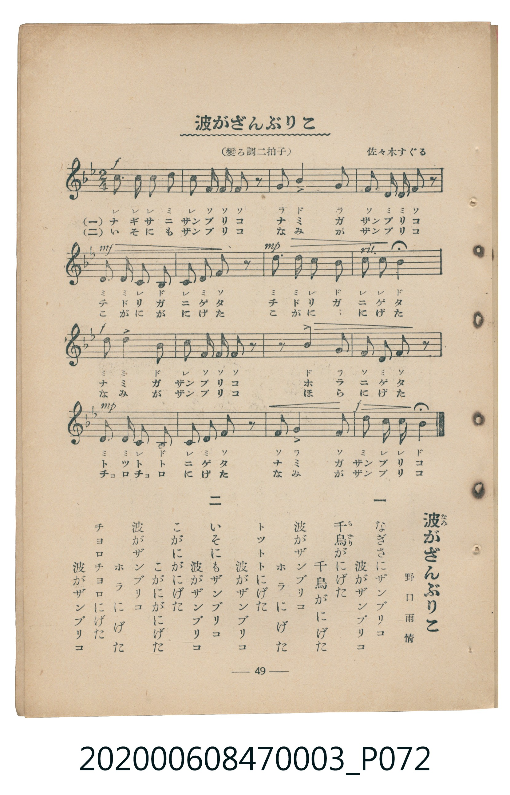

# 波がざんぶりこ

> Re:Shōka 使用 AI 協助辨識與重建樂譜，可能會有錯誤。歡迎回報。

- **NEUTRINO 歌聲合成版**：<br><audio controls src="nami_ga_zanburiko_neutrino.mp3"></audio>
- **鋼琴伴奏版**：<br><audio controls src="nami_ga_zanburiko.mp3"></audio>


- 詞：野口雨情
- 曲：佐々木のぼる
- 臺灣教育會公認《新定兒童唱歌》尋常科第三學年用（2020.006.0847.0003）

## 說明

原書資訊與歌詞全文（對應 P072.jpg，書頁 p. 49，補充教材第 11 首）：
調性與拍號：變ろ調二拍子（Bb 大調 2/4 拍），♩=108


## 歌詞

```text
一
波がざんぶりこ　どんどと打てば
岩がむつくりこ　顔を出した

二
波はあとから　またざんぶりこ
沖の鴎も　飛んで来た

三
お日が出た出た　波ざんぶりこ
舟が鴎と　浮いて来た
```

## ABC

```abc
X:1
T:波がざんぶりこ
C:曲：佐々木のぼる
M:2/4
L:1/16
Q:1/4=108
K:Bb
V:V1 name="Piano" snm="Pia"
[V:V1]
!f! c2 c2 c2 d2 | c2 F F F2 z2 | G2 B2 G4 | F2 D D F2 z2 |
w: 1.~ナ ギ サ ニ | ザン ブ リ コ | ナ ミ ガ | ザン ブ リ コ
w: 2.~い そ に も | ザン ブ リ コ | な み が | ザン ブ リ コ
!mf! D3 D C2 B,2 | C2 D2 F2 z2 | !mp! d2 d2 c2 B2 | c2 c2 B4 |
w: 1.~チ ド リ ガ | ニ ゲ タ | チ ド リ ガ | ニ ゲ タ
w: 2.~こ が に が | に げ た | こ が に が | に げ た
!f! d2 d4 B2 | c2 F F F2 z2 | z2 B4 G2 | F2 D2 F2 z2 |
w: 1.~ナ ミ ガ | ザン ブ リ コ | ホ ラ | ニ ゲ タ
w: 2.~な み が | ザン ブ リ コ | ほ ら | に げ た
!mp! D3 D C2 B,2 | C2 D2 F2 z2 | F2 G4 F2 | d2 c c B4 |
w: 1.~ト ツ ト ト | ニ ゲ タ | ナ ミ ガ | ザン ブ リ コ
w: 2.~チョ ロ チョ ロ | に げ た | な み が | ザン ブ リ コ
```

## TMD 檔案連結

- [主旋律 TMD 檔案](nami_ga_zanburiko.tmd) [[在 TMD Studio 編輯](https://tmdlang.github.io/Tmd-TS/#tmd=s7IKdvYPcrWy4qpTUCpJTLdSSM7PyUlNLsnMz7MqzsjMK0nNjM_KTMmPL87Iz05Ugisry88pzU21Si9KTEmNN443MjAyiDcwMIs3sDAxBzIMjBFKi_NLi5JTrYqTM_Lzc-JLUitKkvLzsxHyBUX5Zal5iXlANQVFIBtTwIoQClLLMlNSQdKpKZkl-UWZiTlI7kgtKga7FWxJfElRYl5xclFmAcgDCFUlGalAx-YllpQWpaKLlieWpBYpcWlpKTzbvOhxY8_jxmmPmyY_btz2uKnrceNkBS0tLkVbBUMDCy57WwWnJC4bI30TO5AZL1bOe79n1sv2vqf9i1_OXvGsuRVs9LPZm4DCT_ZOeNzQ-mzOiseN6x437nnc1A2WfNG-63nj4mdTZ75o2vRsTvPT1jUvVvU-buh6Nm3D03WznrZOer566dMpG5-t7Xnc0P10Q_fTHTueL5_4fM2aJzs6n67d8XTnludTVrzf0wEKbz1geOuBwhvIMDB-v6dTiYtLX0vBllqAS0FB4Wnf_Gezd7zY3P5iRdeLjnagu4C-ftq64tm0dqArnm7ofdbeqRBgYG6kl1WQ_n5PD1DxywWNCgV6CiaWQO6LxXOetrYCvfts7gSgJxQMDRVeLpsGdCowhEDGv1i1_1nDcpDB3b0vZs4Hir5Y1_W4qRco_mRXD1Dw6doJQHuckhSeLlkOFFQAhr0CUBhsQs-jmSttQfECMunJjgYQhTUKHzc0PG5cCRZZ-bhxxbNOIGPZ48YNYA9uAgr1PG4CqljyuLEfruHlwimPmyY9bd_1uHH648b5EDt29cDtWP-4sQlo1uPG7sdNnWAL9gGVoVkMVr1pGjAJvNzS97ipCWTu4tlgFcufzV0KN3dHJ4h63Nj1bDpQsAds63wICdQCtg_D3BcdQNt6QOYCXQFUtBWYzFqA_oKaC1RBeQqAAgUtfS4uv8TcTPfEqMS8pNKizOx8q4DMxLx8hxqDmmqQXQo2Flp2YAYwBRrqmlgBfbPqceN-LPkJOSoeN7ZBogJkBUh3jUJ1Wq2CERgaA3lGChqm8Qqm8ZqqGrqaQFrBAChoFq9gCCJ0gWygkIZxvIIxigqwUT6GNQqPm7sUHjetA-KtQHY3UP3jpm2PmzcraDxungYUWaUJFNisEA-SACltng_krwEbjEshxGwjoILGFiCeC8SrgXJNeM1uXAXE-4G4h7DZwAA01bUABSAwOoHJDJI4F8MTJ1Ci-3HjbmDqfNy4AJI6kUIvFxh8oADRBUJIoABDxQgYYCB3AGmgFDQUq3MLaoFhbAwMY0NwSINooOvggQd0XiPYnMfNnUAnNgP9AAwbUEh1A1mbgHg_NOQaQUpwqICbCAwyDZDzwSY29gBNBAUcMERA4QNiTQLi-dDwAvmyB4cKmInAgLLUNTRCJDWUPAkUxZIjUdMZyPe6UN9jSWcG4AABJjRwMoOHHGrqAiYZoH8g3sYV__FA7mxwQK7EDD-kBAVJJeDgIWBc426wrZ2YgQfPhMa6hmagsAF6uxdcCQFDpelxUyMorYJCCVwKgeVQ0g8wURCXfoAUOA8C6RpgOGoAExAk9DBSUQc0FbWAUlEHGGNLRUQEJmpiam583LwcavZakNlgPpCNNUkREbgg42u5uHTtFNBKOwWgkDIXAA)]
- [鋼琴伴奏 TMD 檔案](nami_ga_zanburiko_piano.tmd) [[在 TMD Studio 編輯](https://tmdlang.github.io/Tmd-TS/#tmd=s7IKdvYPcrWy4tLSUni2edHjxp7HjdMeN01-3LjtcVPX48bJ7_d0vOze83zClid7tjxd2v-8s-P9nk4FLS0uRVsFQwMLLntbBackLhsjfRM7rjoFpRcr573fM-tle9_T_sUvZ6941tyqBBJ-NnsTUPjJ3gmPG1qfzVnxuHHd48Y9j5u6wZIv2nc9b1z8bOrMF02bns1pftq65sWq3scNXc-mbXi6btbT1knPVy99OmXjs7U9jxu6n27ofrpjx_PlE5-vWfNkR-fTtTue7tzyfMoKoDuNDIwM9AwMzPQMLEzMgQwDY6BTlbi4_BJzM90ToxLzkkqLMrPzrQIyE_PygzwcagxqqrkUgMDGQssOzNDXUjDUNbFSeNy46nHjfszAAEqsBPNXPm4EeqLtceOyx40bFLT0wbprFKrTahWMwNAYyDNS0DCNVzCN11TV0NUE0goGQEGzeAVDEKELZAOFNIzjFYxRVICN8jGsUXjc3KXwuGkdEG8FsruB6h83bXvcvFlB43HzNKDIKk2gwGaFeJAESGnzfCB_DdhgXAohZhsBFTS2APFcIF4NlGvCa3bjKiDeD8Q9hM0GBqCprgUoAFseN64HBWBTw-PGxY8b--EB2P24cffjpkmPGxc8bpz-uHE-UujlAoMPFCC6QAgJFGCoGAEDDOQOIA2UgoZidW5BLTCMjYFhbAgOaRANdB088IDOawSb87i5E-jEZqAfgGEDCqluIGsTEO-HhlwjSAkOFXATgUGmAXI-2MTGHqCJoIADhggofECsSUA8HxpeIF_24FABMxEYUJa6hkaIpAYMrCZwoup-3AR0TuM-oGr01IeSzkC-14X6Hks6MwAHCDChgZMZPORQUxcwyQD9A_E2rviPB3JngwNyJWb4ISUoSCoBBw8B4xp3g23txAw8eCY01jU0A4UN0Nu94MICGCpNj5saQWkVFEqgUFkOlkNJP8BEQVz6AVLgPAika4DhqAFMQJDQw0hFHdBU1AJKRR1gjC0VERGYqImpufFx83Ko2WtBZoP5QDbWJEVE4IKMr8VR2PkgF3Ym0MIOFArxCtGm8bFQJihgTEBCJiARYKDB0guYE20Wn4usEk0IFMZIig3JNxSsEG4k0Eu6dgpovor2AZqPTdgILKzMBQA)]

## 分析

```text
================================================================================
📊 TMD Song Profile: [ 波がざんぶりこ ]
================================================================================
⏱  Duration:       0:17 (17.8s), 16 measures total
🎼 Key & Tempo:    首調基準 B,, != 108.0 BPM, <2/4>
   - 分析範圍：      由實際發聲的音符與和弦推測調性；播放脈絡另行呈現
🎤 人聲音域:    A#3 (MIDI 58) – D5 (MIDI 74) [跨度: 16 個半音 / 1.3 個八度, 難度: moderate]
   - 最低音:  A#3 in [NamiGaZanburiko #1 @ m.5, 0:05]
   - 最高音: D5 in [NamiGaZanburiko #1 @ m.1, 0:00]
   - 適合: soprano, mezzo-soprano, contralto, tenor, baritone, bass
🏛  結構:      NamiGaZanburiko (17.8s)
⚡ 編曲密度:        Peak 1 軌道同時演奏
🗝  調性診斷：       A# 調性不明確（純淨自然大調，未偵測到可信轉調）
   - 風格氣質:    純淨自然大調（陽光明朗、易唱易記，無明顯調外色彩）
   - 轉調歷程:    全曲維持單一推測調性（未偵測到可信轉調）
   - 核心骨幹音:  D, C, F, A#, G
   - 調性數值:    A# 調性不明確 [相關度: 0.74, 穩定度: Ambiguous, 自然音純度: 100.0%]
   - 候選調性 (K-S): A# 大調 (0.74), F 大調 (0.73), D 小調 (0.69)
   - 五度圈歷程:   -2
   - 各段落調性細節:
     • [NamiGaZanburiko #1]: A# 調性不明確 (r: 0.74, 自然音純度: 100.0%)

  [ 五度圈游移軌跡 ]
               C  
         F            G  
     [Bb]*              D  
      Eb               A  
         Ab           E  
            Db       B  
               F# 
     (* = active key center)

  [ 十二半音累積音高分佈 ]
     C  : █████████████████████     22.8%
     C# :                            0.0%
     D  : ████████████████████████  26.3%
     D# :                            0.0%
     E  :                            0.0%
     F  : ███████████████████       21.1%
     F# :                            0.0%
     G  : ██████████                10.5%
     G# :                            0.0%
     A  :                            0.0%
     A# : ██████████████████        19.3%
     B  :                            0.0%
--------------------------------------------------------------------------------
Assignment 軌道音域：
  - Piano         : A#3 – D5 (16 個半音 / 1.3 個八度, 55 個音符)
================================================================================
```


## 原書掃描頁




