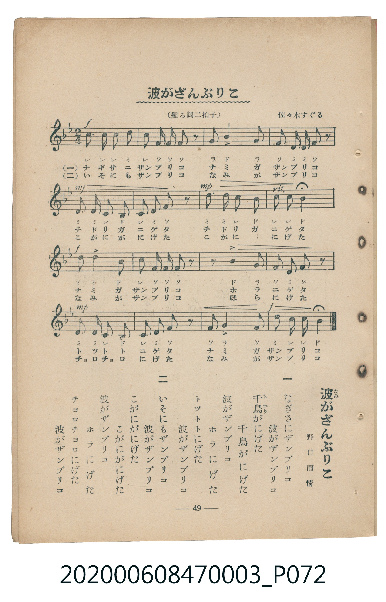

# 波がざんぶりこ

<audio controls src="nami_ga_zanburiko.mp3"></audio>

- 詞：野口雨情
- 曲：佐々木のぼる
- 臺灣教育會公認《新定兒童唱歌》尋常科第三學年用（2020.006.0847.0003）

## 說明

原書資訊與歌詞全文（對應 P072.jpg，書頁 p. 49，補充教材第 11 首）：
調性與拍號：變ろ調二拍子（Bb 大調 2/4 拍），♩=108

## 歌詞

```text
一
波がざんぶりこ　どんどと打てば
岩がむつくりこ　顔を出した

二
波はあとから　またざんぶりこ
沖の鴎も　飛んで来た

三
お日が出た出た　波ざんぶりこ
舟が鴎と　浮いて来た
```

## ABC

```abc
X:1
T:波がざんぶりこ
C:曲：佐々木のぼる
M:2/4
L:1/16
Q:1/4=108
K:Bb
V:V1 name="Piano" snm="Pia"
[V:V1]
c2 c2 c2 d2 | c2 f f f2 z2 | g2 b2 g4 | f2 d d f2 z2 |
d2 d2 c2 B2 | c2 d2 f2 z2 | d2 d2 c2 B2 | c2 c2 B4 |
d2 d4 B2 | c2 f f f2 z2 | z2 b4 g2 | f2 d d f2 z2 |
d2 d c B4 | c2 d2 f2 z2 | f2 g4 f2 | d2 c c B4 |
```

## TMD 檔案連結

- [主旋律 TMD 檔案](nami_ga_zanburiko.tmd) [[在 TMD Studio 編輯](https://tmdlang.github.io/Tmd-TS/#tmd=s7IKdvYPcrWy4qpTUCpJTLdSSM7PyUlNLsnMz7MqzsjMK0nNjM_KTMmPL87Iz05Ugisry88pzU21Si9KTEmNN443MjAyiDcwMIs3sDAxBzIMjBFKi_NLi5JTrYqTM_Lzc-JLUitKkvLzsxHyBUX5Zal5iXlANQVFIBtTwIoQClLLMlNSQdKpKZkl-UWZiTlI7kgtKga7FWxJfElRYl5xclFmAcgDCFUlGalAx-YllpQWpaKLlieWpBYpcWlpKTzbvOhxY8_jxmmPmyY_btz2uKnrceNkBS0tLkVbBUMDCy57WwWnJC4bI30TO5AZL1bOe79n1sv2vqf9i1_OXvGsuRVs9LPZm4DCT_ZOeNzQ-mzOiseN6x437nnc1A2WfNG-63nj4mdTZ75o2vRsTvPT1jUvVvU-buh6Nm3D03WznrZOer566dMpG5-t7Xnc0P10Q_fTHTueL5_4fM2aJzs6n67d8XTnludTVrzf0wEKbz1geOuBwhvIMDB-v6dTiYtLX0vBllqAS0FB4Wnf_Gezd7zY3P5iRdeLjnagu4C-ftq64tm0dqArnm7ofdbeqRBgYG6kl1WQ_n5PD1DxywWNCgV6CiaWQO6LxXOetrYCvfts7gSgJxQMDRVeLpsGdCowhEDGv1i1_1nDcpDB3b0vZs4Hir5Y1_W4qRco_mRXD1Dw6doJQHuckhSeLlkOFFQAhr0CUBhsQs-jmSttQfECMunJjgYQhTUKHzc0PG5cCRZZ-bhxxbNOIGPZ48YNYA9uAgr1PG4CqljyuLEfruHlwimPmyY9bd_1uHH648b5EDt29cDtWP-4sQlo1uPG7sdNnWAL9gGVoVkMVr1pGjAJvNzS97ipCWTu4tlgFcufzV0KN3dHJ4h63Nj1bDpQsAds63wICdQCtg_D3BcdQNt6QOYCXQFUtBWYzFqA_oKaC1RBeQqAAgUtfS4uv8TcTPfEqMS8pNKizOx8q4DMxLx8hxqDGoVqkGUKNhZadmAGMAka6ppYAb2z6nHjfiwZCjkuHje2QeICZAdId42CERgag1kapgqmmqoaupoKpgoGQBEzBcM4IKELZJoqaBgrGCNJwiw31bUAWQ4MC2AcQWJ2MTxmgRLdjxt3A6P2ceMCSNQibAaaB7TTEGyzMdRGZDEQDbQaZpGlrqERwpsoCQIoiiU5oNqkCzUV3Y8GID_qAn2Jx4-GxrqGZiC7gcb2gksYoK1Nj5sagSRQdAUkiYHlUPwHNM4IYhzYJ0j-NAUHqylEFdCrSKq4arm4dO0U0BKAAlBImYsLAA)]
- [鋼琴伴奏 TMD 檔案](nami_ga_zanburiko_piano.tmd) [[在 TMD Studio 編輯](https://tmdlang.github.io/Tmd-TS/#tmd=s7IKdvYPcrWy4tLSUni2edHjxp7HjdMeN01-3LjtcVPX48bJ7_d0vOze83zClid7tjxd2v-8s-P9nk4FLS0uRVsFQwMLLntbBackLhsjfRM7rjoFpRcr573fM-tle9_T_sUvZ6941tyqBBJ-NnsTUPjJ3gmPG1qfzVnxuHHd48Y9j5u6wZIv2nc9b1z8bOrMF02bns1pftq65sWq3scNXc-mbXi6btbT1knPVy99OmXjs7U9jxu6n27ofrpjx_PlE5-vWfNkR-fTtTue7tzyfMoKoDuNDIwM9AwMzPQMLEzMgQwDY6BTlbi4_BJzM90ToxLzkkqLMrPzrQIyE_PygzwcagxqFKq5FIDAxkLLDsyoUTACQ2MwS8NUwVRTVUNXU8FUwQAoYqZgGAckdIFMUwUNYwVjJEmodqAgUKMhWLsxVBuyGIgG6kdSrQuVQbfMAGSZLtA6fJYBxY0g4mBjkSw1BTvUFKIKaC-SKq5aHGHigxImJvAwMY2PV4g2jY-FMkHGm4CETEAihmABqEogJ9osPhdZJZoQkIus2JB8Q8EK4UYC_aRrp4DmLQXsQspcXAA)]

## 分析

```text
================================================================================
📊 TMD Song Profile: [ 波がざんぶりこ ]
================================================================================
⏱  Duration:       0:17 (17.8s), 16 measures total
🎼 Key & Tempo:    首調基準 B,, != 108.0 BPM, <2/4>
   - 分析範圍：      由實際發聲的音符與和弦推測調性；播放脈絡另行呈現
🎤 人聲音域:    A#4 (MIDI 70) – A#5 (MIDI 82) [跨度: 12 個半音 / 1.0 個八度, 難度: easy]
   - 最低音:  A#4 in [NamiGaZanburiko #1 @ m.5, 0:05]
   - 最高音: A#5 in [NamiGaZanburiko #1 @ m.3, 0:02]
   - 適合: soprano, tenor
🏛  結構:      NamiGaZanburiko (17.8s)
⚡ 編曲密度:        Peak 1 軌道同時演奏
🗝  調性診斷：       A# 大調（純淨自然大調，未偵測到可信轉調）
   - 風格氣質:    純淨自然大調（陽光明朗、易唱易記，無明顯調外色彩）
   - 轉調歷程:    全曲維持單一推測調性（未偵測到可信轉調）
   - 核心骨幹音:  D, C, F, A#, G
   - 調性數值:    A# 大調 [相關度: 0.77, 穩定度: Moderate, 自然音純度: 100.0%]
   - 候選調性 (K-S): A# 大調 (0.77), F 大調 (0.73), D 小調 (0.68)
   - 五度圈歷程:   -2
   - 各段落調性細節:
     • [NamiGaZanburiko #1]: A# 大調 (r: 0.77, 自然音純度: 100.0%)

  [ 五度圈游移軌跡 ]
               C  
         F            G  
     [Bb]*              D  
      Eb               A  
         Ab           E  
            Db       B  
               F# 
     (* = active key center)

  [ 十二半音累積音高分佈 ]
     C  : █████████████████████     21.9%
     C# :                            0.0%
     D  : ████████████████████████  25.4%
     D# :                            0.0%
     E  :                            0.0%
     F  : ████████████████████      21.1%
     F# :                            0.0%
     G  : ██████████                10.5%
     G# :                            0.0%
     A  :                            0.0%
     A# : ████████████████████      21.1%
     B  :                            0.0%
--------------------------------------------------------------------------------
Assignment 軌道音域：
  - Piano         : A#4 – A#5 (12 個半音 / 1.0 個八度, 56 個音符)
================================================================================
```


## 原書掃描頁




