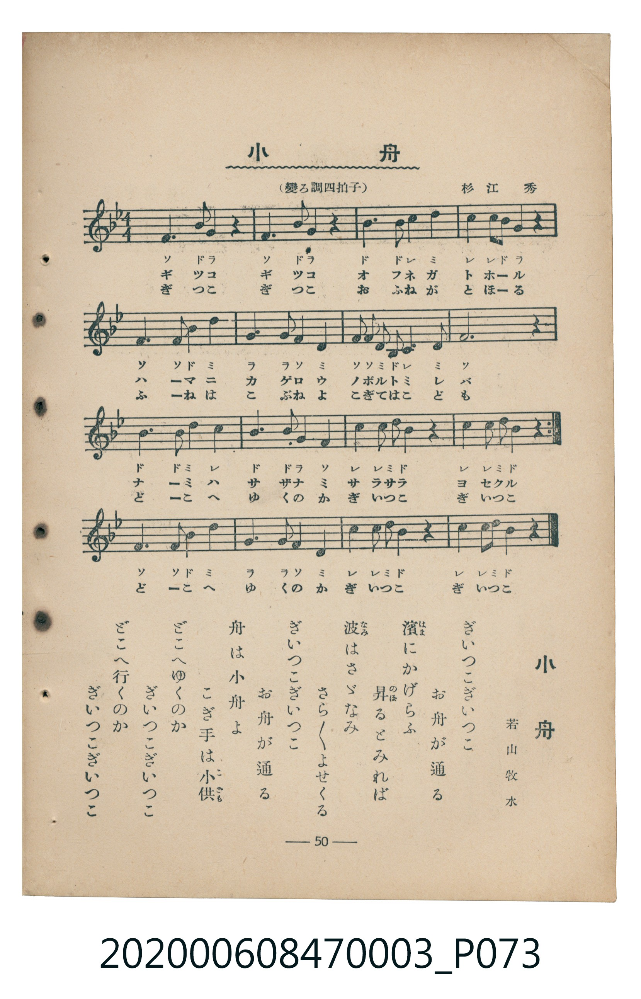

# 小舟

<audio controls src="kobune.mp3"></audio>

- 詞：若山牧水
- 曲：杉江秀
- 臺灣教育會公認《新定兒童唱歌》尋常科第三學年用（2020.006.0847.0003）

## 說明

原書資訊與歌詞全文（對應 P073.jpg，書頁 p. 50，補充教材第 12 首）：
調性與拍號：變ろ調四拍子（Bb 大調 4/4 拍），♩=96

## 歌詞

```text
一
ぎいつこぎいつこ　お舟が通る
濱にかげろふ　昇るとみれば
波はさゞなみ　さらさらよせくる

二
ぎいつこぎいつこ　お舟が通る
舟は小舟よ　こぎ手は小供
どこへゆくのか　ぎいつこぎいつこ
どこへ行くのか　ぎいつこぎいつこ
```

## 原書掃描頁



## 分析

```text
================================================================================
📊 TMD Song Profile: [ 小舟 ]
================================================================================
⏱  Duration:       0:40 (40.0s), 16 measures total
🎼 Key & Tempo:    首調基準 B,, != 96.0 BPM, <4/4>
   - 分析範圍：      由實際發聲的音符與和弦推測調性；播放脈絡另行呈現
🎤 人聲音域:    D4 (MIDI 62) – D5 (MIDI 74) [跨度: 12 個半音 / 1.0 個八度, 難度: easy]
   - 最低音:  D4 in [Kobune #1 @ m.6, 0:14]
   - 最高音: D5 in [Kobune #1 @ m.3, 0:06]
   - 適合: soprano, mezzo-soprano, contralto, tenor, baritone, bass
🏛  結構:      Kobune (40.0s)
⚡ 編曲密度:        Peak 1 軌道同時演奏
🗝  調性診斷：       A# 大調（純淨自然大調，未偵測到可信轉調）
   - 風格氣質:    純淨自然大調（陽光明朗、易唱易記，無明顯調外色彩）
   - 轉調歷程:    全曲維持單一推測調性（未偵測到可信轉調）
   - 核心骨幹音:  F, A#, C, D, G
   - 調性數值:    A# 大調 [相關度: 0.85, 穩定度: Moderate, 自然音純度: 100.0%]
   - 候選調性 (K-S): A# 大調 (0.85), F 大調 (0.78), G 小調 (0.59)
   - 五度圈歷程:   -2
   - 各段落調性細節:
     • [Kobune #1]: A# 大調 (r: 0.85, 自然音純度: 100.0%)

  [ 五度圈游移軌跡 ]
               C  
         F            G  
     [Bb]*              D  
      Eb               A  
         Ab           E  
            Db       B  
               F# 
     (* = active key center)

  [ 十二半音累積音高分佈 ]
     C  : ██████████████████        18.7%
     C# :                            0.0%
     D  : ████████████████          17.0%
     D# :                            0.0%
     E  :                            0.0%
     F  : ████████████████████████  25.0%
     F# :                            0.0%
     G  : ██████████████            14.3%
     G# :                            0.0%
     A  :                            0.0%
     A# : ████████████████████████  25.0%
     B  :                            0.0%
--------------------------------------------------------------------------------
Assignment 軌道音域：
  - Piano         : D4 – D5 (12 個半音 / 1.0 個八度, 61 個音符)
================================================================================
```

## ABC

```abc
X:1
T:小舟
C:曲：杉江秀
M:4/4
L:1/16
Q:1/4=96
K:Bb

V:V1 name="Piano" snm="Pia"

[V:V1]
f6 b2 g4 z4 | f6 b2 g4 z4 | b6 b2 c4 d4 | c4 c2 b2 g4 z4 |
f6 f2 b4 d4 | g6 g2 f4 d4 | f2 f2 d2 b2 c4 d4 | f12 z4 |
b6 b2 d4 c4 | b6 b2 g4 f4 | c4 c2 d2 b4 z4 | c4 c2 d2 b4 z4 |
f6 f2 b4 d4 | g6 g2 f4 d4 | c4 c2 d2 b4 z4 | c4 c2 d2 b4 z4 |
```

- [主旋律 TMD 檔案](kobune.tmd)
- [鋼琴伴奏 TMD 檔案](kobune_piano.tmd)
