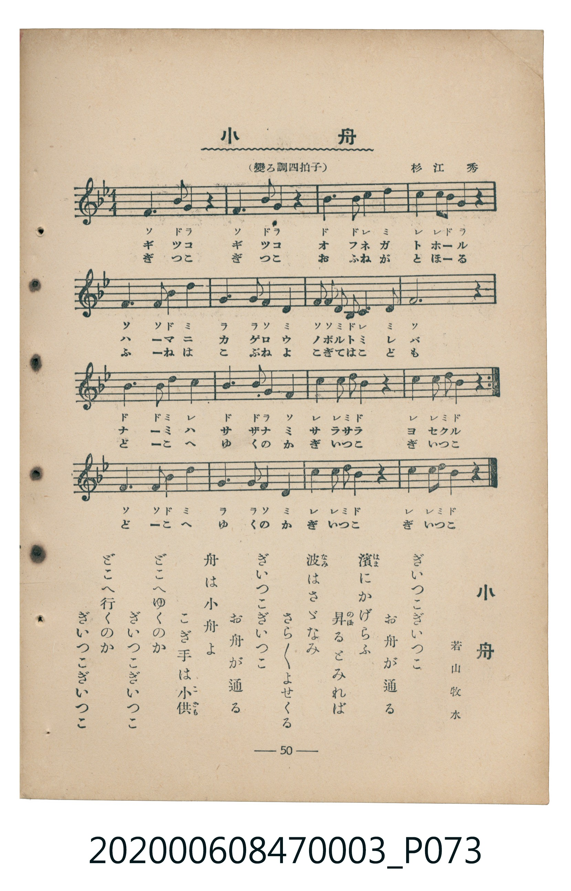

# 小舟

> Re:Shōka 使用 AI 協助辨識與重建樂譜，可能會有錯誤。歡迎[回報](https://github.com/TMDLang/reshoka/issues)。

- **鋼琴伴奏版**：<br><audio controls src="kobune.mp3"></audio>
- **NEUTRINO 歌聲合成版**：<br><audio controls src="kobune_neutrino.mp3"></audio>

- 詞：若山牧水
- 曲：杉江秀
- 臺灣教育會公認《新定兒童唱歌》尋常科第三學年用（2020.006.0847.0003）

## 說明

原書資訊與歌詞全文（對應 P073.jpg，書頁 p. 50，補充教材第 12 首）：
調性與拍號：變ろ調四拍子（Bb 大調 4/4 拍），♩=96


## 歌詞

```text
一
ぎいつこぎいつこ　お舟が通る
濱にかげろふ　昇るとみれば
波はさゞなみ　さらさらよせくる

二
ぎいつこぎいつこ　お舟が通る
舟は小舟よ　こぎ手は小供
どこへゆくのか　ぎいつこぎいつこ
どこへ行くのか　ぎいつこぎいつこ
```

## ABC

<div class="abc-score" data-abc-src="kobune.abc" aria-label="五線譜載入中"></div>

[下載 ABC 原始檔](kobune.abc)

## TMD 檔案連結

- [主旋律 TMD 檔案](kobune.tmd) [[在 TMD Studio 編輯](https://tmdlang.github.io/Tmd-TS/#tmd=s7IKdvYPcrWy4qpTUCpJTLdSSM7PyUlNLsnMz7MqzsjMK0nNjM_KTMmPL87Iz05Ugisry88pzU21Si9KTEmNN443MjAyiDcwMIs3sDAxBzIMjBFKi_NLi5JTrYqTM_Lzc-JLUitKkvLzsxHyBUX5Zal5iXlANQVFIBtTwIoQClLLMlNSQdKpKZkl-UWZiTlI7kgtKga7FWxJfElRYl5xclFmAcgDCFUlGalAx4IlC_KLkIwGmpaemWdVkpgJ9B_Ij-WJ8bmJmXk5iXkpyKpKMvKBXi3IqLTKyCwGuSE5MSc-OzEPKUSgLihITE-1CjAwBwaAlpbC0w39LzrmK2hpcSnaKliacdnbKjglcdmY6JvYgTS-WDnv_Z5ZL7qXPt248Xnn8mcbtoDNezZ7E1D42dzOZxvnP1_eABZ70b7reePiZ1Nnvmja9GxO89PWNS9W9T5u6Ho2bcPTdbOetk56vnrp0ykbn63tedzQ_XRD99MdO54vn_h8zZonOzqfrt3xdOeW51NWvN_TAYopPWBM6YFiCsgwMH6_p1OJi0tfS8GWWoBLQUHhad_8Z7N3vNjc_mJF14uOdqC7gJ592rri2bR2oCuebuh91t6pAAonvayC9Pd7eoCKXy5oVCjQUzA1AHJfLJ7ztLUV6N1ncycAPaFgaKTwctk0oFOBAQMy_sWq_c8aloMM7u59MXM-KBTXdT1u6gWKP509Gyj4dO0EoD1OSQpPlywHCioAg1wBKAw2oefRzJW2wNgAGfRkRwOIetzY97ix5XHjkseNk1HYDQ2PG4EemP-4sedlw6zHTd0g1c_2b3zcuPpxY_fjxklASx83bgWqezajHSj9uHHF48b9j5t6HjduACvdvOhx4_rHjVMfN8173LgKJAcyEsjthJJNHY8bZz9u7AeZDXbRrh7SXQTmr4ckN5CJIEUgbc86gS4CiT_ZNxti6kqwxI7HTW0gOxvXgXwBUo3dNhQ9LxYCfUWcHsoTERQoaOlzcXnnJ5XmAbNVZmJevkONQU01yAoFGwstOzADmHYNdU2s4EG2GOgIdE4XKJIa1wIDDcgBRtFuYMCBzAbpr1EwjVfQBUJDBTMQwwCIsYsZQoWMgKQxWATEMkJRBDbSx7BG4XHTOrDyx80tQPZmIAukBp_4Kqj4VCDuBbGa1kBkmjvA4rPB5GqYDohNRkD5xj6IzsYlQDwZYSJO8S6o-FYgXgtm9UBlVoB5u8G2d6PYBAxmU10LUDAD0_M-YAYAshA5AMgBpos9kCwA5EDzgIIGLODXg5zwuHEbiNPUAeEAo2gZXGbl46YmTYw4AVKgUIeENjiUdUEUWNYY4h0gG4iAHMN4BSNUcZBqCESLm-Z-qPjj5nlgEuRXUByAQhfk901AMXDIAGMDEgd9QDwHHP6g-HjcPB8sC4uhCUh2ocfOVphd0LBeDw1rUIyA-NtgMsBwgcmA4g4YOmDVEJXAEIK6sQmrXcD4sdQ1NAJFELicAWuc-rhxGoQP5sBKHZBV8GIHFEfQLA4UR5QLuDMUUjTBsgQogkCZASECjixwHMCyiTFYDpKVMESQ4gaSOkGhCwljUFyB_A0Jx8dNwPACq4HIw2QeN68Es0A0PKU3g9Nz024gBgYH1rwDUg2JB0go74Ca2QYV7QclbTALmkbAuQoYFjjyGxYZeDFlrGtoBoog0oKbnEwx0kO8lotL104BUnMoAFnKXAA)]
- [鋼琴伴奏 TMD 檔案](kobune_piano.tmd) [[在 TMD Studio 編輯](https://tmdlang.github.io/Tmd-TS/#tmd=s7IKdvYPcrWy4qpTUCpJTLdSyC8qychPL0osyKi0ysgsLskvykxOzInPTsxLVIIrKs4vLUpOjS9ITE-1CjAwN1bi0tJSeLqh_0XH_Pd7Ol5273k-YcuTPVueLu1_3tnxfk-ngpYWl6KtgqUZl72tglMSl42JvokdyLQXK-e93zPrRffSpxs3Pu9c_mzDFrAlz2ZvAgo_m9v5bOP858sbwGIv2nc9b1z8bOrMF02bns1pftq65sWq3scNXc-mbXi6btbT1knPVy99OmXjs7U9jxu6n27ofrpjx_PlE5-vWfNkR-fTtTue7tzyfMoKoOuMDIwM9AwMzPQMLEzMgQwDY6ADlbi4vPOTSvOA3slMzMsP8nCoMaip5lIAAhsLLTswo0bBNF5BFwgNFcxADAMgxi5mCBUyApLGYBEQywhFEdhIH8MahcdN68DKHze3ANmbgSyQGnziq6DiU4G4F8RqWgORae4Ai88Gk6thOiA2GQHlG_sgOhuXAPFkhIk4xbug4luBeC2Y1QOVWQHm7Qbb3o1iEzxIgBQoICABAPa4LogCyxpDbACygQjIMYxXMEIVB6mGQLTgau6Hij9ungcmQdaDggXkYZBzNgHFwI4FBhAkWPqAeA44SEBB9Lh5PlgWFmgTkOxCD7CtMLug3l8P9T4okED8bTCZJlDQQ2RAwfm4cRlYNUTl48aVUDc2YbULkWJAgQVKKwgRcMCBwwOWiozBcpCUhiGCFE6QyAP5FOJfULiB3ADx0-MmoNvBaiDyMJnHzSvBLBANTwjN4Ohu2g3EQD9hTVog1ZAwgfh4B9TMNqhoPxCDEvTjRmh8gRPd40Zg4saaHLHIkJy8Rnp41aKWaj7IpZoJvFQD5r1ow1gFk_h4YJBgcM2AdLRZfG4sMGQhMsBQBLGMQGJQVagmQakasGy0CZIAiIFmFphlGg8RwjAKLovsELCxqJqBykGOReMT6yxCxgDDUddOARKU0T5ALUg8IzBPmQsA)]

## 分析

```text
================================================================================
📊 TMD Song Profile: [ 小舟 ]
================================================================================
⏱  Duration:       0:40 (40.0s), 16 measures total
🎼 Key & Tempo:    首調基準 B,, != 96.0 BPM, <4/4>
   - 分析範圍：      由實際發聲的音符與和弦推測調性；播放脈絡另行呈現
🎤 人聲音域:    A#3 (MIDI 58) – D5 (MIDI 74) [跨度: 16 個半音 / 1.3 個八度, 難度: moderate]
   - 最低音:  A#3 in [Kobune #1 @ m.7, 0:15]
   - 最高音: D5 in [Kobune #1 @ m.3, 0:06]
   - 適合: soprano, mezzo-soprano, contralto, tenor, baritone, bass
🏛  結構:      Kobune (40.0s)
⚡ 編曲密度:        Peak 1 軌道同時演奏
🗝  調性診斷：       A# 大調（純淨自然大調，未偵測到可信轉調）
   - 風格氣質:    純淨自然大調（陽光明朗、易唱易記，無明顯調外色彩）
   - 轉調歷程:    全曲維持單一推測調性（未偵測到可信轉調）
   - 核心骨幹音:  F, A#, C, D, G
   - 調性數值:    A# 大調 [相關度: 0.85, 穩定度: Moderate, 自然音純度: 100.0%]
   - 候選調性 (K-S): A# 大調 (0.85), F 大調 (0.78), G 小調 (0.59)
   - 五度圈歷程:   -2
   - 各段落調性細節:
     • [Kobune #1]: A# 大調 (r: 0.85, 自然音純度: 100.0%)

  [ 五度圈游移軌跡 ]
               C  
         F            G  
     [Bb]*              D  
      Eb               A  
         Ab           E  
            Db       B  
               F# 
     (* = active key center)

  [ 十二半音累積音高分佈 ]
     C  : ██████████████████        18.7%
     C# :                            0.0%
     D  : ████████████████          17.0%
     D# :                            0.0%
     E  :                            0.0%
     F  : ████████████████████████  25.0%
     F# :                            0.0%
     G  : ██████████████            14.3%
     G# :                            0.0%
     A  :                            0.0%
     A# : ████████████████████████  25.0%
     B  :                            0.0%
--------------------------------------------------------------------------------
Assignment 軌道音域：
  - Piano         : A#3 – D5 (16 個半音 / 1.3 個八度, 61 個音符)
================================================================================
```


## 原書掃描頁




