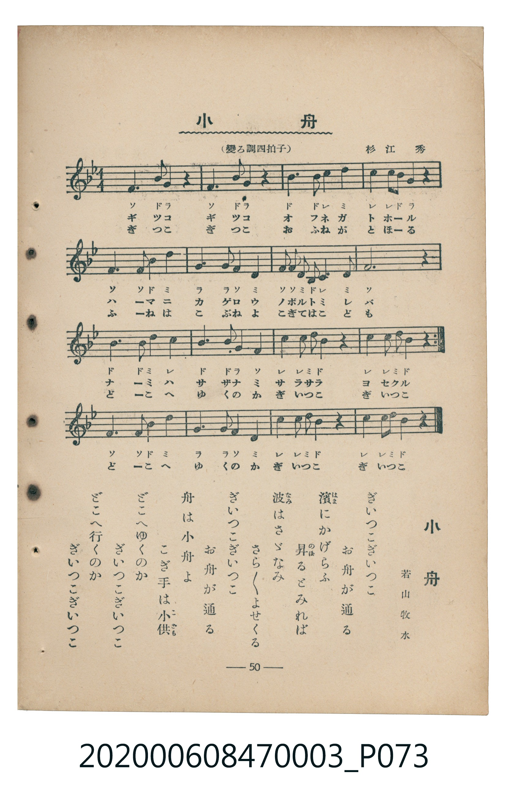

# 小舟

> Re:Shōka 使用 AI 協助辨識與重建樂譜，可能會有錯誤。歡迎回報。

- **鋼琴伴奏版**：<br><audio controls src="kobune.mp3"></audio>
- **NEUTRINO 歌聲合成版**：<br><audio controls src="kobune_neutrino.mp3"></audio>

- 詞：若山牧水
- 曲：杉江秀
- 臺灣教育會公認《新定兒童唱歌》尋常科第三學年用（2020.006.0847.0003）

## 說明

原書資訊與歌詞全文（對應 P073.jpg，書頁 p. 50，補充教材第 12 首）：
調性與拍號：變ろ調四拍子（Bb 大調 4/4 拍），♩=96


## 歌詞

```text
一
ぎいつこぎいつこ　お舟が通る
濱にかげろふ　昇るとみれば
波はさゞなみ　さらさらよせくる

二
ぎいつこぎいつこ　お舟が通る
舟は小舟よ　こぎ手は小供
どこへゆくのか　ぎいつこぎいつこ
どこへ行くのか　ぎいつこぎいつこ
```

## ABC

<div class="abc-score" data-abc-src="kobune.abc" aria-label="五線譜載入中"></div>

[下載 ABC 原始檔](kobune.abc)

## TMD 檔案連結

- [主旋律 TMD 檔案](kobune.tmd) [[在 TMD Studio 編輯](https://tmdlang.github.io/Tmd-TS/#tmd=s7IKdvYPcrWy4qpTUCpJTLdSSM7PyUlNLsnMz7MqzsjMK0nNjM_KTMmPL87Iz05Ugisry88pzU21Si9KTEmNN443MjAyiDcwMIs3sDAxBzIMjBFKi_NLi5JTrYqTM_Lzc-JLUitKkvLzsxHyBUX5Zal5iXlANQVFIBtTwIoQClLLMlNSQdKpKZkl-UWZiTlI7kgtKga7FWxJfElRYl5xclFmAcgDCFUlGalAx4IlC_KLkIwGmpaemWdVkpgJ9B_Ij-WJ8bmJmXk5iXkpSlxaWgpPN_S_6JivoKXFpWirYGnGZW-r4JTEZWOib2IHMuTFynnv98x60b306caNzzuXP9uwBWz2s9mbgMLP5nY-2zj_-fIGsNiL9l3PGxc_mzrzRdOmZ3Oan7auebGq93FD17NpG56um_W0ddLz1UufTtn4bG3P44bupxu6n-7Y8Xz5xOdr1jzZ0fl07Y6nO7c8n7Li_Z4OUFDrAYNaDxTUQIaB8fs9nUpcXPpaCrbUAlwKCgpP--Y_m73jxeb2Fyu6XnS0A90F9OzT1hXPprUDXfF0Q--z9k6FAANzY72sgvT3e3qAil8uaFQo0FMwNQByXyye87S1FejdZ3MnAD2hYGik8HLZNKBTgQEDMv7Fqv3PGpaDDO7ufTFzPigU13U9buoFij-dPRso-HTtBKA9TkkKT5csBwoqAINcASgMNqHn0cyVtsDYABn0ZEcDiHrc2Pe4seVx45LHjZNR2A0NjxuBHpj_uLHnZcOsx03dINXP9m983Lj6cWP348ZJQEsfN24Fqns2ox0o_bhxxePG_Y-beh43bgAr3bzoceP6x41THzfNe9y4CiQHMhLI7YSSTR2PG2c_buwHmQ120a4e0l0E5q-HJDeQiSBFIG3POoEuAok_2TcbYupKsMSOx01tIDsb14F8AVKN3TYUPS8WAn1FnB7KExEUKGjpc3F55yeV5qVaBWQm5uU71BjUVIOsULCx0LIDM4Bp11DXxAoeZIuBjkDndIEiqXEtMNCAHGAU7QYGHMhskP4aBdN4BV0gNFQwAzEMgBi7mCFUyAhIGoNFQCwjFEVgI30MaxQeN60DK3_c3AJkbwayQGrwia-Cik8F4l4Qq2kNRKa5Ayw-G0yuhumA2GQElG_sg-hsXALEkxEm4hTvgopvBeK1YFYPVGYFmLcbbHs3ik3AYDbVtQAFMzA97wNmACALkQOAHGC62APJAkAONA8oaMACfj3ICY8bt4E4TR0QDjCKlsFlVj5uatLEiBMgBQp1SGiDQ1kXRIFljSHeAbKBCMgxjFcwQhUHqYZAtLhp7oeKP26eByZBfgXFASh0QX7fBBQDhwwwNiBx0AfEc8DhD4qPx83zwbKwGJqAZBd67GyF2QUN6_XQsAbFCIi_DSYDDBeYDCjugKEDVg1RCQwhqBubsNoFjB9LXUMjUASByxmwxqmPG6dB-GAOrNQBWQUvdkBxBM3iQHFEuYA7QyFFEyxLgCIIlBkQIuDIAscBLJsYg-UgWQlDBCluIKkTFLqQMAbFFcjfkHB83AQML7AaiDxM5nHzSjALRMNTejM4PTftBmJgcGDNOyDVkHiAhPIOqJltUNF-UNIGs6BpBJyrgGGBI79hkYEXU8a6hmagCCItuMnJFCM9xGu5uHTtFCA1hwKQpcwFAA)]
- [鋼琴伴奏 TMD 檔案](kobune_piano.tmd) [[在 TMD Studio 編輯](https://tmdlang.github.io/Tmd-TS/#tmd=s7IKdvYPcrWy4tLSUni6of9Fx_z3ezpedu95PmHLkz1bni7tf97Z8X5Pp4KWFpeirYKlGZe9rYJTEpeNib6JHVedgtKLlfPe75n1onvp040bn3cuf7ZhixJI-NnsTUDhZ3M7n22c_3x5A1jsRfuu542Ln02d-aJp07M5zU9b17xY1fu4oevZtA1P18162jrp-eqlT6dsfLa253FD99MN3U937Hi-fOLzNWue7Oh8unbH051bnk9ZAXSdkYGRgZ6BgZmegYWJOZBhYAx0oBIXl3d-UmleqlVAZmJefpCHQ41BTTWXAhDYWGjZgRk1CqbxCrpAaKhgBmIYADF2MUOokBGQNAaLgFhGKIrARvoY1ig8bloHVv64uQXI3gxkgdTgE18FFZ8KxL0gVtMaiExzB1h8NphcDdMBsckIKN_YB9HZuASIJyNMxCneBRXfCsRrwaweqMwKMG832PZuFJvgQQKkQAEBCQCwx3VBFFjWGGIDkA1EQI5hvIIRqjhINQSiBVdzP1T8cfM8MAmyHhQsIA-DnLMJKAZ2LDCAIMHSB8RzwEECCqLHzfPBsrBAm4BkF3qAbYXZBfX-eqj3QYEE4m-DyTSBgh4iAwrOx43LwKohKh83roS6sQmrXYgUAwosUFpBiIADDhwesFRkDJaDpDQMEaRwgkQeyKcQ_4LCDeQGiJ8eNwHdDlYDkYfJPG5eCWaBaHhCaAZHd9NuIAb6CWvSAqmGhAnExzugZrZBRfuBGJSgHzdC4wuc6B43AhM31uSIRYbk5DXSw6sWtVTzQS7VTOClGjDvRRvGKpjExwODBINrBqSjzeJzY4EhC5EBhiKIZQQSg6pCNQlK1YBlo02QBEAMNLPALNN4iBCGUXBZZIeAjUXVDFQOciwan1hnETIGGI66dgqQoIz2AWpB4hmBecpcAA)]

## 分析

```text
================================================================================
📊 TMD Song Profile: [ 小舟 ]
================================================================================
⏱  Duration:       0:40 (40.0s), 16 measures total
🎼 Key & Tempo:    首調基準 B,, != 96.0 BPM, <4/4>
   - 分析範圍：      由實際發聲的音符與和弦推測調性；播放脈絡另行呈現
🎤 人聲音域:    A#3 (MIDI 58) – D5 (MIDI 74) [跨度: 16 個半音 / 1.3 個八度, 難度: moderate]
   - 最低音:  A#3 in [Kobune #1 @ m.7, 0:15]
   - 最高音: D5 in [Kobune #1 @ m.3, 0:06]
   - 適合: soprano, mezzo-soprano, contralto, tenor, baritone, bass
🏛  結構:      Kobune (40.0s)
⚡ 編曲密度:        Peak 1 軌道同時演奏
🗝  調性診斷：       A# 大調（純淨自然大調，未偵測到可信轉調）
   - 風格氣質:    純淨自然大調（陽光明朗、易唱易記，無明顯調外色彩）
   - 轉調歷程:    全曲維持單一推測調性（未偵測到可信轉調）
   - 核心骨幹音:  F, A#, C, D, G
   - 調性數值:    A# 大調 [相關度: 0.85, 穩定度: Moderate, 自然音純度: 100.0%]
   - 候選調性 (K-S): A# 大調 (0.85), F 大調 (0.78), G 小調 (0.59)
   - 五度圈歷程:   -2
   - 各段落調性細節:
     • [Kobune #1]: A# 大調 (r: 0.85, 自然音純度: 100.0%)

  [ 五度圈游移軌跡 ]
               C  
         F            G  
     [Bb]*              D  
      Eb               A  
         Ab           E  
            Db       B  
               F# 
     (* = active key center)

  [ 十二半音累積音高分佈 ]
     C  : ██████████████████        18.7%
     C# :                            0.0%
     D  : ████████████████          17.0%
     D# :                            0.0%
     E  :                            0.0%
     F  : ████████████████████████  25.0%
     F# :                            0.0%
     G  : ██████████████            14.3%
     G# :                            0.0%
     A  :                            0.0%
     A# : ████████████████████████  25.0%
     B  :                            0.0%
--------------------------------------------------------------------------------
Assignment 軌道音域：
  - Piano         : A#3 – D5 (16 個半音 / 1.3 個八度, 61 個音符)
================================================================================
```


## 原書掃描頁




