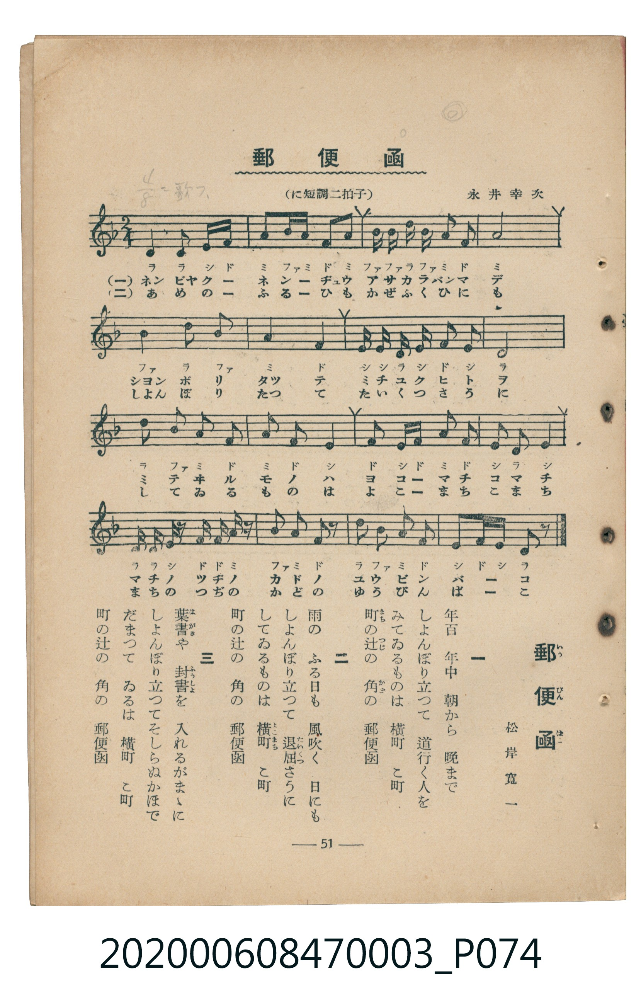

# 郵便函

> Re:Shōka 使用 AI 協助辨識與重建樂譜，可能會有錯誤。歡迎回報。

- **鋼琴伴奏版**：<br><audio controls src="yubinbako.mp3"></audio>
- **NEUTRINO 歌聲合成版**：<br><audio controls src="yubinbako_neutrino.mp3"></audio>

- 詞：松岸寛一
- 曲：永井幸次
- 臺灣教育會公認《新定兒童唱歌》尋常科第三學年用（2020.006.0847.0003）

## 說明

原書資訊與歌詞全文（對應 P074.jpg，書頁 p. 51，補充教材第 13 首）：
調性與拍號：に短調二拍子（D 都節／陰音階 6_ 7_ 1 3 4 6，調號 1♭ ?= F，2/4 拍）
（原書左上角有楊金土鉛筆批註：「4/8 ニ歌フ」）

## 歌詞

```text
一
年百年中　朝から晩まで
しよんぼり立つて　道行く人を
みてゐるものは　横町　こ町
町の辻の　角の　郵便函

二
雨のふる日も　風吹く日にも
しよんぼり立つて　退屈さうに
してゐるものは　横町　こ町
町の辻の　角の　郵便函

三
葉書や封書を　入れるがまゝに
しよんぼり立つて　そしらぬかほで
だまつてゐるは　横町　こ町
町の辻の　角の　郵便函
```

## ABC

```abc
X:1
T:郵便函
C:曲：永井幸次
M:2/4
L:1/16
Q:1/4=100
K:F
V:V1 name="Piano" snm="Pia"
[V:V1]
D4 D2 E F | A2 B A F2 A2 | B B d B A2 F2 | A8 |
w: 1.~ネン ビヤ ク _ | ネ ン _ ヂュ ウ | ア サ カ ラ バン マ | デ
w: 2.~あ め の _ | ふ る _ ひ も | か ぜ ふ く ひ に | も
w: 3.~は がき や _ | ふ う _ しよ を | い れ る が ま ま | に
B4 d2 B2 | A4 F4 | E E D E F2 E2 | D8 |
w: 1.~シヨン ボ リ | タツ テ | ミ チ ユ ク ヒ ト | ヲ
w: 2.~しよん ぼ り | たつ て | た い く つ さ う | に
w: 3.~しよん ぼ り | たつ て | そ し ら ぬ か ほ | で
d2 B2 A2 F2 | A2 F2 E4 | F2 E F A2 F2 | E2 D2 E4 |
w: 1.~ミ テ ヰ ル | モ ノ ハ | ヨ コ _ マ チ | コ マ チ
w: 2.~し て ゐ る | も の は | よ こ _ ま ち | こ ま ち
w: 3.~だ まつ て ゐ | る _ は | よ こ _ ま ち | こ ま ち
D D E z F F A z | B2 A2 F2 z2 | d2 B2 A2 F2 | E2 F E D2 z2 |
w: 1.~マ チ ノ ツ ヂ ノ | カ ド ノ | ユ ウ ビ ン | バ _ _ コ
w: 2.~ま ち の つ ぢ の | か ど の | ゆ う び ん | ば _ _ こ
w: 3.~ま ち の つ ぢ の | か ど の | ゆ う び ん | ば _ _ こ
```

## TMD 檔案連結

- [主旋律 TMD 檔案](yubinbako.tmd) [[在 TMD Studio 編輯](https://tmdlang.github.io/Tmd-TS/#tmd=s7IKdvYPcrWy4qpTUCpJTLdSSM7PyUlNLsnMz7MqzsjMK0nNjM_KTMmPL87Iz05Ugisry88pzU21Si9KTEmNN443MjAyiDcwMIs3sDAxBzIMjBFKi_NLi5JTrYqTM_Lzc-JLUitKkvLzsxHyBUX5Zal5iXlANQVFIBtTwIoQClLLMlNSQdKpKZkl-UWZiTlI7kgtKga7FWxJfElRYl5xclFmAcgDCFUlGalAx4IlC_KLkIyGSqQmZ-Tl5-SnVypxaWkpvGze-mTf_qftexW0tLgUbRUMDQy47G0V3LhsjPRN7EB6X6yc937PrGdz9z3dtOPp-tlPdjSAjXw2exNIeMOOJ7umPt2549mahWDhF-27njcufjZ15oumTc_mND9tXfNiVe_jhq5n0zY8XTfraeuk56uXPp2y8dnanscN3U83dD_dseP58onP16x5sqPz6dodT3dueT5lxfs9HaBA1gMGsh4okIEMA-P3ezqVuLj0tRRsqQW4FBQUnvbNfzZ7x4vN7S9WdL3oaAe6C-jfp60rnk1rB7ri6YbeZ-2dCgEG5iZ6WQXp7_f0ABW_XNCoUKCnYGoI5L5YPOdpayvQu8_mTgB6QsHQWOHlsmlApwLDBmT8i1X7nzUsBxnc3fti5nyg6OPG1c_nrwWKP9nVAxR8unYC0B4XYDzsfb6-4f2e_pczN7ycv_nlrD4Fs3gF83gFQwVjBRMFM5Bdq_YDjVAwfDRzrQIoioBCwDhSABoCtA9kGcjBYO883b7syY6uF8snPZvT-Wxp18v2iU_nzH_ZOfv52rZnnTtfrNgNckdDj4m-hcLj5m5QXDRPfdwANgZkDjCKwUEDjIuZ-4Dkkx1rHzc0PJsz93Fj9-OmzmczVz5u3Pe4cTlI0ePG6Y-bOh43TX7cuOdxU9fz1d2PG5c8blwG1PCycfKLhT2PG_uf7Nr1uGkSRPV-kFzThMdNQJOaHjeue9y4HmT2ilXPp-wCMh43TgYyQEpB_MZ1L_btBilqaAB6BsKAJ1iIU3f1gKiXs1eAzdoKNPfZ9KUgo4EqF614OmEn0H6QSONqoCAhBzc0PN3Y8bhx6uPGNqAGmGrqOngHOKpeTOwExtPjppanGxrBjElAlU9bgS7vAdnUCAy2fY-bgAEOdwUONz9uBCoCynY-blwDip5GoPXQiFkAjiWwOoj7yXc5UBHl2Q0KFLT0ubgiS5My85ISs_OtAjIT8_IdagxqqkG2KNgYmmnZgVnAnB5cWVySmgvMAhq5eoa6JppWwOTa-7h58-PmyY-blzxuWv-4eQ9caM_j5sbHzcAQXKbwuGnR4yZgWlj9uHnl4-YJYOl5QIXtILtBZteAMpcuGIIZ4HxWA8xpusC8Zgxk64LZNUAeMO-BxXTBohA1yLAGbKCPYQ3UIVBhiBNBjKb1YH1AWbAwSMHj5iagS8GSyyCSTYuAeCsQrwZKrgRikKPBKudBdbdjt9cIKNfYBLO0qRFENq6D6GncChbrBottArNBKkEy3UA8B6wCmD9gso2roY6BmYdmlzFIJ8g3YLtAaRTspaYWZOsa28AkKMGCJSdBJVuA7B6wa4A6gXgfWBmIBMmCbMa0EZEEjEBJwFTXApQEmrY_bl4BjtM5j5tXAfn7Hze3PG5uAwbSfHAaAKZ3YMqY9Li5Ayi0CRHnJlDDzYAYxEZEJihqwdaCUgIQwYpecMoACcOTC5Zoh7kHFjDNc8DkKmhgglwHlwIFDsQioGOBuBGIQel1PZAGhRTIzRBZUIzgim9oaQCPiT3gkO6ChuV8YKaHS4HSF9TCRqCFoGgAR_gSIJ4Kjy_cUQCJdDItnAvSClTYCaTXgFMdSMVuqOxyrBYi4twYFOeWuoZG4HwPjNq2x80bHjeDcsiix819j5uB_gAGfBMk788DByaIA2YhMjrQZFBko-ZgeNRCnArlgupamCqwLKxwwIhzYOTBohPoKDAJzTzNi8C8PjDZjwiM5hXgMENkapArISkEXQwjuuEBCyzIwSQoIGEZFZLdERkTJA7Oeo2g-IJltIXQQEcXQ4_pBRB5SIwiWwoyFmQtJJYptQwRyybgwt1Y19AMHM2gyANHLjBHAwvJPlCR-Li5E8wCZexl4IJ1M6SEBEY7sD7cjFKqQ7KuATAWQbFpAM32sHg1ALsMM02A49gQmvWhypBiG1R5gLJqn0I8kATmoeYmKA8UAKCYB7oRHu-QIgOUsWElPNDRYBIU0yAZUICCAxIc92D1SPG9DxxcoHgF2gbOqcDaAcyDFN2g4FwJj3mobU2QchdCglMUOL-CdIDSJyTaQCJItoFjnB621XJx6dopwCt9BSBHmQsA)]
- [鋼琴伴奏 TMD 檔案](yubinbako_piano.tmd) [[在 TMD Studio 編輯](https://tmdlang.github.io/Tmd-TS/#tmd=s7IKdvYPcrWy4tLSUnjZvPXJvv1P2_e-39PxsnvP8wlbnuzZ8nRp__POjvd7OhW0tLgUbRUMDQy47G0V3LhsjPRN7LjqFJRerJz3fs-sZ3P3Pd204-n62U92NCiBhJ_N3gQS3rDjya6pT3fueLZmIVj4Rfuu542Ln02d-aJp07M5zU9b17xY1fu4oevZtA1P18162jrp-eqlT6dsfLa253FD99MN3U937Hi-fOLzNWue7Oh8unbH051bnk9ZAXSgkYGRgZ6BgZmegYWJOZBhYAx0oxIXV2RpUmZeUmJ2vlVAZmJefpCHQ41BTTWXAhDYGJpp2YFZ-loKwZXFJam5CoYKGrl6hrommlYKj5t7Hzdvftw8-XHzksdN6x8374EL7Xnc3Pi4eenjpmUKj5sWPW7a-rhp9ePmlY-bJ4Cl5wEVtito6YPNrlGozi2oVTCLV9AFQzDDPB5oU42CMZBpAiQNgTSIXQPkmSiYgcV0waIQNciwBmyqj2EN1DVQYYg7QYym9WB9QFmwMEjB4-YmoHPBkssgkk2LgHgrEK8GSq4EYpDLwSrnQXW3Y7fXCCjX2ASztKkRRDaug-hp3AoW6waLbQKzQSpBMt1APAes4nFjP0y2cTXUMTDz0OwyBukE-QZsV2PP40awl5pakK1rbAOT0x83dYAlJ0ElW4DsHrBrgDqBeB9YGYgEyYJsxrQRkQ6MQOnAVNcClA6atj9uXgGO2DmPm1cB-fsfN7c8bm4DBtJ8cEJYBk4ekx43dwCFNiFHfFotMC6h8Q7EIDYiRkHxC7YblByACJgywOkCnDxAwvA0gyXuYY6ChU7zHDC5ChqiICfCpUAhBLEI6GIgbgRiUMpdD6RBwQVyOEQWFC24Ih0Uwo-bJsOjYw84uLugATr_cSMo9UGkQIkMamEj0EJQXIBjfQkQT4VHGu54gMQ8mRbOBWkFKuwE0mvASQ-kYjdUdjlWCxERbwyKeEtdQyNwCQCM37bHzRseN4OyyaLHzX2Pm4H-AAZ8E6QUmAcOTBAHzELL8kDjQTGOmpfh8QtxL5RriKQKLAsrJjAiHhiDsDgFugxMQrNR8yIwrw9M9iNCpHkFOOAQ2RvkVEgyQRfDiHN46D5umgAmQaEJy7KQjI_IoiBxcCZsBEUaLMsthIY8uhh6dC-AyEOiFdlSkLEgayFRTalliKg2AZf1xrqGZuC4BsUgOIaBeRtYXPaBCsfHzZ1gFiiLLwMXsZshZSUw7veAgg81rwMjDZKJDYBRCYpSA3CRjkgCBmDnYSYMcEQbQgsBqDKkKAdVKKBM26cQDySBuam5CcoDhQIo-oEOhUc-pPAAZXFYgQ90OZgERTdIBhSq4NAEJwCweqRI3wcOM1DkAm0D51lgZQHmQUpyUJiuhEc_1LYmSDEMIcHJCpxzQTpAiRQSdyARJNvA0U4P22ox2gE-yO0AC9zNAEQEm8UDc2m8tjEoimAsXKImQDaQr22IKmwMZJsDhYEcEBOYOHDVOghrkYxCYuKyGGaDEcQGqGXoqjEtRpR6WG3G7mM8NhDtY6Q8iBrUBjCXorsDixAW20CyQApkITDyde0U4PEf7WMYC7YHVdAIm6BxLEhAmQsA)]

## 分析

```text
================================================================================
📊 TMD Song Profile: [ 郵便函 ]
================================================================================
⏱  Duration:       0:19 (19.2s), 16 measures total
🎼 Key & Tempo:    首調基準 F, != 100.0 BPM, <2/4>
   - 分析範圍：      由實際發聲的音符與和弦推測調性；播放脈絡另行呈現
🎤 人聲音域:    D4 (MIDI 62) – D5 (MIDI 74) [跨度: 12 個半音 / 1.0 個八度, 難度: easy]
   - 最低音:  D4 in [Yubinbako #1 @ m.1, 0:00]
   - 最高音: D5 in [Yubinbako #1 @ m.3, 0:02]
   - 適合: soprano, mezzo-soprano, contralto, tenor, baritone, bass
🏛  結構:      Yubinbako (19.2s)
⚡ 編曲密度:        Peak 1 軌道同時演奏
🗝  調性診斷：       D 小調（純淨自然小調，未偵測到可信轉調）
   - 風格氣質:    純淨自然小調（陰鬱抒情、旋律集中，無明顯調外色彩）
   - 轉調歷程:    全曲維持單一推測調性（未偵測到可信轉調）
   - 核心骨幹音:  A, D, F, E, A#
   - 調性數值:    D 小調 [相關度: 0.87, 穩定度: High, 自然音純度: 100.0%]
   - 候選調性 (K-S): D 小調 (0.87), F 大調 (0.56), A 小調 (0.50)
   - 五度圈歷程:   +2
   - 各段落調性細節:
     • [Yubinbako #1]: D 小調 (r: 0.87, 自然音純度: 100.0%)

  [ 五度圈游移軌跡 ]
               C  
         F            G  
      Bb              [D ]*
      Eb               A  
         Ab           E  
            Db       B  
               F# 
     (* = active key center)

  [ 十二半音累積音高分佈 ]
     C  :                            0.0%
     C# :                            0.0%
     D  : ██████████████████████    23.0%
     D# :                            0.0%
     E  : █████████████████         17.2%
     F  : ██████████████████████    22.1%
     F# :                            0.0%
     G  :                            0.0%
     G# :                            0.0%
     A  : ████████████████████████  24.6%
     A# : █████████████             13.1%
     B  :                            0.0%
--------------------------------------------------------------------------------
Assignment 軌道音域：
  - Piano         : D4 – D5 (12 個半音 / 1.0 個八度, 60 個音符)
================================================================================
```


## 原書掃描頁




