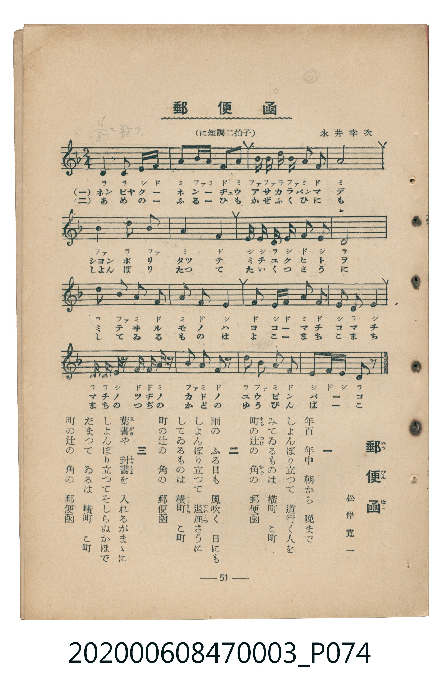

# 郵便函

<audio controls src="yubinbako.mp3"></audio>

- 詞：松岸寛一
- 曲：永井幸次
- 臺灣教育會公認《新定兒童唱歌》尋常科第三學年用（2020.006.0847.0003）

- note

原書資訊與歌詞全文（對應 P074.jpg，書頁 p. 51，補充教材第 13 首）：
調性與拍號：に短調二拍子（D 小調 / 關係大調 F 大調 2/4 拍），♩=100

## 歌詞

```text
一
年百年中　朝から晩まで
しよんぼり立つて　道行く人を
みてゐるものは　横町　こ町
町の辻の　角の　郵便函

二
雨のふる日も　風吹く日にも
しよんぼり立つて　退屈さうに
してゐるものは　横町　こ町
町の辻の　角の　郵便函

三
葉書や封書を　入れるがまゝに
しよんぼり立つて　そしらぬかほで
だまつてゐるは　横町　こ町
町の辻の　角の　郵便函
```

## 原書掃描頁



## 調性分析

```text
================================================================================
📊 TMD Song Profile: [ 郵便函 ]
================================================================================
⏱  Duration:       0:19 (19.2s), 16 measures total
🎼 Key & Tempo:    首調基準 F, != 100.0 BPM, <2/4>
   - 分析範圍：      由實際發聲的音符與和弦推測調性；播放脈絡另行呈現
🎤 人聲音域:    C#3 (MIDI 49) – D5 (MIDI 74) [跨度: 25 個半音 / 2.1 個八度, 難度: difficult]
   - 最低音:  C#3 in [Yubinbako #1 @ m.10, 0:11]
   - 最高音: D5 in [Yubinbako #1 @ m.3, 0:02]
   - 適合: tenor
🏛  結構:      Yubinbako (19.2s)
⚡ 編曲密度:        Peak 1 軌道同時演奏
🗝  調性診斷：       D 小調（流行色彩小調，未偵測到可信轉調）
   - 風格氣質:    流行小調（略帶和弦色彩音與裝飾副屬和弦）
   - 轉調歷程:    全曲維持單一推測調性（未偵測到可信轉調）
   - 核心骨幹音:  A, D, F, C#, A#
   - 調性數值:    D 小調 [相關度: 0.86, 穩定度: High, 自然音純度: 86.2%]
   - 候選調性 (K-S): D 小調 (0.86), F 大調 (0.54), A 大調 (0.46)
   - 五度圈歷程:   +2
   - 各段落調性細節:
     • [Yubinbako #1]: D 小調 (r: 0.86, 自然音純度: 86.2%, 調外音: C#)

  [ 五度圈游移軌跡 ]
               C  
         F            G  
      Bb              [D ]*
      Eb               A  
         Ab           E  
            Db       B  
               F# 
     (* = active key center)

  [ 十二半音累積音高分佈 ]
     C  :                            0.0%
     C# : █████████████             13.8%
     D  : █████████████████████     22.0%
     D# :                            0.0%
     E  : █████                      4.9%
     F  : █████████████████████     22.0%
     F# :                            0.0%
     G  :                            0.0%
     G# :                            0.0%
     A  : ████████████████████████  25.2%
     A# : ████████████              12.2%
     B  :                            0.0%
--------------------------------------------------------------------------------
Assignment 軌道音域：
  - Piano         : C#3 – D5 (25 個半音 / 2.1 個八度, 59 個音符)
================================================================================
```

## ABC

```abc
X:1
T:郵便函
C:曲：永井幸次
M:2/4
L:1/16
Q:1/4=100
K:F

V:V1 name="Piano" snm="Pia"

[V:V1]
d2 d3 e f a | a b a f a4 | b b d b a2 f2 | a8 |
B2 d2 B4 | A4 F4 | E E D E F2 E2 | D8 |
d2 B A F4 | A2 F2 ^C4 | f2 ^c2 a2 f2 | ^c2 d2 c4 |
d d ^c2 f2 a z | b2 a2 f2 z2 | d2 b2 a2 f2 | ^c2 f c d2 z2 |
```

- [主旋律 TMD 檔案](yubinbako.tmd)
- [鋼琴伴奏 TMD 檔案](yubinbako_piano.tmd)
