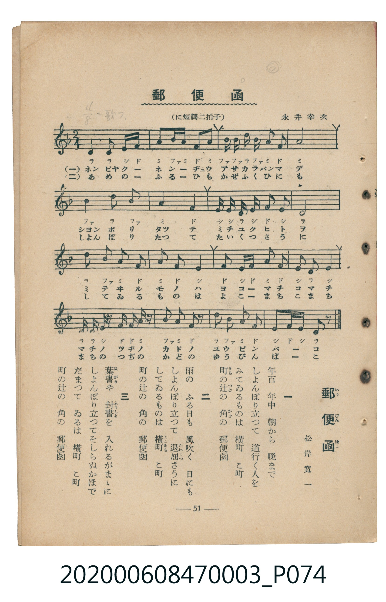

# 郵便函

> Re:Shōka 使用 AI 協助辨識與重建樂譜，可能會有錯誤。歡迎[回報](https://github.com/TMDLang/reshoka/issues)。

- **鋼琴伴奏版**：<br><audio controls src="yubinbako.mp3"></audio>
- **NEUTRINO 歌聲合成版**：<br><audio controls src="yubinbako_neutrino.mp3"></audio>

- 詞：松岸寛一
- 曲：永井幸次
- 臺灣教育會公認《新定兒童唱歌》尋常科第三學年用（2020.006.0847.0003）

## 說明

原書資訊與歌詞全文（對應 P074.jpg，書頁 p. 51，補充教材第 13 首）：
調性與拍號：に短調二拍子（D 都節／陰音階 6_ 7_ 1 3 4 6，調號 1♭ ?= F，2/4 拍）
（原書左上角有楊金土鉛筆批註：「4/8 ニ歌フ」）


## 歌詞

```text
一
年百年中　朝から晩まで
しよんぼり立つて　道行く人を
みてゐるものは　横町　こ町
町の辻の　角の　郵便函

二
雨のふる日も　風吹く日にも
しよんぼり立つて　退屈さうに
してゐるものは　横町　こ町
町の辻の　角の　郵便函

三
葉書や封書を　入れるがまゝに
しよんぼり立つて　そしらぬかほで
だまつてゐるは　横町　こ町
町の辻の　角の　郵便函
```

## ABC

<div class="abc-score" data-abc-src="yubinbako.abc" aria-label="五線譜載入中"></div>

[下載 ABC 原始檔](yubinbako.abc)

## TMD 檔案連結

- [主旋律 TMD 檔案](yubinbako.tmd) [[在 TMD Studio 編輯](https://tmdlang.github.io/Tmd-TS/#tmd=s7IKdvYPcrWy4qpTUCpJTLdSSM7PyUlNLsnMz7MqzsjMK0nNjM_KTMmPL87Iz05Ugisry88pzU21Si9KTEmNN443MjAyiDcwMIs3sDAxBzIMjBFKi_NLi5JTrYqTM_Lzc-JLUitKkvLzsxHyBUX5Zal5iXlANQVFIBtTwIoQClLLMlNSQdKpKZkl-UWZiTlI7kgtKga7FWxJfElRYl5xclFmAcgDCFUlGalAx4IlC_KLkIyGSqQmZ-Tl5-SnVyJkgPakZ-ZZlSRmAn0O8n15YnxuYmZeTmJeCrKqkox8YCAUZFRaZWQWg1yXnJgTn52YhxRWULcVJKanWgUYmJsocWlpKbxs3vpk3_6n7XsVtLS4FG0VDA0MuOxtFdy4bIz0TexAel-snPd-z6xnc_c93bTj6frZT3Y0gI18NnsTSHjDjie7pj7duePZmoVg4Rftu543Ln42deaLpk3P5jQ_bV3zYlXv44auZ9M2PF0362nrpOerlz6dsvHZ2p7HDd1PN3Q_3bHj-fKJz9esebKj8-naHU93bnk-ZcX7PR2gmNQDxqQeKCaBDAPj93s6lbi49LUUbKkFuBQUFJ72zX82e8eLze0vVnS96GgHugvo36etK55Nawe64umG3mftnQqg0NLLKkh_v6cHqPjlgkaFAj0FU0Mg98XiOU9bW4HefTZ3AtATCobGCi-XTQM6FRg2IONfrNr_rGE5yODu3hcz5wNFHzeufj5_LVD8ya4eoODTtROA9rgA42Hv8_UN7_f0v5y54eX8zS9n9SmYxSuYxysYKhgrmCiYgexatR9ohILho5lrFUBRBBQCxpEC0BCgfSDLQA4Ge-fp9mVPdnS9WD7p2ZzOZ0u7XrZPfDpn_svO2c_Xtj3r3PlixW6QOxp6TPQtFB43d4Pionnq4wawMSBzgFEMDhpgXMzcBySf7Fj7uKHh2Zy5jxu7Hzd1Ppu58nHjvseNy0GKHjdOf9zU8bhp8uPGPY-bup6v7n7cuORx4zKghpeNk18s7Hnc2P9k167HTZMgqveD5JomPG4CmtT0uHHd48b1ILNXrHo-ZReQ8bhxMpABUgriN657sW83SFFDA9AzEAY8wUKcuqsHRL2cvQJs1laguc-mLwUZDVS5aMXTCTuB9oNEGlcDBQk5uKHh6caOx41THze2ATXAVFPXwTvAUfViYicwnh43tTzd0AhmTAKqfNoKdHkPyKZGYLDte9wEDHC4K3C4-XEjUBFQtvNx4xpQ9DQCrYdGzAJwLIHVQdxPvsuBiijPblCgoKXPxRVZmpSZl5SYnW8VkJmYl-9QY1BTDbJFwcbQTMsOzALm9ODK4pLUXGAW0MjVM9Q10bQCJtfex82bHzdPfty85HHT-sfNe-BCex43Nz5uBobgMoXHTYseNwHTwurHzSsfN08AS88DKmwH2Q0yuwaUuXTBEMwA57MaYE7TBeY1YyBbF8yuAfKAeQ8spgsWhahBhjVgA30Ma6AOgQpDnAhiNK0H6wPKgoVBCh43NwFdCpZcBpFsWgTEW4F4NVByJRCDHA1WOQ-qux27vUZAucYmmKVNjSCycR1ET-NWsFg3WGwTmA1SCZLpBuI5YBXA_AGTbVwNdQzMPDS7jEE6Qb4B2wVKo2AvNbUgW9fYBiZBCRYsOQkq2QJk94BdA9QJxPvAykAkSBZkM6aNiCRgBEoCproWoCTQtP1x8wpwnM553LwKyN__uLnlcXMbMJDmg9MAML0DU8akx80dQKFNiDg3gRpuBsQgNiIyQVELthaUEoAIVvSCUwZIGJ5csEQ7zD2wgGmeAyZXQQMT5Dq4FChwIBYBHQvEjUAMSq_rgTQopEBuhsiCYgRXfENLA3hM7AGHdBc0LOcDMz1cCpS-oBY2Ai0ERQM4wpcA8VR4fOGOAkikk2nhXJBWoMJOIL0GnOpAKnZDZZdjtRAR58agOLfUNTQC53tg1LY9bt7wuBmUQxY9bu573Az0BzDgmyB5fx44MEEcMAuR0YEmgyIbNQfDoxbiVCgXVNfCVIFlYYUDRpwDIw8WnUBHgUlo5mleBOb1gcl-RGA0rwCHGSJTg1wJSSHoYhjRDQ9YYEEOJkEBCcuokOyOyJggcXDWawTFFyyjLYQGOroYekwvgMhDYhTZUpCxIGshsUypZYhYNgEX7sa6hmbgaAZFHjhygTkaWEj2gYrEx82dYBYoYy8DF6ybISUkMNqB9eFmlFIdknUNgLEIik0DaLaHxasB2GWYaQIcx4bQrA9VhhTboMoDlFX7FOKBJDAPNTdBeaAAAMU80I3weIcUGaCMDSvhgY4Gk6CYBsmAAhQckOC4B6tHiu994OACxSvQNnBOBdYOYB6k6AYF50p4zENta4KUuxASnKLA-RWkA5Q-IdEGEkGyDRzj9LCtlotL104BXukrADnKXAA)]
- [鋼琴伴奏 TMD 檔案](yubinbako_piano.tmd) [[在 TMD Studio 編輯](https://tmdlang.github.io/Tmd-TS/#tmd=s7IKdvYPcrWy4qpTUCpJTLdSyC8qychPL0osyKi0ysgsLskvykxOzInPTsxLVIIrKs4vLUpOjS9ITE-1CjAwN1Hi0tJSeNm89cm-_U_b977f0_Gye8_zCVue7NnydGn_886O93s6FbS0uBRtFQwNDLjsbRXcuGyM9E3sQAa-WDnv_Z5Zz-bue7ppx9P1s5_saADb82z2JpDwhh1Pdk19unPHszULwcIv2nc9b1z8bOrMF02bns1pftq65sWq3scNXc-mbXi6btbT1knPVy99OmXjs7U9jxu6n27ofrpjx_PlE5-vWfNkR-fTtTue7tzyfMoKoAONDIwM9AwMzPQMLEzMgQwDY6Ablbi4IkuTMvOSErPzrQIyE_PygzwcagxqqrkUgMDG0EzLDszS11IIriwuSc1VMFTQyNUz1DXRtFJ43Nz7uHnz4-bJj5uXPG5a_7h5D1xoz-PmxsfNSx83LVN43LTocdPWx02rHzevfNw8ASw9D6iwXUFLH2x2jUJ1bkGtglm8gi4Yghnm8UCbahSMgUwTIGkIpEHsGiDPRMEMLKYLFoWoQYY1YFN9DGugroEKg925GMRoWg_WB5QFC4MUPG7aAXQumLEMItm0CIi3AvFqoJKVQAxyOVj9PKjuduz2GgHlGptgljY1gsjGdRA9jVvBYt1gsU1gNkglSKYbiOeAVTxu7IfJNq6GOgZmHppdxiCdIN-A7WrsedwI9lJTC7J1jW1gcvrjJpCLHzdNgkq2ANk9YNcAdQLxPrAyEAmSBdmMaSMiHRiB0oGprgUoHTRtf9y8Ahyxcx43rwLy9z9ubnnc3AYMpPnghLAMnDwmPW7uAAptQo74tFpgXELjHYhBbESMguIXbDcoOQARMGWA0wU4eYCE4WkGS9yDHLUcOfrngMlV0BAFOREuBQohiEVAFwNxIxCDUu56IA0KLpDDIbKgaMEV6aAQftw0GR4de8DB3QUN0PmPG5fApUCJDGphI9BCUFyAY30JEE-FRxrueIDEPJkWzgVpBSrsBNJrwEkPpGI3VHY5VgsREW8MinhLXUMjcAkAjN-2x80bHjeDssmix819j5uB_gCmhiZIKTAPHJggDpiFluWBxoNiHDUvw-MX4l4o1xBJFVgWVkxgRDwwBmFx-rgJFAIgx0FibxGY1wcm-xEh0rwCrBaRvUFOhSQTdDGMOIeHLigSYZkblmUhGR-RRUHioJT0uBEUabAstxAa8uhi6NG9ACIPiVZkS0HGgqyFRDWlliGi2gRc1hvrGpqB4xoUg-AYBubtJlAwggv1TjALlMWXgYvYzZCyEhj3e0DBh5rXgZEGycQGwKgERakBuEhHJAEDsPMwEwY4og2hhQBUGVKUgyoUUKbtU4gHkqCSbQeUBwoFUPQDHQqPfEjhAcrisAIf6HIwCYpukMwEWGiCEwBYPVKk7wOHGShygbaB8-wMKA9SkoPCdCU8-qG2NUGKYQgJqXNAdoJ0bIDHHUgEyTZwtNPDtlqMdoAPcjvAAnczABHBZvHAXBqvbQyKIhgLl6gJkA3kaxuiChsD2eZAYSAHxAQmDly1DsJaJKOQmLgshtlgBLEBahm6akyLEaUeVpux-xiPDUT7GCkPoga1Acyl6O7AIoTFNpAskAJZCIx8XTsFePxH-xjGgu1BFTTCJmgcCxJQ5gIA)]

## 分析

```text
================================================================================
📊 TMD Song Profile: [ 郵便函 ]
================================================================================
⏱  Duration:       0:19 (19.2s), 16 measures total
🎼 Key & Tempo:    首調基準 F, != 100.0 BPM, <2/4>
   - 分析範圍：      由實際發聲的音符與和弦推測調性；播放脈絡另行呈現
🎤 人聲音域:    D4 (MIDI 62) – D5 (MIDI 74) [跨度: 12 個半音 / 1.0 個八度, 難度: easy]
   - 最低音:  D4 in [Yubinbako #1 @ m.1, 0:00]
   - 最高音: D5 in [Yubinbako #1 @ m.3, 0:02]
   - 適合: soprano, mezzo-soprano, contralto, tenor, baritone, bass
🏛  結構:      Yubinbako (19.2s)
⚡ 編曲密度:        Peak 1 軌道同時演奏
🗝  調性診斷：       D 小調（純淨自然小調，未偵測到可信轉調）
   - 風格氣質:    純淨自然小調（陰鬱抒情、旋律集中，無明顯調外色彩）
   - 轉調歷程:    全曲維持單一推測調性（未偵測到可信轉調）
   - 核心骨幹音:  A, D, F, E, A#
   - 調性數值:    D 小調 [相關度: 0.87, 穩定度: High, 自然音純度: 100.0%]
   - 候選調性 (K-S): D 小調 (0.87), F 大調 (0.56), A 小調 (0.50)
   - 五度圈歷程:   +2
   - 各段落調性細節:
     • [Yubinbako #1]: D 小調 (r: 0.87, 自然音純度: 100.0%)

  [ 五度圈游移軌跡 ]
               C  
         F            G  
      Bb              [D ]*
      Eb               A  
         Ab           E  
            Db       B  
               F# 
     (* = active key center)

  [ 十二半音累積音高分佈 ]
     C  :                            0.0%
     C# :                            0.0%
     D  : ██████████████████████    23.0%
     D# :                            0.0%
     E  : █████████████████         17.2%
     F  : ██████████████████████    22.1%
     F# :                            0.0%
     G  :                            0.0%
     G# :                            0.0%
     A  : ████████████████████████  24.6%
     A# : █████████████             13.1%
     B  :                            0.0%
--------------------------------------------------------------------------------
Assignment 軌道音域：
  - Piano         : D4 – D5 (12 個半音 / 1.0 個八度, 60 個音符)
================================================================================
```


## 原書掃描頁




