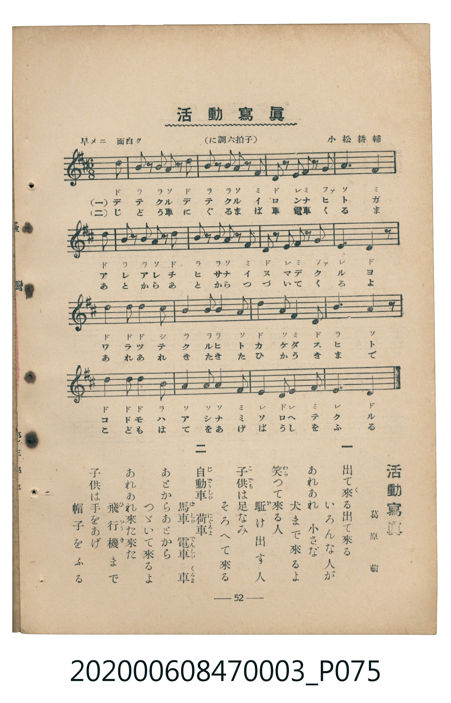

# 活動寫眞

> Re:Shoka 使用 AI 協助辨識與重建樂譜，可能會有錯誤。歡迎回報。

<audio controls src="katsudo_shashin.mp3"></audio>

- 葛原齒 作詞 / 小松耕輔 作曲
- 臺灣教育會公認《新定兒童唱歌》尋常科第三學年用（2020.006.0847.0003）

## 說明

Reference Materials 14: 活動寫眞 (Katsudō Shashin / Motion Pictures)
Source: 臺灣教育會公認 新定兒童唱歌 尋常科第三學年用 (1934), p. 52 (P075.jpg)
Lyricist: 葛原齒 (Kuzuhara Shigeru) / Composer: 小松耕輔 (Komatsu Kōsuke)
Key: D major (?= D), 6/8 (<6/8>), 早メニ 面白ク

## 歌詞

```text
一、出て來る出て來る　いろんな人が
あれあれ小さな　犬まで來るよ
笑つて來る人　駆け出す人
子供は足なみ　そろへて來る
二、自動車　荷車　馬車　電車　車
あとからあとから　つゞいて來るよ
あれあれ來た來た　飛行機まで
子供は手をあげ　帽子をふる
```

## ABC

```abc
X:1
T:活動寫眞
M:6/8
L:1/16
Q:3/8=75
K:D
V:V1 name="Piano" snm="Pia"
[V:V1]
z2 z2 z2 z2 z2 d2 | B2 z2 B2 A2 z2 d2 | B2 z2 B2 A2 z2 F2 | D2 z2 E2 F2 z2 G2 |
A6 F4 d2 | B2 z2 B2 A2 z2 d2 | B2 z2 B2 A2 z2 F2 | D2 z2 E2 F2 z2 G2 |
E6 D4 z2 | d4 d2 d4 c2 | B4 B2 B4 A2 | d4 A2 F4 D2 |
B6 A4 z2 | d4 d2 d4 B2 | A4 A2 A4 F2 | E4 D2 E4 F2 |
E6 D4 z2 |
```

## TMD 檔案連結

- [主旋律 TMD 檔案](katsudo_shashin.tmd) [[在 TMD Studio 編輯](https://tmdlang.github.io/Tmd-TS/#tmd=s7IKdvYPcrWy4qpTUCpJTLdSSM7PyUlNLsnMz7MqzsjMK0nNjM_KTMmPL87Iz05Ugisry88pzU21Si9KTEmNN443MjAyiDcwMIs3sDAxBzIMjBFKi_NLi5JTrYqTM_Lzc-JLUitKkvLzsxHyBUX5Zal5iXlANQVFIBtTwIoQClLLMlNSQdKpKZkl-UWZiTlI7kgtKga7FWxJfElRYl5xclFmAcgDCFUlGalAx5akJmfk5efkp1cqcWlpKTzbsvtp99Sn61c_nzNPQUuLS9FWwdDQiMveVsGFy8ZM38IOpP3FxNlP--a_3DtJ4cneOS9WzlPQV3i6of_Z3H0vGqa-2DMFJPps9iawTS_adz1vXPxs6swXTZuezWl-2rrmxarexw1dz6ZteLpu1tPWSc9XL306ZeOztT2PG7qfbuh-umPH8-UTn69Z82RH59O1O57u3PJ8yor3ezpAYakHDEs9UFgCGQbG7_d0KnFx6WtxKWgpBKWmpRaBQkPBN7EkFRQYxQqGJlaovtHwTiwpLk052qsQnJEIikags33zQWGiEJCZXFJalFqsCTIsGBI1ClidroDpcKDfsTtbQcPQ0thEU0ehQE_B1EhBI8DA3FQvqyAdbItPZVFmcmZxCdAeeGhqeJdWlWYkFiUCXZiZnlpUqgl0onN-bkF-cWqRFWoYa3jn54L8o-B9tLe4NDsVbKh3aqWVgotCbmJWfpGCBijSgLYDY01BAxx3QM6z6SsfNy983Nyt8HLuoucz9z5uWg_UCHdQsRWI-WRHw-OGxqftux43Lnuyr-1xUzcy-3FDw-PGlsdNvY-bJj9uXPVkF1CqB6QNJAGSa3rc1AMhgS5-3DgVqAgo_rxrzePGfY8bl0NNaepA6Hm-ZuLjxiVwG0BGNjS8XN72uHEi2OaZQBGE6qdrJzzZN_tx4_oX2zaDzG7cD7Z2LshJjTvgpoB9sguYrhpftK8CJoMXu7uA6l70bocwXi5bA2XM3g2V2t2F6o3GFY8bgQ7tRGGDpJY8bpoHCgN4kCB7BjkAQNKN8yEkyKrFs18s7Hm2cj4kJLB46Vkn0LBJYAsngcR37AVKgUW2Qrykz8UVBszeqVYBmYl5-Q41BjUK1VwKQGBjoWUHZuhrKTzds_HF1u3PunutFB43twMT0ePGGSCtIOkaBQM4NIxTqIHpMdQFZpjHzW0KwCQBpFeDddagijQtAYusBeLNQNwFxJPAIh1AuTUKGo-bFmki7DED2mCmYAq1B4lrDOQZAmkjIMtAwQTIM1XQBUJjIEZ2kqmuBchJa4CGL4LQzY1g6yYBRbZCHAB1Ug8QzwM7GeRYkAjIAyvIcowR2DGGQGyAcIulrqERyDGgkFgJxC3gkAFaBA8toKOA4QASAYXURiCvAUjvhDkYKAd3DNAJYJ-CaXOwc3SBGESawqRNIcEBlQTxUdxjaKxraAZ0UBMoIjqBGBRC_WDrgaym7dDomQ8W2QuNtBlojsbuIDNohJiCSVD4gELEEEzCeIjwqeXi0rVTAKdJBSBDmQsA)]
- [鋼琴伴奏 TMD 檔案](katsudo_shashin_piano.tmd) [[在 TMD Studio 編輯](https://tmdlang.github.io/Tmd-TS/#tmd=s7IKdvYPcrWy4tLSUni2ZffT7qlP169-Pmfe-z0dL7v3PJ-w5cmeLU-X9j_v7Hi_p1NBS4tL0VbB0NCIy95WwYXLxkzfwo6rTkHpxcTZT_vmv9w7SeHJ3jkvVs5T0Fd4uqH_2dx9LxqmvtgzBST6bPYmJbDS9l3PGxc_mzrzRdOmZ3Oan7auebGq93FD17NpG56um_W0ddLz1UufTtn4bG3P44bupxu6n-7Y8Xz5xOdr1jzZ0fl07Y6nO7c8n7IC6DojAyMDPQMDMz0DCxNzIMPAGOhAJS4ufS0uBS2FoNS01KLUvORUBd_EktSizMScYgVDEysULypoeCeWFJemHO1VCM5ILM7IzAM62ze_JDM_TyEgM7mktCi1WFNBF8hOzMtXcExOzs8tSMzLzE3NKwFZEZxfWpScaqWA1UMKmN4Bhgh2zyhoGFoam2jqKBToKZgaKWgEGJib6mUVpGsCbdHn4gpLLSpOtQI7IsjDocagRqGaSwEIbCy07MCMGgUDODSMU6iBCpoBuWYKplBBJK4xkGcIpI2ALAMFEyDPFOhLXSBPl0z9RmD9hkBsANcO1AQ2Dkybgw3QBWIQaQqTNoXYCZUE8XGaYAZ1pimYBDkBZKkhmITxEE6oRQk2HxzBZhivEG0YC8am8SAewm4ToJRJLMjvEDVAGaxicKZpPJBlGo8iCsIIteSaDJcEBgDMEjCBYTSKf5BVwm0AYSRV2FwKETcCcoxygTwQgew3TKuQjMZtHqp70F2H01_AeNS1UwBHpQIyQ5kLAA)]

## 分析

```text
================================================================================
📊 TMD Song Profile: [ 活動寫眞 ]
================================================================================
⏱  Duration:       0:27 (27.3s), 17 measures total
🎼 Key & Tempo:    首調基準 D, != 112.0 BPM, <6/8>
   - 分析範圍：      由實際發聲的音符與和弦推測調性；播放脈絡另行呈現
🎤 人聲音域:    D4 (MIDI 62) – D5 (MIDI 74) [跨度: 12 個半音 / 1.0 個八度, 難度: easy]
   - 最低音:  D4 in [Verse #1 @ m.4, 0:04]
   - 最高音: D5 in [Verse #1 @ m.1, 0:01]
   - 適合: soprano, mezzo-soprano, contralto, tenor, baritone, bass
🏛  結構:      Verse (27.3s)
⚡ 編曲密度:        Peak 1 軌道同時演奏
🗝  調性診斷：       D 大調（純淨自然大調，未偵測到可信轉調）
   - 風格氣質:    純淨自然大調（陽光明朗、易唱易記，無明顯調外色彩）
   - 轉調歷程:    全曲維持單一推測調性（未偵測到可信轉調）
   - 核心骨幹音:  D, B, A, E, F#
   - 調性數值:    D 大調 [相關度: 0.87, 穩定度: Moderate, 自然音純度: 100.0%]
   - 候選調性 (K-S): D 大調 (0.87), B 小調 (0.77), A 大調 (0.65)
   - 五度圈歷程:   +2
   - 各段落調性細節:
     • [Verse #1]: D 大調 (r: 0.87, 自然音純度: 100.0%)

  [ 五度圈游移軌跡 ]
               C  
         F            G  
      Bb              [D ]*
      Eb               A  
         Ab           E  
            Db       B  
               F# 
     (* = active key center)

  [ 十二半音累積音高分佈 ]
     C  :                            0.0%
     C# : █                          1.2%
     D  : ████████████████████████  29.3%
     D# :                            0.0%
     E  : ████████████              14.6%
     F  :                            0.0%
     F# : ██████████                12.2%
     G  : ██                         2.4%
     G# :                            0.0%
     A  : ████████████████          19.5%
     A# :                            0.0%
     B  : █████████████████         20.7%
--------------------------------------------------------------------------------
Assignment 軌道音域：
  - Piano         : D4 – D5 (12 個半音 / 1.0 個八度, 58 個音符)
================================================================================
```


## 原書掃描頁




