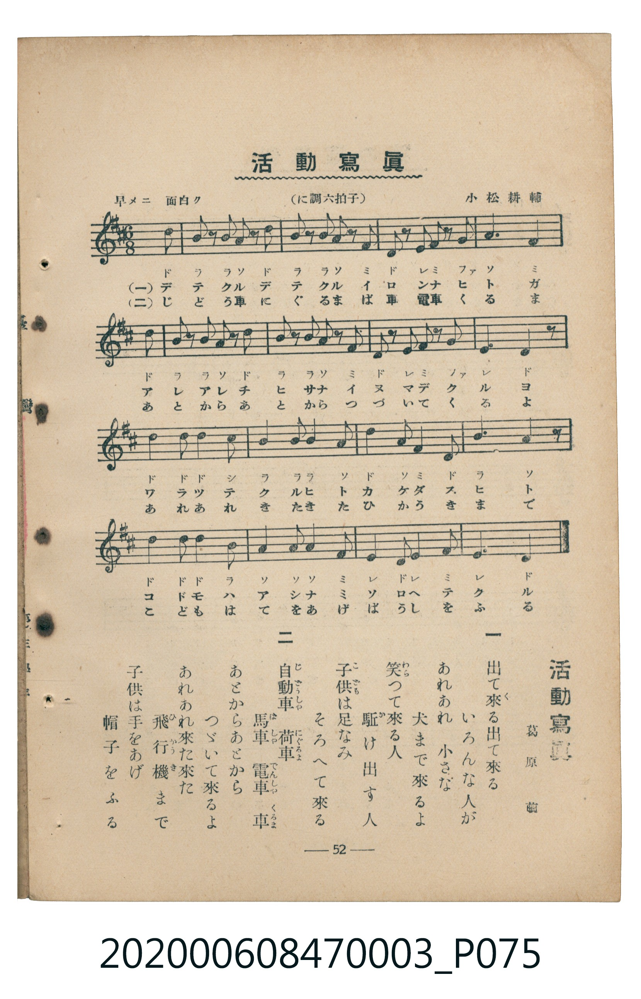

# 活動寫眞

> Re:Shōka 使用 AI 協助辨識與重建樂譜，可能會有錯誤。歡迎回報。

- **鋼琴伴奏版**：<br><audio controls src="katsudo_shashin.mp3"></audio>
- **NEUTRINO 歌聲合成版**：<br><audio controls src="katsudo_shashin_neutrino.mp3"></audio>

- 葛原齒 作詞 / 小松耕輔 作曲
- 臺灣教育會公認《新定兒童唱歌》尋常科第三學年用（2020.006.0847.0003）

## 說明

Reference Materials 14: 活動寫眞 (Katsudō Shashin / Motion Pictures)
Source: 臺灣教育會公認 新定兒童唱歌 尋常科第三學年用 (1934), p. 52 (P075.jpg)
Lyricist: 葛原齒 (Kuzuhara Shigeru) / Composer: 小松耕輔 (Komatsu Kōsuke)
Key: D major (?= D), 6/8 (<6/8>), 早メニ 面白ク


## 歌詞

```text
一、出て來る出て來る　いろんな人が
あれあれ小さな　犬まで來るよ
笑つて來る人　駆け出す人
子供は足なみ　そろへて來る
二、自動車　荷車　馬車　電車　車
あとからあとから　つゞいて來るよ
あれあれ來た來た　飛行機まで
子供は手をあげ　帽子をふる
```

## ABC

<div class="abc-score" data-abc-src="katsudo_shashin.abc" aria-label="五線譜載入中"></div>

[下載 ABC 原始檔](katsudo_shashin.abc)

## TMD 檔案連結

- [主旋律 TMD 檔案](katsudo_shashin.tmd) [[在 TMD Studio 編輯](https://tmdlang.github.io/Tmd-TS/#tmd=s7IKdvYPcrWy4qpTUCpJTLdSSM7PyUlNLsnMz7MqzsjMK0nNjM_KTMmPL87Iz05Ugisry88pzU21Si9KTEmNN443MjAyiDcwMIs3sDAxBzIMjBFKi_NLi5JTrYqTM_Lzc-JLUitKkvLzsxHyBUX5Zal5iXlANQVFIBtTwIoQClLLMlNSQdKpKZkl-UWZiTlI7kgtKga7FWxJfElRYl5xclFmAcgDCFUlGalAx5akJmfk5efkp1ciZIDGpWfmWZUkZgI9CPJkeWJ8bmJmXk5iXgqyqpKMfKBfCzIqrTIyi0GOSE7Mic9OzEMKEqgTChLTU60CDMxNlbi0tBSebdn9tHvq0_Wrn8-Zp6ClxaVoq2BoaMRlb6vgwmVjpm9hB9L-YuLsp33zX-6dpPBk75wXK-cp6Cs83dD_bO6-Fw1TX-yZAhJ9NnsT2KYX7bueNy5-NnXmi6ZNz-Y0P21d82JV7-OGrmfTNjxdN-tp66Tnq5c-nbLx2dqexw3dTzd0P92x4_nyic_XrHmyo_Pp2h1Pd255PmXF-z0doAjTA0aYHijCgAwD4_d7OpW4uPS1uBS0FIJS01KLQEGu4JtYkgoK8WIFQxMrVN9oeCeWFJemHO1VCM5IBKUVoLN980EBrxCQmVxSWpRarAkyLBgS_wpYna6A6XCg37E7W0HD0NLYRFNHoUBPwdRIQQMUyHpZBelgW3wqgXECjBqgPfDQ1PAurSrNSCxKBLowMz21qFQT6ETn_NyC_OLUIivUMNbwzs8F-UfB-2hvcWl2KthQ79RKKwUXhdzErPwiBQ1QpAFtB8aaggY47oCcZ9NXPm5e-Li5W-Hl3EXPZ-593LQeqBHuoGIrEPPJjobHDY1P23c9blz2ZF_b46ZuZPbjhobHjS2Pm3ofN01-3LjqyS6gVA9IG0gCJNf0uKkHQgJd_LhxKlARUPx515rHjfseNy6HmtLUgdDzfM3Ex41L4DaAjGxoeLm87XHjRLDNM4EiCNVP1054sm_248b1L7ZtBpnduB9s7VyQkxp3wE0B-2QXMF01vmhfBUwGL3Z3AdW96N0OYbxctgbKmL0bKrW7C9UbjSseNwId2onCBkktedw0DxQG8CBB9gxyAICkG-dDSJBVi2e_WNjzbOV8SEhg8dKzTqBhk8AWTgKJ79gLlAKLbIV4SZ-LKwxYhgCzbGZiXr5Dja5hTTWXAhDYWGjZgRn6WgpP92x8sXX7s-5eK4XHze3ARPS4cQZIK0i6RsEADg3jFGrAgj6GNQrxcAjSAxU3QhEHmgIRB9phqAvMYI-b2xSASQhIr4boQhVpWgIWWQvEm4G4C4gngUU6gHJrFDQeNy3SRLjLDOgiMwVTqLuQuMZAniGQNgKyDBRMgDxTBV0gNAZiFC-ALAc6E2o91COYonBngVRAHAZiwZwGMhrkPBC5CCkgHjeuBAcC0ION0x83NYM5q0GaGieAje0GsvaBRTeAReGKlgOzCjK_HyQNVA62CagFRDYhgtZU1wIUtGvA9oPp5kaw2yYBRbZCAhLqhx4gngf2J8h_IBFQRKwgK1CNwO4xBGIDlDBdA_YcxCWgcIK5BSQKcQ0iTHvAKiAugoQ5xE1gnwLdpQsURQ7RFeDwAAZcUyeYBQwFLKJgsxuXgtktQLwMMxSbQPEGMxsYhpa6hkagQARF-kogBmoDJgOQBlhqBQYmMLJBIqCUuhHIawDSO2EBDZSDByIw6MApDUybg4NRF4hBpClM2hSSHKGSID56OK4HhwHEMSAWzDkgNsRBIBbMSSA_QRwFYsGcBQlHZL9CwrEJrAqYGuAskGgvOGXNR2KBRDeB2aDE2gZm9YJFQakQxFuOGo6GxrqGZsCAbALlk04gBqUDSMgDWU3bodkabHLTXmhmn4EW2NgD0gyakU3BJCg9glKgIZiE8bCkR6BLQGEAcQuIBXMNyN8Q94BEYS4CsSFuQg1zSKijh-NkcBgA46gJHI6N4PQLTG8gs4GJAhK6jeCSApjJQWxwaQCVB4luhaZHULoEmV3LxaVrpwAusxWADGUuAA)]
- [鋼琴伴奏 TMD 檔案](katsudo_shashin_piano.tmd) [[在 TMD Studio 編輯](https://tmdlang.github.io/Tmd-TS/#tmd=s7IKdvYPcrWy4qpTUCpJTLdSyC8qychPL0osyKi0ysgsLskvykxOzInPTsxLVIIrKs4vLUpOjS9ITE-1CjAwN1Xi0tJSeLZl99PuqU_Xr34-Z977PR0vu_c8n7DlyZ4tT5f2P-_seL-nU0FLi0vRVsHQ0IjL3lbBhcvGTN_CDmTmi4mzn_bNf7l3ksKTvXNerJynoK_wdEP_s7n7XjRMfbFnCkj02exNYOtftO963rj42dSZL5o2PZvT_LR1zYtVvY8bup5N2_B03aynrZOer176dMrGZ2t7Hjd0P93Q_XTHjufLJz5fs-bJjs6na3c83bnl-ZQVQNcZGRgZ6BkYmOkZWJiYAxkGxkAHKnFx6WtxKWgpBKWmpRal5iWnKvgmlqQWZSbmFCsYmliheFFBwzuxpLg05WivQnBGYnFGZh7Q2b75JZn5eQoBmcklpUWpxZoKukB2Yl6-gmNycn5uQWJeZm5qXgnIimBwEFopYPWQAqZ3gCGC3TMKGoaWxiaaOgoFegqmRgoaoPjQyypI1wTaos_FFZZaVAyMJJAjgjwcagxqqrkUgMDGQssOzKhRMIBDwziFGrCgj2GNQjwcPm5uh4kboYg3zoCK1yiYAbWbKZhCDUHiGgN5hkDaCMgyUDAB8kyBgaIL5Omi2ve4uQ1kZtN6IGs1zFZM0aYlYNG1YBWbgbgLzJoEFu0AG_24aQ2YXITk6seNK8EubgPi6Y-bmsGc1SBNjRPAxnYDWfvAohvAonBFyx83TUbm94OkgcrBNgG1gMgmcsLBCGyEIRAboATDGrB7FsFYzY1gr00Ci26FeRgaDD1gFfPAgQUJJpDoaojjmlcAyXiUQFgB9gLQr02dYBbQ4VhEwWY3LgWzW4B4GabHm0BBDTMb6LM4SHSCaXOwx3WBGESawqRNIXEOlQTx0X2-HuzqlUDcAma1gW2EiK4GhwGI1QEWBfnxcdNGIL8BzNoJDSWIz5FdB_F5E1hVDxILJNoLjr75SCyQ6CYwG5Qi2sCsXrAoKKpBvOW4fW4GTd6mYBIU5aBINgSTMB6WKG_aDHZ0JxAvArMgQQ1mN20HRzlIFOy4pr1g9lognoEWSJBgQvf4ZLCjgYHaBPZ4IziJAKMUZPYkWHA0gvMPMOmD2OA8ApUHiW6FRjko6kFm16KUKj7YSxXDeIVow1gwNo0H8WA-rlEwAUqZxIKyCEQNUAarGJxpGg9kmcajiIIwQi25JsMlgfEGswRMYBiN4h9klXAbQBhJFTaXQsSNgByjXCAPRCD7DdMqJKNxm4fqHnTX4fQXMBp17RTAMRntAxRDcIzAHGUuAA)]

## 分析

```text
================================================================================
📊 TMD Song Profile: [ 活動寫眞 ]
================================================================================
⏱  Duration:       0:25 (25.7s), 16 measures total
🎼 Key & Tempo:    首調基準 D, != 112.0 BPM, <6/8>
   - 分析範圍：      由實際發聲的音符與和弦推測調性；播放脈絡另行呈現
🎤 人聲音域:    D4 (MIDI 62) – D5 (MIDI 74) [跨度: 12 個半音 / 1.0 個八度, 難度: easy]
   - 最低音:  D4 in [Verse #1 @ m.4, 0:04]
   - 最高音: D5 in [Verse #1 @ m.1, 0:01]
   - 適合: soprano, mezzo-soprano, contralto, tenor, baritone, bass
🏛  結構:      Verse (25.7s)
⚡ 編曲密度:        Peak 1 軌道同時演奏
🗝  調性診斷：       D 大調（純淨自然大調，未偵測到可信轉調）
   - 風格氣質:    純淨自然大調（陽光明朗、易唱易記，無明顯調外色彩）
   - 轉調歷程:    全曲維持單一推測調性（未偵測到可信轉調）
   - 核心骨幹音:  D, B, A, E, F#
   - 調性數值:    D 大調 [相關度: 0.87, 穩定度: Moderate, 自然音純度: 100.0%]
   - 候選調性 (K-S): D 大調 (0.87), B 小調 (0.77), A 大調 (0.65)
   - 五度圈歷程:   +2
   - 各段落調性細節:
     • [Verse #1]: D 大調 (r: 0.88, 自然音純度: 100.0%)

  [ 五度圈游移軌跡 ]
               C  
         F            G  
      Bb              [D ]*
      Eb               A  
         Ab           E  
            Db       B  
               F# 
     (* = active key center)

  [ 十二半音累積音高分佈 ]
     C  :                            0.0%
     C# : █                          1.2%
     D  : ████████████████████████  29.3%
     D# :                            0.0%
     E  : ████████████              14.6%
     F  :                            0.0%
     F# : ██████████                12.2%
     G  : ██                         2.4%
     G# :                            0.0%
     A  : ████████████████          19.5%
     A# :                            0.0%
     B  : █████████████████         20.7%
--------------------------------------------------------------------------------
Assignment 軌道音域：
  - Piano         : D4 – D5 (12 個半音 / 1.0 個八度, 58 個音符)
================================================================================
```


## 原書掃描頁




