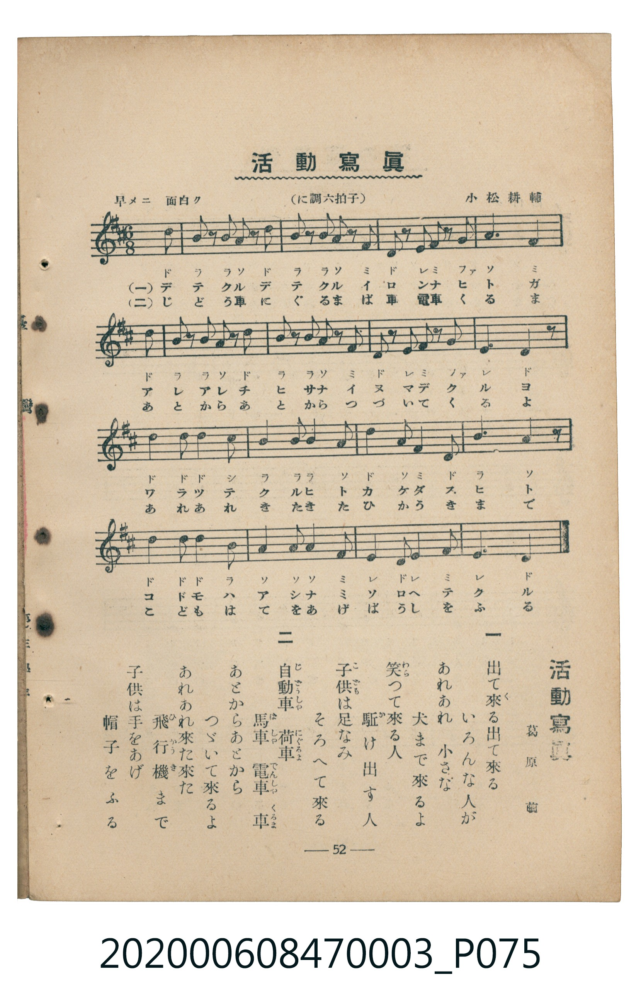

# 活動寫眞

<audio controls src="katsudo_shashin.mp3"></audio>

- 葛原齒 作詞 / 小松耕輔 作曲
- 臺灣教育會公認《新定兒童唱歌》尋常科第三學年用（2020.006.0847.0003）

## 說明

Reference Materials 14: 活動寫眞 (Katsudō Shashin / Motion Pictures)
Source: 臺灣教育會公認 新定兒童唱歌 尋常科第三學年用 (1934), p. 52 (P075.jpg)
Lyricist: 葛原齒 (Kuzuhara Shigeru) / Composer: 小松耕輔 (Komatsu Kōsuke)
Key: D major (?= D), 6/8 (<6/8>), 早メニ 面白ク Dotted Quarter = 112 (!= 112)

## 歌詞

```text
一、出て來る出て來る　いろんな人が
あれあれ小さな　犬まで來るよ
笑つて來る人　駆け出す人
子供は足なみ　そろへて來る
二、自動車　荷車　馬車　電車　車
あとからあとから　つゞいて來るよ
あれあれ來た來た　飛行機まで
子供は手をあげ　帽子をふる
```

## ABC

```abc
X:1
T:活動寫眞
M:6/8
L:1/16
Q:3/8=75
K:D
V:V1 name="Piano" snm="Pia"
[V:V1]
d2 B2 z2 B2 A2 z2 | d2 B2 z2 B2 A2 z2 | F2 D2 z2 E F G2 z2 | A6 F4 z2 |
d2 B2 z2 B2 A2 z2 | d2 B2 z2 B2 A2 z2 | F2 D2 z2 E F G2 z2 | E6 D4 z2 |
d4 d2 d2 c2 B2 | B2 B2 z2 A4 d2 | A2 F2 z2 D2 B,2 z2 | A10 z2 |
d4 d2 d2 B2 A2 | A2 A2 z2 F4 E2 | D2 E2 F6 E2 | D10 z2 |
d2 B2 z2 B2 A2 z2 | d2 B2 z2 B2 A2 z2 | F2 D2 z2 E F G2 z2 | A6 F4 z2 |
d2 B2 z2 B2 A2 z2 | d2 B2 z2 B2 A2 z2 | F2 D2 z2 E F G2 z2 | E6 D4 z2 |
d4 d2 d2 c2 B2 | B2 B2 z2 A4 d2 | A2 F2 z2 D2 B,2 z2 | A10 z2 |
d4 d2 d2 B2 A2 | A2 A2 z2 F4 E2 | D2 E2 F6 E2 | D10 z2 |
```

## TMD 檔案連結

- [主旋律 TMD 檔案](katsudo_shashin.tmd) [[在 TMD Studio 編輯](https://tmdlang.github.io/Tmd-TS/#tmd=s7IKdvYPcrWy4tLSUni2ZffT7qlP169-PmeegpYWl6KtgqGhEZe9rYILl42ZvoUdV52C0ouJs5_2zX-5d5LCk71zXqycp6Cv8HRD_7O5-140TH2xZwpI9NnsTUpgpe27njcufjZ15oumTc_mND9tXfNiVe_jhq5n0zY8XTfraeuk56uXPp2y8dnanscN3U83dD_dseP58onP16x5sqPz6dodT3dueT5lxfs9HUYGRgZ6BgZmegYWJuZAhoHx-z2dSlxc-lpcCloKQalpqUWpecmpCr6JJalFmYk5xQqGJlaovtHwTiwpLk052qsQnJFYnJGZB3S2b35JZn6eQkBmcklpUWqxJsiw4PzSouRUKwWsTlfAdDjQ79idraBhaGlsoqmjUKCnYGqkoBFgYG6ql1WQDrbFp7IoMzmzuARoDzw0NbxLq0ozEosSgS7MTE8tKtUEOtE5P7cgvzi1yAo1jDW883NB_lHwPtpbXJqdCjbUO7XSSsFFITcxK79IQQMUaUDbgbGmoAGOOyDn2fSVj5sXPm7uVng5d9HzmXsfN61XcMkvKUlNUQgsTSwCBp4COMYVNCAxDzIW7txiKxDzyY6Gxw2NT9t3PW5c9mRf2-OmbmT244aGx40tj5t6HzdNfty46skuoFQPSBtIAiTX9LipB0IC_fO4cSpQEVD8edeax437Hjcuh5rS1IHQ83zNxMeNS-A2gIxsaHi5vO1x40SwzTOBIgjVT9dOeLJv9uPG9S-2bQaZ3bgfbO1ckJMad8BNAftkFzDVNb5oXwVMJC92dwHVvejdDmG8XLYGypi9Gyq1uwvVG40rHjcCHdqJwgZJLXncNA8UBvAgQfYMcgCApBvnQ0iQVYtnv1jY82zlfEhIYPHSs06gYZPAFk4Cie_YC5QCi2yFeEmfiysstag41SogMzEv36HGoEahmksBCGwstOzADH0tBUNdYNYAWgB04OPGfqBGdA4i-oCcTWDP9YDMBumvUTCMUzBTMABiUyCJwTVWMATSGkYKxpqqGrqaCiZgUVMFXSA0BmIgD-YOU10LkDsQ4QHkLARbCEoUYHc0QlMFkANyGzAkKXOHEdgdhqjusNQ1NAI6pAloAzAyF8NDAuJ3oNVAFjAFLgCmNKgQshuAxsWBkDnQ6hogBjkC5F2gEMjfxkCuoYJZPFIwgCCS9YbGuoZmoIAABvjKx03AuF0PjuHpkNQLlECkXWgUYbMf5HGQDSDvgwLaCCQNJEFsGA_Z9louLl07BXBqUUBmKHNxAQA)]
- [鋼琴伴奏 TMD 檔案](katsudo_shashin_piano.tmd) [[在 TMD Studio 編輯](https://tmdlang.github.io/Tmd-TS/#tmd=s7IKdvYPcrWy4tLSUni2ZffT7qlP169-Pmfe-z0dL7v3PJ-w5cmeLU-X9j_v7Hi_p1NBS4tL0VbB0NCIy95WwYXLxkzfwo6rTkHpxcTZT_vmv9w7SeHJ3jkvVs5T0Fd4uqH_2dx9LxqmvtgzBST6bPYmJbDS9l3PGxc_mzrzRdOmZ3Oan7auebGq93FD17NpG56um_W0ddLz1UufTtn4bG3P44bupxu6n-7Y8Xz5xOdr1jzZ0fl07Y6nO7c8n7IC6DojAyMDPQMDMz0DCxNzIMPAGOhAJS4ufS0uBS2FoNS01KLUvORUBd_EktSizMScYgVDEysULypoeCeWFJemHO1VCM5ILM7IzAM62ze_JDM_TyEgM7mktCi1WFNBF8hOzMtXcExOzs8tSMzLzE3NKwFZEZxfWpScaqWA1UMKmN4Bhgh2zyhoGFoam2jqKBToKZgaKWgEGJib6mUVpGsCbdHn4gpLLSpOtQI7IsjDocagRqGaSwEIbCy07MCMGgXDOAUzBQMgNgWSGFxjBUMgrWGkYKypqqGrqWACFjUF-kwXKKcL4lFgjhHYHEN0c4BCcSBkDtReA8Qgg0BWAoVAdhsDuYYKZvFITgFBrEaA7AcpArkC5F4jkDSQBLFhPGQDalHCzAdHmJnEK0SbxIKcAWQYghjYxeBM03ggyzQeRRSEgUxkh1NmLpwDJrAbDcJITCSjYOoRImYg88zic7GZDuLhMB7Je-jGg3Sh-B_VULAUWmzo2imAI0QBmaHMxQUA)]

## 分析

```text
================================================================================
📊 TMD Song Profile: [ 活動寫眞 ]
================================================================================
⏱  Duration:       0:51 (51.4s), 32 measures total
🎼 Key & Tempo:    首調基準 D, != 112.0 BPM, <6/8>
   - 分析範圍：      由實際發聲的音符與和弦推測調性；播放脈絡另行呈現
🎤 人聲音域:    B3 (MIDI 59) – D5 (MIDI 74) [跨度: 15 個半音 / 1.2 個八度, 難度: moderate]
   - 最低音:  B3 in [Verse #1 @ m.11, 0:17]
   - 最高音: D5 in [Verse #1 @ m.1, 0:00]
   - 適合: soprano, mezzo-soprano, contralto, tenor, baritone, bass
🏛  結構:      Verse (25.7s) -> Verse (25.7s)
⚡ 編曲密度:        Peak 1 軌道同時演奏
🗝  調性診斷：       D 大調（純淨自然大調，未偵測到可信轉調）
   - 風格氣質:    純淨自然大調（陽光明朗、易唱易記，無明顯調外色彩）
   - 轉調歷程:    全曲維持單一推測調性（未偵測到可信轉調）
   - 核心骨幹音:  D, A, B, F#, E
   - 調性數值:    D 大調 [相關度: 0.93, 穩定度: High, 自然音純度: 100.0%]
   - 候選調性 (K-S): D 大調 (0.93), B 小調 (0.71), A 大調 (0.65)
   - 五度圈歷程:   +2 -> +2
   - 各段落調性細節:
     • [Verse #1]: D 大調 (r: 0.93, 自然音純度: 100.0%)
     • [Verse #2]: D 大調 (r: 0.93, 自然音純度: 100.0%)

  [ 五度圈游移軌跡 ]
               C  
         F            G  
      Bb              [D ]*
      Eb               A  
         Ab           E  
            Db       B  
               F# 
     (* = active key center)

  [ 十二半音累積音高分佈 ]
     C  :                            0.0%
     C# : █                          1.3%
     D  : ████████████████████████  31.6%
     D# :                            0.0%
     E  : ███████                    9.2%
     F  :                            0.0%
     F# : ███████████               14.5%
     G  : ██                         2.6%
     G# :                            0.0%
     A  : ██████████████████        23.7%
     A# :                            0.0%
     B  : █████████████             17.1%
--------------------------------------------------------------------------------
Assignment 軌道音域：
  - Piano         : B3 – D5 (15 個半音 / 1.2 個八度, 116 個音符)
================================================================================
```


## 原書掃描頁




