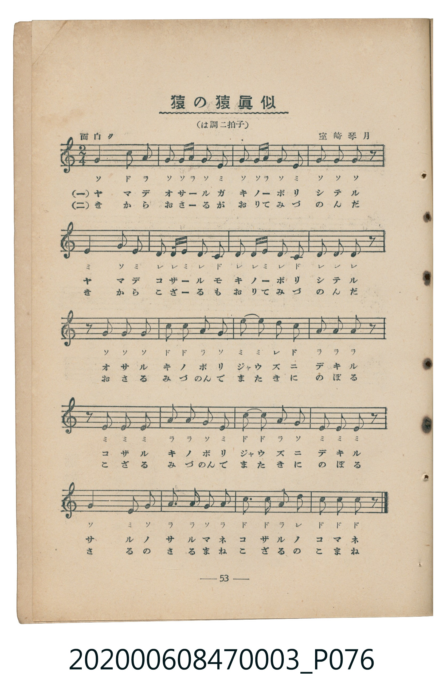
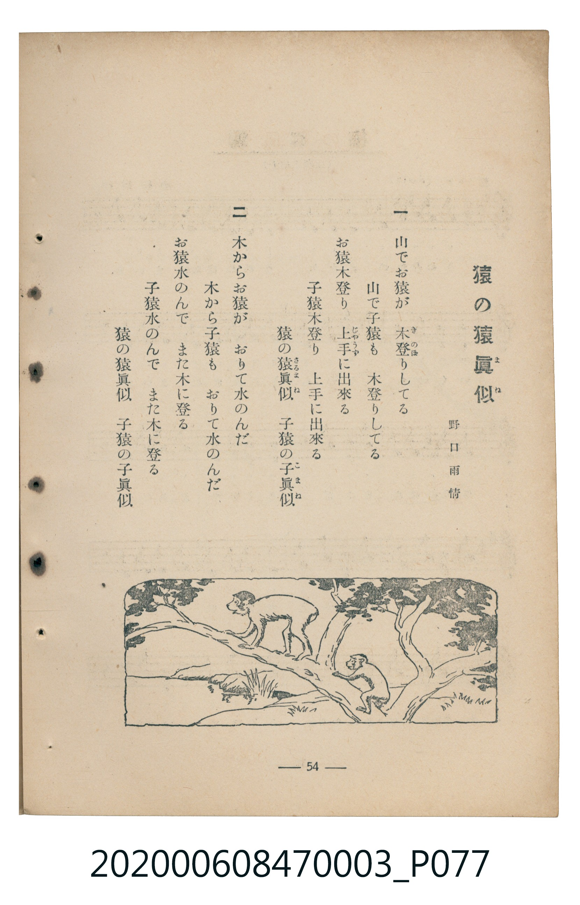

# 猿の猿眞似

> Re:Shōka 使用 AI 協助辨識與重建樂譜，可能會有錯誤。歡迎回報。

- **NEUTRINO 歌聲合成版**：<br><audio controls src="saru_no_sarumane_neutrino.mp3"></audio>
- **鋼琴伴奏版**：<br><audio controls src="saru_no_sarumane.mp3"></audio>


- 野口雨情 作詞 / 室崎琴月 作曲
- 臺灣教育會公認《新定兒童唱歌》尋常科第三學年用（2020.006.0847.0003）

## 說明

Reference Materials 15: 猿の猿眞似 (Saru no Sarumane / Monkey's Monkey-See-Monkey-Do)
Source: 臺灣教育會公認 新定兒童唱歌 尋常科第三學年用 (1934), pp. 53-54 (P076.jpg-P077.jpg)
Lyricist: 野口雨情 (Noguchi Ujō) / Composer: 室崎琴月 (Murozaki Kingetsu)
Key: C major (?= C), 2/4 (<2/4>), 面白ク Quarter = 108 (!= 108)


## 歌詞

```text
一、山でお猿が　木登りしてる
山で子猿も　木登りしてる
お猿木登り　上手に出来る
子猿木登り　上手に出来る
猿の猿眞似　子猿の子眞似
二、木からお猿が　おりて水のんだ
木から子猿も　おりて水のんだ
お猿水のんで　また木に登る
子猿水のんで　また木に登る
猿の猿眞似　子猿の子眞似
```

## ABC

```abc
X:1
T:猿の猿眞似
M:2/4
L:1/16
Q:1/4=108
K:C
V:V1 name="Piano" snm="Pia"
[V:V1]
G4 c2 A2 | G2 G A G2 E2 | G2 G A G2 E2 | G2 G2 G2 z2 |
w: 1.~ヤ マ デ | オ サ _ ル ガ | キ ノ _ ボ リ | シ テ ル
w: 2.~き か ら | お さ _ る が | お り て み づ | の ん だ
E4 G2 E2 | D2 D E D2 C2 | D2 D E D2 C2 | D2 D2 D2 z2 |
w: 1.~ヤ マ デ | コ ザ _ ル モ | キ ノ _ ボ リ | シ テ ル
w: 2.~き か ら | こ ざ _ る も | お り て み づ | の ん だ
z2 G2 G2 G2 | c2 c2 A2 G2 | e2 e2 d2 c2 | A2 A2 A2 z2 |
w: 1.~オ サ ル | キ ノ ボ リ | ジャ ウ ズ ニ | デ キ ル
w: 2.~お さ る | み づ のん で | ま た き に | の ぼ る
z2 E2 E2 E2 | A2 A2 G2 E2 | c2 c2 A2 G2 | E2 E2 E2 z2 |
w: 1.~コ ザ ル | キ ノ ボ リ | ジャ ウ ズ ニ | デ キ ル
w: 2.~こ ざ る | み づ のん で | ま た き に | の ぼ る
G4 E2 G2 | A2 A2 G2 A2 | c2 c2 A2 d2 | c2 c2 c2 z2 |
w: 1.~サ ル ノ | サ ル マ ネ | コ ザ ル ノ | コ マ ネ
w: 2.~さ る の | さ る ま ね | こ ざ る の | こ ま ね
```

## TMD 檔案連結

- [主旋律 TMD 檔案](saru_no_sarumane.tmd) [[在 TMD Studio 編輯](https://tmdlang.github.io/Tmd-TS/#tmd=s7IKdvYPcrWy4qpTUCpJTLdSSM7PyUlNLsnMz7MqzsjMK0nNjM_KTMmPL87Iz05Ugisry88pzU21Si9KTEmNN443MjAyiDcwMIs3sDAxBzIMjBFKi_NLi5JTrYqTM_Lzc-JLUitKkvLzsxHyBUX5Zal5iXlANQVFIBtTwIoQClLLMlNSQdKpKZkl-UWZiTlI7kgtKga7FWxJfElRYl5xclFmAcgDCFUlGalAxybmZeYi6wUalZ6ZZ1WSmAn0HMiD5YnxuYmZeTmJeSlKXFpaCs979j9uXAckn8-Z92TPHgUtLS5FWwVDAwsue1sFZy4bI30TO5BpL9v7nvYvfjl7xbPmVoUne-e8WDlPQV_h6bolT7f0PZ-w5dmcDpDos9mbwHa_aN_1vHHxs6kzXzRtejan-Wnrmhereh83dD2btuHpullPWyc9X7306ZSNz9b2PG7ofrqh--mOHc-XT3y-Zs2THZ1P1-54unPL8ykr3u_pAIW5HjDM9UBhDmQYGL_f06nExaWvxaWgpRCUmpZaBAo1Bd_EklRQoBUrGJpaYfhJIzixqFQhL18BROcm5qUCXe6bn5edWqleDGXoBqem6kKZLvmaINODIXGqgNUvCpg-UcDlDwUNQ0tjE00dhYICPQVTY11TEwWNAANzM72sgnRdIMMcxABb6VNZlJmcWVxipYAS3Bp--emlyRmZCqFZR3s1gY53zs8tyC9OLbJCjQAN39Ki_KrE7EwF78y89NSS4lKwqd6plVYKzgq5iVn5RQoaoGgFugUYrwoa4NgFcl7OXfR85t7HTesVAksTi4BBqQBOAgoakKQAMgXuvGIrEPPJjobHDY1PN2583Lj8cWMXOMSBcdnwbM6K5zN3P27qetw4_XHjssdN3SDVQAkggqh-unYCSHVTEwHVEFMRKhoanuzoetbZ_bhx9dP2Xc_mLkU1G2wqsarREghcP1AQxAALgn25C-inRqCpjxu7Hzd1InsUyAa7e9mzDVuA2h43TX7cuABhA1wPsncJ6IH6GCG3HCy473HjfLBxq8F-w_Q08RqI9Lc-F1cYsMxJtQrITMzLd6gxqKnmUgACGwstOzBDX0vBUNfESuFxUwvYOlASeNw4FWgXMHAUHjf2ghzUuAc5YkGmgrTWKJgq6CoYximYgZkapgpmmqoauppAtjEOERA0UKgBa_cxrFF43LwEaMTj5nlA3A5U8bhplYLG46atCkA9j5tXA_lrwKJrgaLNfRDROUC8Ciy6HchqA6uLh5lpBBRv7AWZ2dgNVNEJUtfYBdTdOBWsG-h6kL9gok1dQMYyoHjjfiBeChZfB1Q1GUgvgJsKDCNTXQuUMALG0DRQGDU1EQojY6BjIN43UtAwUjCGBIiRgiEOERDEH0SbQQ7fBg-i5kVUCKLJoCCaBg8ioLdIDiJLXUMjYBghkg8iWICiMx43NT9ubHvcOAuYmMFB2IsSTAbQ1FEDSlDgNAViG8eBkBFYpAYoBoLIgRMPTjGgBAPyIiQYQKGAHAQ7HjcvBlLLgHgXULAbJAgMSYhS1HABGgf0MyitgNwG8inEz5BMCaSWgwX3AfF8cCAC_QILkMY9YE1IAWJorGtoBgoRWGIhNUSMwRDib0gSQgkbMEQPjc1AvI16oQHy9DTqhIa5rpEBKDQgiQMYDhAGMD8BrUaEEVACyAaLopQzxmBPQ4ICVODAggKYOGAcIELJOaByBJpH-sCehyQTSF7qheYlWHDB1ABFoPKoOQZYfkCLj3VgT0LSCMT7a6F5CBZWMDUgEYg8yKxaLi5dOwVwcawAZChzAQA)]
- [鋼琴伴奏 TMD 檔案](saru_no_sarumane_piano.tmd) [[在 TMD Studio 編輯](https://tmdlang.github.io/Tmd-TS/#tmd=s7IKdvYPcrWy4tLSUnjes_9x4zog-XzOvCd79rzf0_Gye8_zCVue7NnydGn_886O93s6FbS0uBRtFQwNLLjsbRWcuWyM9E3suOoUlF629z3tX_xy9opnza0KT_bOebFynoK-wtN1S55u6QOa8WxOB0j02exNSiDVL9p3PW9c_GzqzBdNm57NaX7auubFqt7HDV3Ppm14um7W09ZJz1cvfTpl47O1PY8bup9u6H66Y8fz5ROfr1nzZEfn07U7nu7c8nzKCqADjQyMDPQMDMz0DCxMzIEMA2OgG5W4uPS1uBS0FIJS01KLUvOSUxV8E0tSizITc4oVDE2t0D2qoBGcWFSqkJevAKJzE_NSgS73zc_LTq1UL4YydINTU3WhTJd8TQVdhYDMRKAOx-Tk_NyCxLzM3NS8EpCdwfmlRcmpVgpYfaiA6T8FXL5T0DC0NDbR1FEoKNBTMDXWNTVR0AgwMDfTyypI1wUyzEEMTaCV-lxcYalFxalWYBcFeTjUGNRUcykAgY2Flh2YUaNgCnSxYZyCGZipYapgpqmqoasJZBvjEAFBA4UasHYfwxqFx81LgEY8bp4HxO1AFY-bViloPG7aqgDU87h5NZC_Biy6Fija3AcRnQPEq8Ci24GsNrC6eJiZRkDxxl6QmY3dQBWdIHWNXUDdjVPBupuAoo09cNGmLiBjGVC8cT8QLwWLrwOqmgykF8BNrQG6XhfqByMFDSMFY4ivjBQMcYiAIH5_bgbZvg3uz-ZFVPDnZJA_p8H92dREsj8NoHFUA4pWcMyC2MZxIGQEFqkBioEgsu_iwfEGijaQGyH-AHkD2Q87HjcvBlLLgHgXULAbJAgMCohSVI8BjQM6GhRjIG-AnApxNNDJEBcvBwvuA-L54FB43Ai2FeSjxj1gTcg-MgZDiLshcYjiNzBE981mIN5GPd-AHD2NGr4BZThjsLshvgHlPJhvgPED4wARSuoDZShoOusDux8SU5D02AtNjzAfw9QARaDyqKkOmJGg-Wgd2J2QaIL4YC00HcK8C1MDEoHIg8yqRSlbfLCXLYbxCtGGsQomQMokFsGHUvj4MK9jqjGNB7JM42MRDCLEEMYBcwdMAqqQkCOhEkAK2RRjiDSKEnR_YDESt78Q1qDoQfIRqinACNC1UwDHQbQPUBjBMQJzlLkA)]

## 分析

```text
================================================================================
📊 TMD Song Profile: [ 猿の猿眞似 ]
================================================================================
⏱  Duration:       0:22 (22.2s), 20 measures total
🎼 Key & Tempo:    首調基準 C, != 108.0 BPM, <2/4>
   - 分析範圍：      由實際發聲的音符與和弦推測調性；播放脈絡另行呈現
🎤 人聲音域:    C4 (MIDI 60) – E5 (MIDI 76) [跨度: 16 個半音 / 1.3 個八度, 難度: moderate]
   - 最低音:  C4 in [Verse #1 @ m.6, 0:06]
   - 最高音: E5 in [Verse #1 @ m.11, 0:11]
   - 適合: soprano, mezzo-soprano, contralto, tenor, baritone, bass
🏛  結構:      Verse (22.2s)
⚡ 編曲密度:        Peak 1 軌道同時演奏
🗝  調性診斷：       C 調性不明確（純淨自然大調，未偵測到可信轉調）
   - 風格氣質:    純淨自然大調（陽光明朗、易唱易記，無明顯調外色彩）
   - 轉調歷程:    全曲維持單一推測調性（未偵測到可信轉調）
   - 核心骨幹音:  G, E, C, A, D
   - 調性數值:    C 調性不明確 [相關度: 0.78, 穩定度: Ambiguous, 自然音純度: 100.0%]
   - 候選調性 (K-S): C 大調 (0.78), G 大調 (0.77), E 小調 (0.71)
   - 五度圈歷程:   +0
   - 各段落調性細節:
     • [Verse #1]: C 調性不明確 (r: 0.78, 自然音純度: 100.0%)

  [ 五度圈游移軌跡 ]
              [C ]*
         F            G  
      Bb               D  
      Eb               A  
         Ab           E  
            Db       B  
               F# 
     (* = active key center)

  [ 十二半音累積音高分佈 ]
     C  : ███████████████           17.8%
     C# :                            0.0%
     D  : ███████████               13.7%
     D# :                            0.0%
     E  : ██████████████████        21.9%
     F  :                            0.0%
     F# :                            0.0%
     G  : ████████████████████████  28.8%
     G# :                            0.0%
     A  : ███████████████           17.8%
     A# :                            0.0%
     B  :                            0.0%
--------------------------------------------------------------------------------
Assignment 軌道音域：
  - Piano         : C4 – E5 (16 個半音 / 1.3 個八度, 74 個音符)
================================================================================
```


## 原書掃描頁






