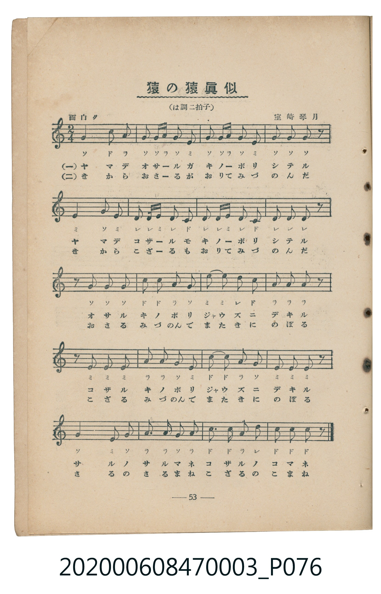
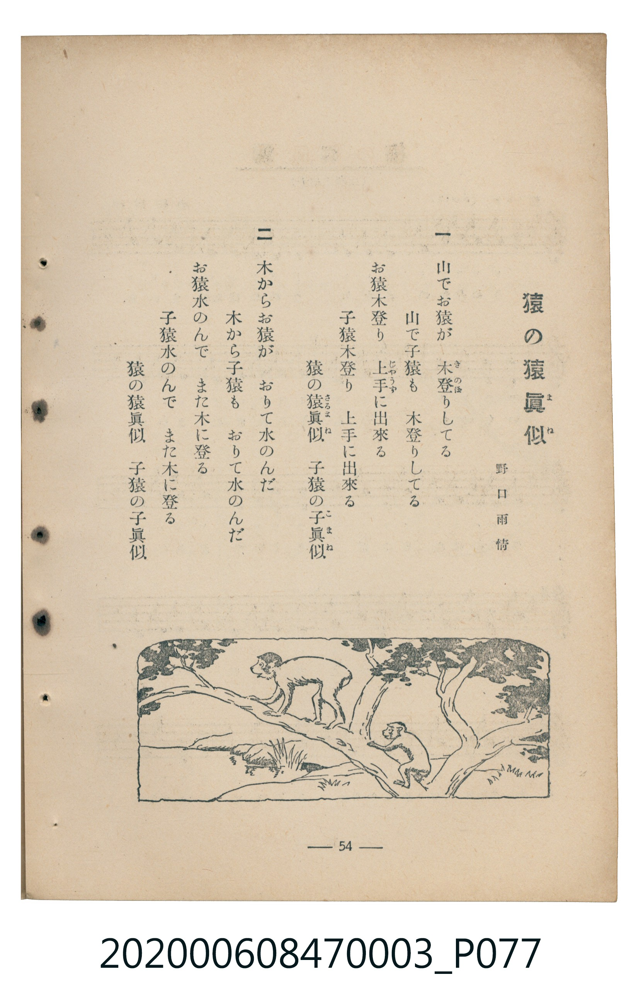

# 猿の猿眞似

<audio controls src="saru_no_sarumane.mp3"></audio>

- 野口雨情 作詞 / 室崎琴月 作曲
- 臺灣教育會公認《新定兒童唱歌》尋常科第三學年用（2020.006.0847.0003）

## 說明

Reference Materials 15: 猿の猿眞似 (Saru no Sarumane / Monkey's Monkey-See-Monkey-Do)
Source: 臺灣教育會公認 新定兒童唱歌 尋常科第三學年用 (1934), pp. 53-54 (P076.jpg-P077.jpg)
Lyricist: 野口雨情 (Noguchi Ujō) / Composer: 室崎琴月 (Murozaki Kingetsu)
Key: C major (?= C), 2/4 (<2/4>), 面白ク Quarter = 108 (!= 108)

## 歌詞

```text
一、山でお猿が　木登りしてる
山で子猿も　木登りしてる
お猿木登り　上手に出来る
子猿木登り　上手に出来る
猿の猿眞似　子猿の子眞似
二、木からお猿が　おりて水のんだ
木から子猿も　おりて水のんだ
お猿水のんで　また木に登る
子猿水のんで　また木に登る
猿の猿眞似　子猿の子眞似
```

## ABC

```abc
X:1
T:猿の猿眞似
M:2/4
L:1/16
Q:1/4=108
K:C
V:V1 name="Piano" snm="Pia"
[V:V1]
G4 c2 A2 | G2 G A G2 E2 | G2 G A G2 E2 | G2 G2 G2 z2 |
E4 G2 E2 | D2 D E D2 C2 | D2 D E D2 C2 | D2 D2 D2 z2 |
z2 G2 G2 G2 | c2 c2 A2 G2 | E2 E2 D2 C2 | A2 A2 A2 z2 |
z2 E2 E2 E2 | A2 A2 G2 E2 | c2 c2 A2 G2 | E2 E2 E2 z2 |
G4 E2 G2 | A2 A2 G2 A2 | c2 c2 A2 d2 | c2 c2 c2 z2 |
G4 c2 A2 | G2 G A G2 E2 | G2 G A G2 E2 | G2 G2 G2 z2 |
E4 G2 E2 | D2 D E D2 C2 | D2 D E D2 C2 | D2 D2 D2 z2 |
z2 G2 G2 G2 | c2 c2 A2 G2 | E2 E2 D2 C2 | A2 A2 A2 z2 |
z2 E2 E2 E2 | A2 A2 G2 E2 | c2 c2 A2 G2 | E2 E2 E2 z2 |
G4 E2 G2 | A2 A2 G2 A2 | c2 c2 A2 d2 | c2 c2 c2 z2 |
```

## TMD 檔案連結

- [主旋律 TMD 檔案](saru_no_sarumane.tmd) [[在 TMD Studio 編輯](https://tmdlang.github.io/Tmd-TS/#tmd=s7IKdvYPcrWy4qpTUCpJTLdSSM7PyUlNLsnMz7MqzsjMK0nNjM_KTMmPL87Iz05Ugisry88pzU21Si9KTEmNN443MjAyiDcwMIs3sDAxBzIMjBFKi_NLi5JTrYqTM_Lzc-JLUitKkvLzsxHyBUX5Zal5iXlANQVFIBtTwIoQClLLMlNSQdKpKZkl-UWZiTlI7kgtKga7FWxJfElRYl5xclFmAcgDCFUlGalAxybmZeaC9GppKTzv2f-4cR2QfD5n3pM9exS0tLgUbRUMDSy47G0VnLlsjPRN7EC6X7b3Pe1f_HL2imfNrQpP9s55sXKegr7C03VLnm7pez5hy7M5HSDRZ7M3ge160b7reePiZ1Nnvmja9GxO89PWNS9W9T5u6Ho2bcPTdbOetk56vnrp0ykbn63tedzQ_XRD99MdO54vn_h8zZonOzqfrt3xdOeW51NWvN_TAQpNPWBo6oFCE8gwMH6_p1OJi0tfi0tBSyEoNS21CBQeCr6JJamg4ChWMDS1wvCTRnBiUalCXr4CiM5NzEsFutw3Py87tVK9GMrQDU5N1YUyXfI1QaYHQ2JLAatfFDB9ooDLHwoahpbGJpo6CgUFegqmxrqmJgoaAQbmZnpZBem6QIY5iAG20qeyKDM5s7jESgEluDX88tNLkzMyFUKzjvZqAh3vnJ9bkF-cWmSFGgEavqVF-VWJ2ZkK3pl56aklxaVgU71TK60UnBVyE7PyixQ0QNEKdAswXhU0wLEL5Lycu-j5zL2Pm9YrBJYmFgGDUgGcBBQ0IEkBZArcecVWIOaTHQ2PGxqfbtz4uHH548YucIgD47Lh2ZwVz2fuftzU9bhx-uPGZY-bukGqgRJABFH9dO0EkOqmJgKqIaYiVDQ0PNnR9ayz-3Hj6qftu57NXYpqNthUYlWjJRC4fqAgiAEWBPtyF9BPjUBTHzd2P27qRPYokA1297JnG7YAtT1umvy4cQHCBrgeZO8S0AP1MUJuOVhw3-PG-WDjVoP9hulp4jUQ6W99Lq4wYGmSahWQmZiX71BjUKNQzaUABDYWWnZghr6WgqGuiZXC46YWsH2gNPC4cSrQMmDoKDxu7AW5qHEPcsyCjAVprVEwVdBVMIxTMAMzNUwVzDRVNXQ1gWxjHCIgaKBQA7PZVNcCxWagx6eBbG5qImSzMdBmiKFGChpGCsYQa4wUDHGIgCCSxZa6hkZAmxFeRVgGFJ3xuKn5cWPb48ZZwJAHO6wXxXIDqE9qQJ4H-x_ENgZCiHVmYIhknaGxrqEZyD6YB0m1D2Q2yLMgcyHeRrfZGMU-c10jA5B9EM8BbYIwgKG8FtkVQAkgGyyKEqfGYGMhloEiF2aZURycA0QgC2u5uHTtFMBpTAGZoczFBQA)]
- [鋼琴伴奏 TMD 檔案](saru_no_sarumane_piano.tmd) [[在 TMD Studio 編輯](https://tmdlang.github.io/Tmd-TS/#tmd=s7IKdvYPcrWy4tLSUnjes_9x4zog-XzOvCd79rzf0_Gye8_zCVue7NnydGn_886O93s6FbS0uBRtFQwNLLjsbRWcuWyM9E3suOoUlF629z3tX_xy9opnza0KT_bOebFynoK-wtN1S55u6QOa8WxOB0j02exNSiDVL9p3PW9c_GzqzBdNm57NaX7auubFqt7HDV3Ppm14um7W09ZJz1cvfTpl47O1PY8bup9u6H66Y8fz5ROfr1nzZEfn07U7nu7c8nzKCqADjQyMDPQMDMz0DCxMzIEMA2OgG5W4uPS1uBS0FIJS01KLUvOSUxV8E0tSizITc4oVDE2t0D2qoBGcWFSqkJevAKJzE_NSgS73zc_LTq1UL4YydINTU3WhTJd8TQVdhYDMRKAOx-Tk_NyCxLzM3NS8EpCdwfmlRcmpVgpYfaiA6T8FXL5T0DC0NDbR1FEoKNBTMDXWNTVR0AgwMDfTyypI1wUyzEEMTaCV-lxcYalFxalWYBcFeTjUGNQoVHMpAIGNhZYdmFGjYAp0smGcghmYqWGqYKapqqGrCWQb4xABQQOFGqh2Y6B2iIyRgoaRgjFErZGCIQ4REEToNoCaVwNyAtgVILYxEELUm4EhsnqQHMg2kDjEXnSdxkjqQZ4zBstA1IN8CVNvFAfnABFITy1KgPngCDDDeIVow1gFEyBlEovgQyl8fIS70NWYxgNZpvGxCAYRYijBCJOAKiTkSKgEkEIJXIg0ihJ0f2AxEre_ENag6EHyEaopwBjQtVMAR4ICMkOZiwsA)]

## 分析

```text
================================================================================
📊 TMD Song Profile: [ 猿の猿眞似 ]
================================================================================
⏱  Duration:       0:44 (44.4s), 40 measures total
🎼 Key & Tempo:    首調基準 C, != 108.0 BPM, <2/4>
   - 分析範圍：      由實際發聲的音符與和弦推測調性；播放脈絡另行呈現
🎤 人聲音域:    C4 (MIDI 60) – D5 (MIDI 74) [跨度: 14 個半音 / 1.2 個八度, 難度: moderate]
   - 最低音:  C4 in [Verse #1 @ m.6, 0:06]
   - 最高音: D5 in [Verse #1 @ m.19, 0:20]
   - 適合: soprano, mezzo-soprano, contralto, tenor, baritone, bass
🏛  結構:      Verse (22.2s) -> Verse (22.2s)
⚡ 編曲密度:        Peak 1 軌道同時演奏
🗝  調性診斷：       C 調性不明確（純淨自然大調，未偵測到可信轉調）
   - 風格氣質:    純淨自然大調（陽光明朗、易唱易記，無明顯調外色彩）
   - 轉調歷程:    全曲維持單一推測調性（未偵測到可信轉調）
   - 核心骨幹音:  G, E, C, A, D
   - 調性數值:    C 調性不明確 [相關度: 0.78, 穩定度: Ambiguous, 自然音純度: 100.0%]
   - 候選調性 (K-S): C 大調 (0.78), G 大調 (0.77), E 小調 (0.71)
   - 五度圈歷程:   +0 -> +0
   - 各段落調性細節:
     • [Verse #1]: C 調性不明確 (r: 0.78, 自然音純度: 100.0%)
     • [Verse #2]: C 調性不明確 (r: 0.78, 自然音純度: 100.0%)

  [ 五度圈游移軌跡 ]
              [C ]*
         F            G  
      Bb               D  
      Eb               A  
         Ab           E  
            Db       B  
               F# 
     (* = active key center)

  [ 十二半音累積音高分佈 ]
     C  : ███████████████           17.8%
     C# :                            0.0%
     D  : ███████████               13.7%
     D# :                            0.0%
     E  : ██████████████████        21.9%
     F  :                            0.0%
     F# :                            0.0%
     G  : ████████████████████████  28.8%
     G# :                            0.0%
     A  : ███████████████           17.8%
     A# :                            0.0%
     B  :                            0.0%
--------------------------------------------------------------------------------
Assignment 軌道音域：
  - Piano         : C4 – D5 (14 個半音 / 1.2 個八度, 148 個音符)
================================================================================
```


## 原書掃描頁






