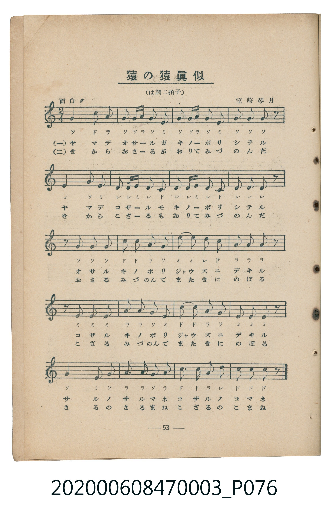
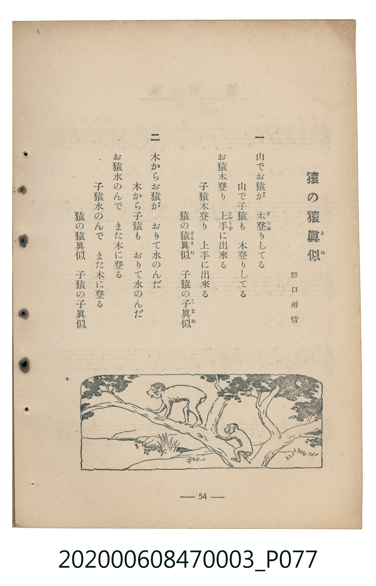

# 猿の猿眞似

> Re:Shōka 使用 AI 協助辨識與重建樂譜，可能會有錯誤。歡迎[回報](https://github.com/TMDLang/reshoka/issues)。

- **鋼琴伴奏版**：<br><audio controls src="saru_no_sarumane.mp3"></audio>
- **NEUTRINO 歌聲合成版**：<br><audio controls src="saru_no_sarumane_neutrino.mp3"></audio>

- 野口雨情 作詞 / 室崎琴月 作曲
- 臺灣教育會公認《新定兒童唱歌》尋常科第三學年用（2020.006.0847.0003）

## 說明

Reference Materials 15: 猿の猿眞似 (Saru no Sarumane / Monkey's Monkey-See-Monkey-Do)
Source: 臺灣教育會公認 新定兒童唱歌 尋常科第三學年用 (1934), pp. 53-54 (P076.jpg-P077.jpg)
Lyricist: 野口雨情 (Noguchi Ujō) / Composer: 室崎琴月 (Murozaki Kingetsu)
Key: C major (?= C), 2/4 (<2/4>), 面白ク Quarter = 108 (!= 108)


## 歌詞

```text
一、山でお猿が　木登りしてる
山で子猿も　木登りしてる
お猿木登り　上手に出来る
子猿木登り　上手に出来る
猿の猿眞似　子猿の子眞似
二、木からお猿が　おりて水のんだ
木から子猿も　おりて水のんだ
お猿水のんで　また木に登る
子猿水のんで　また木に登る
猿の猿眞似　子猿の子眞似
```

## ABC

<div class="abc-score" data-abc-src="saru_no_sarumane.abc" aria-label="五線譜載入中"></div>

[下載 ABC 原始檔](saru_no_sarumane.abc)

## TMD 檔案連結

- [主旋律 TMD 檔案](saru_no_sarumane.tmd) [[在 TMD Studio 編輯](https://tmdlang.github.io/Tmd-TS/#tmd=s7IKdvYPcrWy4qpTUCpJTLdSSM7PyUlNLsnMz7MqzsjMK0nNjM_KTMmPL87Iz05Ugisry88pzU21Si9KTEmNN443MjAyiDcwMIs3sDAxBzIMjBFKi_NLi5JTrYqTM_Lzc-JLUitKkvLzsxHyBUX5Zal5iXlANQVFIBtTwIoQClLLMlNSQdKpKZkl-UWZiTlI7kgtKga7FWxJfElRYl5xclFmAcgDCFUlGalAxybmZeYi6wUalZ6ZZ1WSmAn0HMiD5YnxuYmZeTmJeSnIqkoy8oH-LMiotMrILAY5IDkxJz47MQ8pOKDWFySmp1oFGJib6QIJcyUuLS2F5z37HzeuA5LP58x7smePgpYWl6KtgqGBBZe9rYIzl42RvokdyJiX7X1P-xe_nL3iWXOrwpO9c16snKegr_B03ZKnW_qeT9jybE4HSPTZ7E1gS1-073reuPjZ1JkvmjY9m9P8tHXNi1W9jxu6nk3b8HTdrKetk56vXvp0ysZna3seN3Q_3dD9dMeO58snPl-z5smOzqdrdzzdueX5lBXv93SA4k0PGG96oHgDMgyM3-_pVOLi0tfiUtBSCEpNSy0ChbyCb2JJKijgixUMTa0w_KQRnFhUqpCXrwCicxPzUoEu983Py06tVC-GMnSDU1N1oUyXfE2Q6cGQdKGA1S8KmD5RwOUPBQ1DS2MTTR2FggI9BVNjXVMTBQ1QJOhlFaSDIwLEAFvpUwmMPGAcWimgBLeGX356aXJGpkJo1tFeTaDjnfNzC_KLU4usUCNAw7e0KL8qMTtTwTszLz21pLgUbKp3aqWVgrNCbmJWfpGCBihagW4BxquCBjh2gZyXcxc9n7n3cdN6hcDSxCJgUCqAk4CCBiQpgEyBO6_YCsR8sqPhcUPj040bHzcuf9zYBQ5xYFw2PJuz4vnM3Y-buh43Tn_cuOxxUzdINVACiCCqn66dAFLd1ERANcRUhIqGhic7up51dj9uXP20fdezuUtRzQabSqxqtAQC1w8UBDHAgmBf7gL6qRFo6uPG7sdNncgeBbLB7l72bMMWoLbHTZMfNy5A2ADXg-xdAnqgPkbILQcL7nvcOB9s3Gqw3zA9TbwGIv2tz8UVBiy3gEVFZmJevkONQU01lwIQ2Fho2YEZ-loKhromVgqPm1rA1oGSwOPGqUC7gIGj8LixF-Sgxj3IEQsyFaS1RsFUQVfBME7BDMzUMFUw01TV0NUEso1xiICggUINWLuPYY3C4-YlQCMeN88D4nagisdNqxQ0HjdtVQDqedy8GshfAxZdCxRt7oOIzgHiVWDR7UBWG1hdPMxMI6B4Yy_IzMZuoIpOkLrGLqDuxqlg3UDXg_wFE23qAjKWAcUb9wPxUrD4OqCqyUB6AdxUYBiZ6lqghBEwhqaBwqipiVAYGQMdA_G-kYKGkYIxJECMFAxxiIAg_iDaDHL4NngQNS-iQhBNBgXRNHgQAb1FchBZ6hoaAcMIkXwQwQIUnfG4qflxY9vjxlnAxAwOwl6UYDKApo4aUIICpykQ2zgOhIzAIjVAMRBEDpx4cIoBJRiQFyHBAAoF5CDY8bh5MZBaBsS7gILdIEFgSEKUooYL0Dign0FpBeQ2kE8hfoZkSiC1HCy4D4jngwMR6BdYgDTuAWtCChBDY11DM1CIwBILqSFiDIYQf0OSEErYgCF6aGwG4m3UCw2Qp6dRJzTMdY0MQKEBSRzAcIAwgPkJaDUijIASQDZYFKWcMQZ7GhIUoAIHFhTAxAHjABFKzgGVI9A80gf2PCSZQPJSLzQvwYILpgYoApVHzTHA8gNafKwDexKSRiDeXwvNQ7CwgqkBiUDkQWbVcnHp2imAi2MFIEOZCwA)]
- [鋼琴伴奏 TMD 檔案](saru_no_sarumane_piano.tmd) [[在 TMD Studio 編輯](https://tmdlang.github.io/Tmd-TS/#tmd=s7IKdvYPcrWy4qpTUCpJTLdSyC8qychPL0osyKi0ysgsLskvykxOzInPTsxLVIIrKs4vLUpOjS9ITE-1CjAwN9MFEuZKXFpaCs979j9uXAckn8-Z92TPnvd7Ol5273k-YcuTPVueLu1_3tnxfk-ngpYWl6KtgqGBBZe9rYIzl42RvokdyOyX7X1P-xe_nL3iWXOrwpO9c16snKegr_B03ZKnW_qAZjyb0wESfTZ7E9glL9p3PW9c_GzqzBdNm57NaX7auubFqt7HDV3Ppm14um7W09ZJz1cvfTpl47O1PY8bup9u6H66Y8fz5ROfr1nzZEfn07U7nu7c8nzKCqADjQyMDPQMDMz0DCxMzIEMA2OgG5W4uPS1uBS0FIJS01KLUvOSUxV8E0tSizITc4oVDE2t0D2qoBGcWFSqkJevAKJzE_NSgS73zc_LTq1UL4YydINTU3WhTJd8TQVdhYDMRKAOx-Tk_NyCxLzM3NS8EpCdweDgtVLA6kMFTP8p4PKdgoahpbGJpo5CQYGegqmxrqmJggYovvSyCtLBcQZiaAKt1OfiCkstKgbGJshFQR4ONQY11VwKQGBjoWUHZtQomAJdbBinYAZmapgqmGmqauhqAtnGOERA0EChBqzdx7BG4XHzEqARj5vnAXE7UMXjplUKGo-btioA9TxuXg3krwGLrgWKNvdBROcA8Sqw6HYgqw2sLh5mphFQvLEXZGZjN1BFJ0hdYxdQd-NUsO4moGhjD1y0qQvIWAYUb9wPxLPA4uuAqiYD6QVwU2uArteF-sFIQcNIwRjiKyMFQxwiIIjfn5tBtm-D-7N5ERX8ORnkz2lwfzY1kexPA2gc1YCiFRyzILZxHAgZgUVqgGIgiOy7eHC8gaIN5EaIP0DeQPbDjsfNi4HUMiDeBRTsBgkCgwKiFNVjQOOAjgbFGMgbIKdCHA10MsTFy8GC-4B4PjgUHjeCbQX5qHEPWBOyj4zBEOJuSByi-A0M0X2zGYi3Uc83IEdPo4ZvQBnOGOxuiG9AOQ_mG2D8wDhAhJL6QBkKms76wO6HxBQkPfZC0yPMxzA1QBGoPGqqA2YkaD5aB3YnJJogPlgLTYcw78LUgEQg8iCzalHKFh_sZYthvEK0YayCCZAyiUXwoRQ-PszrmGpM44Es0_hYBIMIMYRxwNwBk4AqJORIqASQQjbFGCKNogTdH1iMxO0vhDUoepB8hGoKMAJ07RTAcRDtAxRGcIzAHGUuAA)]

## 分析

```text
================================================================================
📊 TMD Song Profile: [ 猿の猿眞似 ]
================================================================================
⏱  Duration:       0:22 (22.2s), 20 measures total
🎼 Key & Tempo:    首調基準 C, != 108.0 BPM, <2/4>
   - 分析範圍：      由實際發聲的音符與和弦推測調性；播放脈絡另行呈現
🎤 人聲音域:    C4 (MIDI 60) – E5 (MIDI 76) [跨度: 16 個半音 / 1.3 個八度, 難度: moderate]
   - 最低音:  C4 in [Verse #1 @ m.6, 0:06]
   - 最高音: E5 in [Verse #1 @ m.11, 0:11]
   - 適合: soprano, mezzo-soprano, contralto, tenor, baritone, bass
🏛  結構:      Verse (22.2s)
⚡ 編曲密度:        Peak 1 軌道同時演奏
🗝  調性診斷：       C 調性不明確（純淨自然大調，未偵測到可信轉調）
   - 風格氣質:    純淨自然大調（陽光明朗、易唱易記，無明顯調外色彩）
   - 轉調歷程:    全曲維持單一推測調性（未偵測到可信轉調）
   - 核心骨幹音:  G, E, C, A, D
   - 調性數值:    C 調性不明確 [相關度: 0.78, 穩定度: Ambiguous, 自然音純度: 100.0%]
   - 候選調性 (K-S): C 大調 (0.78), G 大調 (0.77), E 小調 (0.71)
   - 五度圈歷程:   +0
   - 各段落調性細節:
     • [Verse #1]: C 調性不明確 (r: 0.78, 自然音純度: 100.0%)

  [ 五度圈游移軌跡 ]
              [C ]*
         F            G  
      Bb               D  
      Eb               A  
         Ab           E  
            Db       B  
               F# 
     (* = active key center)

  [ 十二半音累積音高分佈 ]
     C  : ███████████████           17.8%
     C# :                            0.0%
     D  : ███████████               13.7%
     D# :                            0.0%
     E  : ██████████████████        21.9%
     F  :                            0.0%
     F# :                            0.0%
     G  : ████████████████████████  28.8%
     G# :                            0.0%
     A  : ███████████████           17.8%
     A# :                            0.0%
     B  :                            0.0%
--------------------------------------------------------------------------------
Assignment 軌道音域：
  - Piano         : C4 – E5 (16 個半音 / 1.3 個八度, 74 個音符)
================================================================================
```


## 原書掃描頁






