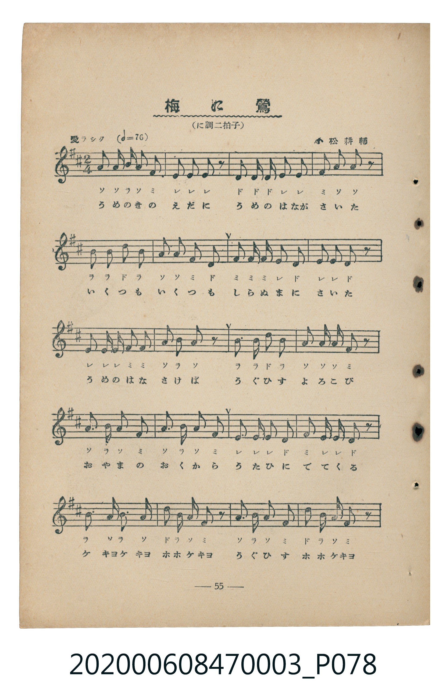
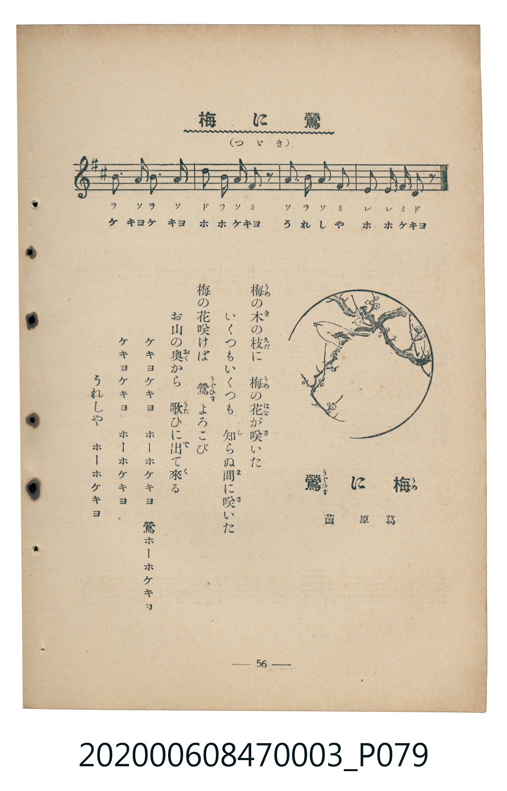

# 梅に鶯

> Re:Shōka 使用 AI 協助辨識與重建樂譜，可能會有錯誤。歡迎回報。

<audio controls src="ume_ni_uguisu.mp3"></audio>

- 葛原齒 作詞 / 小松耕輔 作曲
- 臺灣教育會公認《新定兒童唱歌》尋常科第三學年用（2020.006.0847.0003）

## 說明

Reference Materials 16: 梅に鶯 (Ume ni Uguisu / Bush Warbler on the Plum Tree)
Source: 臺灣教育會公認 新定兒童唱歌 尋常科第三學年用 (1934), pp. 55-56 (P078.jpg-P079.jpg)
Lyricist: 葛原齒 (Kuzuhara Shigeru) / Composer: 小松耕輔 (Komatsu Kōsuke)
Key: D major (?= D), 2/4 (<2/4>), 愛ラシク Quarter = 76 (!= 76)

## 歌詞

```text
梅の木の枝に　梅の花が咲いた
いくつもいくつも　知らぬ間に咲いた
梅の花咲けば　鶯よろこび
お山の奥から　歌ひに出て來る
ケキヨケキヨ　ホーホケキヨ　鶯ホーホケキヨ
ケキヨケキヨ　ホーホケキヨ　うれしや　ホーホケキヨ
```

## ABC

```abc
X:1
T:梅に鶯
M:2/4
L:1/16
Q:1/4=76
K:D
V:V1 name="Piano" snm="Pia"
[V:V1]
A2 A B A2 F2 | E2 E2 E2 z2 | D2 D D E2 E2 | F2 A2 A2 z2 |
w: う め の き の | え だ に | う め の は なが | さ い た
B2 B2 d2 B2 | A2 A2 F2 D2 | F2 F F E2 D2 | E2 E2 D2 z2 |
w: い く つ も | い く つ も | し ら ぬ ま に | さ い た
E2 E E F2 F2 | A2 B2 A2 z2 | B3 B d2 B2 | A2 A A F2 z2 |
w: う め の は な | さ け ば | う ぐ ひ す | よ ろ こ び
A3 B A2 F2 | A3 B A2 F2 | E3 E E2 D2 | F2 E E D2 z2 |
w: お や ま の | お く か ら | う た ひ に | で て く る
B3 A B3 A | d2 B A F2 z2 | A3 B A2 F2 | d2 B A F2 z2 |
w: ケ キヨ ケ キヨ | ホ ホ ケ キヨ | う ぐ ひ す | ホ ホ ケ キヨ
B3 A B3 A | d2 B A F2 z2 | A3 B A2 F2 | E2 E2 F D z2 |
w: ケ キヨ ケ キヨ | ホ ホ ケ キヨ | う れ し や | ホ ホ ケ キヨ
```

## TMD 檔案連結

- [主旋律 TMD 檔案](ume_ni_uguisu.tmd) [[在 TMD Studio 編輯](https://tmdlang.github.io/Tmd-TS/#tmd=s7IKdvYPcrWy4qpTUCpJTLdSSM7PyUlNLsnMz7MqzsjMK0nNjM_KTMmPL87Iz05Ugisry88pzU21Si9KTEmNN443MjAyiDcwMIs3sDAxBzIMjBFKi_NLi5JTrYqTM_Lzc-JLUitKkvLzsxHyBUX5Zal5iXlANQVFIBtTwIoQClLLMlNSQdKpKZkl-UWZiTlI7kgtKga7FWxJfElRYl5xclFmAcgDCFUlGalAxybmZeYi64WIFuQk5gEt09JSeLao9XHj6pfb1itoaXEp2iqYm3HZ2yq4cNkY6ZvYgXS9mDj7ad_8l3snKTzZO-fFynkK-gpPN_Q_m7vvRcPUF3umgESfzd4EtuBF-67njYufTZ35omnTsznNT1vXvFjV-7ih69m0DU_XzXraOun56qVPp2x8trbncUP30w3dT3fseL584vM1a57s6Hy6dsfTnVueT1nxfk8HKGD1gAGrBwpYIMPA-P2eTiUuLn0tLgUthaDUtNQiUNAo-CaWpIJCpljB0MwKyScaobmpCnmZCqHppZnFpUAHO5UWZyiEJxYl5aQWKeTngQJBIQAYlwohRampmiBDgyHxpYDVCwqYHgCGAXbnK2gYWhqbaOooFBToKZia6pqaKWgEGJhb6GUVpOsCGZYgBthKn8qizOTM4hKgpfAg1vAurSrNSCxKVAjOyExPLSrVBLreOT-3IL84tcgKNeA1vPNzE0uA_vM-2ltcmg3xh3dqpZWCi0JuYlZ-kYIGKCaBTgFGpYIGOEKBnGctsx83r3zctP1x03qFwNLEImAYKoDiXUEDHP0gY-DOK7YCMcEhu-7ZnBUgct5cYCg_bmiACL7o2vi4sefppE2PG1seN84HqQaz-h83Lnnc1ITCbmh4Pn_p46bOx41rXk6bDDQFRRvcPLDoxMeNG4AagLH5uKnjcVPv40aghs0Q47uebgRauu7p0qWPG7tB5gEdA0xSjUBtq5-273rcuOzJvrbHTd1g1U0bHzetfdy8AsFoaHjcDAyCPSASSRBkFYY4aUY8bgRaC3TI9MdNLVjVAI3T5-IKA2bfVKuAzMS8fIcag5pqLgUgsLHQsgMz9LUUDHVNrID-BBrWCPTn40ag74Fkx-PGBUAfIkusf9y4Chj8jxunQsIRZDzIjBoFUwUNUwUzTVUNXU0g2xgoYgSGBkCWITCNKhhC5EBiNUB5UyAEyoF1-9SA7FDQANoCZKzTBBK9IAZQIdAVQLwAiFcrxIP5qOrWAzHIRWCpqaCkAMTzQUphfjPVtQD5DXsSAUoAww6UQB437gMlM0yPmQGhYRyQAPkR5DNDsPs1jBWMYT4CiYD8ZYjqI5BT-oF4CTBGm8AOxBSZDvJNJ5CxBuSbfWB_4vSKpa6hEUo8QaID6GRQ6gVLNE4AJ8uZyIkY4RcjBQ2gOyHOBrof7CUzSEQoaJgp6AIhOAqB0nAvA6PVFKYDT4SBIwLu9IlAvAEcYRoghSCDgU4DqdsExDNB6po6QPpB8TwZJL4Z2aOGxrqgAhaY80AJGxQzQM92gWMNlP8gPp0PyYCPG5cDMyBIrqkb4VOgq5F9A0mR2AWNwILgUIHHJjB-4QGFEqtA73RBvNPUAosxUDpFiDf2g8S7gQo6Ub0_H-Z9SAwvB8ktg6oHOh3Z--a6RgZA72OUAwqYORwl1rHJI4IEEsHgyAR6C40LzKVxIDHkuMYeYJjqEIHTtBEaOCCrgXagCwA93jwbKAwkgFIgj4PdiDeh4NAACywjQ10jUOlFdGDBCky6BBaoWAAWFdDCj_ph1dQDCqvpoOQI1QDRBDQLZg4orGq5uHTtFMD1gAKQocwFAA)]
- [鋼琴伴奏 TMD 檔案](ume_ni_uguisu_piano.tmd) [[在 TMD Studio 編輯](https://tmdlang.github.io/Tmd-TS/#tmd=s7IKdvYPcrWy4tLSUni2qPVx4-qX29a_39PxsnvP8wlbnuzZ8nRp__POjvd7OhW0tLgUbRXMzbjsbRVcuGyM9E3suOoUlF5MnP20b_7LvZMUnuyd82LlPAV9hacb-p_N3feiYeqLPVNAos9mb1ICK23f9bxx8bOpM180bXo2p_lp65oXq3ofN3Q9m7bh6bpZT1snPV-99OmUjc_W9jxu6H66ofvpjh3Pl098vmbNkx2dT9fueLpzy_MpK4COMzIwMtAzMDDTM7AwMQcyDIyB7lPi4tLX4lLQUghKTUstSs1LTlXwTSxJLcpMzClWMDSzQnhPQSM0N1UhL1MhNL00s7gU6GCn0uIMhfDEoqSc1CKF_DyFkoxUhYCc0lyFkKLUVE0FXYWAzMS8fAXH5OT83ILEvMzc1LwSkFXB-aVFyalWClg9poDpLWDIYPeUgoahpbGJpo5CQYGegqmprqmZgkaAgbmFXlZBui6QYQliaAKt1OfiCkstKk61ArsoyMOhxqCmmksBCGwstOzADH0tBUNdEyuFx41tj5saHzeue9zYCyY7HjcuAIYAssT6x42rHjf2PG6c-rix5XHjfJAFIDNqFEwVNEwVzDRVNXQ1gWxjoIgRGBoAWYZA5yoYQuRAYjVAeVMgBMqBdfvUgOxQ0ADaAmSs0wQSvSAGUCHQFUC8AIhXK8SD-ajq1gMxyEVgqalA3ALE80FKYX4z1bUA-Q3o2v7HjUseNzUhs4ES0x83dT5uXPO4cR_QDiweMwNCwzggAfIjyGeGYPdrGCsYw3wEEgH5yxDVRyCn9APxEgWQTdhFpoN80wlkrAH5Zh_Ynzi9YqlraIQST5DoADp54uPGDWCJxgmPGzc9bpz5uKnjcRMwGic_btyM8IuRggbQnRBnA90P9pIZJCIUNMyA6VYXEoVAabiXgdFqCtOBJ8LAEQF3-kQg3gCOMA2QQpDBQKeB1G0C4pkgdU0dIP2geJ4MEt-M7FFDY11QDnzc2PW4CRgbwJgBerYLHGvdkOAC-nQ-2KfAKFv-uHEZSK6pG-FToKuRfQNJkdgFjcCC4FCBxyYwfuEBhRKrQO90QbzT1AKLMVA6RYg39oPEu4EKOlG9Px_mfUgMLwfJLYOqBzod2fvmukYGQO83bXzctPZx8wo4Q-Fx8-zHzXtAJEIIKdaxySOCBBLB4MgEeguNC8ylcSAx5LjGHmCY6hCB07QRGjggq4F2oAsAPd48GygMJIBSII-D3Yg3oeDQAAssI0NdI1DpRXRgNQGLL2CmB-YuOgQWqFgAFhXQwo_6YdXUAwqr6aDkCNUA0QQ0C2YOKKxqUaoBH2zVANBP8QrRhrEwCpj344Es0_hYMANcjkNk4OLIWmBeq1EwAYqZxMIoTGMxTYEzUcxBFkXRCVGFxx6EGTjsxu5FvK6BWoNiEpAP4iAFDVwaqhwqTZ4Z6A4BRqKunQI4HhWADGUuAA)]

## 分析

```text
================================================================================
📊 TMD Song Profile: [ 梅に鶯 ]
================================================================================
⏱  Duration:       0:37 (37.9s), 24 measures total
🎼 Key & Tempo:    首調基準 D, != 76.0 BPM, <2/4>
   - 分析範圍：      由實際發聲的音符與和弦推測調性；播放脈絡另行呈現
🎤 人聲音域:    D4 (MIDI 62) – D5 (MIDI 74) [跨度: 12 個半音 / 1.0 個八度, 難度: easy]
   - 最低音:  D4 in [Verse #1 @ m.3, 0:03]
   - 最高音: D5 in [Verse #1 @ m.5, 0:07]
   - 適合: soprano, mezzo-soprano, contralto, tenor, baritone, bass
🏛  結構:      Verse (37.9s)
⚡ 編曲密度:        Peak 1 軌道同時演奏
🗝  調性診斷：       A 大調（純淨自然大調，未偵測到可信轉調）
   - 風格氣質:    純淨自然大調（陽光明朗、易唱易記，無明顯調外色彩）
   - 轉調歷程:    全曲維持單一推測調性（未偵測到可信轉調）
   - 核心骨幹音:  A, B, F#, E, D
   - 調性數值:    A 大調 [相關度: 0.80, 穩定度: Moderate, 自然音純度: 100.0%]
   - 候選調性 (K-S): A 大調 (0.80), D 大調 (0.71), F# 小調 (0.64)
   - 五度圈歷程:   +3
   - 各段落調性細節:
     • [Verse #1]: A 大調 (r: 0.80, 自然音純度: 100.0%)

  [ 五度圈游移軌跡 ]
               C  
         F            G  
      Bb               D  
      Eb              [A ]*
         Ab           E  
            Db       B  
               F# 
     (* = active key center)

  [ 十二半音累積音高分佈 ]
     C  :                            0.0%
     C# :                            0.0%
     D  : █████████████             14.5%
     D# :                            0.0%
     E  : ████████████████          18.6%
     F  :                            0.0%
     F# : █████████████████         19.2%
     G  :                            0.0%
     G# :                            0.0%
     A  : ████████████████████████  27.9%
     A# :                            0.0%
     B  : █████████████████         19.8%
--------------------------------------------------------------------------------
Assignment 軌道音域：
  - Piano         : D4 – D5 (12 個半音 / 1.0 個八度, 96 個音符)
================================================================================
```


## 原書掃描頁






