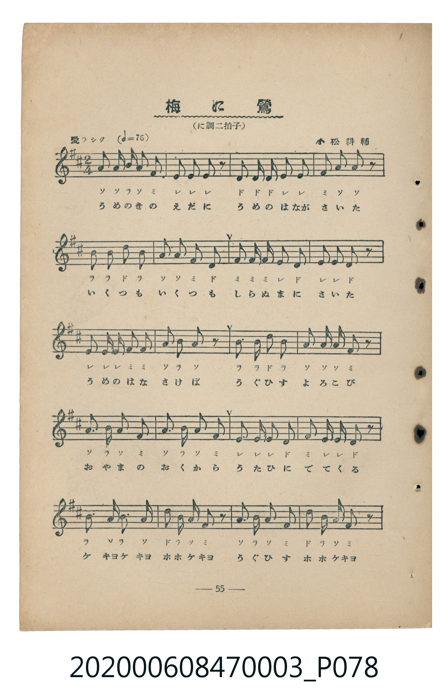
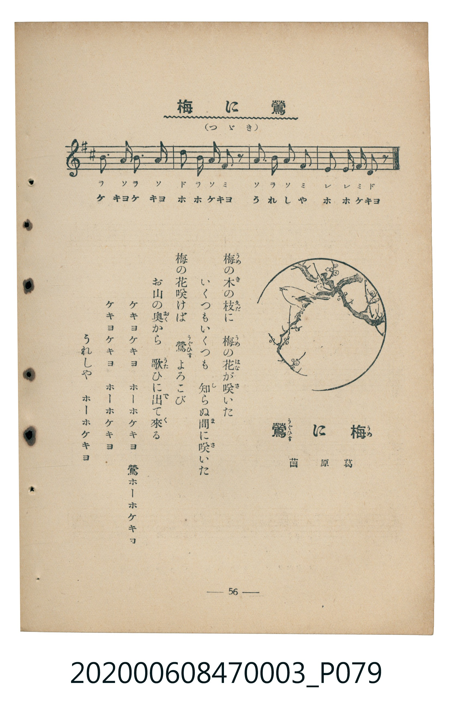

# 梅に鶯

> Re:Shōka 使用 AI 協助辨識與重建樂譜，可能會有錯誤。歡迎回報。

- **鋼琴伴奏版**：<br><audio controls src="ume_ni_uguisu.mp3"></audio>
- **NEUTRINO 歌聲合成版**：<br><audio controls src="ume_ni_uguisu_neutrino.mp3"></audio>

- 葛原齒 作詞 / 小松耕輔 作曲
- 臺灣教育會公認《新定兒童唱歌》尋常科第三學年用（2020.006.0847.0003）

## 說明

Reference Materials 16: 梅に鶯 (Ume ni Uguisu / Bush Warbler on the Plum Tree)
Source: 臺灣教育會公認 新定兒童唱歌 尋常科第三學年用 (1934), pp. 55-56 (P078.jpg-P079.jpg)
Lyricist: 葛原齒 (Kuzuhara Shigeru) / Composer: 小松耕輔 (Komatsu Kōsuke)
Key: D major (?= D), 2/4 (<2/4>), 愛ラシク Quarter = 76 (!= 76)


## 歌詞

```text
梅の木の枝に　梅の花が咲いた
いくつもいくつも　知らぬ間に咲いた
梅の花咲けば　鶯よろこび
お山の奥から　歌ひに出て來る
ケキヨケキヨ　ホーホケキヨ　鶯ホーホケキヨ
ケキヨケキヨ　ホーホケキヨ　うれしや　ホーホケキヨ
```

## ABC

<div class="abc-score" data-abc-src="ume_ni_uguisu.abc" aria-label="五線譜載入中"></div>

[下載 ABC 原始檔](ume_ni_uguisu.abc)

## TMD 檔案連結

- [主旋律 TMD 檔案](ume_ni_uguisu.tmd) [[在 TMD Studio 編輯](https://tmdlang.github.io/Tmd-TS/#tmd=s7IKdvYPcrWy4qpTUCpJTLdSSM7PyUlNLsnMz7MqzsjMK0nNjM_KTMmPL87Iz05Ugisry88pzU21Si9KTEmNN443MjAyiDcwMIs3sDAxBzIMjBFKi_NLi5JTrYqTM_Lzc-JLUitKkvLzsxHyBUX5Zal5iXlANQVFIBtTwIoQClLLMlNSQdKpKZkl-UWZiTlI7kgtKga7FWxJfElRYl5xclFmAcgDCFUlGalAxybmZeYi64WIFuQk5iFZBjQ_PTPPqiQxE-hjkK_LE-NzEzPzgKpSkFWVZOQDPV-QUWmVkVkMclVyYk58dmIeUhhB3VSQmJ5qFWBgbqELJCyVuLS0FJ4tan3cuPrltvUKWlpcirYK5mZc9rYKLlw2RvomdiD9LybOfto3_-XeSQpP9s55sXKegr7C0w39z-bue9Ew9cWeKSDRZ7M3ga160b7reePiZ1Nnvmja9GxO89PWNS9W9T5u6Ho2bcPTdbOetk56vnrp0ykbn63tedzQ_XRD99MdO54vn_h8zZonOzqfrt3xdOeW51NWvN_TAYpCPWAU6oGiEMgwMH6_p1OJi0tfi0tBSyEoNS21CBQJCr6JJamgOChWMDSzQvKJRmhuqkJepkJoemlmcSnQwU6lxRkK4YlFSTmpRQr5eaDgVggAphqFkKLUVE2QocGQlKGA1QsKmB4AhgF25ytoGFoam2jqKBQU6CmYmuqamilogEJcL6sgHRzqIAbYSp9KYEwBIwxoKTyINbxLq0ozEosSFYIzMtNTi0o1ga53zs8tyC9OLbJCDXgN7_zcxBKg_7yP9haXZkP84Z1aaaXgopCbmJVfpKABikmgU4BRqaABjlAg51nL7MfNKx83bX_ctF4hsDSxCBiGCqB4V9AARz_IGLjziq1ATHDIrns2ZwWInDcXGMqPGxoggi-6Nj5u7Hk6adPjxpbHjfNBqsGs_seNSx43NaGwGxqez1_6uKnzceOal9MmA01B0QY3Dyw68XHjBqAGYGw-bup43NT7uBGoYTPE-K6nG4GWrnu6dOnjxm6QeUDHAJNUI1Db6qftux43Lnuyr-1xUzdYddPGx01rHzevQDAaGh43A4NgD4hEEgRZhSFOmhGPG4HWAh0y_XFTC1Y1QOP0ubjCgAUFMBtmJublO9QY1FRzKQCBjYWWHZihr6VgqGtiBfQn0LBGoD8fNwJ9DyQ7HjcuAPoQWWL948ZVwOB_3DgVEo4g40Fm1CiYKmiYKphpqmroagLZxkARIzA0ALIMgWlUwRAiBxKrAcqbAiFQDqzbpwZkh4IG0BYgY50mkOgFMYAKga4A4gVAvFohHsxHVbceiEEuAktNBSUFIJ4PUgrzm6muBchv2JMIUAIYdqAE8rhxHyiZYXrMDAgN44AEyI8gnxmC3a9hrGAM8xFIBOQvQ1QfgZzSD8RLgDHaBHYgpsh0kG86gYw1IN_sA_sTp1csdQ2NUOIJEh1AJ4NSL1iicQI4Wc5ETsQIvxgpaADdCXE20P1gL5lBIkJBw0xBFwjBUQiUhnsZGK2mMB14IgwcEXCnTwTiDeAI0wApBBkMdBpI3SYgnglS19QB0g-K58kg8c3IHjU01gUVsMCcB0rYoJgBerYLHGug_Afx6XxIBnzcuByYAUFyTd0InwJdjewbSIrELmgEFgSHCjw2gfELDyiUWAV6pwvinaYWWIyB0ilCvLEfJN4NVNCJ6v35MO9DYng5SG4ZVD3Q6cjeN9c1MgB6H6McUMDM4Sixjk0eESSQCAZHJtBbaFxgLo0DiSHHNfYAw1SHCJymjdDAAVkNtANdAOjx5tlAYSABlAJ5HOxGvAkFhwZYYBkZ6hqBSi-iAwtWYNIlsEDFArCogBZ-1A-rph5QWE0HJUeoBogmoFkwc0BhVcvFpWunAK4HFIAMZS4A)]
- [鋼琴伴奏 TMD 檔案](ume_ni_uguisu_piano.tmd) [[在 TMD Studio 編輯](https://tmdlang.github.io/Tmd-TS/#tmd=s7IKdvYPcrWy4qpTUCpJTLdSyC8qychPL0osyKi0ysgsLskvykxOzInPTsxLVIIrKs4vLUpOjS9ITE-1CjAwt9AFEpZKXFpaCs8WtT5uXP1y2_r3ezpedu95PmHLkz1bni7tf97Z8X5Pp4KWFpeirYK5GZe9rYILl42RvokdyNAXE2c_7Zv_cu8khSd757xYOU9BX-Hphv5nc_e9aJj6Ys8UkOiz2ZvA9r9o3_W8cfGzqTNfNG16Nqf5aeuaF6t6Hzd0PZu24em6WU9bJz1fvfTplI3P1vY8buh-uqH76Y4dz5dPfL5mzZMdnU_X7ni6c8vzKSuAjjMyMDLQMzAw0zOwMDEHMgyMge5T4uLS1-JS0FIISk1LLUrNS05V8E0sSS3KTMwpVjA0s0J4T0EjNDdVIS9TITS9NLO4FOhgp9LiDIXwxKKknNQihfw8hZKMVIWAnNJchZCi1FRNBV2FgMzEvHwFx-Tk_NyCxLzM3NS8EpBVweCwtFLA6jEFTG8BQwa7pxQ0DC2NTTR1FAoK9BRMTXVNzRQ0QJGjl1WQDo4gEEMTaKU-F1dYalExMOpALgrycKgxqKnmUgACGwstOzBDX0vBUNfESuFxY9vjpsbHjeseN_aCyY7HjQuAIYAssf5x46rHjT2PG6c-bmx53DgfZAHIjBoFUwUNUwUzTVUNXU0g2xgoYgSGBkCWIdC5CoYQOZBYDVDeFAiBcmDdPjUgOxQ0gLYAGes0gUQviAFUCHQFEC8A4tUK8WA-qrr1QAxyEVhqKhC3APF8kFKY30x1LUB-A7q2_3HjksdNTchsoMT0x02djxvXPG7cB7QDi8fMgNAwDkiA_AjymSHY_RrGCsYwH4FEQP4yRPURyCn9QLxEAWQTdpHpIN90AhlrQL7ZB_YnTq9Y6hoaocQTJDqATp74uHEDWKJxwuPGTY8bZz5u6njcBIzGyY8bNyP8YqSgAXQnxNlA94O9ZAaJCAUNM2C61YVEIVAa7mVgtJrCdOCJMHBEwJ0-EYg3gCNMA6QQZDDQaSB1m4B4JkhdUwdIPyieJ4PENyN71NBYF5QDHzd2PW4CxgYwZoCe7QLHWjckuIA-nQ_2KTDKlj9uXAaSa-pG-BToamTfQFIkdkEjsCA4VOCxCYxfeEChxCrQO10Q7zS1wGIMlE4R4o39IPFuoIJOVO_Ph3kfEsPLQXLLoOqBTkf2vrmukQHQ-00bHzetfdy8As5QeNw8-3HzHhCJEEKKdWzyiCCBRDA4MoHeQuMCc2kcSAw5rrEHGKY6ROA0bYQGDshqoB3oAkCPN88GCgMJoBTI42A34k0oODTAAsvIUNcIVHoRHVhNwOILmOmBuYsOgQUqFoBFBbTwo35YNfWAwmo6KDlCNUA0Ac2CmQMKq1qUasAHWzUA9FO8QrRhLIwC5v14IMs0PhbMAJfjEBm4OLIWmNdqFEyAYiaxMArTWExT4EwUc5BFUXRCVOGxB2EGDruxexGva6DWoJgE5IM4SEEDl4Yqh0qTZwa6Q4CRqGunAI5HBSBDmQsA)]

## 分析

```text
================================================================================
📊 TMD Song Profile: [ 梅に鶯 ]
================================================================================
⏱  Duration:       0:37 (37.9s), 24 measures total
🎼 Key & Tempo:    首調基準 D, != 76.0 BPM, <2/4>
   - 分析範圍：      由實際發聲的音符與和弦推測調性；播放脈絡另行呈現
🎤 人聲音域:    D4 (MIDI 62) – D5 (MIDI 74) [跨度: 12 個半音 / 1.0 個八度, 難度: easy]
   - 最低音:  D4 in [Verse #1 @ m.3, 0:03]
   - 最高音: D5 in [Verse #1 @ m.5, 0:07]
   - 適合: soprano, mezzo-soprano, contralto, tenor, baritone, bass
🏛  結構:      Verse (37.9s)
⚡ 編曲密度:        Peak 1 軌道同時演奏
🗝  調性診斷：       A 大調（純淨自然大調，未偵測到可信轉調）
   - 風格氣質:    純淨自然大調（陽光明朗、易唱易記，無明顯調外色彩）
   - 轉調歷程:    全曲維持單一推測調性（未偵測到可信轉調）
   - 核心骨幹音:  A, B, F#, E, D
   - 調性數值:    A 大調 [相關度: 0.80, 穩定度: Moderate, 自然音純度: 100.0%]
   - 候選調性 (K-S): A 大調 (0.80), D 大調 (0.71), F# 小調 (0.64)
   - 五度圈歷程:   +3
   - 各段落調性細節:
     • [Verse #1]: A 大調 (r: 0.80, 自然音純度: 100.0%)

  [ 五度圈游移軌跡 ]
               C  
         F            G  
      Bb               D  
      Eb              [A ]*
         Ab           E  
            Db       B  
               F# 
     (* = active key center)

  [ 十二半音累積音高分佈 ]
     C  :                            0.0%
     C# :                            0.0%
     D  : █████████████             14.5%
     D# :                            0.0%
     E  : ████████████████          18.6%
     F  :                            0.0%
     F# : █████████████████         19.2%
     G  :                            0.0%
     G# :                            0.0%
     A  : ████████████████████████  27.9%
     A# :                            0.0%
     B  : █████████████████         19.8%
--------------------------------------------------------------------------------
Assignment 軌道音域：
  - Piano         : D4 – D5 (12 個半音 / 1.0 個八度, 96 個音符)
================================================================================
```


## 原書掃描頁






