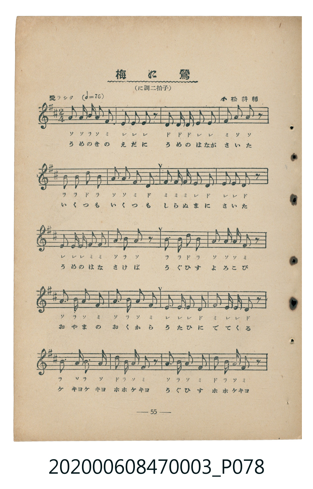
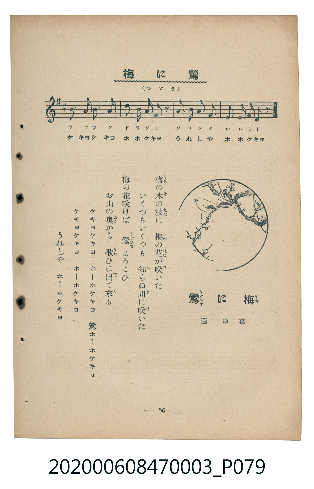

# 梅に鶯

<audio controls src="ume_ni_uguisu.mp3"></audio>

- 葛原齒 作詞 / 小松耕輔 作曲
- 臺灣教育會公認《新定兒童唱歌》尋常科第三學年用（2020.006.0847.0003）

## 說明

Reference Materials 16: 梅に鶯 (Ume ni Uguisu / Bush Warbler on the Plum Tree)
Source: 臺灣教育會公認 新定兒童唱歌 尋常科第三學年用 (1934), pp. 55-56 (P078.jpg-P079.jpg)
Lyricist: 葛原齒 (Kuzuhara Shigeru) / Composer: 小松耕輔 (Komatsu Kōsuke)
Key: D major (?= D), 2/4 (<2/4>), 愛ラシク Quarter = 76 (!= 76)

## 歌詞

```text
梅の木の枝に　梅の花が咲いた
いくつもいくつも　知らぬ間に咲いた
梅の花咲けば　鶯よろこび
お山の奥から　歌ひに出て來る
ケキヨケキヨ　ホーホケキヨ　鶯ホーホケキヨ
ケキヨケキヨ　ホーホケキヨ　うれしや　ホーホケキヨ
```

## ABC

```abc
X:1
T:梅に鶯
C:TMD (Chen, Chih-Han / aguai)
M:2/4
L:1/16
Q:1/4=76
K:D
V:V1 name="Piano" snm="Pia"
[V:V1]
a2 a b a2 f2 | e2 e2 e2 z2 | d2 d d e2 e2 | f2 a3 a z2 |
b2 b2 d2 b2 | a2 a2 f2 d2 | f2 f f e2 d2 | e2 e2 d2 z2 |
e2 e e f2 f2 | a3 b a2 z2 | b2 b2 d2 b2 | a2 a a f2 z2 |
a3 b a2 f2 | a3 b a2 f2 | e2 e2 e2 d2 | f2 e e d2 z2 |
b4 a3 b | a2 d b a f z2 | a3 b a2 f2 | d2 b2 a f z2 |
b4 a3 b | a2 d b a f z2 | a3 b a2 f2 | e2 e2 f d z2 |
```

## TMD 檔案連結

- [主旋律 TMD 檔案](ume_ni_uguisu.tmd)
- [鋼琴伴奏 TMD 檔案](ume_ni_uguisu_piano.tmd)

## 分析

```text
================================================================================
📊 TMD Song Profile: [ 梅に鶯 ]
================================================================================
⏱  Duration:       0:37 (37.9s), 24 measures total
🎼 Key & Tempo:    首調基準 D, != 76.0 BPM, <2/4>
   - 分析範圍：      由實際發聲的音符與和弦推測調性；播放脈絡另行呈現
🎤 人聲音域:    D4 (MIDI 62) – D5 (MIDI 74) [跨度: 12 個半音 / 1.0 個八度, 難度: easy]
   - 最低音:  D4 in [Verse #1 @ m.3, 0:03]
   - 最高音: D5 in [Verse #1 @ m.5, 0:07]
   - 適合: soprano, mezzo-soprano, contralto, tenor, baritone, bass
🏛  結構:      Verse (37.9s)
⚡ 編曲密度:        Peak 1 軌道同時演奏
🗝  調性診斷：       A 大調（純淨自然大調，未偵測到可信轉調）
   - 風格氣質:    純淨自然大調（陽光明朗、易唱易記，無明顯調外色彩）
   - 轉調歷程:    全曲維持單一推測調性（未偵測到可信轉調）
   - 核心骨幹音:  A, E, B, F#, D
   - 調性數值:    A 大調 [相關度: 0.83, 穩定度: High, 自然音純度: 100.0%]
   - 候選調性 (K-S): A 大調 (0.83), D 大調 (0.69), F# 小調 (0.63)
   - 五度圈歷程:   +3
   - 各段落調性細節:
     • [Verse #1]: A 大調 (r: 0.83, 自然音純度: 100.0%)

  [ 五度圈游移軌跡 ]
               C  
         F            G  
      Bb               D  
      Eb              [A ]*
         Ab           E  
            Db       B  
               F# 
     (* = active key center)

  [ 十二半音累積音高分佈 ]
     C  :                            0.0%
     C# :                            0.0%
     D  : ██████████                13.4%
     D# :                            0.0%
     E  : ██████████████            18.6%
     F  :                            0.0%
     F# : █████████████             17.4%
     G  :                            0.0%
     G# :                            0.0%
     A  : ████████████████████████  32.0%
     A# :                            0.0%
     B  : ██████████████            18.6%
--------------------------------------------------------------------------------
Assignment 軌道音域：
  - Piano         : D4 – D5 (12 個半音 / 1.0 個八度, 96 個音符)
================================================================================
```


## 原書掃描頁






