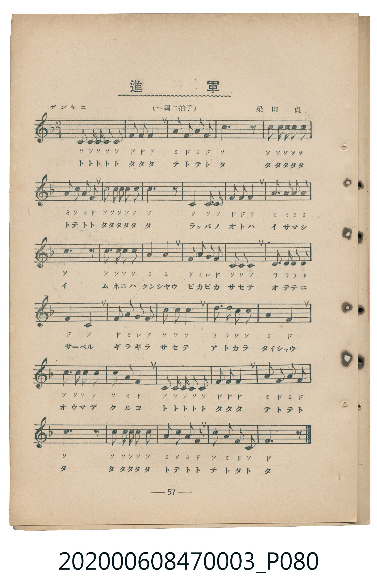

# 進軍

> Re:Shōka 使用 AI 協助辨識與重建樂譜，可能會有錯誤。歡迎回報。

- **鋼琴伴奏版**：<br><audio controls src="shingun.mp3"></audio>
- **NEUTRINO 歌聲合成版**：<br><audio controls src="shingun_neutrino.mp3"></audio>

- 葛原齒 作詞 / 梁田貞 作曲
- 臺灣教育會公認《新定兒童唱歌》尋常科第三學年用（2020.006.0847.0003）

## 說明

Reference Materials 17: 進軍 (Shingun / March)
Source: 臺灣教育會公認 新定兒童唱歌 尋常科第三學年用 (1934), pp. 57-58 (P080.jpg-P081.jpg)
Lyricist: 葛原齒 (Kuzuhara Shigeru) / Composer: 梁田貞 (Yanada Tadashi)
Key: F major (?= F), 2/4 (<2/4>), ゲンキニ Quarter = 116 (!= 116)


## 歌詞

```text
トトトトト、タタタ、テトテトタ、
タタタタタ、トテトト、タタタタタタ、
ラッパのおとはいさましい
むねには勳章ピカピカさせて
おててにサーベルギラギラさせて
あとから大將お馬でくるよ
トトトトト、タタタ、テトテトタ、
タタタタタ、トテトト、テトタトタ、
```

## ABC

<div class="abc-score" data-abc-src="shingun.abc" aria-label="五線譜載入中"></div>

[下載 ABC 原始檔](shingun.abc)

## TMD 檔案連結

- [主旋律 TMD 檔案](shingun.tmd) [[在 TMD Studio 編輯](https://tmdlang.github.io/Tmd-TS/#tmd=s7IKdvYPcrWy4qpTUCpJTLdSSM7PyUlNLsnMz7MqzsjMK0nNjM_KTMmPL87Iz05Ugisry88pzU21Si9KTEmNN443MjAyiDcwMIs3sDAxBzIMjBFKi_NLi5JTrYqTM_Lzc-JLUitKkvLzsxHyBUX5Zal5iXlANQVFIBtTwIoQClLLMlNSQdKpKZkl-UWZiTlI7kgtKga7FWxJfElRYl5xclFmAcgDCFUlGalAx-Zm5mSWJBZVIsSBhqVn5lmVJGYCvQfyYnlifG5iZl5OYl4KsqqSjHygTwsyKq0yMotBTkhOzInPTsxDChCoAwoS01OtAgwsDHSBhKESl5aWwsuGTS929ypoaXEp2ioYGppx2dsquHHZGOmb2IF0v5g4-2nf_Jd7Jyk82Tvnxcp5CvoKzxY1Pp-y4cWmeSChZ7M3gW150b7reePiZ1Nnvmja9GxO89PWNS9W9T5u6Ho2bcPTdbOetk56vnrp0ykbn63tedzQ_XRD99MdO54vn_h8zZonOzqfrt3xdOeW51NWvN_TAYoqPWBU6YGiCsgwMH6_p1OJi0tfi0tBSyEoNS21CBTYCr6JJamgsC5WMDS3gnlCIxiYJtJL84CO9E0sSs7QBOkJhkSwAlYXKmC6TwGX6xQ0DC2NTTR1FAoK9BRMzXVNLRQ0QGGpl1WQDg5PEANspU8lMA6AUQG0FB58Gt6lVaUZiUWJCkBHpqcWlWoCXemcn1uQX5xaZIUUqBqRwJhLSVQIARLANA420Du10krBTSE3MSu_SEEDFENAZwCjSEEDHFFAzuOmTY-bNz9uWvu4uVshsDSxCBg8CuAIVdCARCzIILjjiq1AzMfNHSioofFx034oArKb28DiYBIsAtYDV4FQB1OEZgSSGohtKx83Nz9unvi4cd3jxq7HjSseN65_3NjyuHHq48Z9jxunA9kQGxoeN6593LgaKP20e_Pz1QseN0953LQaSoJUz37cuAysFGTMMjBa_bhp6-PmPY-bZz5uBrLXgWyDkKgamsD2dj9u6ny6ZPnTDe1AI14uW_O4cfnjxv7HTUDxDtqFDFwDkjZ9Lq4wYCkBzJaZiXn5DjUGNdVcCkBgY6FlB2boaykY6lpYoTsJYR1QBsU56A6B6IQ6A8OVQHmgG0AW1SiYxitoALFpvKaqhq4miAtENQqGYKgLZBkDaRAGKgXydRUMFGrAWn1qQJYoaIAtaO7QBPNAGCgOcRAYg4wAugQqC6EhKkCGAa2CuQPoDAVTqCOAsEZBwxjGB1kPMgdTDaaTgAZrQO0GOgnqCKBhUPsRzgQ7DIdqdOcB48NS19AMFCFY0jMwhaEkaJTUDE5ik0ESTc2PG0H-x5KuUaJDFykSdMHRAIoECMQaCSAnAcWArgK6ZB3I-Y1dIH7jCiBeD-YD3dQ4FYj3AfF0qAhq-ANDFiQADl148BoDRUAY5BRjBSNIKgA7DuxOuBuAYdgA1g70NjAcG1fDLQZ5HiwO8z8kPUwBhhFQEZQGKQS5bjYQL4ObC8oE5rpGJsBQx5HlgZqx5HmUDP-4cT44duDBDzKqDRxViNyPCH6zeASChD_Eo8j-B0Mkz4NCG2ItCIN9A3YjOErAzoQktXWgqILT2P0MDEozcECaYcQDJAtgjSaQGDiLIuKjsQkaHytA8dENtLYTbCUoNDDiA6gclGBAwqAMAk4lyyHRBxJsAmkH5lpYrBiZ6hobUa9wQi0hh2rJBGLBMy0lRRLMRZBwQnNRLReXrp0CuPJQADKUuQA)]
- [鋼琴伴奏 TMD 檔案](shingun_piano.tmd) [[在 TMD Studio 編輯](https://tmdlang.github.io/Tmd-TS/#tmd=s7IKdvYPcrWy4qpTUCpJTLdSyC8qychPL0osyKi0ysgsLskvykxOzInPTsxLVIIrKs4vLUpOjS9ITE-1CjCwMNAFEoZKXFpaCi8bNr3Y3ft-T8fL7j3PJ2x5smfL06X9zzs73u_pVNDS4lK0VTA0NOOyt1Vw47Ix0jexAxn5YuLsp33zX-6dpPBk75wXK-cp6Cs8W9T4fMqGF5vmgYSezd4EtvpF-67njYufTZ35omnTsznNT1vXvFjV-7ih69m0DU_XzXraOun56qVPp2x8trbncUP30w3dT3fseL584vM1a57s6Hy6dsfTnVueT1kBdJqRgZGBnoGBmZ6BhYk5kGFgDHSdEheXvhaXgpZCUGpaalFqXnKqgm9iSWpRZmJOsYKhuRXUZwoawRmZeemleUBH-iYWJWdoKugqBGQm5uUrOCYn5-cWJOZl5qbmlYBMCgaHkpUCVncrYLpaAZebFTQMLY1NNHUUCgr0FEzNdU0tFDRAwa6XVZAODnoQQxNopT4XV1hqUTEwUkAuCvJwqDGoqeZSAAIbCy07MKNGwTReQQOITeM1VTV0NUFcIKpRMARDXSDLGEiDMFApkK-rYKBQA9bqU6PwuLlDQQNEALEmmAfCQPGm_XAMMuJxcxtUFkJDVIAMA1oFcwfQGQqmUEcAYY2ChjGMD7IeZA6mGkwnAQ3WgNoNdBLUEUDDoPYjnAl2GA7VWJwXD-QiAkcXHDygwIFArIGz8nFzM1DscfNEhceN60DGNnaB-I0rgHg9mN8CxFOBeB8QT4eKoFoM9DFIAOxruLeNgSIgDHKKsYIRJHbAjgO7E-4GoN8awNofN64F-q9xNdzi_sdNk8Hi0x83NT9ubIPG0xSg14GKoDRIIch1s4F4GdzcGgWzeASChAbEWmTXgCGSU0B-B5kCwWCzm7Y-bt4DDqCZj5tXQyNkHSjg4DQuF2iYgb1lhhEqkISCNdBAYuCEjAidxiZo6KwAhU430NpOsJXzIfGAGjpA5aDoAwmDkhE4zpZDAhMk2ATSDkzbQzJfgVjwpE1JhoK5CKQOw0W1KAWSD64CKV4h2jQ-FsEAugrIMowFUeBUBueBKDQdMKdjKkM1BL81CFPwq0M3mUwHofCNgJRRfC6GQYjUbwIUNYmFUTgNwhWAqKYQ5ws85gyaCAMmL107BXAKUwAylLkA)]

## 分析

```text
================================================================================
📊 TMD Song Profile: [ 進軍 ]
================================================================================
⏱  Duration:       0:33 (33.1s), 32 measures total
🎼 Key & Tempo:    首調基準 F, != 116.0 BPM, <2/4>
   - 分析範圍：      由實際發聲的音符與和弦推測調性；播放脈絡另行呈現
🎤 人聲音域:    C4 (MIDI 60) – D5 (MIDI 74) [跨度: 14 個半音 / 1.2 個八度, 難度: moderate]
   - 最低音:  C4 in [Verse #1 @ m.1, 0:00]
   - 最高音: D5 in [Verse #1 @ m.21, 0:20]
   - 適合: soprano, mezzo-soprano, contralto, tenor, baritone, bass
🏛  結構:      Verse (33.1s)
⚡ 編曲密度:        Peak 1 軌道同時演奏
🗝  調性診斷：       F 大調（純淨自然大調，未偵測到可信轉調）
   - 風格氣質:    純淨自然大調（陽光明朗、易唱易記，無明顯調外色彩）
   - 轉調歷程:    全曲維持單一推測調性（未偵測到可信轉調）
   - 核心骨幹音:  C, F, A, D, G
   - 調性數值:    F 大調 [相關度: 0.79, 穩定度: Moderate, 自然音純度: 100.0%]
   - 候選調性 (K-S): F 大調 (0.79), C 大調 (0.73), A 小調 (0.65)
   - 五度圈歷程:   -1
   - 各段落調性細節:
     • [Verse #1]: F 大調 (r: 0.79, 自然音純度: 100.0%)

  [ 五度圈游移軌跡 ]
               C  
        [F ]*          G  
      Bb               D  
      Eb               A  
         Ab           E  
            Db       B  
               F# 
     (* = active key center)

  [ 十二半音累積音高分佈 ]
     C  : ████████████████████████  49.6%
     C# :                            0.0%
     D  : ██                         4.9%
     D# :                            0.0%
     E  :                            0.0%
     F  : █████████████             26.8%
     F# :                            0.0%
     G  : █                          1.6%
     G# :                            0.0%
     A  : ████████                  17.1%
     A# :                            0.0%
     B  :                            0.0%
--------------------------------------------------------------------------------
Assignment 軌道音域：
  - Piano         : C4 – D5 (14 個半音 / 1.2 個八度, 105 個音符)
================================================================================
```


## 原書掃描頁




