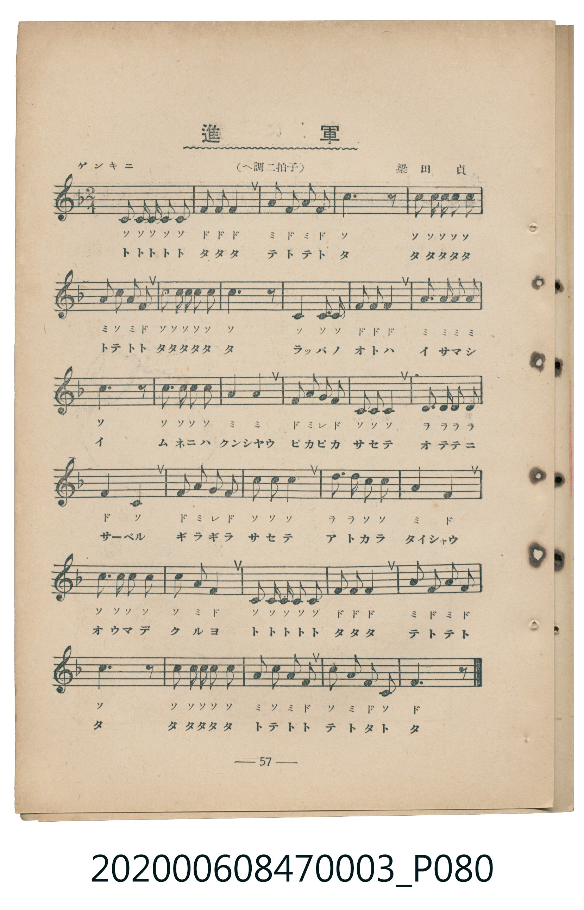
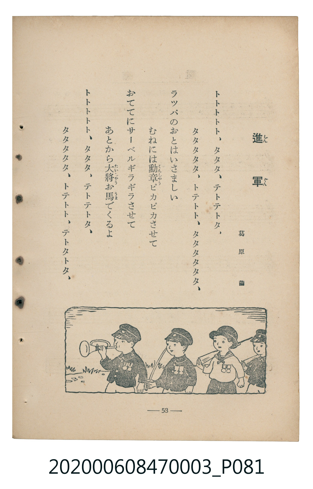

# 進軍

> Re:Shoka 使用 AI 辨識樂譜，可能會有錯誤。歡迎回報。

<audio controls src="shingun.mp3"></audio>

- 葛原齒 作詞 / 梁田貞 作曲
- 臺灣教育會公認《新定兒童唱歌》尋常科第三學年用（2020.006.0847.0003）

## 說明

Reference Materials 17: 進軍 (Shingun / March)
Source: 臺灣教育會公認 新定兒童唱歌 尋常科第三學年用 (1934), pp. 57-58 (P080.jpg-P081.jpg)
Lyricist: 葛原齒 (Kuzuhara Shigeru) / Composer: 梁田貞 (Yanada Tadashi)
Key: F major (?= F), 2/4 (<2/4>), ゲンキニ Quarter = 116 (!= 116)

## 跨冊／重複收錄參照

> 同名異曲（各冊收錄之不同詞曲版本）

- **[同名異曲]** 《新定兒童唱歌》高等科男子用（2020.006.0848）：[**〈進軍〉**](../../koto_boys_2020.006.0848/2_2_02_shingun/index.md)（`G` / `4/4` — [原始 TMD](../../koto_boys_2020.006.0848/2_2_02_shingun/shingun.tmd)）
- **[同名異曲]** 楊金土手抄《唱歌帖》第 10 冊・X（2020.006.0843）：[**〈進軍 (進軍)〉**](../../../shokacho/vol_10/p195b_shingun/index.md)（`G` / `4/4` — [原始 TMD](../../../shokacho/vol_10/p195b_shingun/shingun.tmd)）
- 總表：[跨冊重複與同名歌曲總索引](../../../duplicate_songs.md)

## 歌詞

```text
トトトトト、タタタ、テトテトタ、
タタタタタ、トテトト、タタタタタタ、
ラッパのおとはいさましい
むねには勳章ピカピカさせて
おててにサーベルギラギラさせて
あとから大將お馬でくるよ
トトトトト、タタタ、テトテトタ、
タタタタタ、トテトト、テトタトタ、
```

## ABC

```abc
X:1
T:進軍
M:2/4
L:1/16
Q:1/4=116
K:F
V:V1 name="Piano" snm="Pia"
[V:V1]
C2 C C C2 C2 | F2 F2 F4 | A2 F2 A2 F2 | c6 z2 |
c2 c c c2 c2 | A c A2 F4 | c2 c c c2 c2 | c6 z2 |
C4 C2 C2 | F4 F2 F2 | A2 A2 A2 A2 | c6 z2 |
c3 c c2 c2 | A4 A4 | F2 A2 G2 F2 | C2 C2 C4 |
D2 D2 D2 D2 | F4 C4 | F2 A2 G2 F2 | c2 c2 c4 |
d3 d c2 c2 | A4 F4 | c3 c c2 c2 | c4 A2 F2 |
C2 C C C2 C2 | F2 F2 F4 | A2 F2 A2 F2 | c6 z2 |
c2 c c c2 c2 | A c A2 F4 | c2 A2 F2 C2 | F6 z2 |
```

## TMD 檔案連結

- [主旋律 TMD 檔案](shingun.tmd) [[在 TMD Studio 編輯](https://tmdlang.github.io/Tmd-TS/#tmd=s7IKdvYPcrWy4qpTUCpJTLdSSM7PyUlNLsnMz7MqzsjMK0nNjM_KTMmPL87Iz05Ugisry88pzU21Si9KTEmNN443MjAyiDcwMIs3sDAxBzIMjBFKi_NLi5JTrYqTM_Lzc-JLUitKkvLzsxHyBUX5Zal5iXlANQVFIBtTwIoQClLLMlNSQdKpKZkl-UWZiTlI7kgtKga7FWxJfElRYl5xclFmAcgDCFUlGalAx-Zm5mSWJBZVKnFpaSm8bNj0YnevgpYWl6KtgqGhGZe9rYIbl42RvokdSNuLibOf9s1_uXeSwpO9c16snKegr_BsUePzKRtebJoHEno2exPY-Bftu543Ln42deaLpk3P5jQ_bV3zYlXv44auZ9M2PF0362nrpOerlz6dsvHZ2p7HDd1PN3Q_3bHj-fKJz9esebKj8-naHU93bnk-ZcX7PR2gANQDBqAeKACBDAPj93s6lbi49LW4FLQUglLTUotAQaDgm1iSCgqBYgVDcyuYJzSCgTGVXpoHdKRvYlFyhiZITzAk2BWwulAB030KuFynoGFoaWyiqaNQUKCnYGqua2qhoBFgYGGgl1WQrgtkGIIYYCt9KosykzOLS4CWwoNPw7u0qjQjsShRAejI9NSiUk2gK53zcwvyi1OLrJACVSMyMS8xJVEhBEgAUx7YQO_USisFN4XcxKz8IgUNUAwBnQGMIgUNcEQBOY-bNj1u3vy4ae3j5m6FwNLEImDwKIAjVEEDErEgg-COK7YCMR83d6CghsbHTfuhCMhubgOLg0mwCFgPXAVCHUwRmhFIaiC2rXzc3Py4eeLjxnWPG7seN6543Lj-cWPL48apjxv3PW6cDmRDbGh43Lj2ceNqoPTT7s3PVy943DzlcdNqKAlSPftx4zKwUpAxy8Bo9eOmrY-b9zxunvm4GcheB7INQqJqaALb2_24qfPpkuVPN7QDjXi5bM3jxuWPG_sfNwHFO2gXMnANSNr0ubjCgHk31SogMzEv36HGoEahmksBCGwstOzADH0tBUNdCyt0NyHsA8qguAfdJRCdUHdgOBMoD3QEyKIaBdN4BQ0gNo3XVNXQ1QRxgahGwRAMdYEsYyANwkClQL6ugoFCDUwrUKeCKVQfENYoaBjD-CAdIN2YalBNAfrUUtfQDORVLEkFGHkoaQUloYBjbzJIoqn5cWMb0AQsSQbFo7pI3tMFexDkPQjE9B7Q4bpAHSC3wx1vDFQBwiATjBWMIMECNhNsPNxPhua6RiZAT-FIrEB_YEmtKEn1ceN8sOfhvgMZ1QYOCUS6RfjOLB6BIN6DOAjZnWAIcyTQf2Yg_5lh-A8Scdh8D9INTgowbxqZ6hobUS-ZomYWOqZREAueLiDaa7m4dO0UwPlUAchQ5uICAA)]
- [鋼琴伴奏 TMD 檔案](shingun_piano.tmd) [[在 TMD Studio 編輯](https://tmdlang.github.io/Tmd-TS/#tmd=s7IKdvYPcrWy4tLSUnjZsOnF7t73ezpedu95PmHLkz1bni7tf97Z8X5Pp4KWFpeirYKhoRmXva2CG5eNkb6JHVedgtKLibOf9s1_uXeSwpO9c16snKegr_BsUePzKRtebJoHEno2e5MSWF37rueNi59NnfmiadOzOc1PW9e8WNX7uKHr2bQNT9fNeto66fnqpU-nbHy2tudxQ_fTDd1Pd-x4vnzi8zVrnuzofLp2x9OdW55PWQF0mpGBkYGegYGZnoGFiTmQYWAMdJ0SF5e-FpeClkJQalpqUWpecqqCb2JJalFmYk6xgqG5FdRnChrBGZl56aV5QEf6JhYlZ2gq6CoEZCbm5Ss4Jifn5xYk5mXmpuaVgEwKzi8tSk61UsDqbgVMVyvgcrOChqGlsYmmjkJBgZ6CqbmuqYWCRoCBhYFeVkG6LpBhCGJoAq3U5-IKSy0qTrUCuyjIw6HGoEahmksBCGwstOzAjBoF03gFDSA2jddU1dDVBHGBqEbBEAx1gSxjIA3CQKVAvq6CgUINTCtQp4IpVB8Q1ihoGMP4IB0g3ZhqMEyJB3IR1uqCLQZZC4GYGoAG6gJ1gMyEG2oMVAHCIBOMFYwgzgWbCTYeptUsHoEglkGkkXWBIUKLhhnINjMM2yDew-YWkG5wgNErhEEseOhBtNeixL0PzriPV4g2jY9FMIBmAFmGsSAKHC5wHohC04FwJ7oyVEPwW4OcEvCpQzeZTAeh8I2AlFF8LoZBiOg3AYqaxMIonAbhCkBUU4jzBR5zBk2EAdOXrp0COIkpABnKXFwA)]

## 分析

```text
================================================================================
📊 TMD Song Profile: [ 進軍 ]
================================================================================
⏱  Duration:       0:33 (33.1s), 32 measures total
🎼 Key & Tempo:    首調基準 F, != 116.0 BPM, <2/4>
   - 分析範圍：      由實際發聲的音符與和弦推測調性；播放脈絡另行呈現
🎤 人聲音域:    C4 (MIDI 60) – D5 (MIDI 74) [跨度: 14 個半音 / 1.2 個八度, 難度: moderate]
   - 最低音:  C4 in [Verse #1 @ m.1, 0:00]
   - 最高音: D5 in [Verse #1 @ m.21, 0:20]
   - 適合: soprano, mezzo-soprano, contralto, tenor, baritone, bass
🏛  結構:      Verse (33.1s)
⚡ 編曲密度:        Peak 1 軌道同時演奏
🗝  調性診斷：       F 大調（純淨自然大調，未偵測到可信轉調）
   - 風格氣質:    純淨自然大調（陽光明朗、易唱易記，無明顯調外色彩）
   - 轉調歷程:    全曲維持單一推測調性（未偵測到可信轉調）
   - 核心骨幹音:  C, F, A, D, G
   - 調性數值:    F 大調 [相關度: 0.79, 穩定度: Moderate, 自然音純度: 100.0%]
   - 候選調性 (K-S): F 大調 (0.79), C 大調 (0.73), A 小調 (0.65)
   - 五度圈歷程:   -1
   - 各段落調性細節:
     • [Verse #1]: F 大調 (r: 0.79, 自然音純度: 100.0%)

  [ 五度圈游移軌跡 ]
               C  
        [F ]*          G  
      Bb               D  
      Eb               A  
         Ab           E  
            Db       B  
               F# 
     (* = active key center)

  [ 十二半音累積音高分佈 ]
     C  : ████████████████████████  49.6%
     C# :                            0.0%
     D  : ██                         4.9%
     D# :                            0.0%
     E  :                            0.0%
     F  : █████████████             26.8%
     F# :                            0.0%
     G  : █                          1.6%
     G# :                            0.0%
     A  : ████████                  17.1%
     A# :                            0.0%
     B  :                            0.0%
--------------------------------------------------------------------------------
Assignment 軌道音域：
  - Piano         : C4 – D5 (14 個半音 / 1.2 個八度, 105 個音符)
================================================================================
```


## 原書掃描頁






