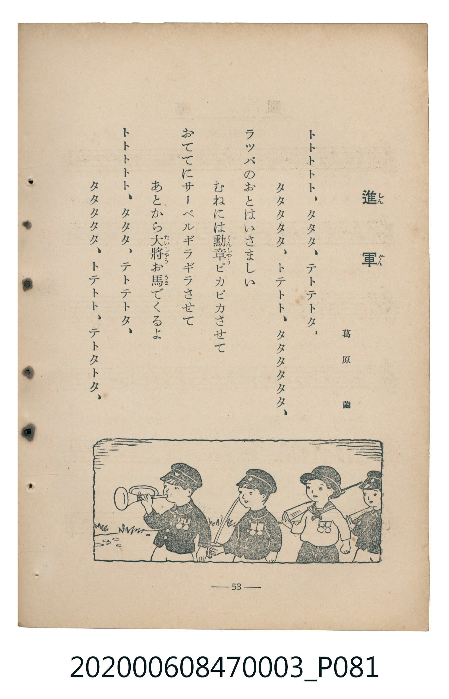

# 進軍

> Re:Shōka 使用 AI 協助辨識與重建樂譜，可能會有錯誤。歡迎回報。

- **鋼琴伴奏版**：<br><audio controls src="shingun.mp3"></audio>
- **NEUTRINO 歌聲合成版**：<br><audio controls src="shingun_neutrino.mp3"></audio>

- 葛原𦱳 作詞 / 梁田貞 作曲
- 臺灣教育會公認《新定兒童唱歌》尋常科第三學年用（2020.006.0847.0003）

## 說明

Reference Materials 17: 進軍 (Shingun / March)
Source: 臺灣教育會公認 新定兒童唱歌 尋常科第三學年用 (1934), pp. 57-58 (P080.jpg-P081.jpg)
Lyricist: 葛原𦱳 (Kuzuhara Shigeru) / Composer: 梁田貞 (Yanada Tadashi)
Key: F major (?= F), 2/4 (<2/4>), ゲンキニ Quarter = 116 (!= 116)


## 歌詞

```text
トトトトト、タタタ、テトテトタ、
タタタタタ、トテトト、タタタタタタ、
ラッパのおとはいさましい
むねには勳章ピカピカさせて
おててにサーベルギラギラさせて
あとから大將お馬でくるよ
トトトトト、タタタ、テトテトタ、
タタタタタ、トテトト、テトタトタ、
```

## ABC

<div class="abc-score" data-abc-src="shingun.abc" aria-label="五線譜載入中"></div>

[下載 ABC 原始檔](shingun.abc)

## TMD 檔案連結

- [主旋律 TMD 檔案](shingun.tmd) [[在 TMD Studio 編輯](https://tmdlang.github.io/Tmd-TS/#tmd=s7IKdvYPcrWy4qpTUCpJTLdSSM7PyUlNLsnMz7MqzsjMK0nNjM_KTMmPL87Iz05Ugisry88pzU21Si9KTEmNN443MjAyiDcwMIs3sDAxBzIMjBFKi_NLi5JTrYqTM_Lzc-JLUitKkvLzsxHyBUX5Zal5iXlANQVFIBtTwIoQClLLMlNSQdKpKZkl-UWZiTlI7kgtKga7FWxJfElRYl5xclFmAcgDCFUlGalAx-Zm5mSWJBZVIsSBhqVn5lmVJGYCvQfyYnlifG5iZl5OYl4KsqqSjHygTwsyKq0yMotBTkhOzInPTsxDChCoAwoS01OtAgwsDHSBhKESl5aWwsuGTS929ypoaXEp2ioYGppx2dsquHHZGOmb2IF0v5g4-2nf_A_LNm5WeLJ3zouV8xT0FZ4tanw-ZcOLTfNAQs9mbwJb86J91_PGxc-mznzRtOnZnOanrWterOp93ND1bNqGp-tmPW2d9Hz10qdTNj5b2_O4ofvphu6nO3Y8Xz7x-Zo1T3Z0Pl274-nOLc-nrHi_pwMUV3rAuNIDxRWQYWD8fk-nEheXvhaXgpZCUGpaahEotBV8E0tSQYFdrGBobgXzhUYwMFGkl-YBHembWJScoQnSEwyJYQWsLlTAdJ8CLtcpaBhaGpto6igUFOgpmJrrmlooaIACUy-rIB0coCAG2EqfSmAkAOMCaCki_DS8S6tKMxKLEhWArkxPLSrVBDrTOT-3IL84tcgKKVQ1IoFxl5KoEAIkgKkcbKJ3aqWVgptCbmJWfpGCBiiOgO4ARpKCBjiqgJzHTZseN29-3LT2cXO3QmBpYhEwfBTAUaqgAYlakEFw1xVbgZiPmztQUEPj46b9UARkN7eBxcEkWASsB64CoQ6mCM0IJDUQ21Y-bm5-3DzxceO6x41djxtXPG5c_7ix5XHj1MeN-x43TgeyITY0PG5c-7hxNVD6affm56sXPG6e8rhpNZQEqZ79uHEZWCnImGVgtPpx09bHzXseN8983AxkrwPZBiFRNTSB7e1-3NT5dMnypxvagUa8XLbmcePyx439j5uA4h20Cxm4BiRt-lxcYcByApgxMxPz8h1qDGqquRSAwMZCyw7M0NdSMNS1sEJ3EsI6oAyKc9AdAtEJdQaGK4HyQDeALKpRMI1X0ABi03hNVQ1dTRAXiGoUDMFQF8gyBtIgDFQK5OsqGCjUgLX61IAsUdAAW9DcoQnmgTBQHOIgMAYZAXQJVBZCQ1SADANaBXMH0BkKplBHAGGNgoYxjA-yHmQOphpMJwEN1oDaDXQS1BFAw6D2I5wJdhgO1ejOA8aHpa6hGShCsKRnYApDSdAoqRmcxCaDJJqaHzeC_I8lXaNEhy5SJOiCowEUCRCINRJATgKKAV0FdMk6kPMbu0D8xhVAvB7MB7qpcSoQ7wPi6VAR1PAHhixIABy68OA1BoqAMMgpxgpGkFQAdhzYnXA3AMOwAawd6G1gODauhlsM8jxYHOZ_SHqYAgwjoCIoDVIIct1sIF4GNxeUCcx1jUyAoY4jywM1Y8nzKBn-ceN8cOzAgx9kVBs4qhC5HxH8ZvEIBAl_iEeR_Q-GSJ4HhTbEWhAG-wbsRnCUgJ0JSWrrQFEFp7H7GRiUZuCANMOIB0gWwBpNIDFwFkXER2MTND5WgOKjG2htJ9hKUGhgxAdQOSjBgIRBGQScSpZDog8k2ATSDsy1sFgxMtU1NqJe4YRaQg7VkgnEgmdaSookmIsg4YTmolouLl07BXDloQBkKHMBAA)]
- [鋼琴伴奏 TMD 檔案](shingun_piano.tmd) [[在 TMD Studio 編輯](https://tmdlang.github.io/Tmd-TS/#tmd=s7IKdvYPcrWy4qpTUCpJTLdSyC8qychPL0osyKi0ysgsLskvykxOzInPTsxLVIIrKs4vLUpOjS9ITE-1CjCwMNAFEoZKXFpaCi8bNr3Y3ft-T8fL7j3PJ2x5smfL06X9zzs73u_pVNDS4lK0VTA0NOOyt1Vw47Ix0jexAxn5YuLsp33zPyzbuFnhyd45L1bOU9BXeLao8fmUDS82zQMJPZu9CWz3i_ZdzxsXP5s680XTpmdzmp-2rnmxqvdxQ9ezaRuerpv1tHXS89VLn07Z-Gxtz-OG7qcbup_u2PF8-cTna9Y82dH5dO2Opzu3PJ-yAug2IwMjAz0DAzM9AwsTcyDDwBjoPCUuLn0tLgUthaDUtNSi1LzkVAXfxJLUoszEnGIFQ3MrqNcUNIIzMvPSS_OAjvRNLErO0FTQVQjITMzLV3BMTs7PLUjMy8xNzSsBmRQMDiYrBazuVsB0tQIuNytoGFoam2jqKBQU6CmYmuuaWihogMJdL6sgHRz2IIYm0Ep9Lq6w1KJiYKyAXBTk4VBjUFPNpQAENhZadmBGjYJpvIIGEJvGa6pq6GqCuEBUo2AIhrpAljGQBmGgUiBfV8FAoQas1adG4XFzh4IGiABiTTAPhIHiTfvhGGTE4-Y2qCyEhqgAGQa0CuYOoDMUTKGOAMIaBQ1jGB9kPcgcTDWYTgIarAG1G-gkqCOAhkHtRzgT7DAcqrE4Lx7IRQSOLjh4QIEDgVgDZ-Xj5mag2OPmiQqPG9eBjG3sAvEbVwDxejC_BYinAvE-IJ4OFUG1GOhjkADY13BvGwNFQBjkFGMFI0jsgB0HdifcDUC_NYC1P25cC_Rf42q4xf2PmyaDxac_bmp-3NgGjacpQK8DFUFpkEKQ62YD8TK4uTUKZvEIBAkNiLXIrgFDJKeA_A4yBYLBZjdtfdy8BxxAMx83r4ZGyDpQwMFpXC7QMAN7ywwjVCAJBWuggcTACRkROo1N0NBZAQqdbqC1nWAr50PiATV0gMpB0QcSBiUjcJwthwQmSLAJpB2YtodkvgKx4EmbkgwFcxFIHYaLalEKJB9cBVK8QrRpfCyCAXQVkGUYC6LAqQzOA1FoOmBOx1SGagh-axCm4FeHbjKZDkLhGwEpo_hcDIMQqd8EKGoSC6NwGoQrAFFNIc4XeMwZNBEGTF66dgrgFKYAZChzAQA)]

## 分析

```text
================================================================================
📊 TMD Song Profile: [ 進軍 ]
================================================================================
⏱  Duration:       0:33 (33.1s), 32 measures total
🎼 Key & Tempo:    首調基準 F, != 116.0 BPM, <2/4>
   - 分析範圍：      由實際發聲的音符與和弦推測調性；播放脈絡另行呈現
🎤 人聲音域:    C4 (MIDI 60) – D5 (MIDI 74) [跨度: 14 個半音 / 1.2 個八度, 難度: moderate]
   - 最低音:  C4 in [Verse #1 @ m.1, 0:00]
   - 最高音: D5 in [Verse #1 @ m.21, 0:20]
   - 適合: soprano, mezzo-soprano, contralto, tenor, baritone, bass
🏛  結構:      Verse (33.1s)
⚡ 編曲密度:        Peak 1 軌道同時演奏
🗝  調性診斷：       F 大調（純淨自然大調，未偵測到可信轉調）
   - 風格氣質:    純淨自然大調（陽光明朗、易唱易記，無明顯調外色彩）
   - 轉調歷程:    全曲維持單一推測調性（未偵測到可信轉調）
   - 核心骨幹音:  C, F, A, D, G
   - 調性數值:    F 大調 [相關度: 0.79, 穩定度: Moderate, 自然音純度: 100.0%]
   - 候選調性 (K-S): F 大調 (0.79), C 大調 (0.73), A 小調 (0.65)
   - 五度圈歷程:   -1
   - 各段落調性細節:
     • [Verse #1]: F 大調 (r: 0.79, 自然音純度: 100.0%)

  [ 五度圈游移軌跡 ]
               C  
        [F ]*          G  
      Bb               D  
      Eb               A  
         Ab           E  
            Db       B  
               F# 
     (* = active key center)

  [ 十二半音累積音高分佈 ]
     C  : ████████████████████████  49.6%
     C# :                            0.0%
     D  : ██                         4.9%
     D# :                            0.0%
     E  :                            0.0%
     F  : █████████████             26.8%
     F# :                            0.0%
     G  : █                          1.6%
     G# :                            0.0%
     A  : ████████                  17.1%
     A# :                            0.0%
     B  :                            0.0%
--------------------------------------------------------------------------------
Assignment 軌道音域：
  - Piano         : C4 – D5 (14 個半音 / 1.2 個八度, 105 個音符)
================================================================================
```


## 原書掃描頁





