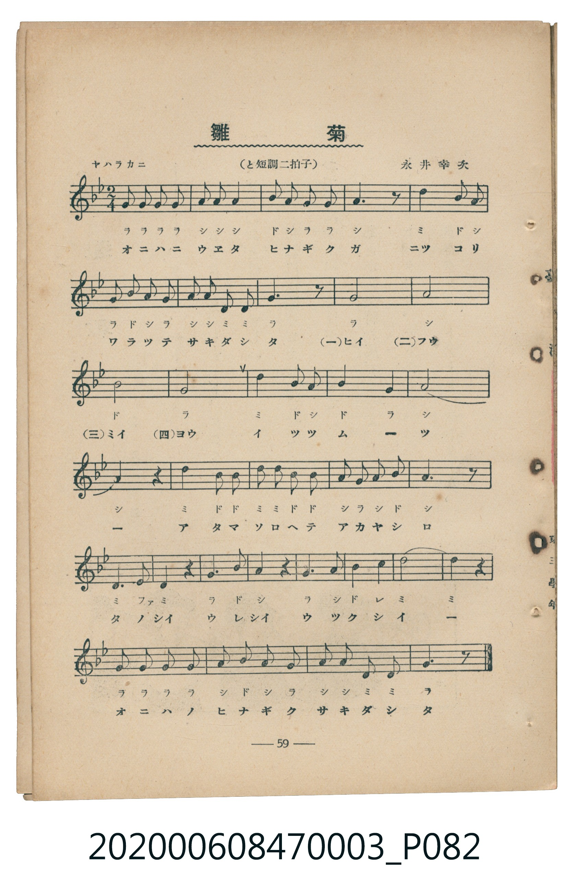
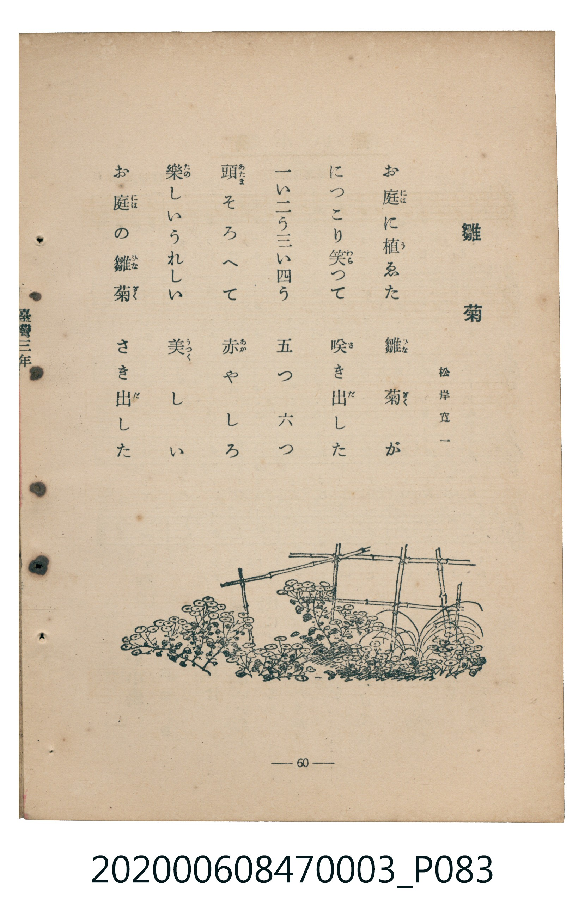

# 雛菊

> Re:Shōka 使用 AI 協助辨識與重建樂譜，可能會有錯誤。歡迎[回報](https://github.com/TMDLang/reshoka/issues)。

- **鋼琴伴奏版**：<br><audio controls src="hinagiku.mp3"></audio>
- **NEUTRINO 歌聲合成版**：<br><audio controls src="hinagiku_neutrino.mp3"></audio>

- 松岸寛一 作詞 / 永井幸次 作曲
- 臺灣教育會公認《新定兒童唱歌》尋常科第三學年用（2020.006.0847.0003）

## 說明

Reference Materials 18: 雛菊 (Hinagiku / Daisy)
Source: 臺灣教育會公認 新定兒童唱歌 尋常科第三學年用 (1934), pp. 59-60 (P082.jpg-P083.jpg)
Lyricist: 松岸寛一 (Matsugishi Kan'ichi) / Composer: 永井幸次 (Nagai Kōji)
Key: G minor (relative major ?= Bb), 2/4 (<2/4>), ヤハラカニ Quarter = 96 (!= 96)


## 歌詞

```text
お庭に植ゑた　雛菊が
につこり笑つて　咲き出した
一い二う三い四う　五つ　六つ
頭そろへて　赤やしろ
楽しいうれしい　美しい
お庭の雛菊　さき出した
```

## ABC

<div class="abc-score" data-abc-src="hinagiku.abc" aria-label="五線譜載入中"></div>

[下載 ABC 原始檔](hinagiku.abc)

## TMD 檔案連結

- [主旋律 TMD 檔案](hinagiku.tmd) [[在 TMD Studio 編輯](https://tmdlang.github.io/Tmd-TS/#tmd=s7IKdvYPcrWy4qpTUCpJTLdSSM7PyUlNLsnMz7MqzsjMK0nNjM_KTMmPL87Iz05Ugisry88pzU21Si9KTEmNN443MjAyiDcwMIs3sDAxBzIMjBFKi_NLi5JTrYqTM_Lzc-JLUitKkvLzsxHyBUX5Zal5iXlANQVFIBtTwIoQClLLMlNSQdKpKZkl-UWZiTlI7kgtKga7FWxJfElRYl5xclFmAcgDCFUlGalAxxbkJOYhGQs0KT0zz6okMRPoN5D_yhPjcxMz84CqUpBVlWTkA71ZkFFplZFZDLI_OTEnPjsxDyk0oLYXJKanWgUYWBjpAglgCGhpKbycPftFf5eClhaXoq2CpRmXva2CUxKXjZG-iR1I97O5-55u2vF0_ewnOxoUnuyd82LlPAV9hWcbdjzZNfXpzh3P1iwEiT6bvQls14v2Xc8bFz-bOvNF06Znc5qftq55sar3cUPXs2kbnq6b9bR10vPVS59O2fhsbc_jhu6nG7qf7tjxfPnE52vWPNnR-XTtjqc7tzyfsuL9ng5QbOkBY0sPFFtAhoHx-z2dSlxc-lpcCloKQalpqUWg8FbwTSxJBQV3sYKhhRXMKxoemXmJ6ZnZpUCHugDDrlITpCkYEskKWJ2ogOlABVzOU9AwtDQ20dRRKCjQUzC11DUzUNAABaleVkE6OFhBDLCVPpXAqADGiJUCSihqAF1dXJoOjNRMBe_EPPXM5IxMTaBbnfNzC_KLU4uAypGDV8MvMT0RqPJob1Ym2Fjv1EorBXeF3My8_CIFjaLUnMSSzLJUhdzELCAfHH1AxwHjT0EDHItAzuPmJY-b-x83r3zctPpxc7dCYGliETDgFEARrqABjneQyXA3F1uBmI8bu57uWvu4cfWzJb2PmyY-bpz_uKEBEsaPG3sgKlY_blzyuHHy46au52uAKoDsZUBFTydtetzY-7R91-PG6UBtIKVAjz9ubHmyq-dxYxswNIHsp7NnA9lA1U92TQHpBGprBdq2BKT65QIga-7jpt7HjTsgRr7YuuRxUwvIvKZekIpnS_eCDQcKtT1uApoKZjc0PN_XB2Ej-2Ad1NUNQDdMRXOZPhdXGDCLArNFZmJevkONQU01lwIQ2Fho2YEZ-loKhrrA1AU0DOzf9WASaCkoRICiQK-uetwItLUfGCqQIFkMCZLHTf2Pm4BeBXKXASVANj9uXACxGWQxyPQaBbN4BKpRMI-HIl0gxxDEQJLRBUIDhRqwRp8akItA9gHxejANEmlTADoMSM8HGwB0HRCvAuI-IO4Hi_SAjQGaCLXfGMgDWwR2CsxKmEuMwQgshWE7yKdAMaBngZZ2gQxv6gfiTqDIYiBeBrZuKhD3AvECIJ4OFgE5DeEAYPBa6hqagcIXGJItQGor2BeN-8G8pg4IDxjPwMS1BCgAjENggC5BCUCQgSD_QsMIEnYwFkIe4XSwVTAFUCsRXLDVcC7ECchGoAQayCKwFSjWg5kGqJaCzAT7AYhB5jYgWbkEzoYEDkwjKPWZ6xoZgMKnCZQFG_ch5wyIaDc8ayBCBeJCQzDLGMqCRC2QhHIwYrQJ7EJQqt4HdtVcoCtBkbcDHp1NQNwNFAVFFDg6gfJo0WlkqGsEzi9Ax66DZEZQwoTnUjAHFJvADAPmI9wMcZIJKFjBbHAAwiIQ7mi0YIWkJ6BdYAeCTYSGIDg_gCWbejAkkVMPPL_pKhiBWaDQg0QHiIVmIchMSIyBeP1g3nQoD5FuMOLRyFLX2AilHAGGDqL0IKGEICWTIhcRkBDCLBLw5dFaLi5dOwVwEakAZChzAQA)]
- [鋼琴伴奏 TMD 檔案](hinagiku_piano.tmd) [[在 TMD Studio 編輯](https://tmdlang.github.io/Tmd-TS/#tmd=s7IKdvYPcrWy4qpTUCpJTLdSyC8qychPL0osyKi0ysgsLskvykxOzInPTsxLVIIrKs4vLUpOjS9ITE-1CjCwMNIFEsZKXFpaCi9nz37R3_V-T8fL7j3PJ2x5smfL06X9zzs73u_pVNDS4lK0VbA047K3VXBK4rIx0jexAxn5bO6-p5t2PF0_-8mOBoUne-e8WDlPQV_h2YYdT3ZNfbpzx7M1C0Giz2ZvAjvgRfuu542Ln02d-aJp07M5zU9b17xY1fu4oevZtA1P18162jrp-eqlT6dsfLa253FD99MN3U937Hi-fOLzNWue7Oh8unbH051bnk9ZAXSgkYGRgZ6BgZmegYWJOZBhYAx0oxIXl74Wl4KWQlBqWmpRal5yqoJvYklqUWZiTrGCoYUV1H8KGh6ZeYnpmdmlQIe6JGYWV2oq6CoEZCbm5Ss4Jifn5xYk5mXmpuaVgIwKBgeWlQJWhytgOlsBl6MVNAwtjU00dRQKCvQUTC11zQwUNEChr5dVkA6OARBDE2ilPhdXWGpRMTBuQC4K8nCoMaip5lIAAhsLLTswo0bBLB6BahTM46FIF8gxBDGQZHSB0EChBqzRp0bhcWMXEK8G4vVgGiTSpvC4aSKQng824HHjJiBeBcR9QNwPFukBGwM0EWq_MZAHtgjsFJiVMJcYgxFYCsP21Y8bFwPFHjdOBlraBTK8qR-IO4Eii4F4Gdi6qUDcC8QLgHg6WATkNGQHQI0GuRfqR4jfYSyEPMLqTY8bW-AKHjduBXkcwd2PItvUgSSL6WmQRWArUKwHMw1QLQWZ-bhxCRiDzG1AsnIJnA3xHLpVhmCWMZQFCWMgCeVgBG0T2Kr5QLwPbPxcoHWgUNwBD9cmIO4GirbAwhUojxaxEHNNQJ4Es8HegQUn3GY0T0Ji53HjOrAt0yG-hgQPLBgfN_VgSCLHJTz16ioYgVmgIIAEDoiFZiHITEj4gXj9YN50KA8Ri-ihipFrSEm4yNkG4k_MbIIv3dai5GsfXPk6XiHaLD43FokFiggg2zg-FsyARAdBZTC341KMYBsBGUZYTAAz0LUTMpawCZgOQBIl0smEbIQzEcmGTEOJCF_CDiBkCXZXYg1BApFFgscJexFnAgAmZV07BXBqVgAylLkA)]

## 分析

```text
================================================================================
📊 TMD Song Profile: [ 雛菊 ]
================================================================================
⏱  Duration:       0:40 (40.0s), 32 measures total
🎼 Key & Tempo:    首調基準 B,, != 96.0 BPM, <2/4>
   - 分析範圍：      由實際發聲的音符與和弦推測調性；播放脈絡另行呈現
🎤 人聲音域:    D4 (MIDI 62) – D5 (MIDI 74) [跨度: 12 個半音 / 1.0 個八度, 難度: easy]
   - 最低音:  D4 in [Verse #1 @ m.7, 0:08]
   - 最高音: D5 in [Verse #1 @ m.5, 0:05]
   - 適合: soprano, mezzo-soprano, contralto, tenor, baritone, bass
🏛  結構:      Verse (40.0s)
⚡ 編曲密度:        Peak 1 軌道同時演奏
🗝  調性診斷：       G 小調（純淨自然小調，未偵測到可信轉調）
   - 風格氣質:    純淨自然小調（陰鬱抒情、旋律集中，無明顯調外色彩）
   - 轉調歷程:    全曲維持單一推測調性（未偵測到可信轉調）
   - 核心骨幹音:  A, G, D, A#, C
   - 調性數值:    G 小調 [相關度: 0.73, 穩定度: Moderate, 自然音純度: 100.0%]
   - 候選調性 (K-S): G 小調 (0.73), D 大調 (0.59), G 大調 (0.56)
   - 五度圈歷程:   +1
   - 各段落調性細節:
     • [Verse #1]: G 小調 (r: 0.73, 自然音純度: 100.0%)

  [ 五度圈游移軌跡 ]
               C  
         F           [G ]*
      Bb               D  
      Eb               A  
         Ab           E  
            Db       B  
               F# 
     (* = active key center)

  [ 十二半音累積音高分佈 ]
     C  : █                          1.7%
     C# :                            0.0%
     D  : ███████████████           19.8%
     D# : █                          0.9%
     E  :                            0.0%
     F  :                            0.0%
     F# :                            0.0%
     G  : ███████████████████████   30.2%
     G# :                            0.0%
     A  : ████████████████████████  31.0%
     A# : █████████████             16.4%
     B  :                            0.0%
--------------------------------------------------------------------------------
Assignment 軌道音域：
  - Piano         : D4 – D5 (12 個半音 / 1.0 個八度, 72 個音符)
================================================================================
```


## 原書掃描頁






