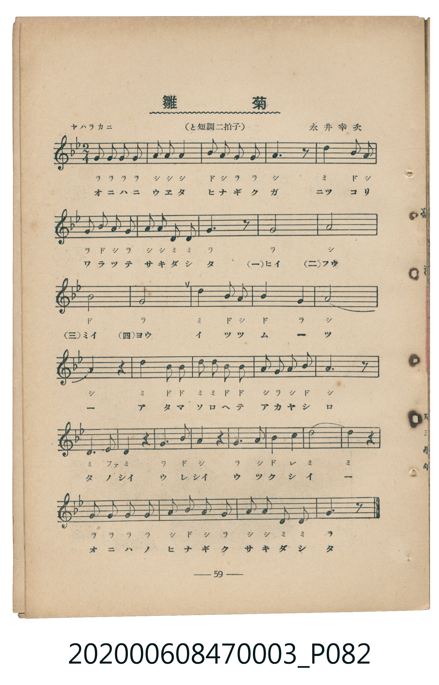
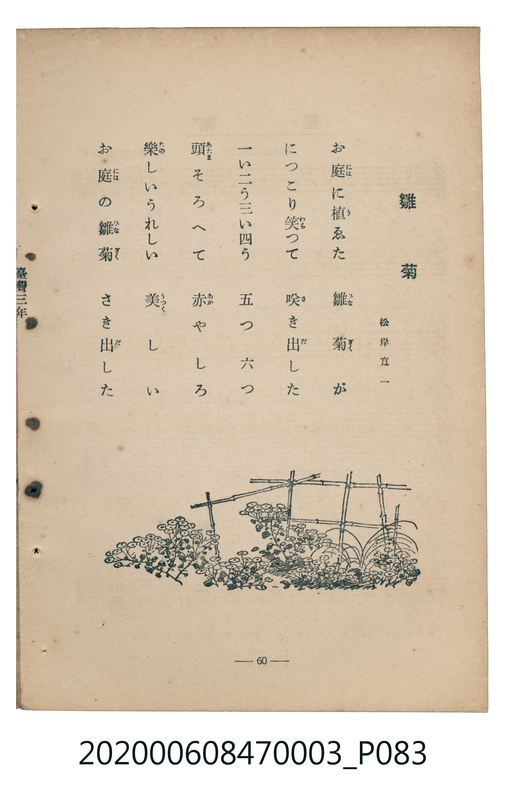

# 雛菊

> Re:Shōka 使用 AI 協助辨識與重建樂譜，可能會有錯誤。歡迎回報。

- **NEUTRINO 歌聲合成版**：<br><audio controls src="hinagiku_neutrino.mp3"></audio>
- **鋼琴伴奏版**：<br><audio controls src="hinagiku.mp3"></audio>


- 松岸寛一 作詞 / 永井幸次 作曲
- 臺灣教育會公認《新定兒童唱歌》尋常科第三學年用（2020.006.0847.0003）

## 說明

Reference Materials 18: 雛菊 (Hinagiku / Daisy)
Source: 臺灣教育會公認 新定兒童唱歌 尋常科第三學年用 (1934), pp. 59-60 (P082.jpg-P083.jpg)
Lyricist: 松岸寛一 (Matsugishi Kan'ichi) / Composer: 永井幸次 (Nagai Kōji)
Key: G minor (relative major ?= Bb), 2/4 (<2/4>), ヤハラカニ Quarter = 96 (!= 96)


## 歌詞

```text
お庭に植ゑた　雛菊が
につこり笑つて　咲き出した
一い二う三い四う　五つ　六つ
頭そろへて　赤やしろ
楽しいうれしい　美しい
お庭の雛菊　さき出した
```

## ABC

```abc
X:1
T:雛菊
M:2/4
L:1/16
Q:1/4=96
K:Bb
V:V1 name="Piano" snm="Pia"
[V:V1]
G2 G2 G2 G2 | A2 A2 A4 | B2 A2 G2 G2 | A6 z2 |
w: お に は に | う ゑ た | ひ な ぎ く | が
d4 B2 A2 | G2 B2 A2 G2 | A2 A2 D2 D2 | G6 z2 |
w: にっ こ り | わ ら っ て | さ き だ し | た
G8 | A8 | B8 | G8 |
w: ひい | ふう | みい | よう
d4 B2 A2 | B4 G4 | A8 | A4 z4 |
w: い つ つ | む _ | つ | _
d4 B2 B2 | d2 d2 B2 B2 | A2 G2 A2 B2 | A6 z2 |
w: あ た ま | そ ろ へ て | あ か や し | ろ
D6 E2 | D4 z4 | G6 B2 | A4 z4 |
w: た の | しい | う れ | しい
G4 A4 | B4 c4 | d8 | d4 z4 |
w: う つ | く し | い | _
G2 G2 G2 G2 | A2 B2 A2 G2 | A2 A2 D2 D2 | G6 z2 |
w: お に は の | ひ な ぎ く | さ き だ し | た
```

## TMD 檔案連結

- [主旋律 TMD 檔案](hinagiku.tmd) [[在 TMD Studio 編輯](https://tmdlang.github.io/Tmd-TS/#tmd=s7IKdvYPcrWy4qpTUCpJTLdSSM7PyUlNLsnMz7MqzsjMK0nNjM_KTMmPL87Iz05Ugisry88pzU21Si9KTEmNN443MjAyiDcwMIs3sDAxBzIMjBFKi_NLi5JTrYqTM_Lzc-JLUitKkvLzsxHyBUX5Zal5iXlANQVFIBtTwIoQClLLMlNSQdKpKZkl-UWZiTlI7kgtKga7FWxJfElRYl5xclFmAcgDCFUlGalAxxbkJOYhGQs0KT0zz6okMRPoN5D_yhPjcxMz84CqUpS4tLQUXs6e_aK_S0FLi0vRVsHSjMveVsEpicvGSN_EDmTIs7n7nm7a8XT97Cc7GhSe7J3zYuU8BX2FZxt2PNk19enOHc_WLASJPpu9CWzli_ZdzxsXP5s680XTpmdzmp-2rnmxqvdxQ9ezaRuerpv1tHXS89VLn07Z-Gxtz-OG7qcbup_u2PF8-cTna9Y82dH5dO2Opzu3PJ-y4v2eDlBI6wFDWg8U0kCGgfH7PZ1KXFz6WlwKWgpBqWmpRaCwUvBNLEkFBVWxgqGFFcwrGh6ZeYnpmdmlQIe6AP1dqQnSFAyJIAWsTlTAdKACLucpaBhaGpto6igUFOgpmFrqmhkoaAQYWBjpZRWk6wIZxiAG2EqfyqLM5MziEisFlFDUALq6uDQdGCGZCt6JeeqZyRmZmkC3OufnFuQXpxYBlSMHr4ZfYnoiUOXR3qxMsLHeqZVWCu4KuZl5-UUKGkWpOYklmWWpCrmJWUA-OPqAjgPGn4IGOBaBnMfNSx439z9uXvm4afXj5m6FwNLEImDAKYAiXEEDHO8gk-FuLrYCMR83dj3dtfZx4-pnS3ofN0183Dj_cUMDJIwfN_ZAVKx-3LjkcePkx01dz9cAVQDZy4CKnk7a9Lix92n7rseN04HaQEqBHn_c2PJkV8_jxjZgaALZT2fPBrKBqp_smgLSCdTWCrRtCUj1ywVA1tzHTb2PG3dAjHyxdcnjphaQeU29IBXPlu4FGw4UanvcBDQVzG5oeL6vD8JG9sE6qKsbgG6YiuYyfS6uMGD2SrUKyEzMy3eoMaip5lIAAhsLLTswQ19LwVAXmLqAhoH9ux5MAi0FhQhQFOjVVY8bgbb2A0MFEiSLIUHyuKn_cRPQq0DuMqAEyObHjQsgNoMsBpleo2AWj0A1CubxUKQL5BiCGEgyukBooFAD1uhTA3IRyD4gXg-mQSJtCkCHAen5YAOArgPiVUDcB8T9YJEesDFAE6H2GwN5YIvAToFZCXOJMRiBpTBsB_kUKAb0LNDSLpDhTf1A3AkUWQzEy8DWTQXiXiBeAMTTwSIgpyEcAAxeS11DM1D4AkOyBUhtBfuicT-Y19QB4QHjGZi4lgAFgHEIDNAlKAEIMhDkX2gYQcIOxkLII5wOtgqmAGolggu2Gs6FOAHZCJRAA1kEtgLFejDTANVSkJlgPwAxyNwGJCuXwNmQwIFpBKU-c10jA1D4NIGyYOM-5JwBEe2GZw1EqEBcaAhmGUNZkKgFklAORow2gV0IStX7wK6aC3QlKPJ2wKOzCYi7gaKgiAJHJ1AeLTqNDHWNwPkF6Nh1kMwISpjwXArmgGITmGHAfISbIU4yAQUrmA0OQFgEwh2NFqyQ9AS0C-xAsInQEATnB7BkUw-GJHLqgec3XQUjMAsUepDoALHQLASZCYkxEK8fzJsO5SHSDUY8GlnqGhuhlCPA0EGUHiSUEKRkUuQiAhJCmEUCvjxay8Wla6cALiIVgAxlLgA)]
- [鋼琴伴奏 TMD 檔案](hinagiku_piano.tmd) [[在 TMD Studio 編輯](https://tmdlang.github.io/Tmd-TS/#tmd=s7IKdvYPcrWy4tLSUng5e_aL_q73ezpedu95PmHLkz1bni7tf97Z8X5Pp4KWFpeirYKlGZe9rYJTEpeNkb6JHVedgtKzufuebtrxdP3sJzsaFJ7snfNi5TwFfYVnG3Y82TX16c4dz9YsBIk-m71JCaT6Rfuu542Ln02d-aJp07M5zU9b17xY1fu4oevZtA1P18162jrp-eqlT6dsfLa253FD99MN3U937Hi-fOLzNWue7Oh8unbH051bnk9ZAXSgkYGRgZ6BgZmegYWJOZBhYAx0oxIXl74Wl4KWQlBqWmpRal5yqoJvYklqUWZiTrGCoYUV1H8KGh6ZeYnpmdmlQIe6JGYWV2oq6CoEZCbm5Ss4Jifn5xYk5mXmpuaVgIwKzi8tSk61UsDqcAVMZyvgcrSChqGlsYmmjkJBgZ6CqaWumYGCRoCBhZFeVkG6LpBhDGJoAq3U5-IKSy0qTrUCuyjIw6HGoKaaSwEIbCy07MCMGgWzeASqUTCPhyJdIMcQxECS0QVCA4UasEafGoXHjV1AvBqI14NpkEibwuOmiUB6PtiAx42bgHgVEPcBcT9YpAdsDNBEqP3GQB7YIrBTYFbCXGIMRmApDNtXP25cDBR73DgZaGkXyPCmfiDuBIosBuJlYOumAnEvEC8A4ulgEZDTkB0ANRrkXqgfIX6HsRDyCKs3PW5sgSt43LgV5HEEdz-KbFMHkiymp0EWga1AsR7MNEC1FGTm48YlYAwytwHJyiVwNsRz6FYZglnGUBYkjIEklIMRtE1gq-YD8T6w8XOB1oFCcQc8XJuAuBso2gILV6A8WsRCzDUBeRLMBnsHFpxwm9E8CYmdx43rwLZMh_gaEjywYHzc1IMhiRyX8NSrq2AEZoGCABI4IBaahSAzIeEH4vWDedOhPEQsoocqRq4hJeEiZxuIPzGzCb50W4uSr31w5et4hWiz-NxYJBYoIoBs4_hYMAMSHQSVwdyOSzGCbQRkGGExAcxA107IWMImYDoASZRIJxOyEc5EJBsyDSUifAk7gJAl2F2JNQQJRBYJHifsRZwJAJiUde0UwKlZAchQ5gIA)]

## 分析

```text
================================================================================
📊 TMD Song Profile: [ 雛菊 ]
================================================================================
⏱  Duration:       0:40 (40.0s), 32 measures total
🎼 Key & Tempo:    首調基準 B,, != 96.0 BPM, <2/4>
   - 分析範圍：      由實際發聲的音符與和弦推測調性；播放脈絡另行呈現
🎤 人聲音域:    D4 (MIDI 62) – D5 (MIDI 74) [跨度: 12 個半音 / 1.0 個八度, 難度: easy]
   - 最低音:  D4 in [Verse #1 @ m.7, 0:08]
   - 最高音: D5 in [Verse #1 @ m.5, 0:05]
   - 適合: soprano, mezzo-soprano, contralto, tenor, baritone, bass
🏛  結構:      Verse (40.0s)
⚡ 編曲密度:        Peak 1 軌道同時演奏
🗝  調性診斷：       G 小調（純淨自然小調，未偵測到可信轉調）
   - 風格氣質:    純淨自然小調（陰鬱抒情、旋律集中，無明顯調外色彩）
   - 轉調歷程:    全曲維持單一推測調性（未偵測到可信轉調）
   - 核心骨幹音:  A, G, D, A#, C
   - 調性數值:    G 小調 [相關度: 0.73, 穩定度: Moderate, 自然音純度: 100.0%]
   - 候選調性 (K-S): G 小調 (0.73), D 大調 (0.59), G 大調 (0.56)
   - 五度圈歷程:   +1
   - 各段落調性細節:
     • [Verse #1]: G 小調 (r: 0.73, 自然音純度: 100.0%)

  [ 五度圈游移軌跡 ]
               C  
         F           [G ]*
      Bb               D  
      Eb               A  
         Ab           E  
            Db       B  
               F# 
     (* = active key center)

  [ 十二半音累積音高分佈 ]
     C  : █                          1.7%
     C# :                            0.0%
     D  : ███████████████           19.8%
     D# : █                          0.9%
     E  :                            0.0%
     F  :                            0.0%
     F# :                            0.0%
     G  : ███████████████████████   30.2%
     G# :                            0.0%
     A  : ████████████████████████  31.0%
     A# : █████████████             16.4%
     B  :                            0.0%
--------------------------------------------------------------------------------
Assignment 軌道音域：
  - Piano         : D4 – D5 (12 個半音 / 1.0 個八度, 72 個音符)
================================================================================
```


## 原書掃描頁






