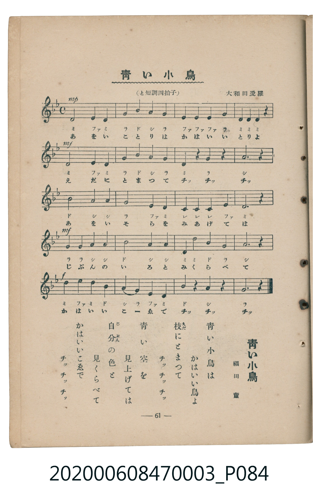

# 青い小鳥

> Re:Shōka 使用 AI 協助辨識與重建樂譜，可能會有錯誤。歡迎回報。

- **NEUTRINO 歌聲合成版**：<br><audio controls src="aoi_kotori_neutrino.mp3"></audio>
- **鋼琴伴奏版**：<br><audio controls src="aoi_kotori.mp3"></audio>


- 福田董 作詞 / 大和田愛羅 作曲
- 臺灣教育會公認《新定兒童唱歌》尋常科第三學年用（2020.006.0847.0003）

## 說明

Reference Materials 19: 青い小鳥 (Aoi Kotori / Blue Little Bird)
Source: 臺灣教育會公認 新定兒童唱歌 尋常科第三學年用 (1934), p. 61 (P084.jpg)
Lyricist: 福田董 (Fukuda Tadasu) / Composer: 大和田愛羅 (Ōwada Aira)
Key: G minor (relative major ?= Bb), 4/4 (<4/4>), Quarter = 96 (!= 96)


## 歌詞

```text
青い小鳥は　かはいい鳥よ
枝にとまつて　チッ　チッ　チッ
青い空を　見上げては
自分の色と　見くらべて
かはいいこゑで　チッ　チッ　チッ
```

## ABC

```abc
X:1
T:青い小鳥
M:4/4
L:1/16
Q:1/4=96
K:Bb
V:V1 name="Piano" snm="Pia"
[V:V1]
!mp! D8 E4 D4 | G4 B4 A4 G4 | E4 E4 E4 G4 | D4 D4 D4 z4 |
w: あ を い | こ と り は | か は い い | と り よ
!mf! D8 E4 D4 | G4 B4 A4 G4 | D4 z4 G4 z4 | A12 z4 |
w: え だ に | と ま っ て | チッ チッ | チッ
B8 A4 A4 | G8 E4 D4 | C4 C4 C4 E4 | D12 z4 |
w: あ を い | そ ら を | み あ げ て | は
!mf! G4 G4 A4 A4 | B8 A4 A4 | D4 d4 B4 G4 | A12 z4 |
w: じ ぶ ん の | い ろ と | み く ら べ | て
!f! d4 e4 d4 B4 | A4 G4 E4 D4 | B4 z4 A4 z4 | G12 z4 |
w: か は い い | こ _ ゑ で | チッ チッ | チッ
```

## TMD 檔案連結

- [主旋律 TMD 檔案](aoi_kotori.tmd) [[在 TMD Studio 編輯](https://tmdlang.github.io/Tmd-TS/#tmd=s7IKdvYPcrWy4qpTUCpJTLdSSM7PyUlNLsnMz7MqzsjMK0nNjM_KTMmPL87Iz05Ugisry88pzU21Si9KTEmNN443MjAyiDcwMIs3sDAxBzIMjBFKi_NLi5JTrYqTM_Lzc-JLUitKkvLzsxHyBUX5Zal5iXlANQVFIBtTwIoQClLLMlNSQdKpKZkl-UWZiTlI7kgtKga7FWxJfElRYl5xclFmAcgDCFUlGalAxybmZeYi6wUalZ6ZZ5WbmpmVieQuLS2Fl3MnPW5sebqh_-XmpQpaWlyKtgqWZlz2tgpOSVw2JvomdiAzni_rfz5lw4uJixWe7J3zYuU8BX2Fp0uWP53UAxR91jL7-b5WkMSz2ZvANr5o3_W8cfGzqTNfNG16Nqf5aeuaF6t6Hzd0PZu24em6WU9bJz1fvfTplI3P1vY8buh-uqH76Y4dz5dPfL5mzZMdnU_X7ni6c8vzKSve7-kAhbQeMKT1QCENZBgYv9_TqcTFpa_FpaClEJSalloECisF38SSVFBQFSsYWlqhekjDMT9TwTsfFJRANzvllKYq-GSWlOSkKjhlFqVogswJhsSZAlZXK2C6WQGXixU0DC2NTTR1FAr0FMwMFTQCgM7WyypIB9viU1mUmZxZXGKlgAhLDbfS7NKURIWQxJTE4lJNoAOd83ML8otTi6wwglfjaE85UJmCY2ZRIthA79RKKwV3hdzMvPwiBY2i1JzEksyyVIXcxCwgHxx9QJcA409BAxyLQE5gaWIRMKAUQBGsoAGOZ5BJcNcVW4GYyMH3uHH944aGx43dIEZjCxCBBJs6QOqezZv7uHH148YVjxv3PW5c8rhxGUhpc-Pj5mZMBsLg5yt3PW6aBJR4saz7yY6ux41AwWVA40EqXrSvetrR9rhx3YvOTSCDwYoeN_Y_bup83LgTqA6kCNk1jxsnP26a-LhxOX6r9bm4woB5J9UqIDMxL9-hxqCmmksBCGwstOzADH0tBUNdEyug2U0gx0EMBjqgCei-9Wg2gkWbOkCmgrTWKFTnFtQqGMcr6IKhCYgB5tUomIEoQyA2BzHAvBqIAgQBFQXrQBAGIEGw-T41IFdBDQc6DkQ2toD1AB0J5q0Ay3SB2euhMt1wHkQ1Qg-SaqAvdBXA9sNCwVTXAhQKHY8bFyBF7mJg0CtAQhONQgqENFICAe5JMB_sW4g8DKIFAMih4ABoXAAmVyN7pnEfmFwMJpdBZCDOg_gOhYMkB4MoIWCpa2iEkhDmglIfMNwfN-4HicLSK8LrIL-BINj9YALqafSQMAJRCAIsBQ0KHN7GFe9z4eKdcFmQ-H6wKpAuoDuRgwOcErD619BY19AM5OEZjxu3PW4CJvt1IG839YICF-xnRPZDi26wJ8EEstexBQckYQMxSBKaBPBF9wyw27eB_QZJ4-ug_gCFAMTnvWBxUAJA-LwfESaNO6EyoBDA7nNzXSMDkM-xlCeEUjsosQPNMkHyFtRHYN8hxzpIDuQ9sCwkpcNTBxav4864oICAeH0iWHw5RJz0lF7LxaVrpwAuERWADGUuAA)]
- [鋼琴伴奏 TMD 檔案](aoi_kotori_piano.tmd) [[在 TMD Studio 編輯](https://tmdlang.github.io/Tmd-TS/#tmd=s7IKdvYPcrWy4tLSUng5d9LjxpanG_pfbl76fk_Hy-49zydsebJny9Ol_c87O97v6VTQ0uJStFWwNOOyt1VwSuKyMdE3seOqU1B6vqz_-ZQNLyYuVniyd86LlfMU9BWeLln-dFIPUPRZy-zn-1pBEs9mb1ICqX7Rvut54-JnU2e-aNr0bE7z09Y1L1b1Pm7oejZtw9N1s562Tnq-eunTKRufre153ND9dEP30x07ni-f-HzNmic7Op-u3fF055bnU1YAHWhkYGSgZ2BgpmdgYWIOZBgYA92oxMWlr8WloKUQlJqWWpSal5yq4JtYklqUmZhTrGBoaYXiSwUNx_xMBe_8kvyiTKCbnXJKUxV8MktKclIVnDKLUjQVdBUCMhPz8hUck5PzcwsS8zJzU_NKQKYH55cWJadaKWD1iwKmTxRw-UNBw9DS2ERTR6FAT8HMUEEjAOgZvayCdE2gLfpcXGGpRcWpVmBHBHk41BjUVHMpAIGNhZYdmKGvpWCoa2Kl8Lix6XETyGOPGyc_blzxuKnrceN6oGg3kAKLAhFYtKkDZC5Ia41CdW5BrYJxPNCXIGgCYoB5NQpmIMoQiM1BDDCvBqIAQUBFwToQhAFIEGy-Tw3IVVDDgY4DkY0tYD1AR4J5K8AyXWD2eqhMN5wHUY3Qg6Qa6AtdBbD9sFAw1bUAhULH48YFjxtXgzzbuO9x4-LHjcsUHjc3Pm5uRqOQAiGNlECAexLMB_sWIg-DaAEAcig4ABoXgMnVyJ5p3AcmF4PJZRAZiPMgvkPhIMnBIEoIWOoaGqEkhLmPmzpB4f64cT9ItBEougwUsnCvg_wGgmD3gwmop9FDwghEIQiwFDQocHgbV7zPhYt3wmVB4vvBqkC6gO5EDg5wSsDqX0NjXUMzkIdnPG7c9rgJmOzXgbzd1AsKXLCf-0EB0LgTZBZqdIM9CSaQvY4tOCAJG4hBktAkgC-6Z4Ddvg3sN0gaXwf1BygEID7vBYuDEgDC5_2IMGncCZUBhQB2n5vrGhmAfI6cuyc_bpr4uHE5odQOSuxAs0yQvAX1Edh3yLEOkgN5DywLSenw1IHF67gzLiggIF6fCBZfDhEnPaXXohSIPtgKRFCUgRRHG8fHgr2CxAG5H8w1i88F8VF5oGQO5htB-Kg8rOYiQoASaxFmQWQgQU3AOlRD8NqH7hGKvEmCvWQEAiFroa7EoRnVv6j2ggxDMhYqipqUgclL104BnMIUgAxlLgA)]

## 分析

```text
================================================================================
📊 TMD Song Profile: [ 青い小鳥 ]
================================================================================
⏱  Duration:       0:50 (50.0s), 20 measures total
🎼 Key & Tempo:    首調基準 B,, != 96.0 BPM, <4/4>
   - 分析範圍：      由實際發聲的音符與和弦推測調性；播放脈絡另行呈現
🎤 人聲音域:    C4 (MIDI 60) – D#5 (MIDI 75) [跨度: 15 個半音 / 1.2 個八度, 難度: moderate]
   - 最低音:  C4 in [Verse #1 @ m.11, 0:25]
   - 最高音: D#5 in [Verse #1 @ m.17, 0:40]
   - 適合: soprano, mezzo-soprano, contralto, tenor, baritone, bass
🏛  結構:      Verse (50.0s)
⚡ 編曲密度:        Peak 1 軌道同時演奏
🗝  調性診斷：       G 小調（純淨自然小調，未偵測到可信轉調）
   - 風格氣質:    純淨自然小調（陰鬱抒情、旋律集中，無明顯調外色彩）
   - 轉調歷程:    全曲維持單一推測調性（未偵測到可信轉調）
   - 核心骨幹音:  D, A, G, D#, A#
   - 調性數值:    G 小調 [相關度: 0.75, 穩定度: Moderate, 自然音純度: 100.0%]
   - 候選調性 (K-S): G 小調 (0.75), D 大調 (0.62), D 小調 (0.57)
   - 五度圈歷程:   +1
   - 各段落調性細節:
     • [Verse #1]: G 小調 (r: 0.75, 自然音純度: 100.0%)

  [ 五度圈游移軌跡 ]
               C  
         F           [G ]*
      Bb               D  
      Eb               A  
         Ab           E  
            Db       B  
               F# 
     (* = active key center)

  [ 十二半音累積音高分佈 ]
     C  : ████                       4.2%
     C# :                            0.0%
     D  : ████████████████████████  26.8%
     D# : ███████████               12.7%
     E  :                            0.0%
     F  :                            0.0%
     F# :                            0.0%
     G  : ███████████████████       21.1%
     G# :                            0.0%
     A  : ████████████████████      22.5%
     A# : ███████████               12.7%
     B  :                            0.0%
--------------------------------------------------------------------------------
Assignment 軌道音域：
  - Piano         : C4 – D#5 (15 個半音 / 1.2 個八度, 58 個音符)
================================================================================
```


## 原書掃描頁




