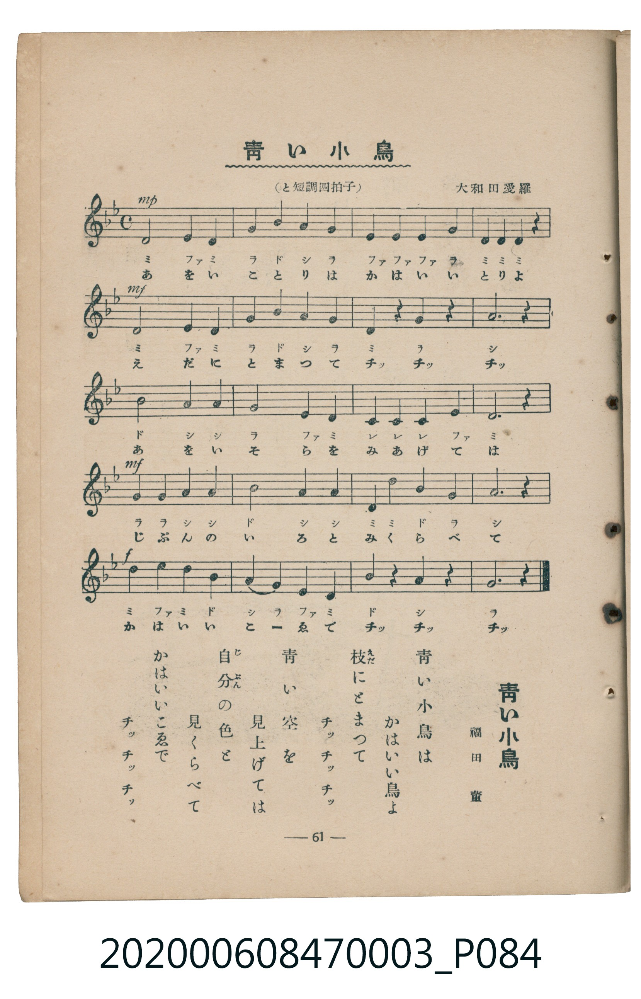

# 青い小鳥

> Re:Shōka 使用 AI 協助辨識與重建樂譜，可能會有錯誤。歡迎[回報](https://github.com/TMDLang/reshoka/issues)。

- **鋼琴伴奏版**：<br><audio controls src="aoi_kotori.mp3"></audio>
- **NEUTRINO 歌聲合成版**：<br><audio controls src="aoi_kotori_neutrino.mp3"></audio>

- 福田董 作詞 / 大和田愛羅 作曲
- 臺灣教育會公認《新定兒童唱歌》尋常科第三學年用（2020.006.0847.0003）

## 說明

Reference Materials 19: 青い小鳥 (Aoi Kotori / Blue Little Bird)
Source: 臺灣教育會公認 新定兒童唱歌 尋常科第三學年用 (1934), p. 61 (P084.jpg)
Lyricist: 福田董 (Fukuda Tadasu) / Composer: 大和田愛羅 (Ōwada Aira)
Key: G minor (relative major ?= Bb), 4/4 (<4/4>), Quarter = 96 (!= 96)


## 歌詞

```text
青い小鳥は　かはいい鳥よ
枝にとまつて　チッ　チッ　チッ
青い空を　見上げては
自分の色と　見くらべて
かはいいこゑで　チッ　チッ　チッ
```

## ABC

<div class="abc-score" data-abc-src="aoi_kotori.abc" aria-label="五線譜載入中"></div>

[下載 ABC 原始檔](aoi_kotori.abc)

## TMD 檔案連結

- [主旋律 TMD 檔案](aoi_kotori.tmd) [[在 TMD Studio 編輯](https://tmdlang.github.io/Tmd-TS/#tmd=s7IKdvYPcrWy4qpTUCpJTLdSSM7PyUlNLsnMz7MqzsjMK0nNjM_KTMmPL87Iz05Ugisry88pzU21Si9KTEmNN443MjAyiDcwMIs3sDAxBzIMjBFKi_NLi5JTrYqTM_Lzc-JLUitKkvLzsxHyBUX5Zal5iXlANQVFIBtTwIoQClLLMlNSQdKpKZkl-UWZiTlI7kgtKga7FWxJfElRYl5xclFmAcgDCFUlGalAxybmZeYi6wUalZ6ZZ5WbmpmVicVd-UUlGflADxZkVFplZBaDbE5OzInPTsxDCgeovQWJ6alWAUDPK3FpaSm8nDvpcWPL0w39LzcvVdDS4lK0VbA047K3VXBK4rIx0TexA2l_vqz_-ZQNLyYuVniyd86LlfMU9BWeLln-dFIPUPRZy-zn-1pBEs9mbwJb9qJ91_PGxc-mznzRtOnZnOanrWterOp93ND1bNqGp-tmPW2d9Hz10qdTNj5b2_O4ofvphu6nO3Y8Xz7x-Zo1T3Z0Pl274-nOLc-nrHi_pwMUUXrAiNIDRRSQYWD8fk-nEheXvhaXgpZCUGpaahEoqBV8E0tSQSFdrGBoaYXqIQ3H_EwF73xQeADd7JRTmqrgk1lSkpOq4JRZlKIJMicYEuUKWF2tgOlmBVwuVtAwtDQ20dRRKNBTMDNU0AAFsV5WQTrYFp9KYIwAI8ZKARGWGm6l2aUpiQohiSmJxaWaQAc65-cW5BenFllhBK_G0Z5yoDIFx8yiRLCB3qmVVgruCrmZeflFChpFqTmJJZllqQq5iVlAPjj6gC4Bxp-CBjgWgZzA0sQiYEApgCJYQQMczyCT4K4rtgIxkYPvceP6xw0Njxu7QYzGFiACCTZ1gNQ9mzf3cePqx40rHjfue9y45HHjMpDS5sbHzc2YDITBz1fuetw0CSjxYln3kx1djxuBgsuAxoNUvGhf9bSj7XHjuhedm0AGgxU9bux_3NT5uHEnUB1IEbJrHjdOftw08XHjcvxW63NxhQGzHjDRZybm5TvUGNRUcykAgY2Flh2Yoa-lYKhrYgU0uwnkOIjBQAc0Ad23Hs1GsGhTB8hUkNYahercgloF43gFXTA0ATHAvBoFMxBlCMTmIAaYVwNRgCCgomAdCMIAJAg236cG5Cqo4UDHgcjGFrAeoCPBvBVgmS4wez1UphvOg6hG6EFSDfSFrgLYflgomOpagEKh43HjAqTIXQwMegVIaKJRSIGQRkogwD0J5oN9C5GHQbQAADkUHACNC8DkamTPNO4Dk4vB5DKIDMR5EN-hcJDkYBAlBCx1DY1QEsJcUOoDhvvjxv0gUVh6RXgd5DcQBLsfTEA9jR4SRiAKQYCloEGBw9u44n0uXLwTLgsS3w9WBdIFdCdycIBTAlb_GhrrGpqBPDzjceO2x03AZL8O5O2mXlDggv2MyH5o0Q32JJhA9jq24IAkbCAGSUKTAL7ongF2-zaw3yBpfB3UH6AQgPi8FywOSgAIn_cjwqRxJ1QGFALYfW6ua2QA8jmW8oRQagcldqBZJkjegvoI7DvkWAfJgbwHloWkdHjqwOJ13BkXFBAQr08Eiy-HiJOe0mu5uHTtFMAlogKQocwFAA)]
- [鋼琴伴奏 TMD 檔案](aoi_kotori_piano.tmd) [[在 TMD Studio 編輯](https://tmdlang.github.io/Tmd-TS/#tmd=s7IKdvYPcrWy4qpTUCpJTLdSyC8qychPL0osyKi0ysgsLskvykxOzInPTsxLVIIrKs4vLUpOjS9ITE-1CjCwMFHi0tJSeDl30uPGlqcb-l9uXvp-T8fL7j3PJ2x5smfL06X9zzs73u_pVNDS4lK0VbA047K3VXBK4rIx0TexA5n5fFn_8ykbXkxcrPBk75wXK-cp6Cs8XbL86aQeoOizltnP97WCJJ7N3gR2wYv2Xc8bFz-bOvNF06Znc5qftq55sar3cUPXs2kbnq6b9bR10vPVS59O2fhsbc_jhu6nG7qf7tjxfPnE52vWPNnR-XTtjqc7tzyfsgLoQCMDIwM9AwMzPaAHzIEMA2OgG5W4uPS1uBS0FIJS01KLUvOSUxV8E0tSizITc4oVDC2tUHypoOGYn6ngnQ8KJKCbnXJKUxV8MktKclIVnDKLUjQVdBUCMhPz8hUck5PzcwsS8zJzU_NKQKYHgwPQSgGrXxQwfaKAyx8KGoaWxiaaOgoFegpmhgoaoNjQyypI1wTaos_FFZZaVAyMIpAjgjwcagxqqrkUgMDGQssOzNDXUjDUNbFSeNzY9LgJ5LHHjZMfN6543NT1uHE9ULQbSIFFgQgs2tQBMhektUahOregVsE4HuhLEDQBMcC8GgUzEGUIxOYgBphXA1GAIKCiYB0IwgAkCDbfpwbkKqjhQMeByMYWsB6gI8G8FWCZLjB7PVSmG86DqEboQVIN9IWuAth-WCiY6lqAQqHjceOCx42rQZ5t3Pe4cfHjxmUKj5sbHzc3o1FIgZBGSiDAPQnmg30LkYdBtAAAORQcAI0LwORqZM807gOTi8HkMogMxHkQ36FwkORgECUELHUNjVASwtzHTZ2gcH_cuB8k2ggUXQYKWbjXQX4DQbD7wQTU0-ghYQSiEARYChoUOLyNK97nwsU74bIg8f1gVSBdQHciBwc4JWD1r6GxrqEZyMMzHjdue9wETPbrQN5u6gUFLtjP_aAAaNwJMgs1usGeBBPIXscWHJCEDcQgSWgSwBfdM8Bu3wb2GySNr4P6AxQCEJ_3gsVBCQDh835EmDTuhMqAQgC7z811jQxAPkfO3ZMfN0183LicUGoHJXagWSZI3oL6COw75FgHyYG8B5aFpHR46sDiddwZFxQQEK9PBIsvh4iTntJrUQpEH-QC0QRaIIKiLF4h2jg-FsEAuRvINIvPjUVigZI1kG0EYiNYaPoNoD4kxViIPpAIUDcu4xAasJqH7CCSnEnAXKIcj8tYsM0YihHuRZhrANMO5kESCzj6dO0UwDGoAGQocwEA)]

## 分析

```text
================================================================================
📊 TMD Song Profile: [ 青い小鳥 ]
================================================================================
⏱  Duration:       0:50 (50.0s), 20 measures total
🎼 Key & Tempo:    首調基準 B,, != 96.0 BPM, <4/4>
   - 分析範圍：      由實際發聲的音符與和弦推測調性；播放脈絡另行呈現
🎤 人聲音域:    C4 (MIDI 60) – D#5 (MIDI 75) [跨度: 15 個半音 / 1.2 個八度, 難度: moderate]
   - 最低音:  C4 in [Verse #1 @ m.11, 0:25]
   - 最高音: D#5 in [Verse #1 @ m.17, 0:40]
   - 適合: soprano, mezzo-soprano, contralto, tenor, baritone, bass
🏛  結構:      Verse (50.0s)
⚡ 編曲密度:        Peak 1 軌道同時演奏
🗝  調性診斷：       G 小調（純淨自然小調，未偵測到可信轉調）
   - 風格氣質:    純淨自然小調（陰鬱抒情、旋律集中，無明顯調外色彩）
   - 轉調歷程:    全曲維持單一推測調性（未偵測到可信轉調）
   - 核心骨幹音:  D, A, G, D#, A#
   - 調性數值:    G 小調 [相關度: 0.75, 穩定度: Moderate, 自然音純度: 100.0%]
   - 候選調性 (K-S): G 小調 (0.75), D 大調 (0.62), D 小調 (0.57)
   - 五度圈歷程:   +1
   - 各段落調性細節:
     • [Verse #1]: G 小調 (r: 0.75, 自然音純度: 100.0%)

  [ 五度圈游移軌跡 ]
               C  
         F           [G ]*
      Bb               D  
      Eb               A  
         Ab           E  
            Db       B  
               F# 
     (* = active key center)

  [ 十二半音累積音高分佈 ]
     C  : ████                       4.2%
     C# :                            0.0%
     D  : ████████████████████████  26.8%
     D# : ███████████               12.7%
     E  :                            0.0%
     F  :                            0.0%
     F# :                            0.0%
     G  : ███████████████████       21.1%
     G# :                            0.0%
     A  : ████████████████████      22.5%
     A# : ███████████               12.7%
     B  :                            0.0%
--------------------------------------------------------------------------------
Assignment 軌道音域：
  - Piano         : C4 – D#5 (15 個半音 / 1.2 個八度, 58 個音符)
================================================================================
```


## 原書掃描頁




