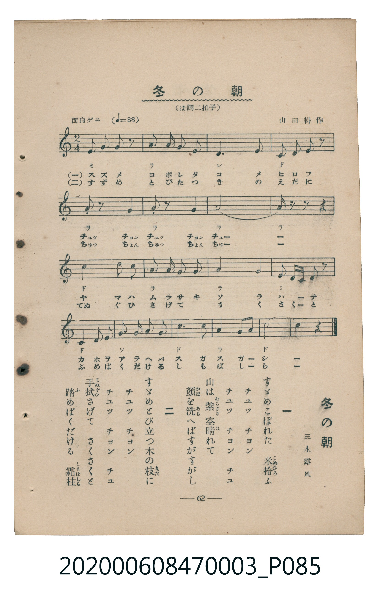

# 冬の朝

<audio controls src="fuyu_no_asa.mp3"></audio>

- 三木露風 作詞 / 山田耕作 作曲
- 臺灣教育會公認《新定兒童唱歌》尋常科第三學年用（2020.006.0847.0003）

## 說明

Reference Materials 20: 冬の朝 (Fuyu no Asa / Winter Morning)
Source: 臺灣教育會公認 新定兒童唱歌 尋常科第三學年用 (1934), p. 62 (P085.jpg)
Lyricist: 三木露風 (Miki Rofū) / Composer: 山田耕作 (Yamada Kōsaku)
Key: C major / A minor (?= C), 2/4 (<2/4>), 面白ゲニ Quarter = 88 (!= 88)

## 歌詞

```text
一、すゞめこぼれた　米拾ふ
チュッ　チョン　チュッ　チョン　チュ
山は紫　空晴れて
顔を洗へばすがすがし
二、すゞめとび立つ木の枝に
チュッ　チョン　チュッ　チョン　チュ
手拭さげて　さくさくと
踏めばくだける　霜柱
```

## ABC

```abc
X:1
T:冬の朝
M:2/4
L:1/16
Q:1/4=88
K:C
V:V1 name="Piano" snm="Pia"
[V:V1]
E2 E2 E2 z2 | A2 A A A2 A2 | D6 D2 | C2 C2 C2 z2 |
A,2 z2 A,4 | A,2 z2 A,4 | A8 | A2 z2 z4 |
c6 c c | A2 A A A2 A2 | A4 A4 | E2 D C D2 z2 |
C2 C2 C2 G2 | A2 A2 A2 A2 | c6 c2 | A6 G A |
c8 | c4 z4 | E2 E2 E2 z2 | A2 A A A2 A2 |
D6 D2 | C2 C2 C2 z2 | A,2 z2 A,4 | A,2 z2 A,4 |
A8 | A2 z2 z4 | c6 c c | A2 A A A2 A2 |
A4 A4 | E2 D C D2 z2 | C2 C2 C2 G2 | A2 A2 A2 A2 |
c6 c2 | A6 G A | c8 | c4 z4 |
```

## TMD 檔案連結

- [主旋律 TMD 檔案](fuyu_no_asa.tmd) [[在 TMD Studio 編輯](https://tmdlang.github.io/Tmd-TS/#tmd=s7IKdvYPcrWy4qpTUCpJTLdSSM7PyUlNLsnMz7MqzsjMK0nNjM_KTMmPL87Iz05Ugisry88pzU21Si9KTEmNN443MjAyiDcwMIs3sDAxBzIMjBFKi_NLi5JTrYqTM_Lzc-JLUitKkvLzsxHyBUX5Zal5iXlANQVFIBtTwIoQClLLMlNSQdKpKZkl-UWZiTlI7kgtKga7FWxJfElRYl5xclFmAcgDCFUlGalAx5Zk5qbG56fFpyRWoksVpyYW5-cVK3FpaSk8bVvzuHHdszlzFbS0uBRtFSwsuOxtFZy5bIz0TexA-p7s6Hw2Z8XLOZteLlqh8GTvnBcr5ynoKzzduPH5lA0vGqYCRUCiz2ZvAtvyon3X88bFz6bOfNG06dmc5qeta16s6n3c0PVs2oan62Y9bZ30fPXSp1M2Plvb87ih--mG7qc7djxfPvH5mjVAa56u3fF055bnU1a839MBCmI9YBDrgYIYyDAwfr-nU4mLS1-LS0FLISg1LbUIFEgKvoklqaAwKlYwMrBC8oyGW2llqUJevoJjcSLQueGgkC5S8M0vysvMS9cEmREMiSgFrC5WwHSvAi7XKmgYWhqbaOooFOgpmBkpaAQYWJjqZRVAbPGpLMpMziwusVJACUcN38zsTIWg_LSjqzWBznPOzy3IL04tAvoAOVw1IhNzE1MSFbyP9hYnZpeCDfROrbRScFbITczKLwLqdFTIzcwDsjRAkQZ0AzDWFDTAcQfkvJy76PnMvY-bNj1u7lYILE0sAoUBKIoVNMAxDTIQ7shiKxDzyY6Gxw2NjxtnPm6a97gJyJj8uHHP46aex43zHzc0PN-4-Vn3vseNW0FKgXwQam583Lz0cXMzjL38cfNmguII_UAPP25c_3zLapDxK3c9m7kFbNsyhIqXC6c8bpr0bMv0x407HjduALmtEagCQk4HO3oXMDUhO3rF48bNz1d3P25cAgxyUIqYN_dx42rqOfpZZ_ez7rWPG6c-bpwEdCtIEMTuh5ErEEpf7OgHOwnobqDEgseNEx83dYN8NWfOs_kbger0ubjCgNk61SogMzEv36HGoEahmksBCGwstOzADH0tBUNdEysFsJ9nocUKUHQyWGjT46ZeYMyADARpqlEwBkMDIMtMQcNMwUxTVUNXE8g2A4oYKegCoRGQZQiGQFUwq0x1LYBWwQICwgIFA16xPQhrzeKBpgEJXXQ22EoIywAIgSyYlZa6hkZAO5taHjcCE9f6x00Nj5s6wWHZC_TeXDAHKApKFgh7DOPAxmkAacM4iN-w-RRkLQiDwkPDSMEQImeE7GNDY11DkJ8bgQlmNzCpPW5sAlsJSm2QQEckNyT7wdAUbAUEwt0EpGD-1TCFOQcuC3ILmAkJg1ouLl07BXASUEBmKHNxAQA)]
- [鋼琴伴奏 TMD 檔案](fuyu_no_asa_piano.tmd) [[在 TMD Studio 編輯](https://tmdlang.github.io/Tmd-TS/#tmd=s7IKdvYPcrWy4tLSUnjatuZx47pnc-a-39PxsnvP8wlbnuzZ8nRp__POjvd7OhW0tLgUbRUsLLjsbRWcuWyM9E3suOoUlJ7s6Hw2Z8XLOZteLlqh8GTvnBcr5ynoKzzduPH5lA0vGqYCRUCiz2ZvUgKpftG-63nj4mdTZ75o2vRsTvPT1jUvVvU-buh6Nm3D03WznrZOer566dMpG5-t7Xnc0P10Q_fTHTueL5_4fM0aoDVP1-54unPL8ykrgO4zMjAy0DMwMNMzsDAxBzIMjIFOVOLi0tfiUtBSCEpNSy1KzUtOVfBNLEktykzMKVYwMrBC-FBBw620slQhL1_BsTgR6NzwzDygOgXf_KK8zLx0TQVdhYDMRJBscnJ-bkFiXmZual4JyOTg_NKi5FQrBaz-UMD0hQIuPyhoGFoam2jqKBToKZgZKWgEGFiY6mUVpGsCbdHn4gpLLSpOtQI7IsjDocagRqGaSwEIbCy07MCMGgVjMDQAsswUNMwUzDRVNXQ1gWwzoIgR0Ae6QLJGwRAMgaqguszigRwgoYvOBuuAsAyAEMiC6jCMA0toAGnDOIgl2KwEGQDCIIdpGCkYQuSMkKyGOMUUrBYC4YYDKZgTNExh5sJlQYaCmRBn1aIEjw-O4DGLj1eINovPjQWzwMGEIgJhAYMKyDQCMU1BgqbxIDFDIMswFkQhBxwktGBBh87DNBmiBiUo4eaCqBoFEyDDJBZGYfKhCkEuQwpGAoaQKg9kIIWsrp0COHAVkBnKXFwA)]

## 分析

```text
================================================================================
📊 TMD Song Profile: [ 冬の朝 ]
================================================================================
⏱  Duration:       0:49 (49.1s), 36 measures total
🎼 Key & Tempo:    首調基準 C, != 88.0 BPM, <2/4>
   - 分析範圍：      由實際發聲的音符與和弦推測調性；播放脈絡另行呈現
🎤 人聲音域:    A3 (MIDI 57) – C5 (MIDI 72) [跨度: 15 個半音 / 1.2 個八度, 難度: moderate]
   - 最低音:  A3 in [Verse #1 @ m.5, 0:05]
   - 最高音: C5 in [Verse #1 @ m.9, 0:10]
   - 適合: soprano, mezzo-soprano, contralto, tenor, baritone, bass
🏛  結構:      Verse (24.5s) -> Verse (24.5s)
⚡ 編曲密度:        Peak 1 軌道同時演奏
🗝  調性診斷：       A 小調（純淨自然小調，未偵測到可信轉調）
   - 風格氣質:    純淨自然小調（陰鬱抒情、旋律集中，無明顯調外色彩）
   - 轉調歷程:    全曲維持單一推測調性（未偵測到可信轉調）
   - 核心骨幹音:  A, C, D, E, G
   - 調性數值:    A 小調 [相關度: 0.89, 穩定度: High, 自然音純度: 100.0%]
   - 候選調性 (K-S): A 小調 (0.89), A 大調 (0.50), C 大調 (0.49)
   - 五度圈歷程:   +3 -> +3
   - 各段落調性細節:
     • [Verse #1]: A 小調 (r: 0.89, 自然音純度: 100.0%)
     • [Verse #2]: A 小調 (r: 0.89, 自然音純度: 100.0%)

  [ 五度圈游移軌跡 ]
               C  
         F            G  
      Bb               D  
      Eb              [A ]*
         Ab           E  
            Db       B  
               F# 
     (* = active key center)

  [ 十二半音累積音高分佈 ]
     C  : ████████████████          33.1%
     C# :                            0.0%
     D  : ████                       8.9%
     D# :                            0.0%
     E  : ███                        6.5%
     F  :                            0.0%
     F# :                            0.0%
     G  : █                          2.4%
     G# :                            0.0%
     A  : ████████████████████████  49.2%
     A# :                            0.0%
     B  :                            0.0%
--------------------------------------------------------------------------------
Assignment 軌道音域：
  - Piano         : A3 – C5 (15 個半音 / 1.2 個八度, 96 個音符)
================================================================================
```


## 原書掃描頁




